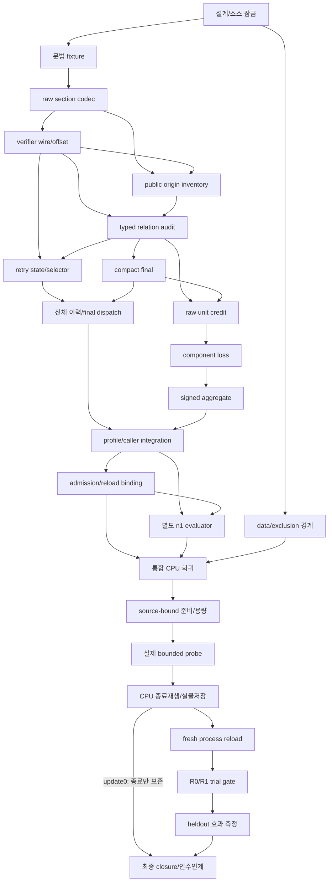

# 오답노트 기반 자기수정 RL 구현 인수인계 계획

설계 기준일: 2026-10-26. 실행 근거 갱신: 2026-10-28. source10의 실제 최소 기능 검증 F는 통과했고 같은 설정의 고정10을 시작했다. 수정 의미 S·효과 E·전체노트 학습은 미완료다. 과거 동결8 고정10의 시간한도 실패도 보존하며 아래 설계 계약과 각 실행 근거를 구분한다.
정본 결정·수식·타입은 [연구 보고서](research_notebook_rl_redesign_20261026.md#D00), 실행 순서와 G0–G7은 이 계획의 표, 흐름은 [구조도](architecture.html)를 따른다.
현재 결과와 문헌의 경계는 [D01 실제 근거](research_notebook_rl_redesign_20261026.md#D01), [D02 연구 검토](research_notebook_rl_redesign_20261026.md#D02), [D17 출처](research_notebook_rl_redesign_20261026.md#D17)에서 확인한다.
이 계획과 보고서가 다르면 작업자가 임의로 절충하지 않고 해당 Dxx 결정과 이 계획의 gate를 함께 확인한다.
보고서 내부 충돌이나 구현 불가능성은 L3 검토로 올리고, 결정 변경과 protocol 재동결을 먼저 수행한다.
이 문서는 실행 일정이 아니라 **선행 근거와 통과 gate로 정렬한 작업 계약**이다.

## 2026-10-28 후속 후보 — 최종 오류·수정 본문 우선 생성

상태는 **CPU 입력 준비·검토 완료 / 실제 후보 생성·학습 미검증**이다. 현재 source10 고정10의
실행·종료·저장/새재로딩을 먼저 닫으며 이 후보를 그 실행의 선행조건으로 넣지 않는다.
독립 검토의 메타데이터 자동보충 대신, 기존 JSON 문법을 유지한 채 `claims`를 먼저 작성하고
시도 목록·성공ID를 뒤에 쓰라는 지시만 private 복사본에 적용했다. 생산 PROMPT/파서/보상은 불변이다.

- 정본: private `verified-repair-notebook-v59/note-claims-first-candidate-v1/contract.json`
  SHA `29530945…`, `main-review-v1.json` SHA `403959c7…`. 기존 `_request`/`InputPreparation` 재사용.
- 실제 CPU4.549초/exit0·7음성경계/Ruff F 통과. 원래12455→후보12546입력token,
  출력8192예약/24576문맥에서3838여유. 전체8풀이·성공·원래피드백·fresh미검증·두이미지·seed와
  원래 token/pixel/grid를 대조했고, 전체이력 suffix는 UTF8 byte동일이다. 모델 적재/생성/학습은 없다.
- 비교 범위는 **minimum 둘째의 policy0 이력 하나**, 원래/후보 각n4·최대2호출/8응답/학습0이다.
  같은 이력의 실제 e4교정과 e8회귀·정상항목에 대한 거짓교정 검사를 함께 사용한다. 이 기대 판정은
  평가기에만 있고 모델 입력에는 없다. 별도 셋째 이력은policy1이라 이번 GPU대상에서 제외한다.
  F0 생성물을policy1로 사칭하거나 과거tree policy를 고치지 않는다.
- 현재고정10 정상종료 시 기존 실물저장/새reload 의무를 먼저 수행한다. 시간한도 종료면 실패와
  중간저장을 보존한다. 소유프로세스 부재를 확인하기 전 새GPU를 시작하지 않는다.
- 원래4출력/F0/seed 재현을 확인하기 전 후보 생성을 막는다. 한 번의 비교로 닫고 재시작·연장·
  성공할 때까지 반복하지 않는다. 형식만 개선되거나 실제 오류수정 본문이 없으면 이 가설을 폐기한다.
  거짓교정이 새로 생기거나 늘면 채택하지 않는다. 올바른 내용도 네후보 보상이 같으면 상대학습신호0이다.
- 내용 생성 가능성은 전체노트 정확성·final전용VJP·실제RL/save/reload·양경로·새문항효과와 별개다.
  같은 한 이력의 개발용 진단을 독립 일반화 검사로 쓰지 않으며, 최대3claim의 부분검증을 전체목표
  완료로 바꾸지 않는다. 필요한 후속 구현은 실제 후보 내용 근거 이후 결정한다.

실행기 CPU 검증도 완료했다. private `note-claims-first-runtime-v1/review-main-v2.json`
SHA `7995cfe0816d85e4e53d26ae571875c9592a4646f08747d767e04a111a9a6e03`가 주검토 근거다.
24개 CPU 검사·Ruff2·범위 mypy2와 독립 7경계를 통과했으며, 과거 timeout 기록 재사용 및
변경된 checkpoint에 이전 reload 근거를 적용하던 두 결함을 수정했다. 양성 경계는 작성 fixture이며
실제 후보 생성·학습 결과가 아니다. 실행 중 source10이나 생성·채점 조건은 변경하지 않았다.

현재 고정10이 정상 종료하면 기존 `local_train._repair_training_replay`의 실제 반환 proof를
필수 종료 CPU 감사에서 보존하고, 기존 `check_payload.py`와 공개 `local_train reload`를 사용한다.
후속 비교는 proof의 canonical SHA와 새 reload의 `repair_replay_sha256`, 실제 checkpoint 파일을
함께 대조한다. 별도 전수입력 검사를 추가로 만들거나 SHA를 맞추기 위해 proof를 구성하지 않는다.
시간한도 종료면 현재 실행의 PID/startticks·launch·로그·모든 raw/중간저장을 보존하며 전체10 완료나
정상 reload로 표시하지 않는다. 다음 GPU 비교는 실제 종료 근거와 소유 프로세스 부재를 확인한 뒤
진행한다. 상세 명령과 두 종료 경로의 입력 필드는 같은 private 폴더의 `README.txt`를 따른다.

실제 이력에 대한 후속 독립 검토는 claim 상한과 내용 검증을 구분했다. 현재 `accurate_submitted_note`
조건에는 전체 오류 coverage가 없으며, metadata 유효·검증된 주장1개 이상·거짓/미확정 주장0을
요구한다. `PERSISTED` 한 주장은 원본/후속 오류2개, 다른 native 관계는 원본 오류1개를 다루고
다른 형제/자손으로 자동 확대하지 않는다. 저장된 고정10 다섯째/여섯째의 비교 가능한 관계 상한은0으로,
claim 제한을 없애도 관측/구조 기록 누락은 해결되지 않는다. 반면 최소시험 둘째에는 교정 근거가 있다.
그 이력의 cap3에서 알려진 오류 coverage 상한3/8은 부분 교정 주장의 검증·학습 차단 조건이 아니다.
`claims=[]`의 제출정확성 false는 verified=0 때문이며 coverage 불완전과 혼동하지 않는다.
그러므로 cap 확대나 coverage 검사 완화 없이 기존 policy0 교정 이력의 준비된 비교를 먼저 수행한다.
bounded 제출 정확성을 전수 오류 설명이나 전체 추론 의미 인증으로 보고하지 않는다.

종료 호출부를 읽기 전용으로 대조했다. proof의 `parameter_inventory`는 실제 최종 checkpoint의
`inventory.trainable`을 사용하며, 기존 `local_run.write_json`으로 캡처 밖에 보존한다.
공개 reload는 같은 proof를 다시 계산해 canonical SHA만 기록하므로 파일 SHA와 혼동하지 않는다.
내부 `BUDGET_STOP`과 `FAILED`는 `finally`에서 result.json을 남기므로 구별한다. private 실행기 v3는
실제 exit2·BUDGET_STOP·현재 소유자/실행/로그/결과 및 모든 캡처 파일의 결합, 정해진 순서의 짝수
부분 표본과 업데이트 수, 시간한도·false 성공표시를 확인하는 별도 분기를 구현했다. `FAILED`는 거부한다.
이 분기는 종료된 부분 실행을 보존한 뒤 원래 F0로 학습 없는 진단을 허용하는 경로이며, 부분 학습의
정상 완료·재개·재로딩 성공을 인증하지 않는다. result 삭제·exit 변경으로 통과시키지 않는다.
32개 CPU 시험·Ruff·범위 mypy, 독립 검토12개 시험/52경계, 실제 기본 CPU 준비1.819초/exit0을 확인했다.
주검토는428입력과 검사 로그를 재해시했다. 정본 `note-claims-first-runtime-v1/review-main-v3.json`
SHA `18f3544bf5d803975047bd0ff0883b89308f180e83e73a08de6a5ed5ac8a3dd2`이며 `gpu_allowed=false`다.
실제 BUDGET_STOP 종료와 후보 GPU 생성은 아직 미실행이다. 기존 정상/외부 시간종료 분기와 생성·채점
함수는 그대로이며, 현재 고정10의 동결 코드·조건·한도를 변경하지 않았다.

<a id="functional-exploration-20261027"></a>

## 2026-10-27 결정 보완 — 기능 검증 후 고정10 탐색

시작 당시 상태: **IMPLEMENTED / TESTED / 동결8 최소 F 검증 완료**. 고정10의 현재 종료 상태는 아래 후속 원장을 따른다. 아래 P21의 기본 strict 진입과 별도로 `verified-functional-repair-exploration-v1`을 명시한 경우만 F 검증 후 고정10 소규모 탐색을 허용한다. 실제 새 minimum의 update1·실물 checkpoint·별도 PID reload·현재 source/protocol/입력·단일/복수 이미지 검증은 모두 필요하다. S가 아직 없다는 이유로 F 최소시험을 같은 조건에서 반복하지 않는다.

| 실제 확인 범위 | 2026-10-27 관측과 근거 |
|---|---|
| 현재 소스·CPU | frozen8 391파일, 통합397검사/skip0와 범위 Ruff·mypy 통과. 비공개 `verified-repair-notebook-v59/p20-closure-main-v8.json` |
| 실제 최소시험 F | 2문항/업데이트1회, L252/M24/V48 tensor 변경·저장, 별도 프로세스에서624 tensor/optimizer/step1·단일/복수 이미지 forward·생성 복원. `training-reload-closure-main-v8.json`, SHA `5661249e3dea7e87471e095dffbbb5c37a1aa5d6e8661b9315be6c2cf3d87669` |
| 현재 S·E | 최소시험의 S=false/E=false. 최종 노트4개에서 native 오류·수정 관계 학습 신호0. 정확한 노트나 자기개선 성공으로 해석하지 않음 |
| 고정10 | `ten-functional-v8`의 동일 실행을 유지. 새 F0 초기값·base 동일, 초기 sync policy0/delta0 검증. 최대5 update/내부14400초, 결과·fresh reload·양 경로 검증은 아직 미완료 |
| 이후 순서 | 고정10 종료·실제 재로딩 → 같은 admission/초기값/예산의 답 보상 대조군 → 분리된 native 개발표본 F0/R1/R0 평가. 실패·무신호·예산 종료는 그대로 보존 |

위 상태는 전체 P 항목을 일괄 통과시킨 기록이 아니다. 정본 원장 root는 `/home/jang2/mmdl-artifacts/notebook-rl-local-nf4-20261021/verified-repair-notebook-v59/`이며, `p22-ten-actual-start-main-v8.json`이 실제 고정10 초기화·PID·입력 연결 근거다. 같은 실행을 재시작하거나 동결 소스를 수정하지 않는다.

- 근거: 실제 v6 F=true/S=false와 다음 고정2의 14응답·native 교정 기회0/0을 확인했다. 기존 고정10 내부의 optimizer/replay/reload는 이미 실제 S를 분리하지만 부모 진입만 S를 먼저 요구했다.
- 새 admission은 **학습 탐색 실행 허용**이다. S/REPAIR_VERIFIED·완전한 노트·E·대규모 준비의 성공 조건을 바꾸지 않는다. R11과 native 양성/합산 VJP 검사는 유지한다.
- 기존 strict admission/default·고정10/순서·freshF0·U5·모델/이미지/seed/생성 예산·보상/분모/MIS/KL·무신호 문항 소비는 유지한다. 학습 신호가 없으면 업데이트하지 않고, 문항·응답·보상을 교체하지 않는다.
- R0/R1 모두 같은 admission을 계약에 기록한다. train→중간저장→종료 재생→reload→evaluation에서 실제 F/S를 그대로 연결하고 S=false를 true로 채우지 않는다.
- 과거 v6 F를 현재 계약의 F로 다시 표시하지 않는다. 새 코드 동결·현재 입력/캐시 검증→현재 minimum/fresh reload→고정10 순서다. 새 호환 bridge는 추가하지 않는다.
- 구현 범위: `local_train.py`, `local_eval.py`, 해당 repair train/eval 시험. 구조화 디코딩·새 데이터셋·보상 변경은 이번 수정에 포함하지 않는다.
- L3 검토 근거: 비공개 `protocol-fit-design-review-v1/review.json`, SHA `5075167741296b088bc594936d14a970e7cb1e9aae84b44b1864c2dade7c1ef0`. 이전 세 설계 파일은 비공개 `design-before-functional-admission-v1/`에 byte 보존했다. 아래 원래 설계·과거 관찰은 소급 완료 처리하지 않는다.

<a id="runtime-close-and-parking-20261027"></a>

## 2026-10-27 후속 상태 — 시간한도 종료와 생성 중 optimizer 상태 배치

- **실제 동결8:** 원래10문항의 70풀이·24최종노트 수집, 업데이트3회/중간저장 완료. 마지막12응답 update의 backward7에서 외부14700초 한도로 종료(exit124)됐다. 사전 SIGINT 요청에도 정상 `result.json`은 생성되지 않았다. 164개 원문·입력·저장 표지 SHA가 보존됐다. `ten-functional-v8-operator-timeout-closure-main-v1.json` SHA `ed2362bfc8f0ac0fd42ed939a554338a84b7f62410b04cda979d279494a17cfc`가 근거다.
- **채점·의미:** 10개 모두 original/applied online·final 계수가0이다. 운영 admission은 ON8/OFF1/UNRESOLVED1이며 미확정을 OFF 학습으로 세지 않는다. 아홉째 정답 재시도도 관측17/18이고 다른 경로의 유효한 Trace와 관측 오류 수정을 구분한다. 원래 결과를 새 점수로 덮어쓰거나 정상 전체10 reload를 강제하지 않는다.
- **다음 소스에서 구현·검사한 최적화:** `checkpoint.park_adam_moments(bundle, optimizer, scheduler, protocol, step)`는 actor별 두 생성 호출만 감싼다. CPU scalar step·dtype·값을 보존하고 CUDA moments를 CPU에 보관했다가 준비/학습/분기/저장 전 복원한다. `launch.optimizer_state_collection_policy`를 재로딩에서 정확히 확인한다. 기본 학습식·n/seed·분모·MIS·KL·모델 정밀도는 바꾸지 않는다.
- **실제 검사 범위:** CPU79 + 작은 AdamW 실제 CUDA4 통과, Ruff5/강화 범위mypy3 통과, 독립Astra 필수 결함0. 기존 시험 본문 strong-mypy5진단은 별도 보존했다. 새392파일 후보의 정본은 `optimizer-parking-candidate-v1/unit-closure-main-v1.json` SHA `fea522dc61915ce53f087e184769fb495b1a3a2ebeec006bedc620080e0b4ed1`다. 실제 Qwen 중간저장624상태 왕복은 후속50.469초/exit0으로 통과했다. allocated4,769,837,056→3,613,880,320→4,769,837,056bytes·값/장치/가중치/스케줄러/RNG/NF4 보존이며 정본 `optimizer-parking-candidate-v1/hardware-closure-main-v2.json` SHA096b4fbc…다. 첫 진단의 CPU배치 중 CUDA device 비교 오류는 실패로 보존했다. 속도·새 source F/S/E는 아직 미검증이다.

다음 작업 순서는 다음과 같다. 원래24단계의 성공 조건을 이 목록으로 축소하지 않는다.

1. **하드웨어 왕복 검증 완료:** 보존된 실제 Qwen 중간저장으로 optimizer 상태 왕복·값/장치·메모리를 확인했다. 이는 중간저장용 하드웨어 검사이며 실패한 전체10 실행의 정상 reload로 표시하지 않는다. 실제 생성 속도와 새 source 전체 연결은 후속 실행에서 따로 측정한다.
2. **구현·CPU검증 완료, 실제 새모델 검증 전:** P07의 goal 통합 공백을 `repair-retry-collector-v2`/`repair-retry-feedback-v2`와 별도 evaluation v2로 연결했다. 공통 `malformed_retry_receipt`→`select_repair_parents`→`repair_parent_feedback`를 생성·`_inspect_tree`·평가에서 재사용한다. 연결125검사, 최종상한 뒤61검사와 독립4경계, 주 통합95검사(91CPU통과/작은CUDA4skip)를 통과했다. 실제 과거 열째 두 UNCERTAIN_REFS의 코드/원문 SHA를 CPU재확인한 근거는 private `malformed-parent-actual-replay-v1/selection-check-main-v1.json` SHA4f3aec7f…다. 이 검사는 새T3 생성이나 과거 전체tree의 새프로토콜 재인증이 아니다. 현재 frozen8은 문법실패로 grade가 없는 T2 둘을 T3 부모로 선택하지 않는 것이 계약대로다. 새 정책은 native 후보를 먼저 유지하고 후보가 없을 때만 실제 공개 parser 오류/raw SHA가 검증된 malformed 부모 하나를 기존 hash 순서로 택한다. 오류 코드·정오 미판정만 피드백하고 `result=None/reward=0`·원래 raw/n2/1024/최대3을 보존한다. 생성·`_inspect_tree`·재생·평가를 함께 연결하며 old source/원장을 바꾸지 않는다. 문법 복구와 OFF admission 또는 S를 동일시하지 않는다.
3. **실제 무업데이트 진단·독립 CPU재생 감사 종료:** 같은 F0 single/paired 부모·이미지·seed의 두 ORIGINAL n2를 원문/token/finish/logprob 기준으로 재현한 뒤 각 fresh n1/1024→WITH_FRESH n2를 완료했다. 실제687.320초/exit0·학습0이다. 정답 상태는 두 조건이 같았지만 paired의 한 응답에서 dir[e4] 교정 기회1이 관측됐다. 동시에 dir[e8] 위반이 남고, 실제 authored online180단위는 모두0·최종노트는 미생성이다. 기회를 S나 개선으로 바꾸지 않는다. 정본 private `retry-fresh-observation-probe-v1/gpu-terminal-main-v1.json` SHAb46ba098…이며 독립 CPU89.635초 재생과484근거 주 재해시를 통과했다. 정본 `retry-fresh-observation-probe-v1/terminal-audit-v1/closure-v1.json` SHAb65536b5…는 교정1·회귀1과 online180단위0을 함께 확인한다. 같은 부모 n2는 같은 미검증 재관찰을 공유한다. 이 비교와 새 collection 정책은 각각 version/source/예산을 고정하고, 재관찰 자체를 보상·route에 넣지 않는다.
4. 실제 노트 수정 내용의 양성·signed gradient→저장→fresh reload를 확인한 뒤 현재 프로토콜의 고정10·필요한 대조군·별도 평가로 돌아간다. 실제 노트 계수가 모두0인 대조군 실행으로 S를 대신하지 않는다. 작은 기능시험에서 점수 상승은 필수가 아니며 E는 별도 관측한다.

### 2026-10-28 후속 입력 준비와 다음 통합의 경계

새 source9의392파일 SHA는 `51942dac141253741c1747f90bb74d8ff7df50fb17f1ab9182e1eb16b1e227ac`, 실제 프로토콜은 `eaf6d2abed6c7135e549d6a20c3db1c9fc9749907db0da4ecf71cd0c1646b655`다. 고정10·170기존입력의 CPU재검증은265.751초/exit0·차단0이며 원래actor/실행actor bytes와4guard CUDA미초기화를 확인했다. 이는 새오염전수검사·사람인증·새source의GPU F가 아니다. 정본 `p21-data-main-v9.json` SHA4ff680b3…다.

재관찰의 실제 교정 기회가 노트 보상으로 이어지는지는 아직 미검증이다. 무업데이트 진단의 sidecar를 기존 collector 원장처럼 합치거나 정상 학습 자료로 자동 승격하지 않는다. 추가 통합 시에는 새 collector/feedback/전체이력·fresh 원문/샘플수·실제token·재생·loss 제외·source/protocol을 함께 고정하고 최소시험의 실제 update/save/fresh reload부터 검증해야 한다. source9에는 재관찰 기능을 아직 반영하지 않았다. 작은 기능시험의 점수 상승은 필요조건이 아니지만, 오류 수정 노트의 양성·signed 기울기 증거와 새 문항 효과는 구분해서 남긴다.

### 2026-10-28 구현·실행 상태 갱신 — source10

**최신 종료 근거:** 최소2문항3509.993초/exit0·실제update1·L252/M24/V48 변경과624실물텐서 검사를 완료했다. 별도PID의 fresh reload도 exit0이며 optimizer/step1·단일/복수 이미지 추론/생성 일치·원본접근0·NF4불변이다. 53연결파일/392동결소스를 주재해시했다. `training-reload-closure-main-v10.json` SHA `c30bfa2d…`가 정본이다. F=true/S=false/E=false이고 online/final signed·positive VJP는0, T1답834token만 PG신호다. 아래 최소시험 진행중 문장은 과거 관측이며 이 종료근거가 우선한다.

**현재 실행:** `ten-functional-v10`, session29954/worker3246026(start65119294). 같은source/protocol의 `verified-functional-repair-exploration-v1`, 원래고정10/순서/freshF0/최대5update·내부14400/외부14700+kill30초다. `ten-functional-v10-launch-main-v1.json` SHA `cb9a815d…`는 실제 제출·입력검증 단계의 근거이며 새초기값/생성·전체10완료 증거가 아니다. 실제초기624해시→진행원장→종료/저장/새reload 순서로 확인한다. 노트계약 변경을 이 실행의 중간 선행조건으로 넣지 않는다.

둘째문항의 독립 CPU1.782초/exit0은8풀이·4online 의미감사를 그대로 재현했다.
실제 부모→T2에서 e4 H→G를 C→H로 고친1건과 e8 H→G를 G→H로 바꾼 회귀1건이
함께 있다. T3 두자손까지의3관계를 독립교정3건으로 세지 않는다. online11주장은 원래
정상인r1/r2/r3만 지목해180단위 모두0이며 실제e4 수정 주장은 없다. fresh도17/18이다.
주검토는42파일 SHA/size/mode와 실제원문span을 재확인했다. 정본
source10-second-tree-main-v1.json SHAcb2e8977…이다. 이는 실제수정과 자기점검·노트의
단절 근거이지 노트학습 성공/재관찰 인과효과/내부Vision책임 인증이 아니다. 관찰자의
같은그룹 형제를history에 넣은 첫오류는 기록하고 생산자와 같은 그룹시작history로 정정했다.
생산코드/원문/보상은 불변이며 같은3238651의역전파10/12·현재update/result미완료다.

재관찰 통합은 **IMPLEMENTED / CPU TESTED**다. 영향범위115검사/skip0, 독립Astra12검사,
실제cohort2검사와17파일 Ruff·강화범위mypy를 통과했다. 최초332검사의 실패1/오류12/skip2는
보존했으며 전체332 PASS로 바꾸지 않는다. source392개 SHA `4ee164da…`, protocol
`89181dfc…`를 동결했다. 입력169.094초와 실제 기존NF4 save47.774초/check43.903초,
두 생성·68로그확률 차이0·원본접근0을 확인했다. check의 OS exit는 도구handle 만료로
미확인이고 실제 result와PID부재를 근거로 한다. 정본 `p21-readiness-main-v10.json`
SHA `f958b801…`이며 새 학습 F/S/E나 오염전수검사·사람 검토 증거는 아니다.

`minimal-functional-v10` 실제 첫 single/paired2문항·최대1update를 시작했다.
`minimal-functional-v10-launch-main-v1.json` SHA `7bafe4cc…`는 session32350,
timeout3238650/worker3238651(start64707895)·초기 입력재검증 상태를 기록한다.
1024풀이/8192NOTE·24576문맥·내부14400/외부14430초를 유지한다. 완료되지 않은 단계를
통과로 쓰지 않는다. 다음은 실제 원문·전체노트·original token credit·채널별 signed/positive
VJP →624실물저장 →새 프로세스 reload →현재F 확인 후 원래 고정10 탐색 →양경로/대조군/
별도평가다. S는 online+final 합산이므로 최종 전체NOTE 기여는 final을 따로 확인한다.
n1의 기존 usage/generation 소계는 fresh를 포함하지 않으므로 receipt별 비용을 추가한다.

후속 실제 근거: 첫 재관찰→T2 입력의 CPU processor 대조(5.886초)는 전체 부모 token과
이미지·동일 인용의 보존을 확인했다. 첫 문항의 별도 native 의미 재생(1.548초)은 오답7/
문법거절1·최종노트0·모든 학습 계수0을 재현했다. 재관찰7/8과 달리 재시도의 Trace/답은
바뀌지 않았고, 점검한 A→C는 원래 정상이라 교정 보상이 없다. `source10-first-tree-main-v1.json`
SHA `04af2c67…`에 입력 감사·의미 감사·실제 PID를 결합했다. 둘째는 T2/T3 각정답2 뒤 최종
NOTE4개를 생성했다. CPU 입력감사4.041초는 전체8풀이·성공·두이미지·피드백의12455token/
pixel/grid 일치를 확인했다. 네NOTE는 모두stop이나 성공ID누락·claims=[]이며, 실제CPU
0.190초 문법/계수 대조는 둘째T1 답834token만 비영·online/final 원래/적용계수0을 확인했다.
이는 정확한 오답노트나 최종NOTE 학습 성공이 아니다. 같은worker의 역전파를 유지하며
새update/실물저장·freshreload는 아직 미완료다. 주정본 `source10-note-closure-main-v1.json`
SHA `caec89a8…`, 실제 입력감사 `source10-actual-note-input-v1/audit-v1.json` SHA `70d65834…`다.
별도회로10/3위상은 기존binder의 pin/경로만 바꿔 현재evaluatorv3에 CPU6.999초/exit0으로
재결합했다. 원래12입력 byte·8거부경계·392소스/2348보호파일을 확인했다. 기존 gold노출
AI검토 재사용/humanfalse/newviews0이며 개발표본 입력준비만 완료했다. 모델평가·새오염전수검사는
아니다. 정본 `circuit-inputs-functional-v10/closure-v1.json` SHA `d01cfcfc…`다.
현재minimum→실제F/새reload→동일source10 고정10 순서를 유지하며, 후보 출력계약 변경을
그 사이의 새선행조건으로 넣어 최소시험을 반복하지 않는다.

<a id="retry-reread-integration-20261028"></a>

### 2026-10-28 설계 결정 — 재관찰을 실제 전체이력 NOTE 학습에 연결

상태: **IMPLEMENTED / CPU TESTED, 실제 source10 최소시험 진행·새 F/S 미검증**. 독립 CPU89.635초 재생에서8retry/2fresh, 교정 e4 1·회귀 e8 1과 online180단위0을 확인했다. 이 관측은 새 재관찰 조건을 최소시험으로 검증할 근거이며, 정확도 개선이나 S의 증거는 아니다. 기존 source9와 모든 원장은 불변으로 남긴다. 새 프레임워크·CLI·의존성·공개 diff 인덱스·보상 변경은 추가하지 않는다.

| 소유 모듈 | 구현 계약 |
|---|---|
| `fresh_observation.py` | private 실제 probe의 RETRY_CONTEXT/quoted_retry_context를 그대로 승격. request_for/generate/validate/POLICY·seed는 유지 |
| `rollout.py` | collector v3. 첫 eligible 재시도 직전 예산 검사→fresh1회·원문 STARTED/COMPLETED 저장→같은 receipt를 모든 T2/T3에서 공유. repair_parent_feedback은 기존 문자열 뒤에 newline+중립 인용을 연결 |
| `prompts.py` | feedback v3와 생성/인용문 hash·삽입 위치를 prompt 계약에 결합. 기존 REPAIR_RETRY 문법은 유지 |
| `repair_notebook.py` | full-history 생성 계약 v3, receipt/호출수/actor/schema/policy/image/token 재생, 전체 NOTE 입력·학습 전 binding 완결 |
| `repair_replay.py` | T1 GROUP 뒤 fresh STARTED/COMPLETED의 실제 위치를 기대 원장에 명시. 누락/중복/순서변경/미완료를 거부 |
| `local_ladder_recovery.py` | 별도 evaluator v3. n1 평가도 같은 재관찰1회/재사용/feedback suffix/재생 규칙 적용 |
| 기존 연결·테스트 | local_profile의 canonical contract hash를 재사용. local_run/train/eval/batches/repair_training/updates/repair_evidence는 기존 연결 검사를 먼저 확인하고 필요한 경계만 수정 |

**실행 순서와 I/O**

1. T1 n4와 기존 native-first 부모 선택을 먼저 수행한다. 재시도 후보 없음 또는 fresh 시작 전 예산 차단이면 호출0이다.
2. 첫 재시도에 앞서 동일 정책·actor·질문/보기·공개 observation schema·원본 이미지로 기존 fresh_observation.generate를 n1/1024 한 번만 호출한다. 이전 풀이·정오·비공개 오류 ID·기대값·gold를 주지 않는다.
3. 잘림/잘못된 내용도 실제 raw 그대로 보존한다. verifier 품질에 따른 선별·재관찰 재시도는 없다. callback은 deep copy를 받고 원본 receipt/이미지/policy/actor/schema 불변을 검사한다.
4. T2/T3의 n2/1024/기존 seed식·전체 부모 token 접두부를 보존하고 같은 receipt를 인용한다. fresh는 Sample/Group/attempt/origin inventory/reward/route/loss에 넣지 않는다.
5. NOTE n4/8192는 모든 원래 풀이·분기·성공 시도·실제 feedback을 받는다. 실제 피드백은 기존 feedback + newline + quoted_retry_context(receipt)다.
6. `_public_feedback`에 receipt를 명시 전달한다. 공유 템플릿 suffix는 기존 newline/closing-public-origins/newline + newline + 동일 quote로 만든다. 기존 before_patch/after_patch/suffix 3필드 wire로 fresh 원문을 NOTE에 한 번만 보내고 각 실제 feedback은 byte/SHA까지 복원한다. 텍스트에서 receipt를 추정하거나 arbitrary verdict에 섞지 않는다.
7. 기존 독립 검증/원래 token 보상·고정분모/중심화/MIS/KL·라우팅을 유지한다. 빈 claim/무분산/계수0은 그대로0이며 호스트가 모델 대신 오류 관계를 쓰지 않는다.

**예외**

- fresh 완료 후 T2의 실제 길이가 늘어 CONTEXT_BLOCKED 또는 예산 차단이 발생할 수 있다. 사실은 fresh1회+명시skip이며, T2가 없다는 이유로 호출0으로 바꾸지 않는다. 불완전 수집 admission은 차단한다.
- STARTED만 남은 모델/원장 쓰기 실패는 완료 receipt를 만들지 않고 보존·중단한다. 같은 문제/policy에서 기존 fresh request ID·seed를 반복 호출하지 않는다.
- 구 note용 quoted_context의 designated-success/attempts-array 지시는 retry에서 재사용하지 않는다.

**CPU 수락 기준**

- 호출순서 T1→fresh→T2→T3→NOTE, 최대1회·무후보0회·T3 재생성 없음.
- request ID/seed/schema/image 동일, 모든 T1/T2/T3/NOTE 기존 seed 불변.
- malformed/length fresh도 무조건 인용, 보상/route/학습그룹·고정분모 제외.
- receipt/hash/count/phase/order/actor/policy/image/token을 바꾸고 재해시해도 fresh 재생에서 거부.
- T2/T3 full-prefix·같은freshSHA, NOTE 공유suffix1회·원래 feedback exact roundtrip.
- fresh 후 context/budget 차단, callback 변조·쓰기 실패·STARTED-only 거부.
- 고정된 풀이/NOTE의 의미 보상·분모는 fresh 변화와 독립이고 prompt binding은 변경을 잡는다.
- native 교정 기회가 있어도 NOTE 기권이면 final 계수0. online 양성을 final 학습으로 표시하지 않는다.
- 새 protocol에 옛 최소시험/reload proof를 붙이면 거부. legacy 경로 보존.

기존 fresh_observation/repair_rollout/notebook/feedback_wire/origin_wire/replay/training/profile/ladder를 결합하고 shared fixture 변경 뒤 local_run/train/eval/batch/update를 확인한다. Ruff·강화 범위mypy와 독립 검토 뒤 새 source 동결→새 입력 결합·실제 processor 용량→cache 준비→원래 고정 첫 single/paired 최소2문항/최대1 update→실물 가중치/optimizer 저장→새 process reload 순서로 실행한다. 같은 최소시험을 S가 나올 때까지 반복하지 않는다. 새 F 확인 뒤에만 기존 명시적 기능 탐색 진입으로 fresh-F0 고정10을 진행한다. whole-history NOTE 학습 완료는 aggregate S와 별개로 **final 채널 자체의 양성 token 및 positive·signed 비영 VJP**를 요구한다. 새 문항 E·정확한 전체노트 품질은 별도다.

## 1. 출발점과 완료의 의미

실제 V58은 검증된 일부 I/U 판정 token이 RL 기울기·실제 update1·저장·별도 PID fresh reload로 연결되는 기능을 보였다.
기록상 모델10449.931초, 외부10553.384초/exit0, 판정40token의 signed 합산 기울기 L/M/V 비영, 실제 변경 L252/M24/V48이다.
실물624 tensor와 새 reload의 optimizer/step1·단일/복수 이미지 forward·짧은 생성 일치를 확인한 기존 근거는 보존한다.
정본은 private `whole-assessment-unit-normalized-v58/functional-training-reload-closure-main-v1.json`이다.
그 파일의 SHA256은 `31e40420e4c8df618e3b5eb620ba683ad1d4b3804dd6c785dbe7a27328320e8d`다.
이는 본 문서 작성 중 V58을 새로 재실행하거나 전수 재감사했다는 뜻이 아니다.
strict 전체노트0/4, native 오류→수정 관계학습0, 최신 OFF-only 미검증은 별도로 남는다.
전체 엔진이 고장 났다고 규정하거나, 이 설계가 남은 문제를 이미 해결했다고 쓰지 않는다.

새 protocol의 목표는 다음을 서로 다른 증거로 확인하는 것이다.

1. **F 기능:** 새 raw action→검증 보상→실제 기울기→update→저장→fresh reload가 연결된다.
2. **S 수정 의미:** retained positive VERIFIED native `CORRECTED`만의 subvector VJP와 전체 signed `CORRECTED` 채널 VJP가 각각 유한·비영이며 실제 저장에 연결된다.
3. **E 효과:** 독립 평가에서 첫시도·회복·노트 정확성·새 오류가 어떻게 바뀌는지 측정한다.

작은 기능시험에서 성능 상승은 필수조건이 아니다. 정확한 내용 검증과 실패 보존은 여전히 필수다.
bounded final의 제출 claim이 정확하다는 사실을 과거의 모든 오류를 빠짐없이 찾은 전체노트 성공으로 바꾸지 않는다.
빈 claim 목록은 구조상 허용 여부와 별개로 의미 성공이 아니다.
2026-10-26 최초 작성 당시 모든 P 작업은 **DESIGNED**였다. 현재 진행은 위 2026-10-27 원장을 따르며, 나머지 상태 전환에는 아래 증거가 필요하다.

| 상태 | 필요한 관찰 | 이 상태로 주장할 수 없는 것 |
|---|---|---|
| DESIGNED | 문서와 계약 확정 | 코드 존재·실행 성공 |
| IMPLEMENTED | 실제 diff·호출부 연결 | 시험 통과 |
| TESTED | 실행한 CPU 검사·정적검사 원장 | 실제 Qwen 동작 |
| FUNCTIONAL_VERIFIED | 실제 Qwen update·저장·fresh reload | native 수정학습·성능 상승 |
| REPAIR_VERIFIED | retained positive VERIFIED native CORRECTED-only VJP·전체 signed CORRECTED VJP 각각 비영·실제 저장/reload 연결 | 일반화·완전노트 |
| EFFECT_MEASURED | 동결 평가기의 원문·재생·통계 | 항상 개선·모듈 내부 원인 |
| BLOCKED | 재현 가능한 차단 근거 | 영구 실패·대체 기준 자동 허용 |

## 2. 작업자가 지켜야 할 결정 고정표

요구사항 ID는 보고서 [D03](research_notebook_rl_redesign_20261026.md#D03)의 정본과 같다.

| ID | 바꿀 수 없는 요구사항 | 주 gate |
|---|---|---|
| R01 | Qwen pretrained pin·동결 NF4·정확한 L/M/V inventory | G0/G5/G6 |
| R02 | 추가 SFT·teacher rationale·CE target·DPO 대체 없음 | G0–G7 |
| R03 | MMMU/MMMU-Pro 모든 파생물 학습 금지 | G0/G4/G7 |
| R04 | actor/private verifier 경계·정답값/issue목록 미노출 | G1/G2/G4 |
| R05 | 실제 raw history/token/logprob·모든 시도 보존 | G1/G2/G3/G6 |
| R06 | T2/T3 한 completion의 ErrorCheck→RevisedSolution | G1/G2/G5 |
| R07 | 전체이력 입력·최대3 claim bounded final | G1/G2/G5/G7 |
| R08 | 독립 answer/observation/operation/관계 검증 | G2/G3/G7 |
| R09 | 독립 route·UNRESOLVED 학습진입 금지 | G2/G3/G5 |
| R10 | answer/online repair/final note PG 분리 | G3/G5 |
| R11 | 양성 VERIFIED native CORRECTED-only와 전체 signed CORRECTED VJP 각각 비영 | G3/G5 |
| R12 | 실제 update·실물저장·별도 process reload | G5/G6 |
| R13 | 3단계/n4,n2,n2/1024·8192·24576 고정 | G0/G2/G4/G5 |
| R14 | split·별도 evaluator·R0/R1·정직한 통계 | G4/G7 |
| R15 | fine_tuning 단독·standalone cache·오프라인 | G4/G6 |
| R16 | MMDL·과거 protocol/원문/실패 보존 | 모든 gate |
| R17 | 자동 cloud·확대·fallback·삭제 없음 | 모든 gate |
| R18 | 실제 근거와 설계·fixture·효과의 구분 | 모든 gate |

모델은 `Qwen/Qwen3-VL-4B-Instruct@ebb281ec70b05090aa6165b016eac8ec08e71b17`이다.
NF4 backbone은 동결하고 Vision/LLM LoRA와 네 nonquantized Merger를 학습한다. full-parameter FT가 아니다.
네 Merger는 `model.visual.merger`와 `model.visual.deepstack_merger_list.{0,1,2}`다.
현 inventory의 설치 trainable tensor624와 한 update에서 실제 변경된 tensor 수를 구분한다.
별도 trainer·framework·scheduler·모델 다운로드 계층을 새로 만들지 않는다.

새 명시적 protocol ID 제안은 `local-nf4-verified-repair-notebook-v1`이다.
기존 GroupKind `T1/T2/T3/DIAG`, Status, Route enum을 유지하고 버전 있는 audit 속성만 추가한다.
T1은 기존 native solution이다. T2/T3은 `ErrorCheck:` typed JSON 뒤 `RevisedSolution:` native body를 한 번에 생성한다.
각 n2는 같은 부모 prompt·같은 policy다. 별도 critique n1→각기 다른 자식 prompt를 같은 group으로 묶지 않는다.
새 retry 전체 출력1024에는 ErrorCheck도 포함된다. final DIAG8192/context24576·기존 이미지 설정은 유지한다.
작으면 자동 상한 확대·해상도 축소·양자화/모델 교체를 하지 않고 CPU/실제 probe 근거로 새 protocol을 먼저 정한다.
final은 실제 answer-correct 후보가 있을 때 n4로 생성하며, 최초 CORRECT 후보에도 적용할 수 있다.
지정 성공 시도는 실제 CORRECT가 있는 가장 최신 stage에서 원래 sample ordinal이 가장 낮은 후보로 고정한다.
raw CORRECT와 `ANSWER_CORRECT_PROCESS_CONTRADICTED`를 각각 보존하고 정답값은 actor에 공개하지 않는다.
정답 후보가 하나도 없으면 final 미생성과 답 미해결 기록을 남긴다. 가짜 successful notebook을 만들지 않는다.
이때 final DIAG가 없어도 독립 route가 ON/OFF이고 실제 online CORRECTED에 상대 신호가 있으면 해당 T2/T3 학습은 허용한다.
final 입력에는 모든 실제 sibling·실패·잘림·성공·조상·피드백·이미지를 포함하고, 출력 claim은 최대3개다.
새 protocol의 legacy strict/fact/assessment PG는0, online repair와 final note PG는 각각.0625, KL은.01이다.
raw binary answer reward는 CORRECT1/기타0이며 R0/R1에서 같고 ErrorCheck/DIAG token에는 answer PG를 주지 않는다.
이 마스크는 직접 answer PG만 제외한다. 공유 파라미터를 통한 간접 영향과 원래 KL은 남으며 인과적 학습 차단을 뜻하지 않는다.

## 3. 문서·소스 잠금과 증거 디렉터리

현재 checkout은 `feat/mmmu-baseline`, HEAD `0f10c338f366ca2568595a06fe275a0f46dd0cb7`에서 읽었다.
working tree에 기존 수정과 미추적 `fine_tuning/`이 있으므로 HEAD만으로 실제 읽은 코드를 고정할 수 없다.
다음은 본 계획 작성 시 읽기 기준의 SHA256이다. 전체 소스 manifest나 V58 frozen359의 대체물이 아니다.

| 현재 파일 | SHA256 |
|---|---|
| notebook_rl/rollout.py | `8aa08909c3c6c2a5832c4c52dc1a93f6a60d178ef12911f1d50ff149f5c8b16f` |
| notebook_rl/verifier_service.py | `482a0d3af61f572642b3b36dee2573a095ef9829495165ddca72879d53669f1d` |
| notebook_rl/reasoning_trace.py | `c3f1ce541bd545c5f5a46d6f828a46c34e44c53bbbcf1eb93e9c985af101d6e2` |
| notebook_rl/observations.py | `326fd325c972704bffb60b85864ad01c8f20e915a1a23b92aa4121769f980e8b` |
| notebook_rl/answers.py | `426911e75ddbf1a278345cdea60058e8d97fc977b562ad7d3b1a3fcfacee3ab4` |
| notebook_rl/notebook_synthesis.py | `47fd992d7733acdf8bae17ef9ad64b83247e18e500b48e7bccd1e635fe1ce336` |
| notebook_rl/local_profile.py | `89888febe8dd22916aca82d5e63d4acdd6101cc01e942a5317ff49c6b816b3cf` |
| notebook_rl/updates.py | `64509a3a404167ed4f5b35d8f593a3d3c87e449b8509145d9d7186c5e795f8f7` |
| notebook_rl/losses.py | `510302654c71622e766cf61821f3abdef69dec6c87a068464d8b7b64bc604bd6` |
| notebook_rl/local_ladder_recovery.py | `3528b2f07c5093a6a049db9291de5559d530bc591a909e4395dac01b63dfd4bd` |
| notebook_rl/local_train.py | `c98c045df00144c9b331b628b3fe3a99c71cf607c2bcc138eb90c6ee4425de96` |
| notebook_rl/local_eval.py | `189a86da16990dfb95d4c9b0fb333550441de3c7ff158e96517cc810f40ee75d` |

P00에서 실제 구현 작업용 전체 manifest를 별도로 만든다: 상대경로·byte SHA256·mode·size·명시적 제외목록이다.
설계 문서 세 파일 SHA, protocol canonical SHA, prompt/codec/verifier/objective 버전도 하나의 lock record에 결합한다.
문서 개정은 `design_revision`을 올리고 영향받은 gate만 무효화한다. 기존 성공 원장을 덮어쓰지 않는다.
미구현 함수·test·CLI는 아래에서 **NEW/제안**으로 표시한다. 실제 존재 여부는 [D18](research_notebook_rl_redesign_20261026.md#D18)을 확인한다.
공유 소스의 새 파일 발견·해시 불일치는 먼저 소유자와 원인을 확인한다. 다른 작업자의 변경을 revert하지 않는다.

향후 실행 증거는 기존 private artifact root의 새 exclusive 디렉터리에 둔다. 여기서 새 실행 디렉터리를 만들지는 않는다.
권장 논리 산출물은 `design-lock.json`, `cpu/`, `prepared/`, `probe/`, `replay/`, `checkpoint/`, `reload/`, `evaluation/`, `closure.json`이다.
새 이름은 제안일 뿐 현재 생성된 파일이라고 주장하지 않는다. 기존 exclusive/fsync 저장기를 재사용한다.
각 record에 command/argv/cwd/env의 비밀 아닌 allowlist·시작/종료·PID/startticks·exit·stdout/stderr 경로·source/protocol/data SHA를 둔다.
raw payload에는 prompt/completion IDs·실제 sampler logprob·원문 text·finish·seed·policy·parent·image identity를 보존한다.
파생 원장은 raw ID/SHA·producer/verifier 버전·구성요소별 score/span/MIS/VJP 근거를 참조한다.
함수 실패·시험 실패·operator stop도 같은 수준으로 남기고 새 수정 원장은 부모 실패 원장을 연결한다.
private gold/native world/benchmark index를 public 보고서나 raw actor payload에 복사하지 않는다.

## 4. 능력 등급과 분할 원칙

| 등급 | 맡길 수 있는 범위 | 독립 완료 판정 |
|---|---|---|
| L1 | 확정된 한 파일 parser·직렬화·fixture·고정 API 연결 | L2가 호출부와 결과 확인 |
| L2 | 두세 모듈 통합·state machine·replay·실행기 연결 | L3가 trust/numerical 경계 검토 |
| L3 | raw offset/wire 보안·loss 수식·VJP·route·실제 실행 승인 | 주 통합자가 근거와 수락 gate 확인 |

이 등급은 작업 난도와 검토 강도다. 모델 이름으로 능력을 보증하지 않는다.
향후 사용자가 지명할 Haiku/Sonnet/Sol/Opus 등은 배치 예시일 수 있으나 현재 사용 승인이나 실행 지시가 아니다.
현재 실제 helper 정책은 Sol6.1/Astra, reasoning `xhigh`, 주 에이전트 직접 배정·depth1이다.
L1의 작업량을 키워 loss·wire·실행 승인까지 한 번에 맡기지 않는다. 불확실한 경계는 구현 전에 L2/L3에 돌린다.
동시 작업은 서로 다른 owned files에서만 한다. 공통 `local_profile.py`, `updates.py`, `episode_notebook.py` 편집은 통합자가 직렬화한다.
worker는 새 의존성·새 abstraction·추가 옵션을 도입하기 전에 기존 helper로 같은 요구를 만족하는지 확인한다.
후술한 최대 파일 목록은 영향 분석이다. 실제 변경은 필요한 파일로 줄이고 제외한 소비자에는 검토 근거를 남긴다.

## 5. 전체 의존성 DAG와 gate



P01 완료 뒤 P02와 data P15 조사, P03과 P04는 각 owned file을 지키며 병렬화할 수 있다.
P07은 P03의 검증 API가 고정된 뒤 수행한다. P09–P11은 수식·원문 소유권 의존성 때문에 순서를 지킨다.
P14는 P12의 contract를 소비하므로 별도 평가기의 새 임시 문법을 만들지 않는다.
P17 이후 GPU를 쓰는 단계는 concurrency1이며 기존 소유 실행이 없음을 실제 확인한 뒤에만 시작한다.

| Gate | 통과 기준 | 다음 허용 범위 |
|---|---|---|
| G0 결정 잠금 | R01–R18·schema·수식·파일 ownership·source manifest | CPU 구현 |
| G1 raw 계약 | section/rawhash/offset/token·private 경계 반례 | verifier/rollout 연결 |
| G2 의미/이력 | 실제 descendant·고정3단계·전체이력·독립 route | CPU objective 통합 |
| G3 수치 | full-group centering·분리 masks·부호/상쇄·재검증 | source-bound 준비 |
| G4 준비 | 기존 데이터승인 조건·source/cache/protocol·최소유효 용량 | 단 한 번 bounded probe |
| G5 실제 기능/의미 | 실제 retained signal·합산 VJP·update·raw 종료 | CPU 재생·실물저장 검사 |
| G6 저장/reload | 소유 종료·624실물·새 PID·추론 일치·NF4 불변 | 별도 engineering trial 판단 |
| G7 효과/보고 | 같은 evaluator·split 설명·R0/R1 원장·불확실성 | 측정된 범위의 결론 |

G5는 F 기능과 S 수정 의미의 결과를 별도로 기록한다. S 무신호는 `NO_REPAIR_SIGNAL`이며 answer-only update의 F 증거를 지우지 않는다.
G6에서 update/save/fresh reload를 실제 확인한 경우만 FUNCTIONAL_VERIFIED다. update0이면 G6는 미실행으로 닫는다.
S는 retained positive VERIFIED native CORRECTED-only subvector와 전체 signed CORRECTED 채널의 VJP가 각각 유한·비영이어야 한다.
이 양성 subvector는 증명용 관찰이며 학습에는 음성항을 포함한 원래 전체 채널을 사용한다. 양성만 골라 학습하거나 음성항을 삭제하지 않는다.
실제 효과시험 확대는 G6만으로 자동 승인되지 않는다. 계획·자료·실행 범위를 다시 명시한다.
원격 BF16 소규모 검증은 `REMOTE-BF16`, 대규모 학습·전체 benchmark 실행은 `LARGE`라는 별도 승인 범위다.
두 범위는 G0–G7의 번호를 재사용하거나 통과만으로 자동 실행하지 않는다. 이번 문서 통합 작업에서는 GPU·외부 실행을 시작하지 않는다.
기존에 승인된 로컬 실행 범위는 보존하며 같은 범위의 작업에 재승인을 추가로 요구하지 않는다.

## 6. P00–P05: 계약·원문·독립 검증

### P00 — 실행 전 설계와 소스 기준 잠금

- 상태/등급: DESIGNED/L2, 검토 L3. 요구 R01–R05/R13/R16–R18; [D00](research_notebook_rl_redesign_20261026.md#D00), [D03](research_notebook_rl_redesign_20261026.md#D03), [D14](research_notebook_rl_redesign_20261026.md#D14).
- 의존: 없음. 소유: 새 private design-lock/manifest만; production 소스는 읽기 전용.
- REUSE: 기존 source manifest/canonical digest/exclusive 저장 방식; 새 범용 lock framework는 만들지 않는다.
- P00.1 `git status`와 branch·실제 source inventory를 확인하고 사용자의 기존 수정 목록을 기준선으로 남긴다.
- P00.2 protocol·generation·score·mask·unit denominator·stopping·R0/R1 노출 정책을 lock record에 명시한다.
- P00.3 worker별 owned files와 공통 파일 통합 순서를 배정한다. 설계 변경권자는 주 통합자다.
- 입력→출력: 문서3개/현재소스/기존근거 → 새로운 design revision과 전체 SHA/mode/size manifest.
- 사전조건: 쓰기 범위와 검토자가 확정됨. 사후조건: 작업자들이 같은 문법·수식·상태 정의를 참조함.
- 실패/반례: HEAD만 고정, dirty 파일 누락, V58과 현재 manifest 혼용, 기존 frozen 파일 쓰기.
- 검사/fixture: manifest roundtrip·한 byte/mode 변경 탐지·다른 protocol 혼입 거부; 현재 문서 작업은 실행하지 않음.
- 원시근거/산출물: git 출력·manifest command·design-lock JSON; G0 서명 대신 실제 검토 record.
- 수락/상향: 잠금 누락0이어야 다음 단계. pin/출력예산/데이터권한 결정 변경은 L3에 상향한다.

### P01 — typed retry/final schema와 반례 fixture 확정

- 상태/등급: DESIGNED/L1+L2 검토. 요구 R04–R08/R13; [D04](research_notebook_rl_redesign_20261026.md#D04), [D06](research_notebook_rl_redesign_20261026.md#D06).
- 의존: P00. 소유: 제안 `tests/test_notebook_rl_repair_contract.py`와 작은 fixture; 다른 production 편집 없음.
- NEW/제안 DTO: `RawSpan`, `RetrySections`, `RepairClaim`, `PublicOrigin`, `RepairWitness`, `UnitScore`, `ComponentCredit`, `NoteAudit`, `RepairGradientEvidence`; bounded final schema와 필드는 보고서 D06과 일치시킨다.
- P01.1 ErrorCheck의 최대3 claim·origin_ref·intent·public rule·proposed value/operation/null 문법을 고정한다.
- P01.2 final의 모든 attempt ID/outcome/answer와 최대3 CORRECTED/PERSISTED/UNKNOWN/OTHER_BRANCH_COMPARISON/FINALIZED claim을 고정한다.
- P01.3 origin·수정 operation·final witness의 raw token 소유권을 표시한 최소 양성/음성 fixture를 작성한다.
- 입력→출력: 기존 graph/tree/DFA/circuit authored fixture → golden raw text와 기대 half-open char spans/판정.
- 사전조건: fixed grammar와 claim 수 상한. 사후조건: prose/JSON/header ambiguity를 구현자가 추측하지 않음.
- 실패/반례: duplicate key/header, 잘린 JSON, foreign ref, future ref, bool-as-int, unknown intent, final attempt 누락.
- 검사: fixture self-check는 구조와 기대치만 확인; fixture가 실제 Qwen 생성이나 개선이라는 주장은 금지한다.
- 근거/산출물: fixture 원문/hash·규칙 근거 표·검토된 expected results; 정확한 test ID는 구현 후 등록한다.
- 수락/상향: 모든 필드별 허용/거부가 결정되면 P02. 문법을 늘려야 하면 P00 revision부터 올린다.

다음은 D06과 같은 **신규 제안 API**이며 기존 production API의 이름을 바꾸라는 지시가 아니다.
`ParsedRepairNote`와 `RepairAudit`는 해당 parser/감사 결과 DTO이며 runtime 객체를 wire 계약으로 pickle하지 않는다.

```python
# NEW/제안 repair_contract.py: private truth를 받지 않음
parse_retry_sections(raw: str, *, contract_version: str) -> RetrySections
parse_error_check(raw: str, sections: RetrySections) -> tuple[RepairClaim, ...]
parse_final_note(raw: str, *, contract_version: str) -> ParsedRepairNote
public_origins(samples: list[Sample], *, contract_version: str) -> tuple[PublicOrigin, ...]
project_solution(raw: str, sections: RetrySections) -> str
lift_solution_spans(report: dict, sections: RetrySections, raw: str) -> dict

# NEW/제안 repair_credit.py: private verifier 경계, actor payload 반환 금지
audit_online_repair(parent: Sample, child: Sample, actor: ActorItem,
                    verifier: Any, origins: tuple[PublicOrigin, ...],
                    sections: RetrySections) -> RepairAudit
audit_final_note(sample: Sample, tree: ProblemTree, actor: ActorItem,
                 verifier: Any, origins: tuple[PublicOrigin, ...]) -> NoteAudit
repair_group_credit(group: Group, audits: list[RepairAudit | NoteAudit],
                    tokenizer: Any, *, completion_cap: int,
                    component: str) -> list[ComponentCredit]
```

**D06.3 관계별 strict schema 추가 계약:** 최종 UNKNOWN만 `unknown_reason="DEPENDENCY_BLOCKED"`와 1개 이상의 모델 제출 `blocked_by: list[str]` public refs를 필수로 갖는다. later_ref는 같은 의미의 실제 descendant UNVERIFIABLE, blocker는 같은 later 시도의 native checker 의존성과 순서·집합·근거가 정확히 일치해야 한다. host의 누락 필드 보충 금지. UNKNOWN 외 extra unknown 필드는 STRUCTURAL_INVALID다. PERSISTED/UNKNOWN/OTHER_BRANCH_COMPARISON/FINALIZED의 repaired_value는 null이며 CORRECTED만 실제 모델 작성 수정값이다. OTHER_BRANCH_COMPARISON은 원래 VIOLATED와 같은 의미의 비-descendant COMPLIANT 분기 비교다. online intent UNKNOWN은 proposed_value=null의 보류 의도로0점이며 최종 typed UNKNOWN과 다르다.

`uncertain_refs`는 최대3개의 고유 public ref 문자열·inventory 순서·claim origin과 비중복이다. 항상0점이며 declared_uncertain/미커버리지로 보고하고 의미 claim precision 분모와 구분한다. generic/root-scope UNKNOWN을 +1로 구제하지 않는다. P05/P09는 이 계약을 그대로 사용한다. 추가 fixture: blocker 누락/추가/다른시도/잘못된순서·host추론채움·genericUNKNOWN·uncertain ref 중복을 거부/0으로 구분한다. 출력 schema와 실제 scorer의 지원 범위가 다르면 G2를 통과시키지 않는다.

### P02 — raw section parser와 token 매핑

- 상태/등급: DESIGNED/L1 구현·L3 offset 검토. 요구 R05/R06/R10; [D06](research_notebook_rl_redesign_20261026.md#D06), [D10](research_notebook_rl_redesign_20261026.md#D10).
- 의존: P01. 소유: NEW/제안 `notebook_rl/repair_contract.py`의 section/문법 부분과 P01 test.
- NEW/제안: 위 `parse_retry_sections`·`parse_error_check`·`RetrySections`와 원문 span 검증 helper.
- REUSE: `fact_credit.token_spans`의 원래 token boundary 검증 방식; 기존 문자열을 재생성해 token으로 만들지 않는다.
- P02.1 `ErrorCheck:`→한 typed JSON→`RevisedSolution:`→native body의 정확한 경계를 한 strict parser로 반환한다.
- P02.2 raw SHA·contract·char offsets·구조상태·JSON 원래 scalar spans를 반환한다. text를 trim/rewrite하지 않는다.
- P02.3 decode prefix 안정성과 token 교차경계를 검사하고 unmappable claim을 명시적으로 uncreditable 처리한다.
- 입력→출력: 원래 text/finish/token IDs/tokenizer → raw-bound sections와 token ownership map.
- 사전조건: protocol이 parser를 명시 선택함. 사후조건: 모든 semantic span이 `[start,end)` 원문에 역참조됨.
- 실패/반례: escaped `Trace:`/`Final answer:`, CRLF, Unicode separator, fake nested marker, 중복헤더, EOS/length, cross-token span.
- 검사: P01 양성·모든 음성, prefix 재decode 불일치, 원문 한 byte 변조, span 이동/잘못된 SHA 거부.
- 근거/수락: codec test 로그·span JSON·diff. G1 전 L3가 raw bytes/Unicode offsets/token indexing을 직접 대조한다.
- 상향: 기존 tokenizer에서 안정적 매핑 불가하면 credit0을 숨기지 않고 원인 보고; 임의 tokenize fallback 금지.

### P03 — verifier service와 observation/trace/answer 투영 연결

- 상태/등급: DESIGNED/L2 구현·L3 trust 검토. 요구 R04/R05/R08; [D05](research_notebook_rl_redesign_20261026.md#D05), [D07](research_notebook_rl_redesign_20261026.md#D07).
- 의존: P02. 소유: `verifier.py`, `verifier_service.py`, `observations.py`, `reasoning_trace.py`, `circuit_trace.py`, `answers.py`와 해당 기존 test.
- MODIFY: `Verifier.grade/trace`, service dispatch/client validation·`_VERIFIER_SOURCES`, trace-report validator의 명시적 contract binding.
- REUSE: 기존 native/circuit checker와 answer parser; legacy contract는 기존 경로를 그대로 유지한다.
- P03.1 새 계약에서 revised span만 현재 observation/answer/Trace로 검사하고 ErrorCheck 속 인용은 현재 주장으로 세지 않는다.
- P03.2 projection offset을 raw start에 더해 report의 원문 range/hash를 복원하고 client도 같은 연산을 재검증한다.
- P03.3 service 생성 시 고정 contract 또는 explicit request field 중 작은 호환 API를 택하되 양쪽 source pin에 결합한다.
- 입력→출력: actor ID+원래 text+finish+contract → 원래 status·slot/trace 보고서·raw/projection provenance.
- 사전조건: private native world는 worker 내부. 사후조건: report text SHA와 모든 evidence offset이 전체 raw에 대응한다.
- 실패/반례: suffix hash를 raw hash로 위장, trim/shift report, private extra field, quoted wrong fact, finish=length의 가짜 CORRECT.
- 검사: 기존 trace/service/evidence/answer/observations 회귀와 새 joint completion 양성·교차contract 거부.
- 근거/수락: 실제 fresh CPU service roundtrip·원문 offset 대조·정상/오류 frame 로그. 단순 mock만으로 G1 통과 금지.
- 상향: private 정보가 exception/IPC/prompt에 노출되거나 raw binding 완화가 필요하면 즉시 중단·L3 검토.

### P04 — public origin inventory와 전체이력 참조 일치

- 상태/등급: DESIGNED/L1 구현·L2 검토. 요구 R04/R05/R07/R10; [D05](research_notebook_rl_redesign_20261026.md#D05), [D07](research_notebook_rl_redesign_20261026.md#D07).
- 의존: P02/P03 API 고정. 소유: `repair_contract.py`의 inventory 부분; P02 완료 뒤 직렬 편집한다.
- NEW/제안: 위 `public_origins` API; REUSE `public_inventory/public_coverage`의 공개 참조 bookkeeping.
- P04.1 각 group 생성 전에 공개 원문·안정 ID·명시 rule schema로 정상/unknown을 모두 포함하는 inventory U를 고정한다.
- P04.2 retry origin은 실제 부모와 그 조상에서만, final origin은 전체 실제 history에서만 만들고 raw spans에 결합한다.
- P04.3 현재 observation/operation ref는 revised span 안에서만 만들고 ErrorCheck 원문은 별도 section provenance로 보존한다.
- 입력→출력: public Samples+schema → deterministic IDs/order/denominator/hash; private issue truth는 입력하지 않는다.
- 사전조건: 모든 원문 존재. 사후조건: 생성 전에 U가 고정되고 네/두 후보의 제출 개수와 무관하다.
- 재사용 경계: `whole_reference_credit.check`의 private VIOLATED-only unit builder는 새 분모/단위 생성에 재사용하지 않는다. 그 계층에서 재사용할 것은 raw token mapper뿐이다.
- 실패/반례: known-error만 선별, missing raw를 빈값 처리, sibling/미래 ref alias, duplicate ownership, parser별 서로 다른 의미 영역.
- 검사: actor-like object가 private field 접근을 막아도 inventory 생성, success/sibling/truncated 보존·순서/hash 재현.
- 근거/수락: state별 public inventory hash·전체 attempt coverage 표; 모델에 전달한 정보와 private audit를 분리한다.
- 상향: 원래 source refs로 같은 identity를 표현할 수 없으면 새 임의 ref를 만들지 않고 P01 계약 재검토.

### P05 — native 수정·지속·unknown 관계의 독립 감사

- 상태/등급: DESIGNED/L2 구현·L3 의미 검토. 요구 R06/R08/R09/R11; [D07](research_notebook_rl_redesign_20261026.md#D07), [D09](research_notebook_rl_redesign_20261026.md#D09).
- 의존: P03/P04. 소유: `notebook_synthesis.py`의 작은 공개 wrapper와 NEW/제안 `repair_credit.py`의 의미 감사 부분.
- NEW/제안: 위 `audit_online_repair` API; REUSE `audit_episode`, `_lesson`, `_identity`의 원래 ancestry/known violation 검사.
- P05.1 공개 wrapper가 기존 bounded truth를 호출하게 하여 rule/identity/descendant 검사를 다시 구현하지 않는다.
- P05.2 ErrorCheck 계획과 실제 emitted revised operation/value를 대조한다. 계획만 맞고 실행이 없으면 CORRECTED가 아니다.
- P05.3 final before/after refs와 CORRECTED/PERSISTED/UNKNOWN/OTHER_BRANCH_COMPARISON/OUTPUT FINALIZED를 각각 검증한다.
- 입력→출력: 모델 claim+public inventory+fresh private audit+actual attempts → VERIFIED/REFUTED/UNVERIFIABLE/STRUCTURAL_INVALID와 원문 근거.
- `_lesson`의 false 하나로 -1을 만들지 않는다. 거짓임이 독립 증명된 의미 주장만 REFUTED/-1이고, 미지원·증거부족은 UNVERIFIABLE/0, 문법·ref 오류는 STRUCTURAL_INVALID/0과 구조실패 기록이다.
- RECHECK_OBSERVATION/RECHECK_OPERATION은 재검토 의도여서 그 자체가 거짓 accusation이 아니다. 실제 수정이 없으면 online0이며, 정상 public origin을 틀렸다고 단정한 거짓 의미 주장은 REFUTED/-1을 유지한다.
- 사전조건: source VIOLATED와 descendant COMPLIANT를 독립 검사할 수 있음. 사후조건: 최종답 정오로 native 관계를 대체하지 않음.
- 실패/반례: same index/different operands, sibling을 수정으로 선언, 미재방문을 개선으로 선언, 정답 뒤에도 틀린 관측, unknown→correct 추정.
- 검사: 기존 synthesis output/unknown/relationship fixture와 correct answer+reversed edge·정답 없이 local operation 수정 양성·`_lesson=false`의 네 판정 구별·정상 ref 거짓 비난.
- 근거/수락: claim별 원문 before/after·독립 rule 결과·identity hash·ancestry; G2 검토가 counterexample를 직접 확인한다.
- 상향: verifier가 등록 DSL 범위를 넘는 설명을 인증해야 한다면 UNVERIFIABLE로 남기고 도메인 확대를 별도 작업으로 분리한다.

## 7. P06–P08: bounded 노트와 실제 순차 수정

### P06 — bounded final 생성 형식·정확성·coverage 분리

- 상태/등급: DESIGNED/L1 구현·L2 검토. 요구 R05/R07/R08; [D06](research_notebook_rl_redesign_20261026.md#D06), [D07](research_notebook_rl_redesign_20261026.md#D07).
- 의존: P05. 소유: `repair_contract.py` final 부분·`repair_credit.py` final 감사 부분; 해당 파일 전 worker 종료 후 편집한다.
- NEW/제안: 위 `parse_final_note`·`audit_final_note` API; generation body는 기존 final producer에서 재사용할 작은 함수로 둔다.
- P06.1 모델이 모든 attempt ID/outcome/추출답을 한 번씩 기록하고 최대3 실제 relation witness를 선택하게 한다.
- P06.2 제출 claim의 false 여부와 independent total issue/native repair coverage·unreviewed/unknown count를 별도 출력한다.
- P06.3 false claim 하나면 `accurate_submitted_note=false`; empty claims에는 semantic success를 부여하지 않는다.
- 입력→출력: 전체 raw history/이미지+모델 final JSON → 제출정확성·누락/미검토·false accusation·typed relation 보고서.
- 사전조건: 실제 CORRECT 후보가 있음. 사후조건: host가 빠진 claim·lesson·정답값을 생성하지 않는다.
- 실패/반례: 전체입력=전수검토 주장, cap3 밖 오류 숨김, OTHER_BRANCH_COMPARISON을 native 수정으로 계산, 자유 prose 의미 보상.
- 검사: 0/1/3/4claims, attempt 누락/중복/순서/잘못된 outcome, false1+true2, 정상과 unknown의 분모 포함.
- 근거/수락: 생성 prompt/hash·모델 원문·정확성/coverage 별도 JSON; 기존 strict0/4는 불변이다.
- 상향: 전수 오류 검출을 새 성공조건으로 되돌리려면 cap/노트 목적 자체가 바뀌므로 보고서 개정부터 한다.

### P07 — retry eligibility와 한 completion ErrorCheck→수정 연결

- 상태/등급: DESIGNED/L2 구현·L3 state 검토. 요구 R05/R06/R08/R13; [D04](research_notebook_rl_redesign_20261026.md#D04).
- 의존: P03/P05. 소유: `rollout.py`, `prompts.py`, 관련 rollout/prompts tests.
- MODIFY: `select_failures`, `build_tree`, `retry_text`; REUSE `continuation_ids`, `_sample_request`, stable seed/parent binding.
- P07.1 기존 answer 실패 외에 독립적으로 증명된 process contradiction이 있는 CORRECT 후보도 retry 대상으로 허용한다.
- P07.2 raw CORRECT status와 answer reward1은 보존하고 `ANSWER_CORRECT_PROCESS_CONTRADICTED` audit 속성을 추가한다.
- P07.3 n2 같은부모에서 typed ErrorCheck를 먼저 쓰고 native revised body를 이어 쓰도록 prompt를 바꾼다.
- 입력→출력: actor/images/원래부모+permitted verdict → T1n4/T2n2/T3n2 실제 group·최대3 stage·skipped 기록.
- 사전조건: 예산 고정, private issue IDs/expected values 비전달. 사후조건: 부모전체 token prefix와 원래 seed가 보존된다.
- 실패/반례: unknown trace를 error로 선택, 정답값 feedback, 이미 고친 후보만 사후선정, 새 n1 child group, 무한 retry.
- 검사: CORRECT+모순은 eligible, CORRECT+unknown은 비모순, 동일parent n2·1024총합·context/budget block·원문보존.
- 근거/수락: 실제 request/prompt IDs·selection reason·candidate inventory hash; selector truth 사용은 binary verifier supervision임을 기록한다.
- 상향: 1024에 출력이 부족해도 자동 cap상향 금지. parser 실패/잘림은 raw로 남기고 P17 용량 gate에서 판단한다.

T2/T3 부모 선택은 각각 바로 앞에서 완료한 T1/T2 frontier에만 적용하며 기존 branch={1:1,2:1}와 결정적 순서를 유지한다. tree 전체에서 오래된 실패를 다시 뽑아 T3를 T1 재시도로 바꾸지 않는다.

구체적으로 기존 RETRYABLE과 독립 VIOLATED가 확인된 CORRECT의 합집합에 현재 `select_failures`의 hash 정렬→추출 답 첫 등장→같은 답 반복 순서를 적용한다. T2 key=`problem_id:policy_version`, T3 key=`problem_id:policy_version:2`이며 선택 수는 각각1이다. 새 CORRECT+모순 후보에 별도 우선순위를 주지 않는다. key·후보·원래 순서를 receipt에 기록하고 gold 값이나 사후 노트 품질로 재정렬하지 않는다.

### P08 — final dispatch·전체이력 재구성·실행 중단 기록

- 상태/등급: DESIGNED/L2 구현·L3 이력 검토. 요구 R05/R07/R09/R13; [D04](research_notebook_rl_redesign_20261026.md#D04), [D10](research_notebook_rl_redesign_20261026.md#D10).
- 의존: P06/P07. 소유: `notebook_learning.py`, `episode_notebook.py`; 공통 파일 변경은 이 작업 단독 소유다.
- MODIFY: `append_rewarded_notebooks`, `append_episode_notebooks`, `audit_episode`, 입력 재구성/late validation dispatch.
- REUSE: `solution_samples`, `public_transcript`, `strict_routing`와 모든 branch/parent prefix 검사.
- P08.1 성공재시도만 요구하던 기존 조건과 새 계약을 구분하여 실제 최초 CORRECT도 새 final trigger로 허용한다.
- 지정 성공 ID는 실제 CORRECT가 있는 최신 stage→최저 원래 sample ordinal로 선택한다. raw status와 과정 모순 audit를 따로 유지하며 정답값은 actor에 공개하지 않는다.
- P08.2 전체 실제 시도·성공·실패·잘림·sibling·이미지·feedback를 final n4 입력에 그대로 결합한다.
- P08.3 무정답이면 final 미생성과 답 미해결을 기록한다. 이를 route UNRESOLVED와 혼동하지 않고 독립적인 ON/OFF route·완료 online CORRECTED group의 학습을 허용한다. 문맥/시간/중단의 미완성 group은 채점·학습·재개에 쓰지 않는다.
- 입력→출력: complete tree+새 contract → DIAG n4와 full-history hash 또는 정직한 종료 원장.
- 사전조건: 모든 원래 raw가 존재하고 현재 policy 동일. 사후조건: route는 독립 audit, 모델 자기주장 사용false.
- 실패/반례: 성공 sibling 제외, 최신 풀이만 입력, ErrorCheck 인용을 새 observation으로 재수집, skipped branch 숨김.
- 검사: 기존 all-branches/intermediate/success·여러 stage/ordinal의 성공 ID 고정·무정답/no-DIAG online 학습·tampered outcome/parent/policy·contextblock·late raw mutation 검사.
- 근거/수락: 실제 final request별 전체 ID/hash/pixel/grid 대조와 재구성 일치. 훈련 전/commit 전 fresh 재검증을 유지한다.
- 상향: 문맥24576에 전체 이력이 안 맞으면 자르지 않고 차단한다. 새로운 축약/초안/분할 생성은 별도 protocol이다.

## 8. P09–P11: 원래 token 보상·분리 loss·수정 전용 기울기

### P09 — 고정 public unit 점수와 raw credit

- 상태/등급: DESIGNED/L2 구현·L3 수치 검토. 요구 R08/R10/R11; [D08](research_notebook_rl_redesign_20261026.md#D08).
- 의존: P05/P06. 소유: `repair_credit.py`의 위 감사 API와 `repair_group_credit` 부분·새 해당 test.
- NEW/제안: `audit_online_repair`, `audit_final_note`, `repair_group_credit`; REUSE 기존 original token 매핑·binding 검증 방식.
- P09.1 각 group 생성 전에 정상/unknown을 포함한 전체 public U를 고정하고 미제출·구조실패 후보까지 원래 n2/n4 전체로 unit별 평균을 계산한다.
- P09.2 독립 REFUTED 의미 주장은-1, 검증된 relevant 주장은+1, absent/UNVERIFIABLE/STRUCTURAL_INVALID/uncreditable은0으로 이유를 분리 기록한다.
- P09.3 online+1은 실제 native CORRECTED만이다. final+1은 독립 검증된 CORRECTED/PERSISTED/지원되는 UNKNOWN/OTHER_BRANCH_COMPARISON이다. 참인 PERSISTED/UNKNOWN/OTHER_BRANCH_COMPARISON은 online0이며, OUTPUT FINALIZED는 online/final 모두0으로 별도 기록한다.
- reward0은 advantage0이 아니다. 예컨대 [CORRECTED+1,PERSISTED0]은 원래 n2 중심화 후 [.5,-.5]이며 PERSISTED 원래 소유 span에도 상대 신호가 가능하다. S의 native CORRECTED-only 증명에는 PERSISTED를 넣지 않는다.
- 입력→출력: 원문 n2/n4+fresh scores+tokenizer → unit reward/advantage·원래 token coefficient vector·binding hash.
- 사전조건: missing raw는 group abort; 구조불가 score를 임의 false label로 만들지 않음. 사후조건: 분모는 제출 개수로 줄지 않음.
- 실패/반례: 좋은 claim만 남김, false accusation 무시, duplicate origin/겹친 token 이중소유, null reward, host 확장 JSON credit.
- 검사: 동일 보상 상대0, -1/0/+1과 [1,0] 손계산, online PERSISTED/UNKNOWN reward0·advantage비영과 final의 지원 관계+1 구분, missing candidate 포함, foreign origin, 원문변조, unstable decode, cap1024/8192 각각.
- 근거/수락: unit→char→token→coefficient 원장과 독립 손계산 표; 의미불가/매핑불가의0은 이유별 count로 공개한다.
- 상향: final과 online이 같은 generated token을 중복 보상할 수 있으면 P00 소유권을 고쳐야 하며 후처리 임의 분할 금지.

### P10 — answer·online repair·final note·KL loss 분리

- 상태/등급: DESIGNED/L3 구현 또는 L2+L3 전수검토. 요구 R10/R13; [D08](research_notebook_rl_redesign_20261026.md#D08), [D19](research_notebook_rl_redesign_20261026.md#D19).
- 의존: P09. 소유: `updates.py`의 loss wiring·필요한 최소 `losses.py` 변경·해당 loss/update test.
- REUSE: `group_loss`, clipped surrogate, `group_advantages`, old/reference logprob·MIS·하나의 same-policy optimizer step.
- P10.1 answer PG는 raw binary status의 full-group centered advantage를 T1 또는 revised body token에만 적용한다.
- P10.2 online/final을 각각.0625로 적용하고 legacy strict/fact/assessment PG0을 새 protocol에서만 강제한다.
- P10.3 MIS와 KL은 full original action mask로 계산한다. 새 semantic mask로 MIS를 재계산하거나 살아남은 후보로 recenter하지 않는다.
- 입력→출력: raw action LP/masks/unit vector → 분리 loss·구성요소 요약; KL은 정확히 한 번, beta.01.
- 정규화: 아래는 D08과 같은 구현 계약이다. cap C는 실제1024/8192를 사용하며 repair/note 성분에서만 단 한 번 상쇄한다. answer 성분은 cap 상쇄를 하지 않는다.
- group weight는 T1/T2/T3=1, DIAG=.5와 원래 usable weight sum이다. 별도 term 재사용 시 KL·group weight 이중계산을 막는다.
- 현재 `has_learning_signal`·`group_has_signal`·`optimizer_step`의 T2/T3 진입은 answer reward 분산만 본다. 새 protocol 분기에서는 감사된 online 성분 신호도 함께 검사하고 final DIAG 존재를 요구하지 않는다.
- 필수 회귀: 모든 T1/T2/T3 답 보상0·final DIAG없음이어도 독립 검증된 online native CORRECTED 분산·원래 token 매핑·ON/OFF admission이 있으면 학습진입한다. 원래 route UNRESOLVED·무신호·integrity 차단은 유지한다.
- ErrorCheck/DIAG의 직접 answer PG0은 공유 파라미터 인과차단이 아니다. 다른 성분의 업데이트와 원래 action KL의 영향은 남는다.
- 실패/반례: ErrorCheck에 answerPG, DIAG에 answerPG, qualified-answer reward 치환, semantic vectors 합산 후 clip 의미변경, C두번상쇄.
- 검사: gradient-bearing toy LP의 손미분·signed coefficients·clip경계·MIS drop/no recenter·n2/n4·zero-scalar/nonzero-vector·답 전부0/no-DIAG online-only optimizer 진입.
- 근거/수락: D08 식↔코드 항별 대응·실제 exact toy 값/gradient·legacy protocol loss 동등성; broad suite 재실행은 변경 근거가 있을 때만.
- 상향: 수식이나 old objective 경로가 바뀌면 L3 설계승인 전 merge하지 않는다. CE/teacher target로 신호부족을 대체하지 않는다.

구현 수식에서 `n`은 원래 group 크기, `U`는 생성 전 고정한 public origin 수, `M`은 원래 전체 action mask, `K`는 이 M으로 계산한 기존 MIS의 후보별 유지 mask다.
`S(i,u)`는 그 component/unit이 소유하는 원래 token 집합이며 claim/실제 patch의 합집합을 한 번만 정규화한다.
빈 집합의 항과 U=0은0이고 원래 n·cap은 유지한다. 원문 자체 누락은0으로 대체하지 않고 group integrity 실패다.

```text
A(i,u)       = r(i,u) - sum_{j=1..n} r(j,u)/n
A_answer(i)  = r_answer(i) - sum_{j=1..n} r_answer(j)/n
c_c(i,t)     = cap * alpha_c/U * sum_u A(i,u) * 1[t in S(i,u)]/|S(i,u)|
c_answer(i,t)= A_answer(i) * solution_mask(i,t)
alpha_online = .0625; alpha_note = .0625

L_c      = group_loss(cur_lp, old_lp, ref_lp, zeros, M, K,
                      eps_low=.2, eps_high=.28, beta=0,
                      norm_const=n*cap, partial_adv=c_c)
L_answer = group_loss(cur_lp, old_lp, ref_lp, zeros, M, K,
                      eps_low=.2, eps_high=.28, beta=0,
                      norm_const=n*cap, partial_adv=c_answer)
L_KL     = group_loss(cur_lp, old_lp, ref_lp, zeros, M, K,
                      eps_low=.2, eps_high=.28, beta=.01,
                      norm_const=n*cap, partial_adv=None)
L_group  = L_answer + L_online + L_note + L_KL
```

위 호출은 기존 `group_loss`의 실제 인자명으로 수식을 대응시킨 의사코드다. 실제 caller의 성분별 loss 수집과 원래 group 정규화는 유지한다.
성분마다 `group_loss`의 clipped surrogate를 따로 적용한 뒤 더한다. 벡터들을 먼저 합쳐 clip하지 않는다.
하나의 원래 full-M MIS 판정을 각 성분에 공유하고, full-group 중심화 **뒤** MIS를 적용한다. 유지된 후보로 평균·n·U·cap을 바꾸지 않는다.
`L_KL`은 원래 행동 전체에 β=.01로 한 번만 적용한다. `L_answer`의 `n*cap` 분모는 보존하며 c_answer에 cap을 곱하지 않는다.
R0도 같은 생성·KL 경로를 유지하되 online/note 계수만0이다. 성분별 결과와 원래 group weight를 중복 정규화하지 않는다.

### P11 — CORRECTED-only signed aggregate VJP와 route 검사

- 상태/등급: DESIGNED/L3. 요구 R09/R11/R12; [D08](research_notebook_rl_redesign_20261026.md#D08), [D09](research_notebook_rl_redesign_20261026.md#D09).
- 의존: P10. 소유: `updates.py`의 VJP/admission 부분; P10 완료 뒤 같은 파일을 넘겨받는다.
- REUSE: `_AssessmentGradientAccumulator`의 parameter identity·CPU FP64 signed 합산 패턴; assessment requirement를 새 이름으로 위장하지 않음.
- P11.1 모든 retained 양/음 correction-purpose token term의 VJP를 actual L/M/V parameter identity별로 합산한다.
- P11.2 answer/KL/PERSISTED/OUTPUT/flags/facts를 제외하고 online/native CORRECTED 및 final native CORRECTED 부분을 명시 구분한다.
- P11.3 retained positive VERIFIED native CORRECTED-only subvector의 VJP와 전체 signed CORRECTED 채널 VJP를 각각 측정한다. 둘 다 finite/nonzero여야 S/REPAIR_VERIFIED 후보로 인정한다.
- 양성 token 수≥1 또는 개별 후보 norm만으로 양성 합산 VJP 비영을 대신하지 않는다. 증명용 양성 subvector가 실제 loss의 음성항을 삭제하거나 양성만 학습하는 mask가 되어서는 안 된다.
- 입력→출력: 같은 forward의 current LP+correction vector+mask/MIS → 양성 전용/전체 signed 두 VJP의 parameter identity/norm·제외채널·원문 bindings.
- 사전조건: 원래 `.grad`를 보존하며 VJP observer 실패 시 optimizer 전 중단. 사후조건: 첫 후보 norm 하나로 통과하지 않음.
- 실패/반례: 개별VJP 비영이나 전체상쇄, negative term 누락, 다른 parameter 순서, overflow/underflow·dtype0, OFF momentum leak.
- 검사: cancel4·양성끼리상쇄/전체signed비영의 S거부·양성비영/전체signed상쇄의 S거부·negative기여·PERSISTED만의 native gate0·finite0·VJP가 `.grad` 불변·별도 forward없음·ON→OFF→ON·OFF V.grad=None/weights불변.
- 근거/수락: unit coeff/MIS→signed aggregate→실제 update metadata 연결; mixed ON/OFF는 OFF-only 검증으로 쓰지 않는다.
- 상향: 신호0은 엔진고장 확정이 아니다. 수학적0/기회없음/매핑불가/실제실행오류를 구분한 뒤 다음 실행을 중단한다.

## 9. P12–P16: 모든 소비자 연결·기존 계약 회귀

### P12 — protocol·callers·source manifest 통합

- 상태/등급: DESIGNED/L2, 검토 L3. 요구 R01/R05–R13/R16; [D10](research_notebook_rl_redesign_20261026.md#D10), [D14](research_notebook_rl_redesign_20261026.md#D14).
- 의존: P08/P11. 소유: `local_profile.py`, `local_run.py`, `local_train.py`, `batches.py`, 필요시 `trainer.py`·`quantized_cache.py` source목록.
- MODIFY: `build_protocol/restore_protocol/local_prompts`, `capture/train`, `collect_batch`의 명시 dispatch; 기존 엔진/optimizer는 REUSE.
- P12.1 새 opt-in protocol에 grammar·objective·score/mask/VJP·cap/n/seed·routing·stopping 버전을 모두 결합한다.
- P12.2 `build_tree` 호출3곳과 final append/bind/partition/optimizer의 동일 protocol 흐름을 연결한다.
- P12.3 enum을 늘리지 않고 sample/tree audit에 response contract·process contradiction·raw section binding을 보존한다.
- `restore_protocol`은 현재 전역 상수와 builder로 과거 계약을 재구성한다. 새 전역 prompt/version을 덮어써 old hash를 깨뜨리지 않도록 버전별 정확한 old builder·prompt 선택을 보존한다.
- 입력→출력: frozen protocol+prepared inputs → 동일 contract를 보는 rollout/verifier/credit/train/replay 호출 그래프.
- 사전조건: P01–P11 API 고정. 사후조건: 캐시검증·source bindings·CLI→builder 사이 flag mismatch0.
- 실패/반례: prompt만 바뀜, restore가 신protocol을 old로 복원, DIAG가 답보상에 포함, source누락, arm별 노출차이.
- 검사: 신/구 각 버전의 exact builder→JSON→restore roundtrip·prompt/result/canonical SHA 동일·oldprotocol snapshot·각 caller fake engine/noGPU 통합·unknown flags거부.
- 근거/수락: caller map·변경파일 diff·검증된 actual `--help`; 신규 CLI option은 구현 후에만 문서 명령으로 쓴다.
- 상향: 제안 함수명 변경은 public API 표와 모든 소비자 계약을 함께 갱신해야 한다. 독립 fallback 경로 추가 금지.

### P13 — 최소시험·고정10·control·reload 진입 기준

- 상태/등급: DESIGNED/L2 구현·L3 admission 검토. 요구 R11/R12/R14/R15; [D11](research_notebook_rl_redesign_20261026.md#D11), [D20](research_notebook_rl_redesign_20261026.md#D20).
- 의존: P12. 소유: `local_run.py` proof/reload, `local_train.py` parent gate/reload, `local_eval.py` parent binding; P12와 직렬 통합.
- MODIFY: `reload_capture`, `training_parent_gate`, `training_binding`, `reload_training`의 새 requirement 명시 분기.
- REUSE: 기존 tensor payload·optimizer/scheduler/RNG/cursor·NF4 불변·실제 sync/reload 검증.
- P13.1 classification V58 기능 증거와 새 native repair 증거를 다른 requirement로 검증한다.
- F는 실제 update/save/fresh reload, S는 양성 VERIFIED native CORRECTED-only VJP와 전체 signed CORRECTED VJP 각각 비영까지 요구한다. S미입증을 실제 F실패로 바꾸지 않는다.
- P13.2 R0는 answer-only objective·동일 ErrorCheck/final 생성·KL 노출, R1은 answer+repair+note로 고정한다.
- P13.3 update0/no-signal/missing reload/live ownedPID가 후속 trained trial/eval에 진입하지 못하게 한다. final없음 자체는 완료 online CORRECTED 학습 차단 사유가 아니다.
- 입력→출력: raw 종료/update/physical/reload 근거 → functional/repair/evaluation admission의 분리 결과.
- 사전조건: 실제 source inventory/parameter ID와 결합. 사후조건: flag true 하나나 저장파일 존재만으로 확대하지 않음.
- 실패/반례: 다른 pair/다른 protocol 증거 재사용, boolTrue=step1, hash교환, live PID, 단일이미지만 검증, R0 노트생성삭제.
- 검사: 기존 local_run/local_train/admission/credit gate fixture와 새 positive/negative/freshPID 조건·CLI roundtrip.
- 근거/수락: arm별 exact execution contract·gate 이유·source/parentSHA; 실제 모델 성공은 P18 이후에만 기록한다.
- 상향: 기존 checkpoint의 정상 호환성을 위해 검증을 약화해야 한다면 새 standalone derivative를 만들고 원본은 보존한다.

### P14 — 별도 n1 evaluator·CPU replay·비교기

- 상태/등급: DESIGNED/L2, 검토 L3. 요구 R07/R08/R14/R18; [D12](research_notebook_rl_redesign_20261026.md#D12), [D13](research_notebook_rl_redesign_20261026.md#D13).
- 의존: P12/P13 인터페이스. 소유: `local_ladder_recovery.py`, `local_eval.py`의 evaluator/compare 부분·해당 기존 tests.
- MODIFY: `diagnose`, `replay`, `validate_paired_records`, `evaluate_ladder`, `compare`와 metric 추출.
- P14.1 training `build_tree`를 호출하지 않는 n1 evaluator에도 동일 typed joint retry·final contract를 별도로 연결한다.
- P14.2 n1 `usable=false/EVALUATION_SINGLE_SAMPLE`·학습불가를 유지하고 원래 stage/seed/이미지 예산을 고정한다.
- P14.3 final claim precision/coverage·native repair·false accusations·새 오류·미검토를 분리하고 raw 정오를 그대로 보고한다.
- 입력→출력: frozen F0/R0/R1+evaluation-only cohort → raw calls·fresh replay·paired counts/불확실성.
- 사전조건: 모든 조건이 하나의 evaluator version 사용. 사후조건: 옛 direct retry와 새 파이프라인 결과를 같은 실험으로 묶지 않음.
- 실패/반례: n1을 n4 learning proof로 사용, stored success 신뢰, paired prompt/pixel 다름, development circuit을 sealed전이로 표기.
- 검사: old evaluator 재생 동등성·새 sections/hash/offset·조건 mismatch·n1 optimizer 금지·heldout training promotion 거부.
- 근거/수락: evaluator protocol/sourceSHA·실제 perattempt raw·fresh CPU 점수; 실제 heldout 실행은 P22 전 시작하지 않는다.
- 상향: 도메인에 public rule/operation checker가 없으면 answer-only로 scope를 낮춰 명시하고 native repair 품질은 미검증이다.

### P15 — 데이터 권한·제외·분리의 재사용 범위

- 상태/등급: DESIGNED/L1 조사·L3 데이터 경계 검토. 요구 R03/R04/R14/R16/R17; [D05](research_notebook_rl_redesign_20261026.md#D05), [D12](research_notebook_rl_redesign_20261026.md#D12).
- 의존: P00, 생산연결은 P12 이후. 소유: 자료 manifest/후속승인 계획; 기존 `local_data.py`/gate 변경은 필요한 최소 caller만.
- REUSE: `prepare_local_data`, vault/schema, source_registry, 기존 exclusion STOP 정책·trusted scanner.
- P15.1 기존 train10=graph5+paired shortest5/15images와 seed3407·원래 actor/execution actor mode-only 차이를 재결합한다.
- P15.2 train/dev/sealed/style_sealed의 구조분리와 공통 source/family를 명시하고 source-independent 전이라고 쓰지 않는다.
- P15.3 circuit10은3 topology family의 development/evaluation-only 자료로 남기며 학습으로 승격하지 않는다.
- 입력→출력: 기존 approval/lineage/scan declarations+source-bound 준비 → 허용범위/남은권한/분리한계 보고서.
- 사전조건: MMMU/Pro 모든 split/config/이미지·문제·답·paraphrase·derived template exclusion 전용. 사후조건: actor/훈련선별에 미사용.
- 실패/반례: 새seed=독립source, AI검토=human인증, receipt의 no blocker=무조건 training승인, detector STOP 완화/조용한해제.
- 검사: 기존 vault/local_data/gate·mode-only projection·source/structure mismatch·heldout promotion 차단.
- 근거/수락: 기존 검토 재사용 여부와 새 검토0을 구분; 새로운 rights/exclusion/render review 없이 후보 승인하지 않는다.
- 상향: CLEVR/AI2D/TabMWP 추가는 별도 후보 작업이다. 원본TRAIN·rights/native annotation·parent provenance·MMMU/Pro 전수제외가 먼저다.

### P16 — 통합 CPU·legacy replay·정적검사 gate

- 상태/등급: DESIGNED/L2 실행·L3 독립검토. 요구 R01–R18 중 연결된 전체; [D13](research_notebook_rl_redesign_20261026.md#D13), [D14](research_notebook_rl_redesign_20261026.md#D14).
- 의존: P13/P14/P15. 소유: 기존/신규 집중 tests와 private test evidence; 생산수정은 해당 원소유자에게 반환한다.
- REUSE: unittest·Ruff·bounded mypy·tiny CPU policy/실제 verifier child·folder-copy portability.
- P16.1 P02–P15 집중검사를 한 frozen 소스에서 통합하고 실패를 fixture/code/knownbaseline으로 근거 있게 분류한다.
- P16.2 old protocol은 old prompt/parser/reward/result를 그대로 restore/replay한다. 신verifier 재채점은 별도 derivative로만 저장한다.
- restore가 참조하는 전역 상수의 변경까지 검사하여 과거 version의 exact builder·JSON roundtrip·prompt SHA가 유지되는지 확인한다.
- P16.3 callback/late mutation·missing raw·두이미지·OFF momentum·parameter identity·원본접근 guard를 연결검증한다.
- 입력→출력: frozen candidate source+fixture/기존 raw → exact command/exit/log·통과범위·실패원장.
- 사전조건: 변경범위 caller를 모두 확인. 사후조건: 전체 suite 미실행/skip을 PASS로 쓰지 않음.
- 실패/반례: test이름만 존재, 수집기exit와 runnerexit 혼동, 타입수정 뒤 전체재실행 주장, 기존실패 핑계로 새반례 무시.
- 검사: 아래 실제 존재하는 CPU명령과 제안 신규 tests; lint/typecheck는 실제 변경파일 범위와 옵션을 명시한다.
- 근거/수락: gate G1/G2/G3 검토원장·관련 source hashes·불확실성 목록. 기능주장은 여전히 CPU fixture 범위다.
- 상향: 독립검토자가 raw-bound 또는 수식 반례를 찾으면 G1/G3를 다시 열고 P17 진입을 차단한다.

## 10. P17–P23: 실제 실행은 근거가 있을 때 한 단계씩

### P17 — source-bound 준비·1024 총출력 용량 검사

- 상태/등급: DESIGNED/L2, 검토 L3. 요구 R01/R05/R13/R15/R17; [D11](research_notebook_rl_redesign_20261026.md#D11).
- 의존: P16/G1–G3. 소유: 새 private source/prepared/cache-check 증거; frozen source와 공유 cache는 수정하지 않는다.
- REUSE: 기존 CPU 준비/helper·NF4 save/check·processor/tokenizer·source pin; 새 양자화나 원본 삭제 없음.
- P17.1 새 source-bound preparation을 만들고 original170입력/고정10/15images·현재 protocol·실제 cwd를 검증한다.
- P17.2 tokenizer로 ErrorCheck최대3+최소 native revised trace·실제 과거 긴 parent+1024예약·전체 final+8192예약을 측정한다.
- P17.3 자식 CPUguard receipt와 helper 종료·공유NF4 불변·오프라인원본차단·별도PID cachecheck를 확인한다.
- 입력→출력: frozen source/protocol+허용기존자료/cache → prepared identity·capacity 표·cache readiness.
- 사전조건: 기존 GPU owned process부재. 사후조건: 용량 초과는 raw유지+BLOCKED이며 cap/이미지 자동변경없음.
- 실패/반례: 최소유효 trace만으로1024초과, context24576초과, 오래된 receipt 이름교체, 잘못된cwd/import, pyc/guard누락.
- 검사: 원문/token prefix·pixel/grid·복사본source byte/mode·actual help/parser·fresh private/public gate.
- 근거/수락: 측정 token수·예약·여유·실제표본 한계·max-output-starvation 검토; 미래 모든 입력 fit을 보장하지 않는다.
- 상향: output starvation이 구조상 확실하면 GPU 실행 전 멈추고 고정된 새 protocol을 사전설계한다. 선택적 재시도 확대 금지.

### P18 — 실제 Qwen bounded 기능 probe 1회

- 상태/등급: DESIGNED/L3 실행책임. 요구 R01/R06/R10–R13/R17; [D11](research_notebook_rl_redesign_20261026.md#D11), [D20](research_notebook_rl_redesign_20261026.md#D20).
- 의존: P17/G4. 소유: 새 exclusive capture; 모델·이미지·원문·실행소스·사전등록 budget은 불변이다.
- REUSE: 기존 `local_run.capture` CLI/외부 watchdog·소유 PID/startticks·초기 단일/복수 sync·실제optimizer.
- P18.1 실행 전 fixed cohort/seed3407/n4n2n2/max3/1024·8192/24576·최대1update·기존 시간계약을 freeze한다.
- P18.2 실제 생성된 joint ErrorCheck→revised와, 실제 CORRECT가 있을 때의 final n4 원문을 모으고 score/MIS/양성 및 전체 signed VJP/optimizer를 순서대로 확인한다. 누락 completion·가짜 성공 시도를 만들지 않는다.
- P18.3 peakallocated/reserved·SMI·CPU memory/time·forward/backward/VJP/검사시간을 서로 다른 관찰로 남긴다.
- 입력→출력: 준비된 fresh F0+실제고정자료 → raw generation·terminal/update 또는 no-signal/blocked/failure.
- 사전조건: G4와 기존 사용자 승인에 포함된 구체적 로컬 실행 범위. 사후조건: probe 도중 prompt/보상/분모/표본/상한/모델을 바꾸지 않음.
- 실패/반례: native CORRECTED없음/동일 보상의 상대신호0/실제 수정 없음/모두 MIS 제외/양성 또는 전체 signed 상쇄0/OOM/context/잘림/검증기 반례. online PERSISTED/UNKNOWN의 reward0만으로 상대신호0을 추정하지 않는다.
- 검사: 실제 초기 sync·request/policy/seed·각 생성 raw·끝난 group/미완료 group 분리; CPU test만으로 이 task 완료 금지.
- 근거/수락: actual PG·update는 G5의 F 결과, retained positive VERIFIED native CORRECTED-only VJP와 전체 signed CORRECTED VJP 각각 finite/nonzero+실제 update는 G5의 S 결과다. G6 fresh reload 뒤 각 상태를 확정하며 성능 상승은 불필요하다.
- 상향: signal 0이면 한 번 결과를 닫고 CPU 원인과 새 근거 전 재실행하지 않는다. 중복 GPU/성공할 때까지 반복 금지.

### P19 — CPU 종료재생·물리 가중치·실행 종료 확인

- 상태/등급: DESIGNED/L2 실행·L3 독립검토. 요구 R05/R08/R11/R12/R16/R18; [D11](research_notebook_rl_redesign_20261026.md#D11).
- 의존: P18 terminal 또는 명시적 operator stop. 소유: private replay/physical/closure 파생원장; raw/checkpoint 원본은 읽기 전용.
- REUSE: 기존 raw/event/TREE/GROUP 재생·624 tensor key/shape/dtype/finite/hash·source/evidence rehash 방식.
- P19.1 모든 completed 원문·이미지·protocol·parentprefix·score/token/MIS/gradient summary를 새 CPU에서 재현한다.
- P19.2 실제 저장 payload의 전체 L/M/V·runtime/optimizer metadata와 변경 tensor를 대조한다. metadata만 검사하지 않는다.
- P19.3 timeout/worker/child 소유 PID/startticks 부재·종료 코드·elapsed를 확인하고 tool session 종료와 모델 종료를 구분한다.
- 입력→출력: actual capture+payload → replay verdict·physical verdict·종료/보존 closure.
- 사전조건: 실행 중 파일 race 없음. 사후조건: 결과 없는 필드를 추정하지 않고 unverified로 둔다.
- 실패/반례: update 0인데 checkpoint 성공, 과거 payload 교체, observer hash 직렬화 오류, 수집기 실패를 모델 실패로 혼동.
- 검사: actual raw replay·payload finite/identity·NF4 codes/scales/metadata불변·원본 접근 guard; 오류 재생과 실험 성공을 구분한다.
- 근거/수락: 읽은 모든 근거 SHA와 실제 exit/log; no-signal은 진단 종료로 수락하고 REPAIR_VERIFIED로 승격하지 않음.
- 상향: 의미 검증 버그 발견 시 기존 성공을 보류하고 원문/보상/실패를 보존한 별도 재감사를 만든다.

### P20 — standalone fresh process reload

- 상태/등급: DESIGNED/L2 실행·L3 검토. 요구 R01/R12/R15/R16; [D11](research_notebook_rl_redesign_20261026.md#D11).
- 의존: P19 update/물리 검사 통과. update0이면 미실행 이유를 기록하고 P23 no-signal closure로 간다.
- REUSE: `reload_capture/reload_training`, standalone NF4+processor/tokenizer+adapter/fourMerger+runtime loader.
- 소유: 새 private reload output; 공유 BF16 두 blob과 기존 6 legacy checkpoint·cache는 보존한다.
- P20.1 학습 PID 종료 후 별도 fresh PID에서 실제 adapter/Merger·optimizer/scheduler/step/cursor/RNG를 복원한다.
- P20.2 전체 trainables hash·동결 NF4·단일/복수 이미지 actual forward와 짧은 생성을 저장 전과 대조한다.
- P20.3 선언된 data/cache 경로만 넘긴 fine_tuning 단독 환경에서 mmdl/experiments/src 의존과 원본 BF16 접근을 막는다.
- 입력→출력: verified standalone payload+probe inputs → actual reload result/추론 일치·접근 guard·종료 근거.
- 사전조건: source/protocol/runtime contracts 일치. 사후조건: 이름만 같은 checkpoint나 기존 cache check로 대체하지 않음.
- 실패/반례: processor 누락, 다른 revision, optimizer0/step 불일치, wrongMergercopy, 원본 fallback, offline load 실패.
- 검사/근거: 실제 새 PID cmd/cwd/startticks·모든 payload hash·actual LP/token 비교·원본 접근 0·소유 종료.
- 수락: G6 통과 시 F/FUNCTIONAL_VERIFIED, G5의 양성 전용 및 전체 signed native CORRECTED VJP 두 조건까지 있으면 S/REPAIR_VERIFIED; E효과는 여전히 미측정이다.
- 상향: OOM/시간이 부담돼도 낮은 해상도·작은 모델·다른 quantization fallback 금지. 별도 새 실험 계약을 검토한다.

### P21 — R0/R1 고정 engineering trial 계획·진입

- 상태/등급: DESIGNED/L3. 요구 R10/R12–R14/R17/R18; [D12](research_notebook_rl_redesign_20261026.md#D12).
- 의존: P20/G6와 별도 명시된 trial 범위. 소유: 새 private arm계획/입력/출력; P18 probe를 trial로 소급 명명하지 않는다.
- REUSE: 기존 고정10/freshF0/최대5update·local_train의 중간 pair checkpoint와 arm별 reload.
- P21.1 R0 answer-only와 R1 answer+repair+note가 같은 ErrorCheck/final 생성·KL·자료/seed/사전budget으로 시작하게 한다.
- P21.2 policy 분기 뒤 tokens/retainedsignal/update수/runtime이 달라짐을 원장으로 남기고 compute가 완전히 같다고 주장하지 않는다.
- P21.3 3408/3409 같은 추가 seed는 별도 새 stage에서 사전 고정한 경우만 사용한다. 실패 seed 대체 금지.
- 입력→출력: fixed engineering cohort+두 arm 계약 → arm별 raw/학습/저장/reload·차이 요약.
- 사전조건: 기본 strict는 의미채널 기능 gate 통과·허용 자료/범위를 확인한다. 위 2026-10-27 보완의 명시적 F 탐색 admission만 현재 minimum/fresh reload의 F 검증 후 S를 측정하면서 고정10에 진입한다. 사후조건: 고정10은 넓은 일반화나 대규모 준비의 증거가 아님.
- 실패/반례: R0 노트 제거, arm별 다른 상한, 불리한 결과 숨김, 미완료 arm을 완료 arm과 비교, batch별 분모 재설정.
- 검사/근거: exact execution contract·각 arm CPU 종료 재생/물리 가중치/freshreload·실제 update 수/노출량.
- 수락/상향: 한 arm이 미완료면 paired 효과 미검증으로 기록. 신호 희소성을 해결하기 위한 data 선별/weight 변경은 새 protocol이다.

### P22 — 분리 평가와 효과 통계

- 상태/등급: DESIGNED/L2 실행·L3 해석. 요구 R07/R08/R14/R18; [D12](research_notebook_rl_redesign_20261026.md#D12), [D15](research_notebook_rl_redesign_20261026.md#D15).
- 의존: P21·P14 frozen evaluator. 소유: evaluation-only raw/파생통계·기존 heldout 원본은 읽기 전용.
- REUSE: 동일 n1 evaluator와 replay/compare; source/style/structure split registry와 그룹 단위 집계.
- P22.1 F0/R0/R1의 독립 첫시도·고정 budget 회복·정답→오답/새 모순·노트 정확성/coverage를 분리한다.
- P22.2 retry 최고값을 첫시도 정확도로 보고하지 않고 각 문항의 실제 stage/종료/unknown을 포함한다.
- P22.3 표본수·문항/structure/source 단위의 paired 결과·불확실성·development 노출을 함께 보고한다.
- 입력→출력: immutable heldout+frozen policies/evaluator → per-item 원문/재생·effect summary/신뢰구간 또는 작은 표본 한계.
- 사전조건: 평가자료 학습 금지·rights/exclusion 승인 범위. 사후조건: 같은 generator reseed를 source 독립으로 세지 않음.
- 실패/반례: circuit 3 family=sealed professional 전이, 여러 retry를 독립 표본으로 계산, whole input=전체 issue coverage, 답 상승=모듈 인과.
- 검사/근거: 누락/중복 문항·pairedidentity·새 평가기 contract·통계 손계산 대조; 외부 benchmark 훈련 파생물 없음.
- 수락: 성능 상승여부와무관하게결과가정확히측정되면EFFECT_MEASURED. 효과 없음을 기능 실패로 고쳐 쓰지 않는다.
- 상향: 추론 ErrorCheck 제거/shuffle ablation은 선택적 새 계획이다. 내부 Vision/LLM 책임의 인과 증명으로 쓰지 않는다.

### P23 — 최종 closure와 다음 작업자 인수인계

- 상태/등급: DESIGNED/L2, 최종 판정 L3. 요구 R16–R18; [D16](research_notebook_rl_redesign_20261026.md#D16), [D20](research_notebook_rl_redesign_20261026.md#D20).
- 의존: P22 또는 모든 단계의 정직한 BLOCKED/no-signal 종료. 소유: closure/report/README의 실제 확인된 결과 부분.
- REUSE: 기존 exclusive 원장·관련 SHA/mode 재확인; 불필요한 전체 재해시·추가 GPU 반복은 하지 않는다.
- P23.1 실제 통과한 gate/미실행/실패/미검증을 구분하고 필수 작업이 남았는지 명시한다.
- P23.2 code/tests/command/source/protocol/data/weight/reload/eval 근거를 하나의 작은 index로 연결한다.
- P23.3 소유 process 종료·임시 테스트 산출물 정리·기존 source/results/cache 보존을 확인하고 다음 task 하나를 지정한다.
- 입력→출력: 실제 전체 원장 → closure 상태·좁은 성공 주장·남은 한계·후속 계약.
- 사전조건: 큰 로그는 디스크에 보존·필요한 요약만 인수인계. 사후조건: 새로운 수신자가 미구현 함수를 기존 API로 오인하지 않음.
- 실패/반례: DESIGNED→DONE 단축, raw 부재를 추정, 무효화된 시험 근거 재사용, goal status 임의 재개, V58 원래 성공 삭제.
- 검사/근거: 아래 anti-drift 체크·문서 링크/앵커·actualSHA·누락 근거 0; CLI 예시는 help 검증된 것만 유지.
- 수락/상향: 주 통합자가 최종 diff와 증거를 확인한다. 전체 목표가 미완료면 그 범위를 명시하고 성능/기능을 혼합하지 않는다.

## 11. 빠뜨리기 쉬운 모든 통합 소비자 확인표

아래 목록은 P12/P16 완료 시 실제 `rg` caller search와 대조한다. 파일 존재만 확인하는 체크가 아니다.

| 경계/실제 소비자 | 처리 | 소유 task·완료 근거 |
|---|---|---|
| `schema.ActorItem/VerifierItem/Sample/Group/ProblemTree` | REUSE enum; 필요한 versioned audit직렬화만 MODIFY | P00/P12·oldjson roundtrip |
| `local_profile.build_protocol/restore_protocol/local_prompts` | MODIFY 명시 protocol·버전별 exact old builder/prompt·모든해시 | P12·각version canonical roundtrip |
| `prompts.NATIVE_RETRY/retry_text/for_actor` | MODIFY new만; legacy generic ErrorCheck보존 | P07/P12·양protocol fixture |
| `rollout.select_failures/build_tree/continuation_ids/_sample_request` | MODIFY selector/contract, literalprefix REUSE | P07·sameparentn2/예산 |
| `batches.collect_batch`, `local_run.capture`, `local_train.train` | MODIFY 모든build_tree호출자 | P12·3caller integration |
| `answers.extract_final`, `Verifier.grade` | MODIFY explicitrevision scope | P03·quotedanswer/length |
| `observations.observation_spans/compare_slots/native_absent_relations` | REUSE 검사·새scope만연결 | P03·rawoffset/conflicts |
| `reasoning_trace.check_trace/validate_trace_report`, circuit등가 | MODIFY raw/projection report | P03·원문hash/shift거부 |
| `verifier_service` server/client/`_VERIFIER_SOURCES` | MODIFY 같은contract와핀·allowlist | P03·freshIPC/private거부 |
| `notebook_synthesis.public_coverage/_trace_checks/audit_episode/_lesson` | REUSE 의미·작은wrapper/scope수정; false만으로 REFUTED 추정금지 | P04/P05·identity/descendant/네판정 |
| `whole_reference_notebook.public_inventory` | legacy REUSE; 새inventory와scope혼용금지 | P04/P16·oldreplay |
| `episode_notebook.solution_samples/public_transcript/audit_episode/strict_routing` | REUSE 전체보존·새contract연결 | P08·누락/route반례 |
| `append_rewarded_notebooks/append_episode_notebooks` | MODIFY 새final trigger/dispatch | P08·초기CORRECT/무정답 |
| `notebook_objective`, `synthesis_credit`, `whole_reference_credit` | old동작REUSE; private VIOLATED-only unitbuilder새사용금지·raw tokenmapper만REUSE | P04/P09/P12·publicU고정/legacyPG0/old불변 |
| `updates.has_learning_signal/group_has_signal/optimizer_step` | MODIFY 새online성분진입; 답전부0/no-DIAG 허용 | P10/P12·online-only회귀/route차단 |
| `updates.action_mask`, scorebinding, MIS·groupnormalization·optimizer | MODIFY componentmask/credit/양성 및 전체signed VJP | P10/P11·수치/상쇄 |
| `losses.group_advantages/mis_mask/group_loss` | REUSE 수식; 필요최소interface | P10·손미분/old동등 |
| `trainer.synchronize/batch_statistics`, `SharedPolicyRolloutEngine` | sync REUSE; audit통계누락만수정 | P12/P16·actualpolicyidentity |
| `local_run` proof/reload·`local_train` gate/binding/reload | MODIFY native새requirement | P13·foreignproof/livePID거부 |
| `local_eval.evaluate_ladder/compare`, `local_ladder_recovery.diagnose/replay` | MODIFY 별도n1경로 | P14·n1학습불가/paired |
| `local_data.prepare_local_data`, laddergate/cohort/provenance | REUSE·새source결합 | P15/P17·old자료보존 |
| `quantized_cache._sources/_measure/_compare`, cache-source목록 | REUSEloader·manifest필요수정 | P12/P17·actualsave/check |
| `policy`, `quantized_policy`, `modules.inspect_modules`, `VisionRoute` | REUSE·원칙적새구현없음 | P16/P20·624/NF4/OFF |
| `InputPreparation`, HFengine, completionobserver, localjournal | REUSEraw토큰/완료보존·새audit전달 | P16/P18·missingrawabort |
| local README·CLI parser/help·source manifest·portability tests | MODIFY 구현된계약만문서화 | P12/P16/P23·foldercopy |

`kind != DIAG`를 풀이로 보는 기존 가정은 새 GroupKind가 없어서 직접 깨지지는 않는다.
그렇더라도 answer PG가 ErrorCheck 전체에 퍼지거나 final inventory가 인용을 새 사실로 세는지를 실제 test로 확인한다.
새 production 모듈은 우선 `repair_contract.py`, `repair_credit.py` 두 개다. 제3의 codec/trainer/framework는 사유 없이 추가하지 않는다.

## 12. 실제 존재하는 검사 명령과 제안 검사의 구분

다음은 현재 파일과 unittest 관례를 확인한 **기존 CPU 검사 명령**이다. 이 문서 작성에서 실행하지 않았다.
저장소 루트에서 기존 pinned 환경의 `python`을 사용하고, 결과에는 실제 interpreter 경로/버전을 기록한다.

```bash
CUDA_VISIBLE_DEVICES='' OMP_NUM_THREADS=2 MKL_NUM_THREADS=2 PYTHONDONTWRITEBYTECODE=1 \
PYTHONPATH="$PWD" python -m unittest \
  fine_tuning.tests.test_notebook_rl_rollout \
  fine_tuning.tests.test_notebook_rl_episode_notebook \
  fine_tuning.tests.test_notebook_rl_reasoning_trace \
  fine_tuning.tests.test_notebook_rl_circuit_trace \
  fine_tuning.tests.test_notebook_rl_observations \
  fine_tuning.tests.test_notebook_rl_verifier_service \
  fine_tuning.tests.test_notebook_rl_trace_service \
  fine_tuning.tests.test_notebook_rl_trace_evidence -v
```

```bash
CUDA_VISIBLE_DEVICES='' OMP_NUM_THREADS=2 MKL_NUM_THREADS=2 PYTHONDONTWRITEBYTECODE=1 \
PYTHONPATH="$PWD" python -m unittest \
  fine_tuning.tests.test_notebook_rl_losses \
  fine_tuning.tests.test_notebook_rl_updates \
  fine_tuning.tests.test_notebook_rl_assessment_credit \
  fine_tuning.tests.test_notebook_rl_assessment_update \
  fine_tuning.tests.test_notebook_rl_synthesis_output \
  fine_tuning.tests.test_notebook_rl_synthesis_unknowns \
  fine_tuning.tests.test_notebook_rl_local_run \
  fine_tuning.tests.test_notebook_rl_local_train \
  fine_tuning.tests.test_notebook_rl_reference_ladder_evaluation \
  fine_tuning.tests.test_notebook_rl_portability -v
```

기존 folder-copy의 작은 연결검사는 `python -m unittest fine_tuning.tests.test_notebook_rl_local_pipeline fine_tuning.tests.test_notebook_rl_rollout fine_tuning.tests.test_notebook_rl_portability -v`다.
광범위 회귀가 필요한 변경이면 `python -m unittest discover -s fine_tuning/tests`를 사용하되 실제 skip/환경 의존 범위를 기록한다.
`python -m ruff check <실제변경Python경로들>`과 기존 환경의 `python -m mypy --follow-imports=skip --ignore-missing-imports --no-incremental <실제범위>`를 실행한다.
bounded mypy는 외부 의존성 전체 검사 PASS가 아니며 `--check-untyped-defs` 사용 여부도 원장에 남긴다.
광범위 import 검사가 오래 걸리면 임의 PASS로 끝내지 않고 실제 종료/미완료를 기록한다.

아래는 **미구현 제안 test 이름**이다. 파일·모듈이 실제로 추가된 뒤에만 unittest 실행 목록에 넣는다.

- `test_notebook_rl_repair_contract`: strictsections·duplicatekeys·rawoffset·header인용·tokenmapping.
- `test_notebook_rl_repair_credit`: publicU생성전고정·n2/n4평균·REFUTED-1/그외0·reward0≠advantage0·native CORRECTED·rawonly.
- `test_notebook_rl_repair_updates`: channelmask·repaircap상쇄1회/answercap유지·성분별clip/KL1회·양성및전체signedcancel·답0/no-DIAG online진입·OFFfreeze·late변조.
- `test_notebook_rl_repair_integration`: 세caller·final모든시도/성공ID고정·새protocol/reload/evaluator·버전별exactoldbuilder/replay.

새 test는 기존 fixture를 확장하고 테스트만을 위한 parallel trainer/가짜 검증기를 새로 만들지 않는다.
핵심 기존 test는 `AssessmentOptimizerTests.test_four_nonzero_signed_vjps_cancel_and_block_optimizer`,
`EpisodeNotebookTests.test_all_branches_intermediate_error_and_success_are_required`,
`NativeReasoningTraceTests.test_original_offsets_hashes_and_no_solution_observation_alias` 등을 재사용한다.
CLI의 실제 존재하는 entrypoint는 `fine_tuning.notebook_rl.local_run`, `local_train`, `local_eval`, `quantized_cache`다.
새 repair option·새 requirement는 제안이며, 구현→`--help`→parser roundtrip 확인 전 실행 명령을 발명하지 않는다.

## 13. 필수 반례와 gate 귀속

| ID | 입력/조작 | 기대 결과 | gate |
|---|---|---|---|
| N01 | CORRECT final+역방향으로사용한edge | rawCORRECT유지·processcontradicted·retryeligible | G2 |
| N02 | CORRECT final+missing/malformed trace | UNVERIFIABLE·모순/건강한Vision추정금지 | G2 |
| N03 | ErrorCheck에과거Observed facts/Trace/Final answer인용 | 현재revised판정오염0·raw인용보존 | G1 |
| N04 | sameindex/differentoperand 또는 siblingafter | native CORRECTED거부 | G2 |
| N05 | ErrorCheck계획정확·실제revisedoperation누락/오류 | online+1없음 | G2/G3 |
| N06 | 실제localoperation고침·최종답여전히오답 | native 수정검증가능·answerreward0 | G2/G3 |
| N07 | 정답재시도에도동일wrongobservation | PERSISTED·native CORRECTED0 | G2 |
| N08 | 진실claim2+falseclaim1 | accurate_submitted_note=false·false-1원장 | G2/G3 |
| N09 | claim0/누락·normal/unknownpublicrefs | 의미성공없음·U/원래n유지 | G2/G3 |
| N10 | duplicateorigin·overlappingtoken·foreign/futureref | 구조/소유권오류·credit발명금지 | G1/G3 |
| N11 | 동일unit보상모두+1또는모두-1 | centeredadvantage0·forcevariance금지 | G3 |
| N12 | MIS후일부만유지·부호상쇄 | 원래평균유지·aggregate0은repair미입증 | G3 |
| N13 | raw/text/token/logprob/parent/pixel/contract교환 | group/replay/commit failclosed | G1–G3 |
| N14 | length끝에그럴듯한Final answer | TRUNCATED유지·suffix로구제금지 | G1/G2 |
| N15 | 총1024/context24576부족 | raw보존·명시block·자동상한변경0 | G4/G5 |
| N16 | routeUNKNOWN/불완전requiredslots | UNRESOLVED·moduleadmission없음 | G2/G3 |
| N17 | ONupdate후isolatedOFF | V.gradNone·Vweights불변·M/L별도검사 | G3/G6 |
| N18 | control에서ErrorCheck/final호출제거 | arm계약거부·sameexposure조건위반 | G4/G7 |
| N19 | oldprotocolraw를새parser로자동해석 | 거부·명시별도derivative만허용 | G1/G3 |
| N20 | benchmark파생/미승인외부TRAIN/heldout승격 | detectorSTOP·훈련불가 | G4/G7 |
| N21 | update/weights있지만freshreload미실행 | FUNCTIONAL_VERIFIED최종gate미완료 | G6 |
| N22 | CPUfixture통과를actualQwen으로표기 | closure거부·TESTED범위로정정 | 모든gate |
| N23 | 모든답보상0·final없음·완료 online CORRECTED분산 | 원래route/매핑통과면online학습진입 | G2/G3 |
| N24 | `_lesson=false`·단순RECHECK의도·증거부족 | 자동-1금지·네판정분리·실제수정없으면online0 | G2/G3 |
| N25 | 정상 public origin을 틀렸다고 단정 | REFUTED/-1 유지·privateissue목록밖도감사 | G2/G3 |
| N26 | online PERSISTED/UNKNOWN reward0과다른후보+1 | 원래n중심화후advantage비영가능·CORRECTED-only증명에서제외 | G3 |
| N27 | 양성CORRECTED합산VJP0·전체signed비영또는그역 | S거부·F의실제성공기록별도보존 | G3/G5 |
| N28 | private VIOLATED-only로U축소·생성후origin선별 | 거부·생성전정상/unknown포함publicU고정 | G2/G3 |
| N29 | 여러stage에CORRECT·그안에여러ordinal | 최신실제CORRECTstage→최저원래ordinal·모순audit별도 | G2 |
| N30 | 전역prompt/version교체로oldrestore변경 | 버전별exactoldbuilder/roundtrip회귀실패 | G1/G3 |

## 14. 작업자 계약·동시 편집·에스컬레이션

배정은 다음 공통 양식을 사용한다. L1에게 문서 전체를 주고 “알아서 구현”하게 하지 않는다.

```text
TASK=Pxx.subtask / STATE=DESIGNED|IMPLEMENTED|TESTED|...
DESIGN_REV=... / D_ANCHORS=... / REQUIREMENTS=R..
OBJECTIVE=하나의관찰가능한행동
OWNED_FILES=절대경로목록 / READ_ONLY=관련callee·caller
BASE_LOCK=manifestSHA / EXPECTED_PREIMAGE=각ownedfileSHA
DEPENDENCIES=통과한task·gate와근거경로
INPUTS=typedrecords·raw/protocol/dataidentity
OUTPUTS=publicAPI/recordshape·originalspan소유권
PRECONDITIONS=... / POSTCONDITIONS=...
INVARIANTS=fulln/U·noSFT·nooracle·fixedbudget·oldrestore
NEGATIVES=Nxx목록 / ACCEPTANCE=exactchecks+expectedbehavior
REVIEWER=L2|L3 / ESCALATE=범위밖API·수식·private노출·budget변경
RETURN=changedfiles;actualcommands/exits;artifacts;unverified;deviations
FORBIDDEN=다른ownedfile편집·oldraw덮어쓰기·추가GPU·기준완화
```

통합순서는codec→verifier→inventory/semantic audit→rollout/final→credit/loss/VJP→profile/callers→admission/eval이다.
`repair_contract.py`는P02→P04→P06, `repair_credit.py`는P05→P06→P09의순서로한번에한작업자만편집한다.
`updates.py`는P10→P11→P12통합, `local_run/local_train/local_eval`은P12→P13→P14의공유파일편집을직렬화한다.
읽기검토·다른fixture작성·data권한조사는독립파일에서병렬가능하다. 병렬전체suite로동일CPU/GPU/I/O를불필요하게경합시키지않는다.
worker는다른worker의변경을되돌리지않고현재SHA가예상과다르면차이와소유자만보고한다.
반복실패는새근거없는동일재시도대신main의원인분석으로반환한다. L3검토는위험한변경에집중한다.

즉시상향항목은private값노출, rawhash/offset검사완화, source/protocol불일치, 수식/분모변경, enum추가,
cap/모델/해상도/quantizationfallback, 데이터STOP해제, cloud/외부게시/삭제, 학습예산확대다.
상향은일상적인“진행해도됩니까”가아니다. 먼저재현원문·최소반례·작은수정안·영향gate를제시한다.
현재사용자가승인한범위가있으면그범위의가역적CPU수정/검증을반복승인없이마친다.

## 15. 세션 이어가기와 드리프트 방지

새 작업자/새 컨텍스트는 아래 순서만 수행하고 남은 작업 하나부터 시작한다.

1. 이 파일 첫 절과 정본 D03/D08/D16/D20·현재 design revision을 읽는다.
2. 실제 cwd/branch/status와 owned file preimage SHA를 확인한다. HEAD 일치만으로 동일 source라 판정하지 않는다.
3. 마지막 handoff의 artifact를 실제로 열고 필요한 SHA/exit/실행 PID를 검증한다. “PASS” 문구만 읽지 않는다.
4. 진행 중 process가 있으면 PID/startticks/cmd/cwd/result를 확인하고 중복 실행하지 않는다.
5. accepted decision/open question/task state를 분리한 뒤 의존 gate가 통과한 next task를 수행한다.
6. 수정 후 실제 diff·집중 검사·새 원장과 남은 한계로 handoff를 갱신한다.

```text
HANDOFF_VERSION=repair-notebook-plan-v1
DESIGN_REV=... / REPORT_SHA=... / PLAN_SHA=... / D_ANCHORS=...
SOURCE_LOCK=... / BRANCH=... / HEAD=... / DIRTY_SCOPE=...
PROTOCOL_ID=... / PROTOCOL_SHA=... / PREPARATION_SHA=...
ACTUAL_V58=classificationRL/update/reloadONverified;strict0/4;native CORRECTED0;OFFunverified
CURRENT_PROPOSAL_STATE=DESIGNED|IMPLEMENTED|TESTED|FUNCTIONAL_VERIFIED|REPAIR_VERIFIED|EFFECT_MEASURED|BLOCKED
COMPLETED_TASKS=Pxx:exactevidencepath/exits
ACTIVE_TASK=Pxx.subtask / OWNED_FILES=... / OWNER=...
DEPENDENCY_GATES=Gx:actualrecord / INVALIDATED_GATES=...withreason
RUNNING=PID/startticks/argv/cwd/timeout/session/resultpath OR verifiednone
RAW_ROOT=... / RAW_COMPLETENESS=... / SOURCE_IMMUTABLE=...
TESTS_ACTUALLY_RUN=command/interpreter/env/exit/log/artifactSHA
TESTS_NOT_RUN=... / FAILURES_PRESERVED=...
DECISIONS_LOCKED=jointT2T3n2;finaln4max3claims;latestCORRECTstage/lowestordinal;onlineNoDIAGallowed;rawanswerPGexcludesnote;fixedbudgets
NO_SIGNAL_CLASS=noopportunity|equalrewards|unmappable|MISdrop|cancellation|executionerror|notobserved
OPEN_ISSUES=reproduction+scope;noassumedfix
NEXT_TASK=Pxx.subtask / REQUIRED_PRECONDITIONS=...
STOP_CONDITIONS=... / REVIEW_REQUIRED=L2|L3withspecificquestion
FORBIDDEN_NEXT=repeatidenticalGPU;rewritehistory;changebudget;SFT;benchmarktrain;cloud;MMDLedit
```

각 handoff에서 코드가 실행됐는지, 실행됐다면 tiny fixture인지 실제 pinned Qwen인지 한 문장으로 명시한다.
실제signal 0을enginefailure로자동분류하지않는다. absent repair/equal reward/MIS/cancellation은 서로 다른 정상 경로다.
기록 손실·NaN·틀린 raw hash·IPC/private 경계 위반은 execution/integrity failure로 분리해 optimizer를 차단한다.
분류 불가면 `notobserved`로 두고 증거 없는 원인 추정을 확정하지 않는다.

## 16. 정지 규칙과 최종 수락 체크

문맥/출력/시간/메모리 한도를 만나면 전체 원문과 미완료 상태를 남기고 정지한다. 실패 응답 교체·숨은 재시도·자동 상한 변경은 없다.
한boundedprobe에정말수정기회가없거나동일 보상 0이면CPU원인분석과새근거전동일GPU를다시시작하지않는다.
검증기 반례가발견되면현재raw/보상/실패를동결하고새version으로만교정한다. 옛 성공 원장은 무효화 사유를 덧붙인다.
신호강도를올려0을억지로비영으로만들거나원하는후보만학습해서기능 gate를통과시키지않는다.
노트 의미 미검증을 형식 통과·가중치 변경·KL gradient·최종답 정답으로 구제하지 않는다.
성능 효과가 없다는 이유만으로 실제 기능 update/reload 완료를 실패로 바꾸지 않는다.
goal 도구 상태는 사용자의 실제 pause/resume 및 도구 반환을 따르고 문서에서 임의 active로 쓰지 않는다.

| 수락 질문 | 필요한 대답/증거 |
|---|---|
| 새기능이실제로구현됐는가? | 모든caller/parser/wire/replay/eval연결의actualdiff |
| 비공개정답과benchmark자료가actor에들어가지않았는가? | prompt/inputallowlist·guard·source/lineagegate |
| ErrorCheck가실제수정보다앞서는가? | 같은rawcompletion의sectionspans와actualoperation |
| final은전체history를읽고최대3claim만내는가? | 원문/pixel/attemptID/hash·boundedoutput검사 |
| 제출정확성과누락이분리됐는가? | precision/coverage/unknown/falseaccusation별도지표 |
| answerPG가노트에퍼지지않는가? | T1/revised-onlymask와독립loss미분시험 |
| 모든보상의분모와cap이정확한가? | fulln·생성전publicU·repairC상쇄1회/answerC유지·성분별clip·KL1회손계산 |
| 최종답/노트가없어도실제수정을학습하는가? | 답보상전부0/no-DIAG·onlineCORRECTED분산진입회귀·독립route |
| native수정만의signed학습기여가있는가? | 양성VERIFIEDCORRECTED-only및전체양/음CORRECTED VJP각각유한·비영 |
| 실제update·save·freshreload까지됐는가? | 실물624·step/optimizer·새 PID·단일/복수추론 |
| 과거V58과oldprotocol이보존됐는가? | immutablemanifest·oldrestore/replay동등성 |
| 평가/대조군결과를과장하지않았는가? | 같은evaluator·R0/R1노출·split/표본한계 |
| 남은일과다음단계가명확한가? | 실제gate상태와하나의nexttask·stoprules |

이 계획이 생략한 것은 새 trainer/framework, 추가 SFT, benchmark 파생학습, cloud 실행, MMDL 수정, 원본/cache 삭제다.
아직 검증하지 않은 위험은 실제 1024 출력 적합성·희소 repair 신호·verifier 지원범위·8GB 상주/실행비용·OFF-only·일반화 효과다.
