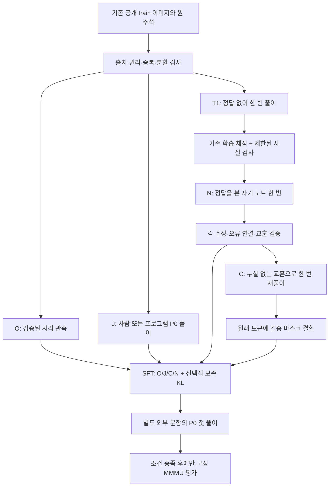

# v16 구현 설계 — 검증된 시각 관측과 자기 교정을 첫 풀이에 학습시키기

- 작성일: 2026-11-15.
- 상태: **조사·설계 문서. 구현·학습·GPU 실행·신규 평가를 수행한 결과가 아니다.** 2026-11-15 독립 검증 보강은 §24에 있고, 본문과 충돌하면 §24가 우선한다(본문의 `[정정 §24…]` 표시 참조).
- 목표: 지정 Qwen3-VL-4B-Instruct에서, 기존 P0·B2·V8·문항당 단일 응답을 유지하면서 첫 풀이 정확도를 개선한다.
- 장기 목표: V8 585/900 이상. 이 문서는 달성을 보장하지 않는다.
- 산출물 범위: 이 Markdown 한 개로 v16의 코드 변경, 데이터 준비, 검증 순서를 결정할 수 있게 한다.
- 실행 코드 기준: MMDL_test `ba0318f6e5213d6314881d0f09f202983c356642`.
- v15 학습 코드 기준: `7e3d26fb6eb6353646eb2a4d071cf528f534fcfe`.
- 위 커밋의 핵심 학습 파일과 현재 상위 작업공간 파일의 일치를 확인했다.
- 구현은 상위 `fine_tuning/`에서 진행하고 MMDL_test는 정해진 동기화 절차로 게시한다.
- 교수님 제출용 `MMDL/`, 기존 V8 파일, 기존 실행 원문은 변경하지 않는다.

## 0. 구현자가 먼저 읽을 결론

**v16 기본안은 ‘검증된 내용 중심 SFT + 검증된 자기 오답노트 학습’이다.**

현재 RL을 이름만 바꾸거나 감점만 늘리는 방식은 기본안에서 제외한다.
v15의 RL 목적함수에는 확인된 신호 제한이 있지만, 그 모든 제한이 구현 버그는 아니다.
특히 후보 토큰이 하나인 분포의 정책 기울기가 0인 것은 수학적으로 올바른 결과다.
그 자리에 다른 확률을 대입하면서 같은 RL이라고 보고해서는 안 된다.

v16의 기본 손실에서 정책 기울기 계수는 0으로 고정한다.
실행 명칭은 `verified-content-self-training`, 한국어로는 ‘검증된 내용 기반 자기 지도학습’으로 기록한다.
이 모드를 RL+SFT 실행이라고 보고하지 않는다.
별도 RL 확장안은 §15에 정의하지만 기본 구현의 필수 범위에 포함하지 않는다.
따라서 기본안 구현을 마치기 위해 여러 RL 알고리즘을 동시에 구현할 필요가 없다.

기본안의 핵심 변화는 다음 다섯 가지다.

1. 이미지에 실제로 표시된 값·관계·대상에 대한 **출처가 확인된 관측 목표 O**를 추가한다.
2. 허용된 사람 풀이 또는 검증 가능한 프로그램 풀이를 **평가와 같은 P0 입력의 목표 J**로 학습한다.
3. 자기 재풀이 C에서는 최종 정답과 검증된 부분만 손실 대상으로 삼는다.
4. 자유 서술 오답노트 B는 학습에서 제외하고, 모든 주장이 검증된 제한형 자기 노트 N만 학습한다.
5. 정답률 외에 ‘어떤 문항의 어떤 내용이 실제 기울기를 만들었는지’를 기록한다.

기존 도구를 재사용한다.
새 학습 프레임워크, 범용 자연어 증명기, 새 모델 판정기, 대형 데이터 생성기는 만들지 않는다.
신설 핵심 모듈은 `content_v16.py`, `train_v16.py` 두 개를 기준으로 한다. **[정정 §24.3 A18 · 구현 순서 §24.7]**
데이터 연결과 실행 진입점은 기존 모듈에 v16 분기를 추가한다.
모든 제안 함수·필드는 이 문서에서 **신규 제안**이라고 표시한다.

## 1. 확인된 사실과 설계 가설을 구분한다

| 구분 | 내용 | 해석의 한계 |
|---|---|---|
| 실측 | v15 280/450, 같은 문항 B2 275 | 전체 900 성적이 아님 |
| 실측 | 회복 33·손실 28, 정확 양측 p≈0.609 | 유의하지 않음이 동일성 증명은 아님 |
| 실측 | B2 길이 종료 집단 정답 1→9, 정상 종료 집단 274→271 | 사후 집단 비교이며 순수 인과효과가 아님 |
| 실측 | 양쪽 정상 종료 398문항 정답 271→271 | 회복 24·손실 24가 존재함 |
| 실측 | 추가 학습 16회·256문항, 누적 checkpoint 57 | 57회 신규 학습으로 표현하면 안 됨 |
| 실측 | 147문항은 직접 PG·SFT 없이 KL/anchor만 받음 | 전체 역전파가 0이라는 뜻은 아님 **[보충 §24.2 A2]** |
| 실측 | 양의 PG 대상 토큰 77.29%는 singleton support | 다른 SFT 경로의 기울기까지 0은 아님 **[정정 §24.2 A1·A6]** |
| 실측 | A2 14개, B 10개 | 행 수가 적다고 최적화 영향까지 작다고 단정하지 않음 |
| 실측 | 틀린 B와 맞는 A2가 같이 학습된 기하 사례 | 전체 하락의 원인 비율은 미측정 |
| 실측 | 최종 adapter 효과 RMS 0.26270 | 합성 128토큰 검사값이며 MMMU 효과 크기가 아님 **[보충 §24.2 A3]** |
| 실측 | 시각 단독 증폭 탐침 pass=null | 고장 증명도, 정확한 적용 인증도 아님 **[보충 §24.2 A4]** |
| 설계 가설 | 검증된 관측·풀이를 늘리면 내용 정확도가 개선될 수 있음 | 외부 held-out 첫 풀이로 검증해야 함 |
| 설계 가설 | 잘못된 노트의 손실을 제거하면 모순된 지도가 줄어듦 | 점수 상승 크기는 미확인 |

상세 근거는 [프로젝트 상태 기록](../docs/PROJECT_STATUS.md)의 2026-11-15 항목이다.
저장 결과 루트는 `/home/jang2/mmdl-artifacts/self-note-single-20261105/pod-v15-9n3tu6xbqdk5qd/final/extract/`다.
블록 52의 `rows-16.json`에는 다음 두 목표가 동시에 존재한다.

```text
A2: 7.94 × 360 / 70 = 40.834285714… → 40.83
B : 잘못된 계산을 근거로 40.84가 맞다고 주장
```

v16은 이 사례를 그대로 회귀 fixture로 공개하지 않는다.
원본은 비공개 회귀 감사에 사용한다.
공개 CPU 시험에는 별도의 작은 합성 산술 사례를 작성한다.
MMMU 응답을 학습용 fixture·증강·지도 목표로 옮기지 않는다.

## 2. 규칙을 코드 계약으로 고정한다

### 2.1 계속 금지되는 것

- 상위 모델의 풀이·설명·수정 노트·시각 관측을 SFT 목표로 사용하지 않는다.
- GPT 등의 판정 결과로 만든 중간 추론·bbox를 사람/프로그램 정답으로 재표기하지 않는다.
- 공개 데이터라도 teacher-generated provenance이면 제외한다.
- MMMU/MMMU-Pro의 모든 split과 모든 파생물을 학습·증강에서 제외한다.
- 평가에서 답 여러 개를 만들고 정답·판정기·다수결로 고르지 않는다.
- 평가에 오답노트, 정답, 검증기 결과, 검색 결과를 넣지 않는다.
- CompassVerifier 결과를 학습 보상이나 답 선택에 쓰지 않는다.
- 내용 검증을 통과시키기 위해 모델 출력을 고쳐 쓰지 않는다.
- 일반적인 수학 정리를 구체적 이미지의 관측 사실로 바꾸지 않는다.

### 2.2 기본안에서 허용하는 것

- 기존 공개 데이터의 사람 주석과 사람이 제공한 풀이.
- 기존 공개 이미지의 원 구조·표·공식 프로그램에서 결정적으로 계산한 라벨.
- 같은 Qwen이 정답 없이 생성한 첫 풀이.
- 채점 후 정답을 보고 같은 Qwen이 생성한 제한형 오답노트.
- 정답이 새지 않은 교훈을 이용한 학습용 재풀이 **1회**.
- 검증된 자기 출력 토큰에 대한 SFT.
- 실제 이미지가 있는 행에서 Vision LoRA·Merger·LLM LoRA 전체 경로 학습.

v15 한정 ‘최대 3회 재풀이’ 예외를 v16에 자동 상속하지 않는다.
v16 기본은 T1 1회 → N 1회 → C 최대 1회다.
재풀이가 실패해도 다시 뽑아 정답을 선택하지 않는다.
진단용 무교훈 대조는 학습·평가 답 선택에서 제외하고 별도 manifest로 구분한다.

### 2.3 이번 작업의 권한 범위

이 문서 작성은 구현·다운로드·유료 실행 승인이 아니다.
본문의 실행 명령 중 v16 명령은 앞으로 구현할 인터페이스 명세다.
지금 실행 가능한 명령이라고 주장하지 않는다.
로컬 CompassVerifier-7B 다운로드·실행 금지는 유지한다.
실제 GPU 시험·클라우드 실행·900문항 평가는 해당 단계의 사용자 지시가 있어야 한다.
승인 질문을 설계 작업 중간에 반복할 필요는 없다.
먼저 코드·데이터·비용안을 검토 가능한 상태로 준비하는 것이 순서다.

## 3. 전체 학습 흐름



O와 J는 자기 생성이 없어도 존재할 수 있다.
N은 모델 자신이 실제로 쓴 것이어야 한다.
C의 학습 입력에서는 교훈을 제거해 평가와 같은 P0를 사용한다.
N의 입력에 포함된 틀린 T1은 모두 손실에서 제외한다.
O의 사실이 단순한 JSON으로만 학습되고 끝나지 않도록 J를 함께 둔다.
J는 해당 관측을 어떻게 원래 질문의 답에 연결하는지 보여 주는 역할이다.
이 연결이 없으면 관측 시험만 좋아지고 P0 정답률은 그대로일 수 있다.

## 4. 시작 체크포인트와 학습 범위

### 4.1 F0에서 새로 시작한다

기본안은 지정 F0 원본에서 새 adapter와 새 optimizer를 만든다.
v15 checkpoint 57이나 v14 checkpoint 41을 기본 시작점으로 삼지 않는다.
이유는 기존 잘못된 노트·서로 다른 목적함수·소진된 학습률을 새 방법에 섞지 않기 위해서다. **[정정 §24.2 A5]**
이 결정은 새로운 방법의 효과를 해석하기 위한 설계 선택이다.
F0 시작이 반드시 더 높은 점수를 준다는 실측 결론은 아니다.

학습률·optimizer·RNG·자료 순서를 모두 v16 manifest에 새로 고정한다.
Stage A와 B는 하나의 사전 계획을 공유한다.
Stage B에서 유리해 보이는 checkpoint를 골라 시작하지 않는다.
안전 중단 시 사전에 정한 checkpoint 하나만 사용하거나 실행 전체를 종료한다.

### 4.2 ‘풀파인튜닝’의 정확한 뜻

현재 프로젝트의 전체 경로 학습은 다음이다.

```text
원본 backbone: 동결
Vision: LoRA 학습
Merger: 4개 모듈 학습
LLM: LoRA 학습
```

이 문서의 기본안도 이 구성을 유지한다.
실제 모든 원본 파라미터를 갱신하는 full-parameter FT와 구분한다.
공식 Qwen 학습 코드도 Vision·Merger·LLM 학습 범위를 구분하지만,
그 코드를 가져오는 것만으로 현재 custom adapter 저장·재생 계약이 보존되지는 않는다.
따라서 새 Trainer나 PEFT 버전으로 교체하지 않는다.
공식 설명은 [Qwen 학습 README](https://github.com/QwenLM/Qwen3-VL/blob/main/qwen-vl-finetune/README.md),
[PEFT adapter 저장 설명](https://huggingface.co/docs/peft/developer_guides/custom_models)을 참고한다.

### 4.3 전체 파라미터 학습을 기본에서 제외하는 이유

로컬에 이미 있는 고정 모델의 safetensors 헤더를 읽어 확인한 파라미터 수는 다음과 같다.

| 구분 | 파라미터 수 |
|---|---:|
| LLM | 4,022,468,096 |
| Vision | 306,242,560 |
| Merger 4개 | 109,105,152 |
| 합계 | 4,437,815,808 |
| 현재 학습 대상 L adapter | 33,030,144 |
| 현재 학습 대상 V adapter | 2,359,296 |
| 현재 학습 대상 M | 109,105,152 |
| 현재 학습 대상 합계 | 144,494,592 |

현재 학습 대상은 원본 파라미터 수의 약 3.26%다.
BF16 원본 가중치 자체가 약 8.266 GiB여서 로컬 8GB에 완전히 상주하지 못한다.
전체 파라미터 Adam 학습은 FP32 master·gradient·moment 구성에 따라 원시 상태만 약 74.4 GiB다.
BF16 gradient를 쓰는 구성은 약 66.1 GiB지만 activation·workspace·참조 모델은 추가된다.
A100 80GB 한 장에서 가능하다고도, 반드시 불가능하다고도 단정하지 않는다.
현재 예산과 검증된 경로에서는 전체 파라미터 FT보다 **정확한 지도 목표 확보가 우선**이다. **[보강 §24.6: BF16 정밀도 근거]**

참고 산식은 [Transformers 메모리 구성](https://huggingface.co/docs/transformers/model_memory_anatomy)의 mixed-precision Adam 설명을 따른다.
이는 실제 peak 측정이 아니다.
adapter 방식도 activation·참조 forward·vLLM KV 때문에 원시 tensor 계산보다 훨씬 큰 메모리를 쓸 수 있다.
기존 capacity 측정과 실행 전 실제 장비 검증을 유지한다.

## 5. 데이터 선정 원칙

### 5.1 학습 목표의 출처 등급

| 등급 | 허용 근거 | 보장하지 않는 것 |
|---|---|---|
| PROGRAM_EXACT | 공식 구조·프로그램과 검증된 변환으로 재계산 | 렌더링이 그 구조를 정확히 보여 준다는 자동 보장 |
| HUMAN_ANNOTATION | 원 데이터의 사람 작성 사실·풀이 | 팀이 해당 행을 직접 검수했다는 보장 |
| HUMAN_CONSENSUS | 독립 사람 답들의 사전 고정 합의 | 이미지의 모든 사실이 완전하다는 보장 |
| SELF_VERIFIED | 본 모델의 원래 토큰을 위 근거로 제한 검증 | 검증되지 않은 나머지 서술의 정확성 |
| UNKNOWN | 근거 부족·누락·연결 실패 | 학습 목표로 사용하지 않음 |
| TEACHER_GENERATED | 상위 모델 작성·검토·정제에 의존한 목표 | 이 프로젝트에서는 허용하지 않음 |

`source_human_annotation=true`와 `human_verified=true`를 구별한다.
팀의 사람 검수가 없으면 `human_verified=false`다.
에이전트가 자료를 읽어 검토한 것은 사람 검수가 아니다.

### 5.2 source 값, 보이는 값, 추론 결과를 분리한다

예를 들어 원 CSV에 소수점 아래 값이 있어도 그림 막대에는 반올림된 숫자만 보일 수 있다.
그 경우 원 CSV의 모든 자릿수를 ‘이미지에서 읽은 사실’로 학습시키면 안 된다.
다음 세 필드를 구분한다.

```json
{
  "source_value": "12.347",
  "visible_value": "12.3",
  "value_semantics": "printed_label",
  "precision": "0.1",
  "unit": "%"
}
```

숫자가 인쇄되지 않고 축으로 추정해야 하는 경우 `axis_estimate`를 사용한다.
`axis_estimate`를 원표의 임의 정밀도로 exact 채점하지 않는다.
허용 오차는 평가 결과를 보고 바꾸지 않고 표시 해상도·축 눈금 규칙으로 사전에 정한다.
규칙을 정할 수 없으면 해당 관측 목표는 제외한다.

도형에서는 ‘표시된 각도’와 ‘정리로 계산한 각도’를 분리한다.
보기에서 답을 역으로 읽어 그림 관측을 만드는 것은 금지한다.
그림이 대략 그려졌다는 이유로 픽셀의 기울기에서 실제 각도를 확정하지 않는다.

## 6. Hugging Face 데이터 후보와 채택 순서

아래 목록은 사용 승인이 끝난 학습 manifest가 아니다.
논문·카드·원 배포를 확인한 후보이며 실제 행 연결·중복 검사 후에만 사용할 수 있다.
`main` URL은 조사 링크다. 실행 manifest에는 반드시 전체 revision SHA를 넣는다.

### 6.1 그래프: GVLQA 원 구조 연결을 우선한다

- HF: [`Yanbin99/GVLQA-BASE`](https://huggingface.co/datasets/Yanbin99/GVLQA-BASE).
- 확인된 revision: `7aeff19faa34ddb19f79b8a5a80d31c1fe9db18b`.
- 공식 근거: [NeurIPS 2024 논문](https://proceedings.neurips.cc/paper_files/paper/2024/file/00295cede6e1600d344b5cd6d9fd4640-Paper-Conference.pdf).
- 원 그래프·정답을 렌더링하고 사람 작성 템플릿으로 질문을 구성한 출처다.
- HF 카드의 MIT 표기와 원 배포 조건을 manifest에 함께 기록한다.
- `data/<task>/QA/Vision_Only_train.json`을 명시해 읽는다. **[정정 §24.3 A8]**
- 같은 ID의 Text_Only 원 구조는 private 정답 backend에서만 읽는다.
- 원 그래프 텍스트를 모델 입력으로 넘기면 시각 읽기 학습이 아니다.
- `gpt` 역할 필드 이름만으로 AI 작성이라고 판단하지 않는다. 실제 제작 근거를 본다.

O 목표는 `nodes`, `directed`, `edges`, 지정 노드의 `neighbors`·`degree`다.
J 목표는 기존 알고리즘으로 검증한 도달성·경로·차수 계산이다.
간선 교차를 노드로 만들지 않고 고립 노드를 보존한다. **[정정 §24.3 A7: 고립 노드는 그림에 그려지지 않는다]**
방향·가중치가 있는 그래프는 이를 생략한 해시로 묶지 않는다.
같은 그래프의 다른 렌더링·질문·스타일은 하나의 분할 그룹이다.

### 6.2 차트: PlotQA를 우선하고 검증된 ChartQA-H를 보강 후보로 둔다

기본 pilot의 차트 출처는 공식 PlotQA train으로 고정한다. **[정정 §24.3 A9]**
[공식 스키마](https://github.com/NiteshMethani/PlotQA/blob/master/PlotQA_Dataset.md)의
`models{name,color,bboxes,label,x,y}`와 `general_figure_info`를 이미지 ID로 연결한다.
원 질문의 `question_string`, `answer`, `template`, `type`도 함께 보존한다.
기존 수치 자료로 렌더링하고 사람이 만든 템플릿을 프로그램으로 전개한 데이터다.
이 출처의 값을 이미지에서 읽을 수 있는 정밀도와 구분하는 검사는 §5.2대로 유지한다.
비공식 HF PlotQA loader를 자동 실행하지 않고 공식 원 주석과 파일 hash를 확인한다.
ChartQA-H는 기존 자료 재사용을 위한 보강 후보이며, PlotQA 실패 시 자동 대체하지 않는다.

- 공식 원 배포: [`ahmed-masry/ChartQA`](https://github.com/ahmed-masry/ChartQA). **[정정 §24.3 A10: 이 링크는 404]**
- 단순 HF QA 변환판만으로는 표·축·bbox 근거가 부족할 수 있다.
- ChartQA-H와 모델 생성 ChartQA-M을 구분한다.
- H의 사람 질문이나 원표에서 프로그램으로 만든 목표만 후보로 삼는다.
- M의 모델 생성 문답을 사람 작성으로 취급하지 않는다.
- 원표와 SVG 주석도 오류가 있을 수 있으므로 자동 진실로 승격하지 않는다.

실제 조사에서 공식 `train/tables/10095.csv`에 비정상적으로 보이는 값이 확인됐다.
따라서 ‘CSV가 있으므로 이미지 관측 정답도 정확하다’는 검증은 불충분하다.
원표 값·표시 텍스트·SVG/bbox 연결의 불일치는 `SOURCE_RENDER_CONFLICT`로 제외한다.
원표 전체를 모델 입력으로 주지 않는다.

O 목표는 특정 시리즈·범주·단위·표시 숫자다.
J 목표는 확인된 숫자에 대한 차이·합·비율·최댓값 비교다.
축 절단, 로그 축, 이중 축, 누적 막대는 별도 지원 유형으로 등록하기 전까지 제외한다.
합계가 100이어야 한다는 이유로 보이지 않는 원값을 추측하지 않는다.

### 6.3 도형: Geometry3K의 원 의미 주석을 다시 연결한다

- 기존 학습의 Geometry3K 이미지와 질문을 계속 활용할 수 있다.
- QA-only HF 변환판이 버린 `diagram_logic_forms`를 원 배포와 연결한다.
- 원본 ID·질문·이미지 hash가 일치해야 한다. **[정정 §24.3 A11: 로컬 행에는 원본 ID가 없다]**
- 텍스트 조건과 그림에서 표시된 조건을 같은 관측 필드로 합치지 않는다.
- `TR = x + 21` 같은 원 표기와 계산된 수치 결과를 분리한다.

O는 표시된 각도·길이·직각·평행·동일 표시를 읽는 목표다.
J는 검증 가능한 제한된 정리 사슬을 학습하는 목표다.
임의 자연어 풀이를 해석하는 범용 기하 증명기는 만들지 않는다.
지원하지 않는 정리·도형 관계는 `UNSUPPORTED_RULE`로 남긴다.
기존 데이터 사용 이력이 있어도 새 목표·원 주석 연결의 오염·분할 검사는 다시 필요하다.

### 6.4 사진: VQAv2의 사람 합의 관찰 문항을 조건부로 포함한다

- HF: [`HuggingFaceM4/VQAv2`](https://huggingface.co/datasets/HuggingFaceM4/VQAv2).
- 확인한 로더 revision: `4b98c864262e9db184eb039e85e97e6630825b6a`. **[정정 §24.3 A12]**
- 원 필드: `question_id`, `image_id`, `question`, `answers`, `answer_type`, `question_type`.
- 원 사람 답 10개와 confidence를 보존한다.
- [공식 데이터 형식](https://visualqa.org/download.html), [주석 이용 조건](https://visualqa.org/terms.html)을 함께 기록한다.
- 주석 CC BY 4.0과 COCO 원 사진의 권리를 구분한다.

색·개수·명시적 존재·직접 위치 질문만 초기 대상이다.
의도·직업·감정·배경 상식을 추정하는 질문은 제외한다.
정규화한 답의 8/10 이상 합의를 제안 품질 문턱으로 고정한다.
이 8/10은 팀 설계이며 정확성 보증이나 논문 표준값이 아니다.
합의가 낮으면 잘 맞히는 답으로 교체하지 않는다.
원 질문이 묻지 않은 전체 장면 설명을 새로 만들어 목표로 삼지 않는다.
사진에 없는 대상이라는 음성 주장은 원 주석 누락만으로 만들지 않는다.

사진 목표는 HUMAN_CONSENSUS 층으로 별도 집계한다.
PROGRAM_EXACT 목표와 합쳐 ‘전체 내용 검증 완료’라고 보고하지 않는다.
사진 층의 성능은 구조·표·기하 층과 따로 보고한다.

### 6.5 확장 후보

| 자료 | 쓸 수 있는 정보 | 기본안에서의 상태 |
|---|---|---|
| PlotQA | 렌더링 수치·템플릿 질문 | 원표·이미지 연결과 license 확인 후 차트 대안 |
| CLEVR | 공식 장면 그래프·기능 프로그램 | 정확한 객체·관계 보조 자료, 사진 대체로 보고하지 않음 |
| AI2D | 사람 작성 도식 요소·관계 주석 | 원 DPG 연결이 가능한 행만 관측 목표 후보 |
| TextVQA | 사진 속 문자에 대한 사람 답 | OCR 관련 확장, 자동 OCR 문자열을 정답으로 승격하지 않음 |
| GQA | 원 장면 그래프·관계·프로그램 QA | 긍정 사실 중심, 누락 관계를 음성으로 쓰지 않음 |
| TallyQA | 출처가 구분된 사람 개수 질문 | 원 AMT 출처를 재연결한 뒤 검토 |

CLEVR HF 로더의 `program`과 공식 scene graph는 별도 자료다.
[`HuggingFaceM4/clevr`](https://huggingface.co/datasets/HuggingFaceM4/clevr)만 로드했다고 장면 그래프까지 확보했다고 하지 않는다.
[공식 CLEVR 배포](https://cs.stanford.edu/people/jcjohns/clevr/)와 image filename을 연결해야 한다.

AI2D의 흔한 [`lmms-lab-encoder/ai2d`](https://huggingface.co/datasets/lmms-lab-encoder/ai2d)는 test-only 배포다.
이를 train으로 바꿔 사용하는 계획을 세우지 않는다.
The Cauldron의 ai2d train에는 QA가 있지만 DPG가 없으므로 원 주석 연결이 필요하다.
원 데이터 권리는 [공식 등록](https://registry.opendata.aws/allenai-diagrams/)의 **CC BY-SA 4.0**을 따른다. **[정정 §24.3 A13]**
AI2D-Caption처럼 GPT-4V/LLaVA 생성이라고 명시된 자료는 제외한다.

## 7. 데이터 분할과 문항 선택

### 7.1 분할 단위

문항 ID 해시만으로 나누지 않는다.
같은 이미지·그래프·도형의 질문 전체를 동일 그룹으로 묶는다.
표와 그 표의 다른 렌더링도 같은 그룹이다.
COCO/VG/OpenImages ID와 실제 이미지 hash를 교차 사용한다.
가까운 중복과 부모 파생 관계를 기존 blacklist 정책에 포함한다.
동형 그래프 검사를 지원하지 못하면 지원한다고 기록하지 않는다.
동일성 판단이 불확실하면 보수적으로 묶거나 제외한다.

### 7.2 제안 pilot 규모

아래는 실행 전 동결할 **설계값**이다. 현재 확보 수량을 뜻하지 않는다. **[정정 §24.3 A23 · §24.8: 이 수량은 확보 불가, 예산 초과]**

| 층 | train 부모 | dev 부모 | sealed 외부 평가 부모 |
|---|---:|---:|---:|
| 차트 | 128 | 64 | 64 |
| 도형 | 128 | 64 | 64 |
| 그래프 | 128 | 64 | 64 |
| 사진 관찰 | 128 | 64 | 64 |
| 합계 | 512 | 256 | 256 |

모든 층은 공식 train에서 그룹 단위로 분리한다.
공식 validation/test를 학습으로 섞지 않는다.
검증 가능한 자료가 부족하면 실행 전에 `INSUFFICIENT_ELIGIBLE_DATA`로 멈춘다.
다른 출처로 몰래 채우거나 문턱을 낮추지 않는다.
사진 층을 CLEVR로 대체하려면 manifest와 실험 이름을 새로 정한다.
실행 중 자동 대체하지 않는다.

학습 순서는 출처별 해시 정렬 후 결정적 교차 배치로 고정한다.
8부모 block마다 네 출처에서 정확히2부모씩 배치한다.
후반부가 특정 출처에 몰리는 기존 문제를 피한다.
샘플의 정오를 본 뒤 쉬운 문제만 앞으로 옮기지 않는다.
어려운 문항도 원장에 남지만, 검증할 목표가 없으면 `NO_TASK_SIGNAL`로 기록한다.
모든 문항이 반드시 학습에 기여한다고 약속하지 않는다.

### 7.3 단계 구성

- Stage A: 처음 128 부모, O/J 중심 시각 관측·적용 학습.
- Stage B: 나머지 384 부모, O/J와 자기 N/C를 함께 학습.
- Stage A에서는 모델 응답을 새로 생성하지 않고 O/J만 학습한다. R은0이다.
- Stage B에서만 T1을 생성하며, 틀렸거나 프로그램으로 과정 오류가 확인된 경우 N/C를 시도한다.
- 배치: 부모 8개를 하나의 갱신 단위로 한다.
- 최대 갱신: 64회. 같은 부모의 O 여러 행을 별도 독립 문항으로 세지 않는다.
- Stage A/B 경계는 16회 갱신이다.
- 이 크기는 효과가 입증된 최적값이 아니라 비용을 제한한 최초 검증안이다.
- 실제 시간·메모리 측정으로 전체 실행 가능성을 먼저 판정한다.
- 규모가 예산에 맞지 않으면 별도 계획으로 줄이고 평가한 뒤 소급 변경하지 않는다.

### 7.4 생성·인코딩 한도를 명시한다

기존 `contract.py`와 `protocol.py`에서 확인한 값을 바탕으로 다음 v16 초기 계약을 제안한다.
이 표는 새 v16 protocol에 값을 직접 봉인하며 legacy 전역 상수를 변경하라는 뜻이 아니다.

| 항목 | v16 기본안 |
|---|---|
| 학습 이미지 pixel budget | v15와 같은 1,003,520–4,014,080 |
| 학습 전체 context 상한 | 기존 24,576토큰 |
| Stage B T1·C 생성 상한 | 각각 기존 8,192토큰 |
| N 생성 상한 | 기존 note 상한 1,024토큰 |
| O/J/C SFT target 상한 | 기존 4,096토큰 |
| N SFT target 상한 | 1,024토큰 |
| SFT target 하한 | 수용된 손실 대상 토큰 1개 이상; 내용 계약은 별도 필수 |
| sampling | 기존 `SINGLE_SAMPLING`의 모든 값과 hash를 복사해 봉인 |
| seed | master 3407과 기존 T1/note/resolve 단계별 sample seed 계약 |
| 평가 | 기존 B2의 32,768 생성·40,960 context·P0·V8 그대로 |

T1은 SFT target이 아니므로 4,096토큰 target 상한을 T1 정오 측정에 적용하지 않는다.
C가 정상 종료했더라도 4,096토큰을 넘으면 SFT에서는 제외하고 원문과 이유를 남긴다.
길거나 context에 들어가지 않는 행은 자르지 않고 `TARGET_TOO_LONG` 또는 `CONTEXT_BLOCKED`로 기록한다.
N 입력에 긴 T1을 넣기 위해 원문을 임의 요약하거나 자르지 않는다.
관측·풀이를 짧게 만드는 것은 원 자료에서 정한 target 작성 규칙이며, 생성 결과를 보고 삭제하는 후처리가 아니다.
짧은 target이 출력 길이 축소를 다시 일으킬 위험은 §17의 길이·정상 종료 오답 지표로 확인한다.

## 8. 데이터 행과 검증 영수증 계약

### 8.1 ContentExample — 신규 제안

```python
ContentExample = {
    "schema": "v16-content-example-v1",
    "problem_id": str,
    "parent_id": str,
    "group_id": str,
    "split": "train|dev|sealed",
    "source_repo": str,
    "source_revision": str,
    "source_item_id": str,
    "source_image_id": str,
    "image_paths": list[str],
    "image_sha256": list[str],
    "question": str,
    "options": list[str],
    "label_backend_ref": str,
    "annotation_sha256": str,
    "license_ref": str,
    "label_source": "PROGRAM_EXACT|HUMAN_ANNOTATION|HUMAN_CONSENSUS",
    "source_human_annotation": bool,
    "human_verified": bool,
    "training_allowed": bool,
    "public_upload_allowed": bool,
}
```

private 라벨 참조를 생성 request 사전에 그대로 전달하지 않는다.
생성용 view와 검증용 view는 기존 경계에 맞춰 따로 만든다.
정제된 로그 표시에도 gold·이미지·전체 응답을 섞지 않는다.
임의의 Python 식을 평가하는 `eval()`을 사용하지 않는다.
계산 validator는 허용된 유한한 연산·구문만 처리한다.

### 8.2 Fact — 신규 제안

```json
{
  "fact_id": "f0",
  "kind": "printed_value",
  "entity": "series:blue/category:2018",
  "value": "12.3",
  "unit": "%",
  "evidence_origin": "image",
  "source_annotation_pointer": "/models/0/y/3",
  "source_annotation_sha256": "...",
  "render_check": "VERIFIED",
  "visibility": "VISIBLE",
  "verification": "PROGRAM_EXACT"
}
```

`evidence_origin`은 `image|question|derived` 중 하나로 한다.
문제에서 주어진 사실을 이미지에서 읽었다고 표시하지 않는다.
`derived`에는 사용한 premise IDs와 rule ID를 필수로 둔다.
`visibility=UNKNOWN`인 이미지 사실을 O의 정답 목표로 사용하지 않는다.

### 8.3 VerificationReceipt — 신규 제안

```python
VerificationReceipt = {
    "version": "v16-content-verification-v1",
    "problem_id": str,
    "group_id": str,
    "image_sha256": list[str],
    "annotation_sha256": str,
    "protocol_sha256": str,
    "verifier_code_sha256": str,
    "generation_sha256": str | None,
    "generation_prompt_sha256": str | None,
    "training_prompt_sha256": str,
    "target_sha256": str,
    "verdict": "VERIFIED|CONTRADICTED|UNKNOWN|UNSUPPORTED",
    "verified_claim_ids": list[str],
    "rejected_claim_ids": list[str],
    "target_token_mask_sha256": str,
    "reason_codes": list[str],
}
```

모델이 receipt를 자기 신고해도 수용하지 않는다.
실제 validator가 만든 receipt와 원문 hash를 다시 대조한다.
다른 이미지·문제·revision의 receipt는 재사용할 수 없다.
UNKNOWN을 VERIFIED로 간주하지 않는다.
저장된 receipt의 내용은 다음 모델 갱신 때 덮어쓰지 않는다.
C는 생성 입력에 교훈이 있지만 학습 입력은 P0이므로 두 prompt hash가 다르는 것이 정상이다.
각각 실제 request와 실제 training messages에 결합하고, 서로 같다고 강제하지 않는다.
O/J에는 생성 prompt가 없으므로 null을 쓰고 가짜 request를 만들지 않는다.

### 8.4 ContentRow — 신규 제안

```python
ContentRow = {
    "schema": "v16-content-row-v1",
    "row_id": str,
    "problem_id": str,
    "parent_id": str,
    "source": str,
    "kind": "O|J|C|N|R",
    "route": "FULL|LM",
    "prompt": str,
    "target": str,
    "target_origin": "program|human|self",
    "generation": dict | None,
    "target_token_ids": list[int],
    "target_token_mask": list[bool],
    "verification_receipt": dict,
    "active_target_tokens": int,
}
```

O/J의 program/human 행에 가짜 generation을 붙이지 않는다.
C/N의 self 행에는 실제 token IDs·원문·생성 policy hash를 필수로 둔다.
R은 보존용으로 실제 존재하는 prefix이며, 가상의 RL 행이 아니다.
R에는 원 T1 전체 token IDs를 결합하고 별도 `kl_token_count=min(128, 원 T1 토큰 수)`를 둔다.
R의 SFT mask는 모두 false, `active_target_tokens=0`으로 두며 CE encoder와 빈 SFT 행 검사를 거치지 않는다.
대신 R 전용 validator가 정답 상태·원 T1 hash·정상 종료·양의 KL token 수를 검사한다.
위 enum을 기존 v4.KINDS에 무조건 추가하지 않는다.
v16 schema의 validator 안에서만 유효하게 한다.

## 9. 각 학습 행을 만드는 방법

### 9.1 O: 이미지에 근거가 있는 관측

입력은 이미지와 범위를 제한한 관측 요청이다.
원표·scene graph·정답은 입력에 넣지 않는다.
목표는 사람/프로그램이 확인한 사실만 고정 템플릿으로 표현한다.
템플릿으로 자연어 문장을 만드는 것 자체를 상위 모델 증류와 혼동하지 않는다.
이를 program-authored supervision이라고 명시한다.

```text
Input example: State the displayed value and unit for the blue series in 2018.
Target example: The displayed value for the blue series in 2018 is 12.3%.
```

이 예시는 명세 설명용이며 실제 데이터 행이 아니다.
실제 데이터에서는 모델이 값을 추측해 보완해서는 안 된다.
하나의 부모 이미지에서 만드는 O는 한 행이며, 그 안에 사실을 최대3개 넣는다. **[변경 §24.8: 여러 줄 묶음]**
사실 후보가 셋을 넘으면 생성 결과를 보기 전에 사실 ID의 hash로 고정한다.
맞히기 쉬운 관측만 골랐다고 오해하지 않도록 선택 규칙을 저장한다.

### 9.2 J: 관측을 P0의 풀이에 연결한다

J의 입력은 평가와 같은 build_prompt/build_messages 경로를 사용한다.
추가 관측 JSON을 입력에 삽입하지 않는다.
목표는 다음 둘 중 하나로 제한한다.

- 원 데이터에 포함된, 허용된 사람 풀이.
- 원 사실과 유한한 규칙으로 검증한 프로그램 작성의 짧은 풀이.

프로그램 풀이는 ‘관측 → 적용 규칙 → 계산 → 최종답’의 관계를 보존한다.
모델의 틀린 글을 정답으로 고쳐 쓰고 J라고 불러서는 안 된다.
J와 C는 출처를 구분해 보존한다.
사람 풀이에 AI 생성 내용이 섞이면 J에 넣지 않는다.
ScienceQA의 lecture는 관련 지식이며, 항상 해당 문제의 완전한 풀이인 것은 아니다.
글 전체를 무조건 정답 풀이에 이어 붙이지 않는다.

### 9.3 C: 같은 모델의 한 번의 재풀이

N의 교훈에 정답이 새지 않았을 때만 한 번 생성한다.
생성 입력의 교훈을 학습 입력에서 제외하고, P0에서 그 출력을 학습한다.
원문 target·token IDs는 변경하지 않는다.
최종답이 맞고 정상 종료했다는 것은 필요조건이다.
그것만으로 전체 추론을 VERIFIED로 처리하지 않는다.

C의 손실 대상은 다음으로 제한한다.

- 원 주석과 대조한 관측값·관계.
- 허용된 규칙으로 확인한 계산 결과.
- 확인된 최종답의 원 출력 구간.

미확인 설명은 loss mask=false로 둔다.
오류가 확인된 설명을 포함하면 **행 전체를 거부**한다.
마스크로 오류를 가리고 정답만 학습하는 방식으로 운영하지 않는다.
UNKNOWN인 앞 문맥을 조건으로 최종답을 학습하는 것은 완전한 추론 학습이 아니라고 보고한다.
mask=true인 부분이 최종답뿐이면 `ANSWER_ONLY_C`로 기록한다.
생성 전에 Stage B 384부모를 `sha256("v16-partial-c:" + parent_id)`로 정렬한다. **[변경 §24.10: 부분 검증 C 목록은 삭제 권고]**
첫96부모만 `partial_c_allowed_ids`로 동결해 UNKNOWN prefix가 있는 C를 허용한다.
그96개를 `sha256("v16-answer-only-c:" + parent_id)`로 다시 정렬한 첫38개만 `answer_only_allowed_ids`로 둔다.
38은 전체 Stage B 부모384개의10%를 내림한 수다.
두 목록의 원문·해시를 생성 전에 manifest에 넣고, 현재 모델의 정오를 보고 고르지 않는다.
해당 부모가 실패하면 그 자리를 다른 부모로 채우지 않는다.
나중에 더 낮은 해시의 행이 생겼다는 이유로 이미 학습한 행을 제외하지 않는다.
모든 내용이 검증된 C에는 이 부분검증 상한을 적용하지 않는다.

v16에서는 256토큰이라는 일률적인 하한을 사용하지 않는다.
짧고 올바른 기하 계산을 길이만으로 제외하지 않는다.
대신 검증된 내용과 최소 하나의 관측/계산 근거가 있는지 기록한다.
긴 글을 자동으로 고품질이라고 간주하지 않는다.
반복·부정·미완료·복수 최종답 검사는 유지한다.

### 9.4 N: 제한형 자기 오답노트

자유 서술 B의 전체 토큰 학습을 중단한다.
N은 같은 Qwen이 다음 제한 구조로 한 번 생성한다.
N/C는 T1이 틀렸거나 프로그램으로 실제 과정 오류가 확인된 경우에만 생성한다.
맞고 확인된 오류도 없는 T1은 `SKIP_NOTE_NO_ERROR`로 닫으며 오류 노트를 강제하지 않는다.
T1/N/C의1/1/1은 최대 호출 수이지 매 문항의 의무 호출 수가 아니다.

N 전용 입력에는 원 이미지·질문·실제 T1·채점 결과·허용된 정답과 함께 `note_catalog`를 제공한다.
catalog의 사실 항목은 `fact_id`, `kind`, `entity`, `evidence_origin`만 담으며 원 주석의 정답 값은 담지 않는다.
예를 들어 f0가 ‘blue series / 2018 value’, f1이 ‘red series / 2018 value’에 대응함을 알려 준다.
이 대응은 출처의 고정 주석에서 만들며, 모델이 쓴 참조를 보고 사후에 바꾸지 않는다.
값은 원 이미지·질문에서 읽어 모델이 출력해야 하며, validator만 private backend의 기대값과 대조한다.
검증 가능한 관계 전제는 source의 고정 relation ID와 참조 대상을 catalog에 둘 수 있다.
해당 정보는 정답을 본 뒤 쓰는 N의 참고 문맥임을 기록하며 독립적인 무힌트 관측 성과로 보고하지 않는다.
사용 가능한 `operation`, `rule_id`, 추상 `formula`와 적용 조건의 고정 목록도 N 입력에 명시한다.
카탈로그를 포함한 실제 N 입력 hash를 봉인한다. private 파일 경로·backend 객체 자체를 넘기지 않는다.
T1에는 catalog를 주지 않고, C에는 검증된 원 `lesson` 두 필드만 준다.

```json
{
  "observed_facts": [
    {"fact_ref": "f0", "value": "12"},
    {"fact_ref": "f1", "value": "3"}
  ],
  "error": {
    "earlier_span": [120, 126],
    "earlier_quote": "12/3=5",
    "kind": "ARITHMETIC",
    "operand_fact_refs": ["f0", "f1"],
    "operation": "DIV",
    "old_value": "5",
    "corrected_value": "4",
    "rounding": "none",
    "unit": "dimensionless",
    "rule_id": "DIVIDE_EXACT"
  },
  "lesson": {
    "rule_id": "DIVIDE_EXACT",
    "formula": "result=numerator/denominator"
  }
}
```

실제 프롬프트·출력 언어는 기존 영어 경로에 맞춘다.
위 한국어 설명은 명세용이며 학습용 라벨이 아니다.
JSON의 수치·offset은 구조 설명용 합성 예시이며 실제 실행 기록이 아니다.
모든 객체에서 `additionalProperties=false`로 알 수 없는 필드를 거부한다.
관측은 최대3개, 오류는 정확히1개, 교훈은 정확히1개다.
`old_value`/`corrected_value`는 숫자·짧은 라벨·제한된 원자 관계만 허용한다.
수정 풀이 전체나 자유 설명을 넣을 문자열 필드는 제공하지 않는다.
수치 문자열은 길이64 이하, 관계 목록은 원자 항목32개 이하로 제한한다.
`earlier_span`은 실제 T1의 Unicode codepoint 기준 반열림 문자 구간에 대응해야 한다.
해당 구간이 `earlier_quote`와 바이트까지 일치하는지 검사한다.
모델이 인용 위치를 조작했다면 거부한다.
`rule_id`는 source별로 사전에 정한 allowlist에서 고른다.
규칙 이름만 맞는 것으로는 부족하며, 적용 조건과 교정 결과를 다시 계산한다.
교정했다고 주장하는 원래 값이 처음부터 맞았던 경우도 거부한다.

초기 N은 `OBSERVATION`과 `ARITHMETIC` 두 kind만 지원한다.
OBSERVATION은 operation=`LOOKUP`으로 원 주석의 한 원자 사실과 비교한다.
ARITHMETIC은 `ADD|SUB|MUL|DIV|TRIANGLE_REMAINDER|STRAIGHT_REMAINDER`만 허용한다.
DIV의 분모0, 단위 불일치, 존재하지 않는 operand 참조는 거부한다.
TRIANGLE/STRAIGHT 규칙은 해당 구조 전제와 대응 각이 명시돼 있을 때만 허용한다.
원 인용문에서 피연산자·연산·old_value를 유일하게 추출할 수 없으면 UNSUPPORTED다.
수식 자체의 참/거짓과 T1이 실제로 그 수식을 주장했다는 판정도 분리한다.
`earlier_assertion_status=ASSERTED|RETRACTED|UNKNOWN`을 validator receipt에 기록한다.
부정·가정·인용·예시이거나 이미 후속 문장에서 철회한 수식을 실제 오류로 인증하지 않는다.
예를 들어 T1의 `12/3=5 is incorrect; 12/3=4`에서 앞 수식만 인용한 N은 거부한다.
지원하는 계산 구간은 독립 수식 행과 명시된 단순 연결 문법으로 제한하고 그 문법을 protocol에 봉인한다.
부분 문자열만 검사하지 않고 연결된 계산 구간과 후속 정정 여부를 함께 검사한다.
자유 서술 때문에 주장/철회 관계를 이 문법으로 확정할 수 없으면 UNKNOWN/UNSUPPORTED로 닫는다.
‘부정 단어가 없다’는 regex 검사만으로 ASSERTED를 부여하지 않는다.
N은 assertion이 ASSERTED이고 실제 잘못된 주장으로 확인된 경우에만 오류 학습 목표가 된다.
이 검증 범위 밖의 지식·자유 추론 오류는 N으로 학습하지 않고 원문만 보존한다.

교훈은 모델이 실제 출력한 `rule_id`와 **문제별 값이 없는 추상 공식**만 허용한다.
예를 들어 DIVIDE_EXACT는 위 공식, TRIANGLE_REMAINDER는 `x=180deg-a-b`다.
허용 공식 문자열·변수·상수180deg와360deg의 목록을 protocol에 고정한다.
공식의 적용 조건이 해당 문제에서 충족되는지도 별도로 검사한다.
일반 상수 이외의 문제 숫자·보기·개체명·답 문자열을 교훈에 넣지 않는다.
검증을 통과한 원 `lesson` 두 필드만 C 입력에 투영한다.
`observed_facts`, `error.corrected_value`, 정답, 원 참고 자료는 C에 전달하지 않는다.
코드가 실패한 노트를 수정하거나 새 교훈을 대신 작성해 재풀이하지 않는다.
추상 규칙의 선택 자체가 문제 해결의 힌트인 것은 의도한 학습 절차이며 평가에서는 사용하지 않는다.

N은 모든 학습 대상 주장을 검증할 수 있을 때만 수용한다.
일부만 맞는 자유 서술을 이어 붙여 새 자기 노트를 만들지 않는다.
기존 `lesson`에 정답 단어가 없다는 이유만으로 안전하다고 판단하지 않는다.
정답의 동의어·보기의 바꿔 쓰기·유일한 후보를 가리키는 설명도 누설 후보이다.
판단할 수 없으면 C를 만들지 않고 원래 N은 감사용으로 저장한다.

**중요:** N의 내용 검증은 C의 정오 판정보다 먼저 한다.
C가 정답이었다는 사후 결과로 N의 내용 검증을 대신하지 않는다.
N이 맞아도 C가 실패할 수 있으므로 둘은 별도 지표로 둔다.

### 9.5 R: 정답인 현재 T1 문맥에서의 원본 분포 정규화

R은 공개 데이터의 독립 train/dev 경계를 지키는 보존용 입력으로 만든다.
과거 MMMU 정답 558문항을 보존 데이터로 사용해서는 안 된다.
같은 실행에서 얻은 실제 T1 중 정답이며 해당 문제의 내용 검사에서 모순이 없는 것만 후보로 삼는다.
R은 SFT 행이 아니라 raw F0와 현재 모델의 분포 차이를 억제하는 KL 항이다.
이 조건은 F0가 그 문항을 맞혔거나 prefix 전체가 검증됐다는 뜻이 아니다.
R receipt는 `answer_status=CORRECT`, `prefix_content_status=UNKNOWN_OR_PARTIAL`을 구분해 저장한다.
F0 KL이 새로 배운 올바른 행동도 억제할 수 있으므로 ‘정확한 능력 보존’으로 단정하지 않는다.
R의 수가 0이면 기여가 0이라고 기록하고, 가상의 prefix로 채우지 않는다.
보존 효과는 출력 길이와 외부 P0 정답률로 검증한다.

## 10. 유한한 내용 검증기

### 10.1 처음 구현할 범위

| 영역 | 허용할 검증 | 처음에는 다루지 않을 것 |
|---|---|---|
| 산술 | 유리수/Decimal의 사칙연산·비율·단위 변환 | 자유 자연어에서 수식 추정 |
| 차트 | 원 라벨과의 대응·확인된 수치의 비교와 차이 | 임의 이미지에서 새 OCR 정답 생성 |
| 그래프 | 정점·간선·방향·가중치·도달성·고정 규칙 탐색 | 등록되지 않은 자유로운 알고리즘 증명 |
| 기하 | 원 의미 조건과 유한한 정리 적용 | 이미지의 겉모습만으로 각도 측정 |
| 사진 | 원 질문에 대한 사람 합의 답 | 완전한 scene graph·지식이나 의도 추정 |

기존 verifier/helper가 같은 의미를 구현하고 있다면 재사용한다.
기존 동결 schema/guards를 v16에 맞추려고 덮어쓰지 않는다.
새 의미는 v16 adapter 층에서 기존 함수로 전달한다.

### 10.2 기하의 초기 규칙 집합

- 삼각형 내각의 합: 원 주석에서 삼각형과 대응 각이 확정돼 있어야 한다.
- 일직선 위의 이웃각: collinear와 이웃 관계가 확정돼 있어야 한다.
- 맞꼭지각: 교차하는 두 직선과 각의 대응이 확정돼 있어야 한다.
- 원 한 바퀴 360도, 호의 길이와 중심각의 비: 중심·호·단위가 확정돼 있어야 한다.
- 명시된 등길이/평행/직각의 단순 대입.

원 주석에 없는 평행·접선·등변을 모델의 추측으로 추가하지 않는다.
전제가 부족하면 UNKNOWN으로 둔다.
답이 일치한다는 이유만으로 부족한 전제를 허용하지 않는다.
같은 답에 도달하는 다른 풀이를 참조 경로와 다르다는 이유만으로 오답 처리하지 않는다.
다른 풀이를 검증할 수 없으면 UNSUPPORTED로 두고 false와 구분한다.

### 10.3 검증기 실패를 학습 실패와 혼동하지 않는다

이미지와 주석의 연결 실패는 `SOURCE_JOIN_FAILED`이다.
주석의 모순은 `ANNOTATION_CONFLICT`이다.
렌더링과의 차이는 `SOURCE_RENDER_CONFLICT`이다.
모델 주장의 모순은 `CLAIM_CONTRADICTED`이다.
구현에서 지원하지 않는 것은 `UNSUPPORTED_RULE`이다.
모델 출력의 구문 불일치는 `INVALID_NOTE_CONTRACT`이다.
내용 미확인은 `UNKNOWN_CONTENT`이다.
이를 모두 ‘모델이 틀렸다’로 묶지 않는다.

## 11. 손실 함수

### 11.1 일반 SFT 확률을 사용한다

```text
CE_i = - sum_t(mask_it × log p_theta(y_it | x_i, y_i,<t)) / sum_t(mask_it)
```

`p_theta`는 전체 어휘에 대한 일반 모델 분포이다.
생성 때의 top-k/top-p로 다시 정규화한 분포가 아니다.
이는 SFT 목적함수이며 sampling mismatch가 있는 PG가 아니다.
자기 생성에 top-p를 쓰더라도 수용한 라벨을 raw CE로 학습하는 것은 명시된 자기 지도 SFT로 취급한다.
`sum(mask)=0`이면 해당 행을 제외하고 0으로 나누지 않는다.
prompt·이미지 special token·앞선 틀린 풀이에는 손실을 부여하지 않는다.

### 11.2 같은 이미지에서 O를 많이 만들어도 과도한 가중치가 붙지 않는 정규화

각 source/kind 셀에서 먼저 같은 parent의 행 손실을 평균한다.
그다음 parent 평균을 구하고 마지막으로 source/kind의 고정 계수를 곱한다.
한 이미지에서 만들 수 있는 행이 많다는 이유로 그 이미지를 더 강하게 학습하지 않는다.

```text
L_task = sum_source alpha[source] * sum_kind lambda[stage,kind] *
         mean_parent(mean_rows_of_same_parent(CE_row))
L = L_task + beta_R * KL_R
```

제안하는 초기 계수는 다음과 같다.

| 계수 | Stage A | Stage B |
|---|---:|---:|
| O | 0.35 | 0.25 |
| J | 0.65 | 0.45 |
| C | 0 | 0.20 |
| N | 0 | 0.10 |
| raw F0 정규화 beta_R | 0 | 0.01 |
| 정책 기울기 | **0** | **0** |

source는 chart/geometry/graph/photo 각각 초기값 1/4로 둔다.
사진은 가중치가 같더라도 신뢰 층을 별도로 보고한다.
계수는 실측으로 최적화한 값이 아니라 사전등록할 초기 설계값이다.
셀이 비어 있으면 0으로 두고 그 가중치를 다른 셀에 자동 재분배하지 않는다.
빈 셀로 인한 유효 손실량의 변화를 반드시 기록한다.
A2만 per-row로 늘어나는 v15 가중치 방식을 v16에 이어 쓰지 않는다.
분모는 한 optimizer block의 모든 수용 행이 닫힌 뒤 확정한다.
`P[s,k]`를 그 block에서 해당 셀에 수용된 고유 부모 집합으로 정의한다.
`n[p,k]`는 그 부모/종류의 수용 행 수이며 초기 구현에서는 최대1이다.
각 행의 역전파 계수는 `alpha[s]*lambda[k]/(|P[s,k]|*n[p,k])`다.
microbatch마다 분모를 다시 계산하거나 microbatch 평균을 평균하지 않는다.
빈 셀은 연산을 생략하고0으로 기록한다.

### 11.3 참조 모델 분포 정규화 KL

기존 raw KL(F0 || current)의 올바른 구현을 재사용한다.
실제로 존재하는 R prefix에서만 계산하며, 첫 4토큰만의 형식 anchor를 v16 기본값으로 삼지 않는다.
계산 대상은 사전에 고정한 최대 128개 응답 토큰으로 한다.
이 범위에 기반한 국소 정규화이며 모델 전체의 능력 보존을 보장하지 않는다.
토큰별 KL 벡터를 기존 legacy 분모로 자동 축약하지 않는다.
v16의 스칼라 정의는 다음으로 고정한다.

```text
T_i = min(128, 실제 정상종료 T1 응답 token 수)
k_i = sum_{t < T_i} KL(raw_F0_t || raw_current_t) / T_i
KL_R = sum_s alpha[s] * mean_{i in accepted_R_parents_of_source_s}(k_i)
```

T_i가0인 행은 거부한다. R은 부모당 최대1행이다.
빈 source 셀은0이며 alpha를 재분배하지 않는다.
분모는 block 단위로 미리 동결하고 microbatch에 같은 계수를 적용한다.
beta_R=0.01은 이 **새 정규화 단위**의 설계값이다.
v15의 `sum/(부모 수*1024)`와 같은 강도라고 주장하지 않는다.
첫 component gradient 진단에서 task 항과 R을 따로 보고한다.
참조 F0의 Merger도 원래 값인지 확실히 확인한다.
adapter를 비활성화한 것만으로 Merger까지 F0로 돌아갔다고 가정하지 않는다.

### 11.4 optimizer·schedule 초기안

```yaml
start: pinned_F0
updates: 64
parents_per_update: 8
warmup_updates: 4
lr_language_adapter: 0.00001
lr_vision_adapter: 0.000002
lr_merger: 0.000002
schedule: linear_warmup_then_linear_decay_to_zero
optimizer: existing_AdamW_path
gradient_clip: existing_group_clip
policy_gradient_weight: 0.0
```

새 scheduler 구현을 추가하지 않고 기존 설정 경로로 표현한다.
learning rate 초기안도 검증 전 설계값이며 65점의 근거로 삼지 않는다. **[정정 §24.3 A15·A16: 위 yaml의 학습률과 schedule 이름]**
checkpoint에는 optimizer·scheduler·RNG·source 순서·mask/receipt hash를 포함한다.
stage를 전환할 때 optimizer를 암묵적으로 초기화하지 않는다.
같은 v16 schema/protocol/source/data에서만 재개를 허용한다.
v15에서의 warm start는 명시적으로 거부한다.

## 12. 내용 마스크 구현 시 주의점

문자 offset과 token offset을 혼동하지 않는다.
tokenizer는 지정 모델과 같은 revision을 사용한다.
문자 구간이 token 경계와 완전히 대응하지 않으면 해당 경계 token을 함부로 포함하지 않는다.
원 token IDs의 decode와 저장된 target의 일치를 확인한다.
기존 helper로 byte 수준의 token 경계를 확인할 수 없으면 최종답처럼 안전하게 대응하는 구간만 사용한다. **[정정 §24.3 A19: 그런 helper는 없다]**
mask를 붙이기 위해 target을 잘라 붙이고 다시 tokenize하지 않는다.
EOS는 자연 종료했고 대상 전체의 계약이 성립한 행에서만 대상으로 삼는다.
미완료·잘못된 노트에 EOS 학습을 추가하고 완성했다고 하지 않는다.

원래 전체 글을 조건으로 teacher forcing하므로 UNKNOWN prefix를 mask하는 것만으로 그 문맥의 영향이 사라지지는 않는다.
C에 명확한 오류가 있으면 행 전체를 거부하는 이유가 이것이다.
UNKNOWN만 있는 행을 쓰더라도 해당 학습을 ‘전 과정 검증 완료’라고 하지 않는다.
내용 미확인 C에는 §9.3에서 생성 전에 동결한96부모 목록을 적용한다.
그중 최종답만 학습하는 C는 사전에 고정한38부모 목록으로 더 제한한다.

신규 제안의 최소 연산은 다음 형태이다.

```python
def masked_token_nll(logprobs, mask):
    if logprobs.shape != mask.shape:
        raise ValueError("v16 target/mask shape mismatch")
    active = mask.sum()
    if active.item() == 0:
        raise ValueError("v16 row has no supervised tokens")
    selected = logprobs[mask]
    if not torch.isfinite(selected).all():
        raise ValueError("v16 supervised logprobs are nonfinite")
    return -selected.mean()
```

이는 설명용 신규 함수안이다.
구현할 때는 기존 tensor dtype/device/error형에 맞춘다.
기존의 전체 글 평균 `_backward_rows`를 모든 버전에서 변경하지 않는다.

## 13. 파일별 구현 명세

### 13.1 새 파일 두 개

| 파일 | 신규 함수안 | 책임 |
|---|---|---|
| `fine_tuning/error_note/content_v16.py` | `validate_content_manifest` | 출처·분할·원본 hash·권리·오염 영수증 확인 |
| 같은 파일 | `verify_claims` | 출처별 제한된 사실·연산 검증 |
| 같은 파일 | `build_content_rows` | O/J/C/N/R 생성과 수용/거부 이유 기록 |
| 같은 파일 | `validate_content_row` | 행·receipt·마스크·원문 일치 확인 |
| 같은 파일 | `bind_verified_token_mask` | 원 토큰을 보존하는 보수적 마스크 결합 |
| `fine_tuning/error_note/train_v16.py` | `encode_content_row` | 작성 목표와 자기 생성 목표를 구분해 인코딩 |
| 같은 파일 | `backward_content_block` | 고정 가중치·부모/출처 정규화·마스크 SFT |
| 같은 파일 | `content_component_statistics` | 실제 학습 토큰·기울기·원장 연결 |

이 함수들은 아직 존재하지 않는다.
이름과 입출력은 구현 계약 제안이며, 해당 파일 밖에 같은 역할의 별도 프레임워크를 만들지 않는다.
해시·원자 저장·경로 검사·계산 helper는 기존 구현을 호출한다.

### 13.2 함수 입출력

```python
def verify_claims(example, claims, *, backend, protocol) -> VerificationReceipt:
    """원 주석을 읽되 생성 입력에 유출하지 않는다."""

def build_content_rows(example, record, receipts, *, protocol) -> tuple[list, dict]:
    """학습 행과 모든 누락/거부 이유를 함께 돌려준다."""

def bind_verified_token_mask(generation, accepted_spans, *, tokenizer) -> list[bool]:
    """원 completion IDs를 바꾸지 않고 완전히 포함된 토큰만 선택한다."""

def encode_content_row(bundle, row, *, protocol) -> dict:
    """prompt와 target, 실제 image grid, 목표 마스크를 결합한다."""

def backward_content_block(bundle, encoded_rows, *, expected_parent_ids, protocol) -> dict:
    """optimizer step 없이 손실과 backward만 실행한다."""
```

함수 서명은 설명용이며 실제 프로젝트의 오류형·bundle 타입을 따른다.
`backward_content_block`이 optimizer step까지 숨겨 수행하지 않는다.
기존 `run_joint_single_update`의 저장·cursor transaction이 단일 소유자가 된다.

### 13.3 기존 파일 변경 지점

| 기존 파일·함수 | v16 변경 | 보존할 것 |
|---|---|---|
| `protocol.py` | `plain_protocol_content_v16` 신설 | `plain_protocol_single`과 v11~v15 해시 |
| `single.py::_protocol_check` | v16 전용 계약 dispatch | legacy 검증 조건 |
| `single.py::_run_single_block` | v16 O/J/N/C/R 구성 분기 | 기존 request ledger·원문 저장 |
| `single.py`의 continuous follow 경로 | note 검증 후 retry 1회 | STARTED 요청 중복 생성 금지 |
| `single.py::prove_single_backward` | v16 O/J/C/N/R 별도 증거 계약 | 기존 PG/KL/A1/A2/B 시험 |
| `train_v4.py::encode_single_row` | protocol 인자에 따른 v16 인코더 dispatch | 기존 target==generation.text 검증 |
| `train_v4.py::backward_single_block` | legacy RL 검증보다 먼저 v16 dispatch | 과거 손실식·상수 |
| `single_campaign.py::_prepare` | v16 데이터·단계·수량 manifest | 기존 정확히 3,500개 계약 |
| `single_campaign.py::run_campaign` | v16 행 종류·통계·schedule 분기 | cursor·pending transaction |
| `frozen_data.py` | v16 별도 manifest 검사 진입점 | 기존 freeze 파일·검사 기준 |
| `source_evidence.py` | 원 도형/표/그래프 주석 연결 | 기존 원본 hash 검증 |
| `references.py` | 허용된 사람 풀이의 명시적 출처 목록 | 설명 모양 필드의 무조건 수용 금지 |
| `capacity.py` | v16 profile 버전·O/J/C/N/R coverage | 기존 profile 의미 |
| `llm_lora.py` | 시각 적용 검사와 실제 효과 판정 분리 | 비병합 적용·복원 검증 |
| `lora_preflight.py` | 시각 전용 양성·음성 탐침 연결 | 기준 완화 없이 fail/HOLD |
| `single_vllm.py` | 공통 preflight와 state 복원 | 기존 단일 요청 seed 계약 |
| `error_note/plan.py` | v16 params/content manifest 검증 | 유료 실행 자동 시작 금지 |
| `notebook_rl/proof_eval.py` | v16 export 버전 registry | 과거 scoring/protocol 해석 |

상위 소스의 행 위치는 조사 시점 기준이다.
구현 시 함수명으로 찾아 수정하고, 문서의 줄 번호를 기계적으로 적용하지 않는다.
핵심 위치는 `single.py:460`, `train_v4.py:263`, `train_v4.py:587`, `single_campaign.py:168`이다.

### 13.4 숨은 legacy 가정을 반드시 분리한다

기존 block validator는 모든 문항에 RL 행이 있다고 가정한다.
v16 SFT 모드에서 이를 맞추려고 보상 0짜리 가짜 RL 행을 만들지 않는다.
기존 `v4.KINDS`, `SFT_KINDS`에 새 종류를 전역 추가하지 않는다.
기존 `single_solution_review_bindings`는 과거 resolve 단계와 프롬프트를 전제로 한다.
해시 helper만 재사용하고 v16 receipt의 실제 prompt/generation에 새로 결합한다.

인코더 호출자 두 군데에 protocol을 전달해야 한다.

- `single.py`의 CLI update 경로.
- `single_campaign.py`의 campaign update 경로.

CLI만 고치고 campaign에서 v15 인코더를 쓰는 불완전한 구현을 방지한다.
continuous와 staged collector의 수용 결과가 같아야 한다.
v16 builder를 기존 single builder에 끼워 넣어 legacy ‘unknown version 거부’ 시험을 깨뜨리지 않는다.

### 13.5 기존 데이터 검증을 재사용할 수 있는 곳

`source_evidence._annotations`는 일부 출처의 유용한 연결을 이미 확인한다.

- CLEVR의 scene·질문 program·이미지·실행 정답.
- CircuitVQA의 native box와 symbol count.
- TAT-QA의 원표·derivation·scale·부모 출처.
- TAT-DQA의 사실·PDF·레이아웃 연결.
- ScienceQA의 원 lecture·solution.
- ChEBI의 원 description·SMILES.

각 helper가 확인하는 범위까지만 인증한다.
의료 설명 metadata가 있다고 실제 이미지의 병변을 인증하지 않는다.
현재 Geometry3K 연결은 problem/answer에 집중돼 있어 그림 사실 주석을 추가해야 한다.
이 작업을 기존 `notebook_rl/schema.py` 변경으로 해결하지 않는다.

### 13.6 반복 이미지와 batch partition

초기 구현은 `(problem_id, kind)`마다 최대 한 행을 만든다.
O의 여러 사실은 한 O 목표 안에 최대3개로 묶는다.
같은 부모를 같은 종류 batch에 중복 삽입하지 않는다.
기존 batch partition의 고유 problem ID 조건을 유지한다.
행 개수가 늘어도 부모별 가중치 합이 바뀌지 않게 시험한다.

### 13.7 갱신 신호가 없는 block

모든 O/J/C/N 마스크가 비어 있거나 거부되면 `NO_TASK_SIGNAL`이다.
R만 있다고 ‘오답노트 학습 update 성공’으로 기록하지 않는다.
기본안에서는 그런 block에 optimizer step과 weight decay를 적용하지 않는다. **[정정 §24.3 A17]**
데이터 cursor는 처리한 부모들을 소비한 것으로 전진한다.
schedule은 **사전 고정 데이터 block 인덱스**를 기준으로 전진한다.
optimizer step 수와 schedule block 수를 별도 저장한다.
재개 때 두 값을 혼동하지 않는다.
실제 task update가 계획의 절반 미만이면 외부 평가 확대 전에 HOLD한다.
이 절반 문턱은 구현 초기의 기능적 coverage 기준이며 점수 보장은 아니다.

## 14. Vision·Merger·LLM 검증 명세

### 14.1 세 종류의 증거를 구분한다

1. 해당 손실에서 해당 경로로 기울기가 흐르는가.
2. 실제 optimizer step에서 해당 파라미터가 변경·저장됐는가.
3. 저장된 변경이 생성 backend에서 올바르게 적용되고 내용 성능을 바꾸는가.

하나가 통과했다고 나머지까지 통과한 것으로 보고하지 않는다.
row route=FULL이라는 문자열도 기울기 증거가 아니다.
원래 LoRA B가 0이면 초기 A 기울기가 0일 수 있다.
모든 tensor의 비영 기울기를 강제하지 말고 그룹·학습 가능한 경로별로 판정한다.

### 14.2 기울기 검증

기존 `prove_single_backward`와 `_gradient_norms`를 재사용한다.
작은 고정 batch에서 O/J/C/N/R를 각각 단독 backward한다.
각 component의 L/M/V 유한성·노름을 분리 기록한다.
기울기를 측정하는 과정에서 optimizer를 실행하지 않는다.
측정 전후 parameter SHA가 같아야 한다.
본학습 모든 step에 무거운 다중 backward를 추가하지 않는다.
첫 block과 사전 고정 checkpoint에서만 component 진단을 하고 일반 step에서는 합산 지표를 남긴다.
스칼라 손실의 비율을 gradient 기여율이라고 표기하지 않는다.

### 14.3 Vision 동결과 Vision 비활성화는 다르다

`VisionRoute.apply(False)`는 `requires_grad=False`를 설정한다.
forward에서 시각 adapter를 끄는 함수가 아니다.
추론 ON/OFF 비교에는 HF의 `scaled_adapters(bundle, V=0.0)`를 사용한다.
vLLM에서는 시각 hooks의 활성 상태를 명시적으로 끈다.
비교하는 동안 LLM adapter와 Merger는 고정한다.
이 진단에서 나온 답을 골라 평가 점수에 사용하지 않는다.

### 14.4 실제4B의 시각 적용 양성 탐침

벤치마크와 무관한 고정 작은 이미지와 고정 continuation을 사용한다.
결정적인 시각 전용 임시 sentinel adapter를 만든다.
이 adapter는 학습 결과가 아니라 적용 경로 시험용이다.
충분한 시각 출력 변화가 생긴 상태에서 HF와 vLLM의 효과를 비교한다.
기존 slope/correlation 기준은 낮추지 않는다.
효과 크기가 부족하면 PASS가 아니라 HOLD다.

다음 음성 대조는 반드시 실패해야 한다.

- 시각 hook 끄기.
- 다른 블록에 연결하기.
- qkv 대상 또는 배율을 잘못 적용하기.

검사 후 실제 adapter·Merger·hook 상태를 SHA까지 원복한다.
sentinel을 checkpoint나 실제 평가 모델에 저장하지 않는다.
전체/언어 검사가 통과했다고 시각 `pass=null`을 통과로 해석하지 않는다.

### 14.5 실제 학습 효과 검사

실제 checkpoint의 시각 효과가 작으면 null을 그대로 남긴다.
sentinel 통과는 실제 시각 학습 성공 증거가 아니다.
외부 이미지 관측 exact match와 P0 QA 전이를 함께 측정한다.
원본 이미지와 교체/차폐 이미지 비교는 진단 전용이다.
차폐로 답을 못하게 됐다는 사실만으로 올바른 관측 학습을 인증하지 않는다.
차폐는 분포 밖 입력일 수 있으므로 원 이미지의 정확한 사실 출력도 확인해야 한다.

## 15. 선택적인 RL 확장안 — 기본 구현과 분리

### 15.1 기본안에 RL을 넣지 않는 이유

v15의 보상 경로는 제한된 sampling support와 raw 분포를 양·음 보상에 다르게 사용한다.
‘REINFORCE++로 이름을 바꾸기’만으로 이 차이가 해결되지 않는다.
singleton support에서 기울기가 0인 것은 잘못된 backward가 아니다.
잘못된 노트를 학습하는 문제도 RL 알고리즘 이름으로 해결되지 않는다.

기본 v16은 먼저 정확한 내용의 supervised gradient를 확보한다.
그 다음 외부 진단이 필요성을 보일 때만 별도 protocol `v16-r-experimental`을 설계·실행한다.
기본 코드에 자동 fallback으로 넣지 않는다.
RL을 꺼 놓고 RL 효과를 성과로 보고하지 않는다.

### 15.2 현재 sampler를 유지하는 경우

생성에 사용한 temperature·presence penalty·top-k/top-p support를 그대로 재현한다.
한 문항에서 한 응답만 생성한다.
baseline은 현재 응답의 정오를 보기 전에 정한 값이어야 한다.
초기값 `b=0.5`, scale=1은 단순한 사전 설계안으로 사용할 수 있다. **[정정 §24.3 A20]**
같은 한 응답의 reward를 자신의 평균으로 빼면 advantage가0이므로 금지한다.

```text
u_t(v) = (logit_t(v) - presence_penalty * seen_t(v)) / temperature
q_t(v) = softmax over the recorded support S_t
A_i = reward_i - baseline_before_current_batch
L_PG = - mean_i[A_i * sum_t(log q_t(y_it)) / fixed_token_scale]
```

local update 중 support를 고정한 목적함수라는 한계를 명시한다.
top-p 경계 변화까지 매끄러운 원래 목적함수라고 주장하지 않는다.
singleton 기울기는 여전히0이고 이를 정상으로 검사한다.
정답에 대해서 raw CE를 추가하면 그것은 SFT 항으로 별도 기록한다.

### 15.3 더 직접적인 대안: 학습용 full-support sampler

별도 RL 실험에서는 학습 sampler를 `top_p=1, top_k=0`으로 정의할 수 있다.
backend에서 0이 disable을 뜻하는지 확인하고, 다른 sentinel값이면 그 값을 명세에 고정한다.
평가 sampler는 B2 그대로 유지한다.
이는 **새 학습 protocol**이며 기존 v15 결과를 이 설정으로 재표기하지 않는다.

학습 생성과 replay가 같은 transformed full-support q를 사용해야 한다.
raw p와 temperature/penalty를 적용한 q도 다른 분포다.
old logprob 재생 검사를 통과한 batch에 optimizer update를 한 번만 적용한다.
여러 epoch의 같은 rollout 재사용은 기본안에 포함하지 않는다.
응답별 길이로 나누는 대신 고정 token scale을 사용한다.
이 선택은 길이에 따른 기울기 크기 차이를 없애는 것이 아니므로 길이를 감시한다.

틀린 응답의 음의 advantage는 올바른 중간 토큰도 억제할 수 있다.
따라서 단순히 `REASONED_WRONG=-1`로 바꾸는 것을 확정 해법으로 제시하지 않는다.
부분 오류 구간에만 감점을 주면 별도의 국소 surrogate이며 정확한 정책 기울기와 구분한다.
긍정·부정·SFT·KL의 실제 gradient 방향과 크기를 외부 자료에서 먼저 확인한다.

## 16. 최신 논문 대조

확인 기준일은 2026-11-15다.
최신 논문이라고 이 프로젝트에 바로 적용 가능한 것은 아니다.
아래는 원 논문을 확인한 요약이며, 표의 판단은 이 프로젝트 규칙에 대한 적용 분석이다.
논문 수치를 v16 예상 점수로 환산하지 않는다.

| 연구·확인 버전 | 가져올 원리 | 그대로 쓰지 않는 이유 |
|---|---|---|
| [A Sign Law for Entropy Drift under Sampler Mismatch](https://arxiv.org/html/2610.34044v2), 2026-10 | sampler와 learner 확률 정의 일치 | 다른 텍스트 모델의 분석이며 Qwen3-VL 성능 인증 아님 |
| [SAPO](https://arxiv.org/html/2608.19842v4), 2026-10 | 단일 rollout에서도 정책·가치 학습 가능 | 별도 value/Q 경로와 agent 환경으로 구현 범위가 큼 |
| [BASIS](https://arxiv.org/html/2605.27293v2), 2026-09 | 문항 간 정보를 이용한 baseline | 온라인1회라도 사전64응답 캐시가 필요한 보고 설정 |
| [Rethinking Groups in Critic-Free RLVR](https://arxiv.org/html/2606.17250v1), 2026-06 | 실패 응답의 공통 토큰을 무차별 억제하지 않기 | 텍스트 모델·다른 sampler·수정 surrogate **[정정 §24.3 A21]** |
| [REINFORCE++](https://arxiv.org/html/2501.03262v9), 2025-11 | 단일 rollout과 전역 정규화의 구분 | Baseline 변형의 그룹 평균을 n=1에 복사하면0 |
| [SPO](https://arxiv.org/html/2509.13232v2), 2025-09 | 과거 데이터 기반 baseline | 텍스트 도구 환경, 별도 초기화·우선순위 sampling |
| [Negative Sample Reinforcement](https://arxiv.org/html/2506.01347v2), 2025-10 | 잘못된 응답에서도 신호를 얻을 수 있음 | 보고 학습은8rollout, 텍스트 Qwen3와 VLM은 다름 |
| [Dr. GRPO](https://arxiv.org/abs/2503.20783) | 길이·그룹 표준편차 정규화의 부작용 검토 | 여전히 그룹 방식, n=1 신호를 만들지 않음 |
| [STaR](https://arxiv.org/abs/2203.14465) | 자기 생성 정답을 학습으로 재사용 | 원본 gold-conditioned rationale 학습은 현재 제한과 충돌 |
| [ReST-EM](https://arxiv.org/html/2312.06585v4) | 외부 정답 검증 후 SFT | 원 실험은 여러 completion과 다른 규모 |
| [RISE](https://arxiv.org/html/2407.18219v2) | 반복 자기 수정의 분포 문제 | teacher 변형과 best-of-16 자기 변형을 구분해야 함 |
| [SCoRe](https://proceedings.iclr.cc/paper_files/paper/2025/file/871ac99fdc5282d0301934d23945ebaa-Paper-Conference.pdf) | 자기 수정 행동의 학습 분포를 직접 검증 | 두 번째 응답 개선을 첫 풀이 향상으로 옮길 수 없음 |
| [Recursive Self-Improvement in Unified Multimodal Models](https://arxiv.org/html/2610.03002v1), 2026-10 | 실행 가능한 chart specification을 검증 근거로 사용 | 이미지 생성 능력·자료 생성 경로가 필요, 현재 모델에 직접 이식 불가 |
| [StructReward](https://arxiv.org/html/2608.08326v1), 2026-08 | 검사 가능한 중간 결과·노트 활용 | 강한LLM의 수정 자료와 VisualPRM 주석·그룹 rollout 사용 |
| [PeBR-R1](https://arxiv.org/html/2509.13031v2) | 지각과 추론을 구분해 측정 | 상위모델 키워드·외부 자료·여러 rollout 조건 |
| [EASE](https://arxiv.org/html/2605.30912v1), 2026-05 | 시각 근거 감독을 학습에만 넣기 | GPT/Qwen/Gemini 생성·검증 주석은 사용 금지 |
| [Faithful-MR1](https://arxiv.org/html/2605.22072v1), 2026-05 | 올바른 관측과 올바른 사용을 별도 측정 | 상위모델 주석·judge·특수프롬프트·8rollout |
| [PerceptRL](https://arxiv.org/html/2610.37471v1), 2026-10 | 개수·색·공간 등 세부 관측 평가 | 여러 VLM이 작성·검토한 자료를 그대로 쓸 수 없음 |
| [지각·추론 분리 연구](https://aclanthology.org/2026.findings-aacl.117/), 2026 | 최종답 보상만으로 오류 위치를 알 수 없다는 진단 | 길이·형식 보상이 사실 검증을 대신하지 않음 |

### 16.1 중요한 적용 판단

StructReward의 ‘온라인 LLM judge 없음’은 ‘상위 모델 자료 없음’과 다르다.
원문은 강한 모델이 반성·수정 자료를 만든다고 명시한다.
따라서 논문 전체 레시피를 teacher-free 방법으로 가져오지 않는다.
중간 결과를 검증 가능한 형식으로 다룬다는 원리만 차용한다.

EASE의 공개 근거 주석은 GPT-4.1-mini, 큰 Qwen, Gemini 검증을 사용한다.
그 자료 대신 원 데이터의 사람/프로그램 사실을 쓰는 것은 이 문서의 별도 설계다.
그렇게 바꿨을 때 원 논문의 성능 향상이 유지된다는 증거는 없다.

새 attention loss는 첫 v16에서 제외한다.
현재 `_single_hidden`은 마지막 hidden state 경로이고 attention 행렬 감독은 메모리·커널 변경을 요구한다.
O/J 보조 과제로 먼저 정확한 관측과 사용을 확인하는 편이 구현 범위가 작다.
이 선택이 attention 감독보다 우월하다는 주장도 아니다.

### 16.2 제외할 공개 학습 자료의 구체 사례

- [AtomThink/AMATH-SFT](https://arxiv.org/html/2411.11930v2#S3.SS1): GPT-4o 생성·검토와 MMMU-dev 원천 포함으로 제외.
- [NVIDIA UniGeo CoT](https://huggingface.co/datasets/nvidia/Nemotron-Image-Training-v3/blob/main/unigeo/README.md): 큰 모델 생성·검토 풀이이므로 원 UniGeo와 구분해 제외.
- [AI2D-Caption](https://huggingface.co/datasets/abhayzala/AI2D-Caption): GPT-4V/LLaVA 생성 목표를 사람 도식 주석으로 사용하지 않음.
- 출처가 불명확한 ‘geometry CoT’·‘visual reasoning enhanced’ 변환판은 UNKNOWN으로 보류.

## 17. 외부 검증과 MMMU 진입 기준

### 17.1 먼저 측정할 것

| 측정 | 의미 | 잘못된 해석 |
|---|---|---|
| O 사실 정확도 | 관측 목표를 맞히는가 | 이것만으로 MMMU 개선 |
| J/P0 첫 풀이 정답 | 관측을 원 질문에 적용하는가 | 같은 학습 문제 암기 성적을 전이로 보고 |
| N verified 비율 | 자기 노트 주장 중 확인된 범위 | 형식 통과를 내용 정확성으로 보고 |
| C 회복률 | 교훈 후 한 번의 재풀이 | 가중치 변경 효과 또는 평가 점수 |
| 외부 held-out 첫 풀이 차이 | 새 문제에서의 가중치 효과 | 작은 표본을 전체MMMU로 환산 |
| 유지 집단 손실 | 원래 맞히던 문제를 잃는가 | 회복 문항만 보고 |

기존 v15의 450문항을 하이퍼파라미터 조정용으로 다시 사용하지 않는다.
MMMU 실패 사례로부터 새 학습 문제를 변형 생성하지 않는다.
외부 검증의 사실 유형을 일반적으로 정하는 것과 benchmark 파생 문항을 만드는 것을 구분한다.

### 17.2 진단 집합

고정 외부 dev 256부모를 사용한다.
O 관측 요청과 P0 QA는 별도 요청이며 평가 목적을 구분한다.
P0 정확도에는 한 문항의 첫 응답 하나만 사용한다.
관측 응답을 뒤이어 P0 입력에 붙이지 않는다.
문항별로 O/P0 중 유리한 답을 선택하지 않는다.

교훈 효과를 확인할 때는 학습과 무관한 진단집합에서 무교훈 대조를 사용한다.
노트가 있는 응답과 없는 응답의 정답 차이를 측정하되 어느 것도 학습 행으로 돌려 넣지 않는다.
기존 허용 범위의 진단일 뿐, 여러 답 선택 방법이 아니다.

### 17.3 제안 진행 기준

기능 검증은 모두 통과해야 한다.
기본 문턱은 다음과 같이 사전등록한다.

- 문항/이미지/목표/receipt hash 불일치 0.
- 금지된 출처·benchmark 파생 목표 0.
- 실제 학습에 들어간 명백한 거짓 N 0.
- 미실행 component를 PASS로 기록한 항목 0.
- 정상 종료 오답 집단의 개선과 기존 정답 손실을 함께 기록.
- 외부 dev P0 순이득이 양수이고, 회복/손실의 정확 양측 검정 p<0.05. **[보강 §24.3 A24]**
- source별 성적과 길이·잘림·반복·최종답 누락을 모두 공개.

마지막 통계 문턱은 소규모 실험을 확대하기 위한 제안이지 65점 보장 기준이 아니다.
여러 checkpoint를 dev에서 시험해 가장 좋은 것을 고르지 않는다.
진행 기준을 실패한 뒤 완화하지 않는다.
source별 표본이 작아 결과가 불확실하면 그 불확실성을 유지한다.
통과한 하나의 checkpoint만 sealed 외부256과 향후 MMMU의 후보가 된다.

### 17.4 MMMU 평가

평가 조건은 P0/B2/V8/seed3407/단일 응답을 유지한다.
V8+보완은 선택적으로 별도 보고할 수 있지만 목표·문턱을 대신하지 않는다. **[변경 §24.11: V8과 V8+보완 병행 보고는 필수]**
v15의 450→450 실행 허가를 새 실행에 자동 상속하지 않는다.
새 평가의 전체900 또는 사전등록된 부분 중단은 실행 전에 비용과 함께 확정한다.
부분 실행을 900점수로 환산하지 않는다.
585/900을 실제로 관측하기 전에는 65점 달성이라고 보고하지 않는다.

## 18. 검증 시험 명세

### 18.1 신규 CPU 시험 파일

- `fine_tuning/tests/test_error_note_content_v16.py`.
- `fine_tuning/tests/test_error_note_train_v16.py`.

필요한 경우 기존 LoRA/preflight 시험 파일에 v16 시각 검증 사례를 추가한다.
기존 source·CLI·capacity 시험과 중복된 대형 fixture를 새로 만들지 않는다.

### 18.2 반드시 실패해야 하는 내용 사례

1. 맞는 C + 틀린 N → N 거부.
2. 노트가 원래 맞았던 T1 구간을 틀렸다고 지적 → 거부.
3. 최종답 일치 + 검증된 잘못된 중간 계산 → C 거부.
4. 불충분한 기하 전제에서 맞는 수치가 나옴 → UNKNOWN/UNSUPPORTED.
5. source CSV와 표시 라벨 불일치 → O/J 거부.
6. 문제문장 숫자를 이미지 관측으로 표시 → provenance 오류.
7. 다른 이미지 receipt 재사용 → 오류.
8. teacher-generated 필드가 사람 설명으로 들어옴 → 오류.
9. benchmark 파생 표시를 지운 하위 행 → 부모 provenance 검사에서 오류.
10. 정답 의미가 새는 교훈 → C 생성하지 않음.
11. `12/3=5 is incorrect; 12/3=4`의 앞 수식만 오류로 인용 → N 거부.
12. 가정·예시·인용·후속 철회 여부가 미확정 → 실제 T1 오류로 인증하지 않음.
13. 없는 fact ID 또는 N catalog의 entity와 다른 피연산자 → N 거부.
14. 생성 뒤 C 허용 부모 목록을 변경하거나 실패한 자리를 대체 → manifest 검사 실패.

### 18.3 마스크·수치 시험

1. 수동 계산한 CE 값과 gradient를 비교한다.
2. masked token의 직접 logit gradient가0인지 확인한다.
3. 빈 마스크·길이 불일치·비bool 마스크는 거부한다.
4. 문자 경계를 걸치는 token을 포함하지 않는다.
5. microbatch 분할 전후 부모/source/kind 정규화가 같다.
6. 같은 부모의 관측 수를 늘려도 부모 총가중치가 변하지 않는다.
7. C 원문을 잘라 재결합한 가짜 token IDs는 거부한다.
8. 정답 span만 있는 C는 ANSWER_ONLY_C 층으로 기록한다.
9. KL-only block은 task update로 세지 않는다.
10. nonfinite supervised logprob·gradient는 중단한다.
11. KL의 토큰/부모/출처 평균을 독립 수동 계산과 대조하고 microbatch 분할에도 같음을 확인한다.
12. R의 CE mask가 모두 false여도 유효한 KL 계약이면 수용하며, O/J/C/N의 빈 mask는 거부한다.

### 18.4 생성·재개 시험

1. T1과 retry 입력에 gold/reference answer가 없다.
2. note에는 채점 후 허용된 정답과 출처 정보만 들어간다.
3. continuous/staged 모두 retry 최대1회다.
4. STARTED 요청 재개 시 이미 시작한 응답을 새 seed로 다시 만들지 않는다.
5. row·receipt를 닫은 뒤 변경하면 train이 거부한다.
6. optimizer step 없는 block의 cursor/scheduler를 정확히 복원한다.
7. 새 프로세스 reload에서 L/M/V·optimizer·RNG·cursor가 일치한다.
8. F0 원본 접근이 필요한 경로와 없어야 하는 경로를 기존 계약대로 검사한다.

### 18.5 과거 버전 회귀

v11~v15 protocol hash의 golden 값을 유지한다.
과거 저장 행의 수용/거부 결과가 변하지 않아야 한다.
기존 v15 warm start 허용 범위에 v16을 섞지 않는다.
과거 capacity profile로 새 objective를 실행하려 하면 거부한다.
기존 V8 파일 네 개의 hash를 보존한다.
MMDL 제출 checkout은 변경하지 않는다.

### 18.6 미래 구현 후의 검사 명령

다음은 구현 후 실행할 검사다. 이번 문서 작성에서 실행한 결과가 아니다.

```bash
/home/jang2/mmdl-envs/notebook-nf4/bin/python -m unittest discover -s fine_tuning/tests -p 'test_error_note*.py'
/home/jang2/mmdl-envs/notebook-nf4/bin/python -m unittest discover -s fine_tuning/tests -p 'test_notebook_rl_proof_eval*.py'
/home/jang2/mmdl-envs/notebook-nf4/bin/python -m unittest discover -s fine_tuning/tests -p 'test_notebook_rl_pod_eval*.py'
/home/jang2/mmdl-envs/notebook-nf4/bin/python -m unittest discover -s fine_tuning/tests -p 'test_notebook_rl_checkpoint.py'
ruff check fine_tuning/error_note fine_tuning/tests/test_error_note_content_v16.py fine_tuning/tests/test_error_note_train_v16.py
git diff --check
```

mypy는 실제 변경 Python 파일을 명시해 `--follow-imports=skip --ignore-missing-imports --no-incremental`로 검사한다.
설치되지 않은 도구를 있다고 가정하지 않고 기존 환경의 실행 경로를 확인한다.
기존 실패를 발견하면 원래 커밋에서도 재현되는지 확인하고 별도 기록한다.
시험을 skip하거나 기준을 낮춰 PASS를 만들지 않는다.

## 19. 로그와 보고 필드

기존 update-stats에 v16 전용 통계를 넣는다.
개인 원문·이미지는 비공개 artifact에 남기고 공개 요약에는 수치·hash만 넣는다.

```json
{
  "objective": "verified_content_sft",
  "parents_seen": 8,
  "parents_with_task_signal": 6,
  "parents_retention_only": 1,
  "parents_no_signal": 1,
  "rows_by_kind": {"O": 6, "J": 5, "C": 2, "N": 1, "R": 3},
  "active_tokens_by_kind": {},
  "receipt_counts_by_verdict": {},
  "reject_reasons": {},
  "source_parent_counts": {},
  "task_gradient_norms": {},
  "optimizer_step_performed": true,
  "data_block_index": 20,
  "optimizer_steps": 19,
  "schedule_block_index": 20
}
```

위 수치는 스키마 예시이며 실측이 아니다.
`task_gradient_norms`가 측정되지 않은 step에는 null과 측정 여부를 기록한다.
빈 dict를0기울기나PASS로 해석하지 않는다.
자기 노트 수, 검증 노트 수, 학습 노트 수, 실제 N gradient 확인 수를 각각 분리한다.
답 회복 수와 새 문제 첫 풀이 향상도 분리한다.

## 20. 구현 순서와 완료 조건

### 작업 A — 데이터 계약과 검사

- 두 신규 모듈의 타입·receipt·예외 계약을 먼저 만든다.
- 기존 annotation helper를 연결한다.
- Geometry3K 원 의미 주석과 GVLQA 원 구조를 실제 부모 ID로 연결한다.
- 차트는 PlotQA 또는 검증된 ChartQA-H 중 하나를 manifest에서 명시한다.
- 사진은 raw VQAv2 사람 답을 보존한다.
- 공개용 작은 fixture에서 오류 사례를 확인한다.
- 완료 조건: 출처·내용·split·금지 provenance 검사가 독립적으로 동작함.

### 작업 B — protocol과 행 생성

- 별도 v16 builder와 명시적 CLI 선택자를 추가한다.
- T1/N/C 한 번씩의 요청 계약을 연결한다.
- O/J의 authored target과 C/N의 sampled target을 구분한다.
- 완료 조건: 생성 없이 저장 fixture로 모든 상태 전이·거부 이유를 검증함.

### 작업 C — 손실과 gradient

- legacy reducer를 보존하고 v16 masked reducer를 연결한다.
- parent/source/kind 정규화를 수동 oracle와 대조한다.
- O/J/C/N/R별 기울기 증거를 추가한다.
- 완료 조건: 값·gradient·마스크·분할 불변 시험 통과.

### 작업 D — campaign·capacity·저장

- 3,500개 legacy 가정과 v16 512부모 계획을 분리한다.
- 새 profile로 실제 v16 shape/component를 검증한다.
- cursor·schedule·optimizer·receipt 재개를 연결한다.
- 완료 조건: 중단/재개/무신호 block의 회귀가 통과함.

### 작업 E — 시각 적용 검증·export

- 실제4B 시각 적용 양성/음성 탐침을 준비한다.
- sentinel 복원과 실제 adapter export를 분리한다.
- 모델 manifest에 objective와 data/receipt hash를 넣는다.
- 완료 조건: 합성 CPU 검사와 허가된 실제 장비 검사의 상태가 분리돼 기록됨.

### 작업 F — 외부 효과·실행안

- 외부 집합의 최초 출력·반복·길이·관측/적용 결과를 비교한다.
- 데이터량·토큰·실측 처리량으로 비용안을 계산한다.
- 완료 조건: 사용자에게 검토 가능한 실행 계획과 정확한 남은 불확실성을 제시함.
- 여기까지 마치기 전 cloud 실행 승인을 요청하며 설계 작업을 중단하지 않는다.

## 21. 비용·실행·중단 정책

마지막 기록의 잔액6.26달러는 2026-11-14 snapshot이지 현재 잔액 보증이 아니다. **[보강 §24.11: 실측 비용표]**
새 학습이 그 돈에 들어간다고 추정하지 않는다.
특히 학습뿐 아니라 모델 취득·검증·외부 평가·회수 시간도 포함해야 한다.
이번 조사에서는 클라우드 잔액·가격 조회나 자원 생성을 하지 않았다.

```text
예상 총비용 = 실제 시간당 가격 ×
  (설치 + 데이터 준비 + preflight + 생성 + 학습 + 외부 검증 + 회수)
  + storage 비용 + 사전 고정 회수 예약금
```

허가된 실행 전에 실제 가격·잔액·종료시각을 다시 고정한다.
새 하드웨어·양자화·해상도·토큰 축소로 자동 우회하지 않는다.
시간이 부족하면 사전 정의된 경계에서 중단하고 실패/부분 완료를 보존한다.
회수·해시·삭제 순서는 기존 프로젝트 지침을 따른다.
연속 재시도나 900 평가를 자동 시작하지 않는다.

## 22. 데이터 revision과 주의사항 부록

조사 중 확인된 revision이다. 다운로드한 실물 검증 영수증은 아니다.

| 출처 | revision |
|---|---|
| GitHub `lupantech/InterGPS` | `99e6b5293c7bb4a5eaf2a370e6b213c79ab33ebb` |
| HF `hiyouga/geometry3k` | `fd21e533e1e50d0662a2bf7b223e60511bd5f8b7` |
| GitHub `NiteshMethani/PlotQA` | `e0f5c34acbe92753f70798aafda99184e3e0cd8c` |
| GitHub `vis-nlp/ChartQA` | `044eabfc306abfe9340c5741f0093aefc5973d06` |
| HF `ahmed-masry/ChartQA` | `af8b6f5c08c95085271561c2a3f9d15f2b5a9031` |
| HF 기존 `HuggingFaceM4/ChartQA` | `b605b6e08b57faf4359aeb2fe6a3ca595f99b6c5` |
| HF `Yanbin99/GVLQA-BASE` | `7aeff19faa34ddb19f79b8a5a80d31c1fe9db18b` |
| HF `HuggingFaceM4/VQAv2` | `4b98c864262e9db184eb039e85e97e6630825b6a` |
| HF `PeijieWang/PGPS9K` | `7dfd9dad4e455344b751b87340cd0ecf8798f4db` |

Geometry3K 원 의미 주석 zip의 확인된 SHA256은
`264cd7316056d7ee57171b57397e3555c97e40d648a4e901db7baec59423665d`다.
원 ID0의 `point_positions`에도 비정상적인 범위의 좌표가 있으므로 좌표를 그대로 위치 정답으로 삼지 않는다.
[원 주석](https://github.com/lupantech/InterGPS/blob/99e6b5293c7bb4a5eaf2a370e6b213c79ab33ebb/data/geometry3k/logic_forms.zip).

PlotQA의 공식 데이터는 CC BY4.0, 코드는 MIT로 구분돼 있다.
[공식 스키마](https://github.com/NiteshMethani/PlotQA/blob/master/PlotQA_Dataset.md)와
[라이선스](https://github.com/NiteshMethani/PlotQA#license)를 확인한다.
HF `Dodon/PlotQA_dataset`은 공식 배포가 아니며 조사된 loader에 파일 목록 처리 문제가 있었다.
공식 annotation을 연결하는 경로를 우선하고, 임의 HF mirror를 원 저자로 간주하지 않는다.

ChartQA 공식 저장소·카드는 GPL3.0을 표시한다.
Geometry3K·PGPS는 저장소/HF의 MIT 표기가 있다. **[정정 §24.3 A14]**
수집된 제3자 차트·교과서 이미지의 권리까지 그 표기만으로 해결됐다고 기록하지 않는다.
원문 이미지·풀이를 공개 저장소로 재배포하지 않는 기존 정책을 유지한다.

PGPS9K는 Geometry3K에서 유래한 문제가 상당수 포함돼 있다.
추가 자료로 도입할 때 새 독립 문항으로 중복 집계하지 않는다.
[PGPS 공식 출처](https://nlpr.ia.ac.cn/databases/CASIA-PGPS9K/).
UniGeo·GeoQA는 원 배포의 라이선스·행 구조·수정본을 확인하기 전 기본 데이터로 넣지 않는다.

## 23. 이번 문서의 검증 범위

수행한 작업은 저장 결과·코드·원 자료 metadata·논문을 읽고 설계를 작성한 것이다.
일부 작은 원 주석은 메모리에서 구조를 확인했다.
모델 가중치·대형 데이터 shard·새 이미지 묶음을 다운로드하지 않았다.
로컬/클라우드 GPU를 실행하지 않았다.
코드를 구현하거나 새 학습·평가를 수행하지 않았다.
본문의 테스트 목록은 앞으로 실행해야 하는 명세다.
이미 통과한 것처럼 읽히는 표현을 사용하지 않는다.

이 설계로 직접 해결하려는 것은 다음이다.

- singleton PG에 의존하지 않는 실제 supervised 내용 신호 확보.
- 정확한 관측값과 검증된 규칙의 학습.
- 정답 C가 틀린 N을 인증하는 잘못된 연결 제거.
- 새로 맞힌 문제와 잃은 문제를 함께 평가.
- 시각 경로 연결·기울기·생성 효과·정답 전이를 각각 검증.

아직 해결됐다고 말할 수 없는 것은 다음이다.

- 모든 자연어 풀이의 의미 정확성 검증.
- 사람 합의 사진 정답의 무오류 보증.
- 새 데이터의 전수 오염·권리·렌더링 일치 검사.
- 제안한 가중치·학습률·512부모 규모의 최적성.
- 실제4B 시각 적용 탐침과 학습 효과.
- V8 585/900 이상의 달성 가능성 또는 예상 상승 폭.

v16의 성공 기준은 새 형식이나 학습 경로가 생겼다는 것이 아니다.
검증된 내용을 실제 가중치에 반영하고, 독립된 문제의 P0 첫 풀이에서 순정답을 늘렸다는 증거다.

---

## 24. 독립 검증 보강 (2026-11-15)

- 작성: Claude 주 세션. §0–§23(Codex 작성)을 저장 결과·실제 코드·원 자료·논문과 대조한 결과다.
- 방식: Opus 검토 6건(수치 재계산, 설계 대 코드, 데이터셋, 검증·비용, 문헌 2건) 뒤 Fable 감사 1건이 높은 등급 지적을 모두 다시 확인했다.
- 모두 CPU·읽기 전용이다. GPU·클라우드·학습·평가·저장소 쓰기는 하지 않았다. 벤치마크 문항·응답은 외부로 보내지 않았다.
- 검토 중 공개 주석 파일을 세션 임시 폴더에 받아 확인했다(InterGPS 주석 약 85.5MB, GVLQA 구조 파일 269개 1.1MB, ChartQA·CLEVR·AI2D는 원격 zip의 일부만 읽음). 프로젝트 데이터 폴더에 넣지 않았고 학습 자료로 등록하지 않았다.
- 보고서와 재현 스크립트: `/home/jang2/mmdl-artifacts/self-note-single-20261105/v16/review-20261115/` (`V1_final_audit.md`가 통합본, 개별 보고서 R1–R4·L1–L2).
- 표기: **[V]** 감사가 직접 재확인 · **[R]** 검토자 한 명의 보고(방법만 확인) · **[M]** 주 세션이 직접 확인 · **[해석]** 측정이 아닌 판단.
- 본문과 이 절이 다르면 이 절이 우선한다. 아래의 "L숫자"는 본문 줄 번호다(정정 표시는 같은 줄 끝에 붙였으므로 줄 번호는 보강 전과 같다).

### 24.1 판정

**방향은 유지할 수 있으나, 적힌 그대로는 구현·실행할 수 없다.**

유지할 것: 기본 손실에서 정책 기울기 0, 출처가 확인된 관측 목표 O, 자유 서술 노트 B의 학습 중단, F0에서 새로 시작, 조정층 비병합 서빙.

바꿔야 하는 것은 세 가지다.

1. **순서.** "검증된 관측 지도학습이 처음 보는 그림의 관측과 P0 첫 풀이를 바꾸는가"는 이 프로젝트에서 한 번도 측정되지 않았다. 그런데 본문은 기존 파일 13개 수정(§13.3)과 12~19달러 규모 실행(§7.2)을 먼저 요구한다. 잔액은 약 6.2달러다. → 0달러 로컬 판정(§24.7의 L0)을 맨 앞에 둔다.
2. **범위.** 1차 구현은 O만 한다. N·C·R·J는 구현의 대부분(주장 문법, 카탈로그, 토큰 마스크, 부분 검증 목록, campaign 분기)을 요구하는데, v15 실측 수율은 256문항 → 노트 121 → 학습된 노트 10이었고 선례도 나쁘다(§24.12).
3. **학습률과 서빙.** 본문 §11.4의 학습률은 v15 실제 값의 1/5이라 Merger 변화가 BF16에서 대부분 보이지 않게 된다. 또 v16 protocol에 `rollout_adapter` 키가 없으면 생성·평가가 병합 경로로 조용히 바뀐다.

기대 효과도 정직하게 적어야 한다. 이 규모(수백 문항, 수십 갱신)에서 MMMU 순 +22(원본 재실행과 구별되는 최소 차이)를 지지하는 근거는 프로젝트 안에도 밖에도 없다. 상위 모델 없이 시각 읽기를 학습한 공개 연구의 MMMU 변화는 −1.9~+1.4점 범위였다 [R]. 따라서 v16 첫 실험의 목적은 "65점 달성"이 아니라 **"관측 학습이 실제로 작동하고 P0 풀이로 옮겨 가는지 싸게 확인"**하는 것이다.

### 24.2 사실 수치 정정 (§0, §1, §4.1)

저장된 v15 결과에서 다시 계산했다. 평가 수치(280/450, B2 275, +33/−28, p 0.609, 종료 상태별 1→9·274→271·271→271, 오답 170 = 130 + 13 + 27)와 학습 수치(갱신 16회·256문항, 보상 +1 71/−1 29/0 156, 끝까지 풀고 틀린 90문항과 그중 교정 행 없는 81문항, 노트 121 → 91 → 250 → 61 → A2 14 → B 10, 학습 대상 144,494,592)는 그대로 맞다 [V].

| # | 위치 | 본문 | 정정 | 근거 |
|---|---|---|---|---|
| A1 | §1 L53 | 77.29% | 정책 기울기가 읽는 구간 30,635토큰 중 후보가 하나인 토큰 23,676개 = **77.28%**. 행 전체로 세면 72.87%. 실효 기울기 질량 Σ(1−q)는 3,229토큰 상당(10.5%) | [V] |
| A2 | §1 L52 | 147문항 | 147문항 중 정답이 아닌 것은 **84**(오답 82 + 복수 답 1 + 판정 불가 1), 정답 63 | [V] |
| A3 | §1 L56 | 최종 효과 0.26270 | 같은 검사 도구로 잰 체크포인트 42도 **0.26034**다. v15의 16회 갱신 동안 효과는 +0.9%만 변했다. "시작 0.05 → 최종 0.263"은 서로 다른 도구(학습 쪽 탐침 대 평가 쪽 탐침)를 비교한 것이라 성립하지 않는다 | [V][M] |
| A4 | §1 L57 | 시각 탐침 pass=null | 시각 조정층을 16배 증폭한 값(0.037~0.040)이 증폭 전 값(0.050~0.052)보다 **작고** 상관은 −0.24~0.13이다. 둘 다 수치 잡음이다. 시각 LoRA의 B 노름은 0.036(언어 0.855)이다. "시각 조정층은 v15에서 사실상 학습되지 않았다"는 가설로 적는다. Merger(학습 대상의 75%)의 효과는 어떤 검사에서도 따로 잰 적이 없다 | [V][M] |
| A5 | §4.1 L149 | 소진된 학습률 | 정지 시 학습률은 최고값의 13%였고 v15 구간 학습률 합의 10.14%가 남아 있었다. "감쇠 중인 학습률"로 고친다 | [V] |
| A6 | §0 L18–21, §1 L53, §23 L1477 | 후보 하나인 토큰의 기울기 0을 "신호 제한"으로 다룸 | **고칠 결함이 아니다.** 학습 생성 설정이 B2 평가 설정과 같으므로(`collect.py:857`) 그 자리는 평가 정책에서 이미 확률 1이다. 실제 제약은 ① 보상 0인 행 156/256, ② 끝까지 풀고 틀린 90문항에 직접 신호 없음, ③ 감점 쪽만 다른 확률 정의(전체 어휘 raw log p, `train_v4.py:726`)를 쓰는 불일치다 | [V] |
| — | §1 (누락) | 교정 풀이 탈락 사유 | 정답인 재풀이 61개 중 탈락 47 = 반복 22, 256토큰 미만 14, 4,096 초과 7, 32 미만 1, 누설 문구 2, 답 부정 1. 상태 원장의 "교훈 복사 2·문제 부정 1" 표기는 이 값으로 정정한다 | [V] |
| — | §1 (누락) | 노트 내용 감사 | 121개 모두 내용 미확인이며 사유는 검토 없음 112, 형식 오류 9다 | [V] |
| — | §0 L63–67 | 블록 52 사례 | 맞다. 추가로, 그 노트는 **채점 정답 자체를 반박**하는데도 프로그램 검사(`b_target_problem`)를 통과했다. N 검사에 "노트의 주장 값이 정답 또는 같은 문항 재풀이의 답과 다르면 탈락"이 반드시 있어야 한다 | [V] |

### 24.3 설계·데이터·문헌 정정

| # | 위치 | 고칠 내용 | 근거 |
|---|---|---|---|
| A7 | §6.1 L266 | "고립 노드를 보존"은 그림과 맞지 않는다. GVLQA 그림에는 간선 없는 노드가 그려지지 않는다(허용된 그래프 269개 중 89개가 해당). 목표의 노드는 `차수 ≥ 1`인 노드만, 노드 수 n은 목표에서 뺀다. 그려지지 않은 노드를 묻는 행은 `NODE_NOT_RENDERED`로 제외 | [V] 그림 직접 확인 |
| A8 | §6.1 L259–260 | 구조 파일 위치는 `data/<task>/graph_structure/<level>/graphN.txt`이고 **로컬에 없다**(269개 약 1.1MB). 첫 줄 `n m` 뒤 **정확히 m줄만** 간선이다. 269개 중 210개 파일은 그 뒤에 질의 줄이 있어서 끝까지 읽으면 질의 쌍이 간선으로 들어간다 | [V] |
| A9 | §6.2 L272·L279 ↔ §6.5 L337 | 문서 안에서 PlotQA의 위치가 엇갈린다. 로컬에 허용된 PlotQA는 0개이고 약 5.3GB를 새로 받아 오염 검사도 새로 해야 한다. 기본 차트 출처는 **ChartQA의 Statista·OECD 차트**로 바꾸고 PlotQA는 2단계로 내린다 | 모순 [V], 수량 [R] |
| A9b | §6.2 L283–290 | ChartQA의 Pew 차트(파일명이 숫자)는 원표가 원래 없다(논문 3.1절). 로컬 허용 675개 중 Pew 445, Statista 225, OECD 5다. Pew는 `PEW_NO_SOURCE_TABLE`로 수치 목표에서 통째로 뺀다. Statista·OECD도 표 값과 주석 값이 정확히 같은 사실만 쓴다(표본 일치율 Pew 7/25, OECD 15/25, Statista 17~19/25) | 논문 문장 [V], 수량 [R] |
| A10 | §6.2 L281 | 링크 `github.com/ahmed-masry/ChartQA`는 404다. 공식 저장소는 `https://github.com/vis-nlp/ChartQA`(§22의 표기가 맞음) | [V] |
| A11 | §6.3 L300–302 | "원본 ID 일치"는 불가능하다. 로컬 Geometry3K 행에는 ID 열이 없고 `train:k`는 행 번호다. 같은 번호에서 그림이 같은 경우는 2/2,101뿐이다. 연결 규칙: ① 그림 sha256 일치 → ② 답 값 일치 → ③ 문장 유사도 1위(2위와 0.05 이상 차이), 아니면 `LINK_AMBIGUOUS`. 이 규칙으로 허용 386문항 중 379문항이 연결된다 | [V] 표본 200/200 그림 일치 |
| A12 | §6.4 L314–315, §7.2 | `HuggingFaceM4/VQAv2`는 로딩 스크립트만 있어 로컬 `datasets` 4.3.0에서 열리지 않고, 로컬에 허용된 사진 문항은 0개다. 답이 1~3단어라 짧은 답 습관 위험도 가장 크다. **첫 실험에서 사진 층을 뺀다** | [V] |
| A13 | §6.5 L351 | AI2D는 등록 페이지 표기(CC BY-SA 4.0)와 zip 안 `license.txt`(비상업, 재배포 금지)가 다르다. 둘 다 적고 엄격한 쪽을 적용한다 | [R] |
| A14 | §22 L1456 | PGPS9K는 MIT가 아니라 동의서 기반 학술용이다(공식 페이지). PGPS9K·FormalGeo7k·UniGeo는 권리 미확인으로 제외한다 | [R] |
| A15 | §11.4 L854–856 | 학습률을 v15 실제 값 **L 5e-5 / M 1e-5 / V 1e-5**로 둔다(`campaign-plan.json`). 문서 값(1e-5 / 2e-6 / 2e-6)은 전체 파라미터 학습용 비율을 조정층에 그대로 쓴 것으로 보이며, 조정층의 적정 학습률은 전체 학습의 약 10배다. 낮추려면 근거와 BF16 가시성 예상치를 함께 적는다(§24.6) | [V][M] |
| A16 | §11.4 L857 | `linear_warmup_then_linear_decay_to_zero`라는 이름은 코드에 없다. `{"schedule": "linear_decay_after_warmup", "warmup_steps": 4, "total_steps": <실행 block 수>}`로 쓴다(`checkpoint.py:106–118`) | [V][M] |
| A17 | §13.7 ↔ §13.2 L946 | "R만 있는 block은 갱신 없음"은 재사용하겠다는 `run_joint_single_update`(기울기가 있으면 갱신, `single.py:824–829`)와 모순된다. 규칙을 "`task_signal`과 `has_gradient`가 모두 참일 때만 optimizer step, scheduler와 slot은 항상 전진"으로 통일한다 | [V] |
| A18 | §0 L39 ↔ §13.3 | "신설 두 모듈"과 기존 파일 13개(표 18행) 수정 목록이 모순이다. `capacity.py`, `frozen_data.py`, `references.py`, `llm_lora.py`, `lora_preflight.py`, `single_vllm.py`는 v16 기능에 필요하지 않으므로 목록에서 뺀다 | 문서 [V], 필요성 [R] |
| A19 | §12 L876 | byte 경계를 확인하는 "기존 helper"는 저장소에 없다. C·N을 구현할 때 새 함수로 만든다(§24.10) | [V] |
| A20 | §15.2 L1108 | `b=0.5`는 보상이 {0, 1}일 때만 뜻이 있다. 현재 보상 {−1, 0, +1}을 유지하면 끝까지 풀고 틀린 행이 모두 감점된다. 보상 집합과 기준값을 함께 봉인한다 | [V] |
| A21 | §16 L1154 | 해당 논문의 장치는 "틀린 응답에서 현재 정책 확률이 높은 토큰을 손실에서 가리고 분모는 고정"이다. 이 장치 없이 문항당 응답 1개로 학습하면 붕괴했다고 보고한다 | [V] 원문 |
| A22 | §16 L1164·L1168·L1169 | StructReward의 VisualPRM, PerceptRL의 "여러 VLM 작성", AACL 논문 요지는 초록에서 확인되지 않았다. 절·표 번호를 달거나 미확인으로 표기한다 | [R] |
| A23 | §7.2–7.3, §21 | 문서 규모(Stage A+B, 외부 dev 2회, sealed, MMMU 앞 절반)는 **12.4~19.3달러 + 회수 예약금**으로 잔액의 2~3배다. 층별 128/64/64 부모도 확보할 수 없다(§24.8) | 실측 시간 [V], 합산 추정 [R] |
| A24 | §17.3 L1233 | 외부 dev 256문항에서 p<0.05는 순 +13(+5점) 이상이어야 나온다. 진짜 효과가 +3점일 때 이 기준을 넘을 확률은 약 0.2다. 또 dev는 학습과 같은 출처라 통과해도 MMMU 전이의 증거가 아니다 | [V] |
| A25 | §4.3 L193–197 | 전체 파라미터 학습 제외 사유에 BF16 정밀도 근거를 추가한다(§24.6) | [V] 산술 |

### 24.4 질문 ① — 현재 RL+SFT 체계를 어떻게 바꾸는가

확인된 문제별 대응이다. "해결"이 아니라 "직접 겨냥하는 장치"이며 효과는 미측정이다.

| 확인된 문제 | v16의 대응 | 남는 한계 |
|---|---|---|
| 틀린 노트가 맞는 재풀이와 함께 학습됨 | 자유 서술 노트 학습 중단. 노트는 모든 주장이 검증되고 정답과 모순이 없을 때만(§24.10) | 검증 가능한 주장은 관측·산술뿐이라 수율이 낮을 것으로 예상 |
| 256문항 중 147문항에 직접 신호 없음 | 그림이 있는 모든 문항에 O 행을 둔다. 첫 풀이의 정오와 무관하게 "그림에 무엇이 보이는가"의 정답을 배운다 | 규칙 적용·산술·최종 선택 오류에는 신호가 없다. 사람 풀이가 있는 출처에서만 풀이 목표가 가능 |
| 끝까지 풀고 틀린 90문항이 보상 0 | 감점을 늘리지 않는다(올바른 중간 토큰도 억제). RL을 다시 켤 때의 조건은 §24.10 | 일반 내용 오답의 직접 교정은 여전히 미해결 |
| 시각 경로는 열렸지만 효과가 잡음 수준 | 학습률 유지, BF16 가시성 영수증, Merger 절제 열, 실제 그림에서의 시각 기여 측정(§24.11) | 4B 실물에서 미검증 |
| 이득이 "답 끝내기"에만 있음 | 평가를 종료 상태별로 나눠 보고하고, 외부 dev에서 P0 첫 풀이 순이득을 먼저 본다 | 순이득이 나온다는 근거는 아직 없다 |

구성 요소별 결정이다.

| 구성 요소 | 결정 | 이유 |
|---|---|---|
| 문항당 첫 풀이 1회, B2와 같은 생성 설정 | 유지 | 단일 답 원칙과 일치 |
| 정답 칭찬(저장 후보 안 확률) | 끔 | 다섯 판 모두 원본 재실행과 구별되지 않았다 |
| 오답 감점(전체 어휘 확률) | 폐기 | 생성 때의 확률 정의와 달라 분포를 한쪽으로 민다. 다시 쓰려면 §24.10 조건 |
| 원본 분포 유지 항(KL)·형식 유지 항 | 첫 구현에서 제외 | v15 실측 크기가 SFT 항의 1/1000 수준(1.3e-4~3.3e-4 대 0.27~0.34) |
| 맞힌 긴 첫 풀이의 SFT | 생성 단계를 만들 때 v15 가중치로 유지 | 모델 자신의 길이·문체를 지키는 유일한 자기 신호 |
| 교훈 재풀이의 SFT | 1회만, 내용 검사 통과 시만 | §24.10 |
| 오답노트 SFT | 로컬 수율 시험 뒤 결정 | §24.12 |
| 비병합 서빙, 그림 행의 전체 경로 학습 | 유지 | 병합 손실 실측 |
| **새로 추가** | 관측 목표 O를 P0가 아닌 별도 관측 지시문으로 학습 | 사용자 요청. P0에 짧은 목표를 붙이지 않아 출력 단축 위험을 줄인다 |

### 24.5 질문 ② — 최신 논문에서 넣을 것과 뺄 것

감사가 원문을 다시 연 것은 7건이고 나머지 수치는 검토자 보고다. 논문 수치를 v16 예상 점수로 환산하지 않는다.

**넣을 만한 것**

| 원리 | 출처 | v16에서의 쓰임 |
|---|---|---|
| 조정층의 적정 학습률은 전체 학습의 약 10배(짧은 실행은 약 15배). attention만 대상으로 한 조정층은 MLP 대상보다 뚜렷이 약하다 | [LoRA Without Regret](https://thinkingmachines.ai/blog/lora/) [V] | 학습률을 v15 값으로 유지(A15). 시각 조정층이 attention 전용(`llm_lora.py:30`)이라는 한계를 명시 |
| 생성 때와 학습 때의 확률 정의가 다르면 보상의 부호만으로 분포가 한 방향으로 흐른다 | [Sign Law](https://arxiv.org/abs/2610.34044) [V 초록] | RL을 다시 켤 때 칭찬·감점 모두 같은 저장 후보 확률을 쓰고 block의 순 보상 합을 기록 |
| 문항당 응답 1개 학습에는 "틀린 응답의 고확률 토큰 가리기"가 필요 | [Rethinking Groups](https://arxiv.org/html/2606.17250v1) [V] | 위와 같은 조건에 포함 |
| 학습 이득은 선택지가 갈리는 약 20% 토큰에서 나온다 | [Beyond the 80/20 Rule](https://arxiv.org/abs/2506.01939) [R] | A6의 해석 근거 |
| 그림을 가렸을 때 답 확률이 얼마나 떨어지는지로 시각 의존을 잰다 | [PAPO](https://arxiv.org/html/2507.06448v4), [VPPO](https://arxiv.org/pdf/2510.09285) [R] | **진단으로만** 사용: 관측 목표의 확률을 시각 조정층·Merger를 끈 상태와 비교(§24.11) |
| 잊어버림은 새 과제 분포에서 원본과의 거리로 정해진다 | [RL's Razor](https://arxiv.org/abs/2509.04259) [R] | 원본과의 KL을 O 학습 위치에서 감시 지표로 기록 |
| BF16에서는 작은 갱신이 반올림으로 사라진다 | [2602.03839](https://arxiv.org/abs/2602.03839), [2010.06192](https://arxiv.org/abs/2010.06192) [R] | §24.6의 외부 근거 |
| 차트→표, 도형 관측 목표는 **같은 형식 과제**를 크게 올린다 | [MatCha](https://arxiv.org/abs/2212.09662), [ChartMoE](https://arxiv.org/abs/2409.03277), [VisOnlyQA](https://arxiv.org/html/2412.00947v1), [Euclid](https://arxiv.org/html/2412.08737v1) [R] | O 설계의 근거. 단 VisOnlyQA는 각도·면적이 실제 그림으로 잘 옮겨 가지 않는다고 보고하고, MMMU 같은 혼합 벤치마크로의 전이 근거는 확인되지 않았다 |
| 지각을 먼저 학습한 뒤 추론을 학습 | [GeoPQA](https://arxiv.org/html/2509.17437v1), [Perception-R1](https://arxiv.org/html/2506.07218v2) [R] | 순서의 근거만 차용(두 논문의 자료는 상위 모델 제작이라 사용 불가) |
| 풀이의 결론과 최종 답이 다른 응답을 걸러 낸다 | [ACRE](https://arxiv.org/abs/2510.10104) [R] | 결정적 "추론–답 일치 검사"를 학습 행 수용 조건과 진단 집계에 사용(§24.10). 평가 답은 바꾸지 않는다 |

**넣지 않는 것**

| 방법 | 이유 |
|---|---|
| Vision-Zero식 자기 대국, GRPO 계열 | 문항당 여러 응답과 수십 GPU 시간이 필요 |
| EASE·Perception-R1·GeoPQA·ViCrit의 학습 자료, Geo170K, MAVIS-Instruct, PixMo-Cap 캡션 | 상위 모델이 만들거나 고친 자료 |
| attention 감독 | 모델이 만든 상자가 필요 |
| "정답을 본 자기 자신"을 교사로 삼는 방식(OPSD) | 2026-11-02 결정(정답을 보고 쓴 풀이는 학습하지 않음)과 충돌. 사용자 판정 전에는 넣지 않는다 |
| 프로그램이 사실 하나를 바꾼 글에서 틀린 곳 찾기 | 2026-10-30 결정(학습 자료를 직접 만들지 않음)과 닿는다 |
| 평가 때 여러 답 생성 후 다수결·재순위, 관측을 먼저 생성해 입력에 붙이는 2단계 풀이 | 단일 답 원칙 위반 |
| 원본·학습 가중치 보간 비율을 MMMU로 고르기 | 선택 금지 위반 |

### 24.6 질문 ③ — Vision + LLM + Merger "풀파인튜닝"

**결론: 조정층 방식을 유지한다. 세 경로(시각 조정층, Merger 전체, 언어 조정층)를 모두 학습하는 지금 구성이 이 프로젝트에서 말하는 풀파인튜닝이다.** 원본 파라미터 전부를 직접 갱신하는 방식은 다음 이유로 권하지 않는다.

- **메모리.** 파라미터 4,437,815,808개. FP32 원본 + 기울기 + Adam 모멘트 2개만 66.1GiB(BF16 사본 포함 74.4GiB)이고, 여기에 활성값, 별도의 원본 참조 모델 8.3GiB(조정층을 끄는 방식으로 원본을 얻을 수 없게 됨), 생성용 vLLM이 더해진다. A100 80GB 한 장에서 생성과 함께 돌릴 수 없다. 저장 한 번이 50~66GiB다(현재 체크포인트 1.65GB).
- **정밀도.** BF16은 유효 자릿수가 8비트라 가중치 크기의 약 0.4%보다 작은 변화는 반올림으로 사라진다. 가중치 크기 중앙값 약 0.013에서 그 한계는 약 3e-5다. 64회 갱신에서 Adam의 누적 이동은 학습률 1e-5·부호가 계속 같을 때도 약 5e-5, 전체 학습에 권장되는 학습률(1e-6대)에서는 그 1/10이다 [R 수치, V 산술]. 대부분의 원소가 BF16 값을 바꾸지 못한다.
- **이미 관측된 같은 현상.** 전부 학습하는 Merger는 v15 규모에서도 원소의 **45.3%만** 실제로 바뀌었다(방향 일치 0.846). 변화를 0.2배로 줄이면 11.1%(0.45), 0.1배면 5.6%(0.32)다 [V]. 본문 §11.4의 Merger 학습률은 v15의 0.2배다.
- **조정층이 유리한 이유.** 조정층은 변화를 원본에 더하지 않고 자기 크기의 수로 따로 저장하므로 비병합 서빙에서 그대로 보존된다.
- **평가 조건.** 정밀도 문제를 피하려고 FP32/FP16으로 서빙하면 B2(BF16)와 조건이 달라져 원본 재측정(900문항 약 6달러)이 필요하다.

참고로 Merger는 학습 forward에서도 같은 BF16 반올림을 거치므로(`train.py:127`, `policy.py:91–94`) 학습과 서빙이 보는 값은 같다. 문제는 불일치가 아니라 "작은 갱신이 forward에 보이지 않는다"는 것이다. 그래서 대책은 서빙 방식 변경이 아니라 **학습률 유지 + 가시성 측정**이다.

시각 쪽을 더 세게 학습하고 싶다면 원본 전체 갱신 대신 다음 순서를 권한다.

1. 먼저 측정: 실제 그림에서 시각 조정층·Merger를 껐을 때 관측 목표의 확률이 떨어지는지(§24.11).
2. 의미 있는 기여가 보이면: 시각 MLP에도 조정층 추가(`visual.blocks.N.mlp.linear_fc{1,2}`, +3,932,160개). 학습 대상·vLLM hook·사전 점검을 함께 바꿔야 하므로 별도 판으로 한다.
3. 기여가 안 보이면: 학습 대상을 늘리기 전에 목표와 학습률을 다시 본다.

### 24.7 구현 순서 (본문 §20을 대체)

| 단계 | 내용 | 비용 | 통과해야 다음으로 |
|---|---|---|---|
| **L0** | 로컬 RTX 5060(4비트)에서 O만으로 16회 갱신 뒤 처음 보는 그림으로 판정 | 0달러, 수 시간 | 아래 판정 규칙 |
| 1차 구현 | L0를 돌리는 데 필요한 파일 4개만(§24.9). 기존 파일 수정 0 | — | CPU 시험 통과 |
| 2차 구현 | protocol·campaign·평가 내보내기 분기, 그다음 C·N(§24.10) | — | L0 통과 뒤에만 |
| 클라우드 | 사용자 명령 뒤에만. 가능한 범위는 §24.11 | 유료 | — |

**L0에서 재는 것** (모두 학습에 쓰지 않은 그림 묶음, 원본 F0와 학습 모델을 같은 seed로 비교, 문항당 응답 1개):

1. **P0 첫 풀이 정답 수** — 그 그림들의 원래 질문을 P0로 풀게 한 결과. 이것이 주 판정이다.
2. **시각 기여** — 정답 관측 목표의 평균 로그 확률을 네 조건(전부 켬 / 시각 조정층 끔 / 언어 조정층 끔 / Merger만 원본)으로 잰다. 생성이 필요 없다.
3. **관측 정확도** — 관측 지시문에 대한 출력에서 사실 단위로 맞은 비율. 원본은 이 출력 형식을 배우지 않았으므로 이 수치의 상승은 형식 학습과 섞인다. 보고는 하되 단독 판정 기준으로 쓰지 않는다. [해석 — 감사의 L0 규칙에 주 세션이 더한 구분]
4. **감시 16문항** — P0 출력 길이, 최종답 누락, 길이 한도 도달.

**판정 규칙(실행 전에 파일로 고정):** P0 첫 풀이의 회복·손실 정확 검정 p<0.05이고 순이득이 사전 고정 문턱 이상(256문항이면 +13), 시각 조정층 끔과 Merger 원본 조건이 각각 관측 목표 확률을 낮춤, 감시 미발동. 하나라도 실패하면 **0달러로 종료하고 보고**한다.

**L0의 한계:** 4비트 결과는 16비트 결과의 근거가 아니다. 8GB에서 B2 이미지 크기(1,003,520 픽셀 이상)로 시각 기울기가 들어가는지는 확인하지 못했다. 메모리가 모자라면 로컬 전용 크기(262,144~1,310,720)를 쓰고 그렇게 표기해야 하며 이는 사용자 결정 사항이다(§24.13 D5). P0 생성 시간은 재지 않았다. 이 기준은 +5점 수준의 효과만 잡아낸다.

### 24.8 이미지 설명(O) 자료 명세 (본문 §6·§7을 대체)

**바로 쓸 수 있는 네 출처** — 그림은 이미 로컬에 있고 기존 오염 검사를 통과한 문항이다. 주석만 새로 받는다(수 KB~85MB).

| 층 | 출처 | 확보 가능 수 | 설명 목표의 근거 | 목표 형식(합성 예시) |
|---|---|---:|---|---|
| 도형 | Geometry3K + InterGPS `diagram_logic_forms` | 379 (수치 라벨 있는 것 278) | 사람이 단 도형 논리식. 줄마다 논리식 하나와 일대일 | `Printed labels: segment PQ = 7; angle PQR = 38°.` / `Marks: PQ ⊥ QR.` |
| 그래프 | GVLQA 구조 파일 | 269 (간선 30개 이하 72) | 그림을 만든 원 그래프 | `Undirected graph.` / `Drawn nodes: 1, 2, 4, 5, 7.` / `Edges: 1-2, 1-5, 2-7, 4-5.` |
| 차트 | ChartQA Statista·OECD의 표와 주석 | 230 | 차트를 만든 원표. 표 값 = 주석 값일 때만 | `Bar chart. Unit: %.` / `Values: Alpha 12.4; Beta 9.1; Gamma 3.0.` |
| 합성 장면 | CLEVR 장면 JSON | 302 | 그림을 만든 장면 정의 | `Objects (left to right): large red metal cube; small blue rubber sphere.` |

규칙:

- **O는 P0가 아닌 고정 관측 지시문으로만 학습한다.** 지시문 네 개는 protocol에 봉인한다. 문제 문장·보기·정답은 O의 입력에도 목표에도 넣지 않는다.
- 본문 L569의 "사실 최대 3개"는 짧은 답 습관 위험이 있다. 한 그림의 해당 범주 사실을 **빠짐없이 여러 줄**로 쓴다. 일부만 적으면 "빠뜨려도 된다"를 가르치므로, 지원하지 않는 논리식이 하나라도 있으면 그 그림은 제외한다(`UNSUPPORTED_FORM`).
- 도형: 문제 문장에서 온 사실(text 논리식)은 금지. 그림에 찍힌 수치·식 라벨과 직각·평행 표시만 묻고 답한다. 점의 좌표는 쓰지 않는다(원 주석에 범위를 벗어난 좌표 807개).
- 그래프: 간선 30개 이하만 전체 목록형. 31~60개는 지정 노드의 이웃 목록형, 60개 초과는 제외. 방향·가중치는 과제별 표로 고정하고 그림으로 확인한 과제만 쓴다.
- 차트: 그 숫자가 그림에 실제로 인쇄돼 있는지는 주석으로 알 수 없다 [미확인]. 문자 인식 도구(LLM이 아닌 것)를 "그 숫자가 그림에 있는가"의 거름망으로만 쓰고, 도구가 없으면 차트 층을 L0에서 뺀다(`VISIBILITY_UNVERIFIED`). 인식 결과를 정답으로 쓰지 않는다.
- 분할 묶음 키: GVLQA `task-level-graphN`(같은 번호라도 과제마다 구조가 다름), Geometry3K는 그림 sha256(허용 86문항이 그림을 공유), ChartQA `imgname`, CLEVR 그림 파일명. 기존 dev 402·sealed 209·Geometry3K 보류 5+5는 계속 제외한다.
- 수량은 동결 전에 층별 적격 수를 세어 정한다. 예: 학습은 층당 32 부모(16회 갱신 × 8 부모), dev는 남은 수와 64 중 작은 값. 부족하면 `INSUFFICIENT_ELIGIBLE_DATA`로 멈추고 다른 출처로 몰래 채우지 않는다.
- `ContentExample`(§8.1)에 추가할 필드: `join_method`, `join_receipt_sha256`, `chart_source`, `question_source`, `visible_nodes`, `annotation_process_documented`(Geometry3K 논리식의 작성 절차는 공식 문서에 없어 `false`).
- 거부 코드 추가: `LINK_AMBIGUOUS`, `NODE_NOT_RENDERED`, `PEW_NO_SOURCE_TABLE`, `TABLE_ANNOTATION_MISMATCH`, `UNSUPPORTED_FORM`, `VISIBILITY_UNVERIFIED`, `TOO_MANY_EDGES`, `RIGHTS_PENDING`.

**다음 후보** (조건부)

| 자료 | 조건 | 주의 |
|---|---|---|
| TabMWP 표 전사 + 사람 풀이 | 로컬에 있음. 오염 검사를 새로 해야 함 | 2026-10-12 선례: 표 사실+답 지도학습에서 셀 일치는 268→299/310으로 올랐지만 QA는 35→28/48로 내렸다. QA 감시 필수 |
| DOCCI(사람이 쓴 긴 사진 설명, CC BY 4.0, 학습 9,647) | 7.6GB 내려받기 + 새 오염 검사 | 사진 층의 1순위. 사람 캡션 학습이 일반 점수를 낮춘 보고가 있어 비중 상한 필요 |
| PlotQA | 5.3GB + 새 검사 | 값이 인쇄되지 않은 그림이 많아 "눈금 a와 b 사이" 같은 구간 목표가 필요 |
| Visual Genome 객체·속성 | 약 140MB + 그림별 내려받기 | 주석에 없다는 이유로 "없다"는 사실을 만들지 않는다 |
| VQAv2 | 스크립트 로더 대신 공식 파일 사용 | 짧은 답 위험 최대. 낮은 우선순위 |

**쓰지 않는 것**

- 절대 금지: MMMU·MMMU-Pro의 모든 split과 파생물, **MMStar**(MMMU 문항 포함 [R]), MathVista·MathVerse, 이름·카드에 이들이 들어간 혼합 세트, 각 출처의 val·test split.
- 상위 모델 제작: ChartQA-M 질문(T5 생성; 단 그 차트와 원표는 모델 제작이 아니므로 O에는 쓸 수 있음), AI2D-Caption, PixMo-Cap 캡션, Geo170K, GeoPQA, ViCrit 자료, Perception-R1·EASE 주석, MAVIS-Instruct, TextVQA의 OCR 토큰.
- 권리 미확인: PGPS9K, FormalGeo7k, UniGeo, AI2D.
- 연결 불가: DVQA·FigureQA의 HF 사본(메타데이터 없음), cauldron의 PlotQA(주석 없음).

### 24.9 코드 구현 명세 — 1차 범위 (기존 파일 수정 0)

L0를 돌리는 데 필요한 것만 만든다. 파일은 네 개다.

| 파일 | 내용 |
|---|---|
| `fine_tuning/error_note/content_v16.py` | 원 주석 연결, 관측 목표 작성, 행 검사 (CPU 전용) |
| `fine_tuning/error_note/train_v16.py` | 행 인코딩, 마스크 SFT backward, BF16 가시성, 시각 기여 측정, 로컬 실행기 |
| `fine_tuning/tests/test_error_note_content_v16.py` | 아래 시험 목록 |
| `fine_tuning/tests/test_error_note_train_v16.py` | 아래 시험 목록 |

아래 코드는 **신규 제안**이며 아직 실행하지 않았다. 재사용하는 함수(`prepare_protocol_inputs`, `user_message`, `batch_logprobs`, `plan_microbatches`, `bundle.route.apply`, `build_quantized_policy`, `scaled_adapters`)는 현재 코드에 있는 것을 확인했다 [M]. 정규식과 파일 형식은 실제 주석 파일로 고정 시험을 만든 뒤 확정한다.

#### content_v16.py

```python
"""v16 observation (O) rows built from creator annotations. No model text and no benchmark data enter a target."""
from __future__ import annotations

import re
from collections import defaultdict
from difflib import SequenceMatcher

ROW_SCHEMA = "v16-content-row-v1"
MAX_LIST_EDGES = 30
O_INSTRUCTION = {  # sealed in the protocol (prompts hash); an observation request, never the P0 question
    "geometry": "List every label printed in the diagram (segment lengths and angle measures) and every "
                "right-angle or parallel mark. Do not solve anything.",
    "graph": "List the nodes drawn in the figure and every edge between them.",
    "chart": "State the chart type and the unit, then the value shown for each category.",
    "scene": "List every object in the image from left to right with its size, color, material and shape.",
}


def parse_gvlqa_structure(text: str) -> dict:
    """First line `n m [...]`, then exactly m edge lines. Later lines are queries and are never edges."""
    lines = [line.split() for line in text.splitlines() if line.strip()]
    n, m = int(lines[0][0]), int(lines[0][1])
    body = lines[1:1 + m]
    if len(body) != m or len({len(edge) for edge in body}) > 1 or any(len(edge) not in (2, 3) for edge in body):
        raise ValueError("gvlqa: malformed edge block")
    edges = [(int(e[0]), int(e[1])) + ((e[2],) if len(e) == 3 else ()) for e in body]
    return {"n": n, "m": m, "edges": edges,
            "visible_nodes": sorted({node for edge in edges for node in edge[:2]})}  # isolated nodes are not drawn


def graph_target(struct: dict, *, directed: bool) -> tuple[str | None, str | None]:
    if struct["m"] > MAX_LIST_EDGES:
        return None, "TOO_MANY_EDGES"
    canon = sorted(struct["edges"] if directed else [tuple(sorted(e[:2])) + e[2:] for e in struct["edges"]])
    sep = "->" if directed else "-"
    edges = ", ".join(f"{e[0]}{sep}{e[1]}" + (f" ({e[2]})" if len(e) == 3 else "") for e in canon)
    nodes = ", ".join(map(str, struct["visible_nodes"]))
    return f"{'Directed' if directed else 'Undirected'} graph.\nDrawn nodes: {nodes}.\nEdges: {edges}.", None


def link_geometry3k(rows: list[dict], intergps: dict[int, dict]) -> dict[int, int | str]:
    """rows: {index, image_sha256, answer, problem} from the local parquet (it has no id column).
    intergps: id -> {image_sha256, answer_value, texts}. Same image bytes, same answer value, then the best text
    match with a 0.05 margin. Never joins by row number; a tie or a shared target is LINK_AMBIGUOUS."""
    norm = lambda s: re.sub(r"[\s$]+", " ", (s or "").replace("<image>", "")).strip().lower()
    by_image: dict[str, list[int]] = defaultdict(list)
    for pid, item in intergps.items():
        by_image[item["image_sha256"]].append(pid)
    out: dict[int, int | str] = {}
    for row in rows:
        cands = [pid for pid in by_image.get(row["image_sha256"], ())
                 if intergps[pid]["answer_value"].strip() == row["answer"].strip()]
        scored = sorted(((max(SequenceMatcher(None, norm(row["problem"]), norm(text)).ratio()
                              for text in intergps[pid]["texts"]), pid) for pid in cands), reverse=True)
        unique = scored and (len(scored) == 1 or scored[0][0] - scored[1][0] >= 0.05)
        out[row["index"]] = scored[0][1] if unique else "LINK_AMBIGUOUS"
    taken = defaultdict(list)
    for index, pid in out.items():
        taken[pid].append(index)
    for pid, indices in taken.items():
        if pid != "LINK_AMBIGUOUS" and len(indices) > 1:  # the mapping must be one-to-one
            for index in indices:
                out[index] = "LINK_AMBIGUOUS"
    return out


_LEN = re.compile(r"Equals\(LengthOf\(Line\((\w), (\w)\)\), ([^()]+)\)$")
_ANG = re.compile(r"Equals\(MeasureOf\(Angle\((\w), (\w), (\w)\)\), ([^()]+)\)$")
_REL = re.compile(r"(Perpendicular|Parallel)\(Line\((\w), (\w)\), Line\((\w), (\w)\)\)$")
_STRUCTURE = re.compile(r"PointLiesOn(Line|Circle)\(")  # structure, not a printed label: neither asked nor listed
_NUMBER = re.compile(r"\d+(\.\d+)?$")


def geometry_target(diagram_forms: list[str]) -> tuple[str | None, str | None]:
    """Only diagram logic forms (never text forms). One unsupported form rejects the whole diagram, because a
    partial answer to "list every label" would teach omission."""
    labels, marks = [], []
    for form in diagram_forms:
        if _STRUCTURE.match(form):
            continue
        if m := _LEN.match(form):
            labels.append(f"segment {m[1]}{m[2]} = {m[3]}")
        elif m := _ANG.match(form):
            labels.append(f"angle {m[1]}{m[2]}{m[3]} = {m[4]}{'°' if _NUMBER.match(m[4]) else ''}")
        elif m := _REL.match(form):
            marks.append(f"{m[2]}{m[3]} {'⊥' if m[1] == 'Perpendicular' else '∥'} {m[4]}{m[5]}")
        else:
            return None, "UNSUPPORTED_FORM"
    if not labels and not marks:
        return None, "NO_FACTS"
    return ("Printed labels: " + ("; ".join(labels) or "none") + ".\nMarks: " + ("; ".join(marks) or "none") + "."), None


def chart_source(imgname: str) -> str:
    if imgname.startswith("OECD"):
        return "OECD"
    if imgname.startswith(("two_col", "multi_col")):
        return "STATISTA"
    if re.match(r"^\d+\.", imgname):
        return "PEW"  # no source table exists for these charts: numeric targets are forbidden
    return "OTHER"


def observation_row(item: dict, target: str, *, layer: str, receipt: dict) -> dict:
    """An authored row: no generation, no question text, no gold answer."""
    row = {"schema": ROW_SCHEMA, "kind": "O", "route": "FULL", "row_id": f"O:{item['problem_id']}",
           "problem_id": item["problem_id"], "parent_id": item["parent_id"], "group_id": item["group_id"],
           "source": item["source_repo"], "layer": layer, "prompt": O_INSTRUCTION[layer], "target": target,
           "target_origin": "program", "verification_receipt": receipt}
    validate_content_row(row, item)
    return row


def validate_content_row(row: dict, item: dict) -> None:
    receipt = row["verification_receipt"]
    if (row["schema"] != ROW_SCHEMA or row["kind"] != "O" or "generation" in row or not row["target"].strip()
            or row["prompt"] != O_INSTRUCTION.get(row["layer"])
            or item.get("training_allowed") is not True or item.get("split") != "train"
            or item.get("label_source") not in ("PROGRAM_EXACT", "HUMAN_ANNOTATION")
            or receipt.get("verdict") != "VERIFIED" or receipt.get("problem_id") != row["problem_id"]
            or receipt.get("image_sha256") != item["image_sha256"]
            or item["question"] and item["question"] in row["target"]):
        raise ValueError("v16 content: row is not an admitted authored observation")
```

차트(`chart_facts`)와 CLEVR(`scene_target`)도 같은 모양이다: 원표 값과 주석 값이 정확히 같은 사실만 내고, 다르면 `TABLE_ANNOTATION_MISMATCH`; 장면은 `pixel_coords`의 x 순서로 객체를 나열한다. 두 파일의 실제 키 이름은 내려받은 파일로 확인한 뒤 고정한다 [미확인].

#### train_v16.py

```python
"""v16 first scope: masked SFT on authored observation rows. Backward only; the caller owns the optimizer."""
from __future__ import annotations

from collections import defaultdict
from contextlib import contextmanager

import torch

from .content_v16 import ROW_SCHEMA
# existing helpers, unchanged: prepare_protocol_inputs, user_message, END_TOKEN, ROUTE_FULL,
# train.batch_logprobs, train.plan_microbatches, train.NonFiniteStop, llm_lora.scaled_adapters


def encode_content_row(processor, model_config, row: dict, images: list, *, image: dict) -> dict:
    """Observation instruction + authored target. No lower token bound (train_v4._encode_human_row forces the LM
    route and 32 tokens, so it cannot be reused). `image` is the protocol's pixel budget."""
    tokenizer = processor.tokenizer
    if row.get("schema") != ROW_SCHEMA or "generation" in row or not images:
        raise ValueError("v16 train: only authored image rows are in the first scope")
    if any(token in text for token in tokenizer.all_special_tokens for text in (row["prompt"], row["target"])):
        raise ValueError("v16 train: control token in an authored row")
    prepared, _ = prepare_protocol_inputs(processor, model_config, [user_message(row["prompt"], len(images))],
                                          images, image)
    target = tokenizer.encode(row["target"], add_special_tokens=False)
    if not target:
        raise ValueError("v16 train: empty target")
    ids = target + [tokenizer.convert_tokens_to_ids(END_TOKEN)]
    # The list ends where the observation ends, so END is supervised here. A row trained under P0 must not
    # supervise END (it would teach short P0 answers); that is why first-scope rows never use the P0 prompt.
    inputs = prepared["inputs"]
    return {**row, "input_ids": torch.cat([inputs["input_ids"][0], torch.tensor(ids, dtype=torch.long)]),
            "target_len": len(ids), "loss_mask": torch.ones(len(ids), dtype=torch.bool),
            "pixel_values": inputs["pixel_values"], "image_grid_thw": inputs["image_grid_thw"],
            "input_sha256": prepared["input_sha256"]}


def block_coefficients(rows: list[dict], alpha: dict[str, float]) -> list[float]:
    """alpha[layer] / (parents of that layer in this block), fixed once the block is closed. An empty layer
    contributes 0 and its weight is not redistributed."""
    parents: dict[str, set[str]] = defaultdict(set)
    for row in rows:
        parents[row["layer"]].add(row["parent_id"])
    if len({(row["parent_id"], row["kind"]) for row in rows}) != len(rows):
        raise ValueError("v16 train: one row per parent and kind")
    return [alpha[row["layer"]] / len(parents[row["layer"]]) for row in rows]


def masked_backward(bundle, encoded: list[dict], plan: list[list[int]], coefficients: list[float]) -> dict:
    """train._backward_rows with a per-row token mask. Never builds an optimizer or changes parameters."""
    loss_by_kind: dict[str, float] = defaultdict(float)
    for indices in plan:
        rows = [encoded[index] for index in indices]
        bundle.route.apply(rows[0]["route"] == ROUTE_FULL)
        losses = []
        for row, values in zip(rows, batch_logprobs(bundle, rows), strict=True):
            mask = row["loss_mask"].to(values.device)
            if mask.shape != values.shape or not bool(mask.any()):
                raise ValueError("v16 train: mask/target mismatch or no supervised token")
            picked = values[mask]
            if not torch.isfinite(picked).all():
                raise NonFiniteStop("v16 train: nonfinite supervised log-probability")
            losses.append(-picked.mean())
        torch.stack([loss * coefficients[i] for i, loss in zip(indices, losses, strict=True)]).sum().backward()
        for row, loss in zip(rows, losses, strict=True):
            loss_by_kind[row["kind"]] += float(loss.detach())
    return dict(loss_by_kind)


def bf16_survival(masters: dict[str, torch.Tensor], base: dict[str, torch.Tensor]) -> dict[str, float]:
    """How much of a fully trained group's change is visible after the BF16 cast that both the training forward
    (autocast) and serving apply. CPU only; reads tensors."""
    total = changed = 0
    dot = true_sq = seen_sq = 0.0
    for name, master in masters.items():
        origin = base[name].float()
        delta = master.float() - origin
        seen = master.float().to(torch.bfloat16).float() - origin
        total += delta.numel()
        changed += int((seen != 0).sum())
        dot += float((delta.double() * seen.double()).sum())
        true_sq += float((delta.double() ** 2).sum())
        seen_sq += float((seen.double() ** 2).sum())
    return {"changed_fraction": changed / total, "cosine": dot / ((true_sq * seen_sq) ** 0.5 + 1e-30),
            "projection": dot / (true_sq + 1e-30)}


@contextmanager
def mergers_original(bundle, roots: list[str]):
    """Ablation column: forward with the F0 Mergers while LoRA stays as it is. Restores on exit; the test compares
    parameter hashes and the set of trainable names before and after."""
    wrappers = [bundle.model.get_base_model().get_submodule(root) for root in roots]
    try:
        for wrapper in wrappers:
            wrapper.enable_adapters(False)
        yield
    finally:
        for wrapper in wrappers:
            wrapper.enable_adapters(True)


@torch.no_grad()
def gold_logp(bundle, encoded: list[dict]) -> list[float]:
    """Teacher-forced mean log-probability of the gold observation, one value per held-out parent."""
    return [float(values[row["loss_mask"].to(values.device)].mean())
            for row, values in zip(encoded, batch_logprobs(bundle, encoded), strict=True)]


def visual_contribution(bundle, encoded: list[dict], merger_roots: list[str]) -> dict[str, list[float]]:
    """Columns: everything on / vision LoRA off / language LoRA off / F0 Mergers. A diagnostic, never an answer."""
    out = {"on": gold_logp(bundle, encoded)}
    with scaled_adapters(bundle, V=0.0):
        out["vision_off"] = gold_logp(bundle, encoded)
    with scaled_adapters(bundle, L=0.0):
        out["language_off"] = gold_logp(bundle, encoded)
    with mergers_original(bundle, merger_roots):
        out["merger_f0"] = gold_logp(bundle, encoded)
    return out
```

로컬 실행기(`python -m fine_tuning.error_note.train_v16 l0 --manifest … --model-path … --out …`)의 순서:

1. manifest 검사(행·영수증·그림 해시·분할 묶음·사전 고정 판정 규칙 파일의 해시).
2. `build_quantized_policy`로 4비트 정책을 만들고 AdamW와 `linear_decay_after_warmup` 스케줄(warmup 4, total 16, 학습률 L 5e-5 / M 1e-5 / V 1e-5)을 기존 `checkpoint` 경로로 만든다. `single_campaign`은 4비트 학습을 거부하므로(`single_campaign.py:181`) 쓰지 않는다.
3. 원본 상태에서 dev 측정: P0 첫 풀이, 관측 출력, 감시 16문항.
4. 16회 갱신: block마다 `block_coefficients` → `plan_microbatches` → `masked_backward` → 기울기 노름 기록 → optimizer·scheduler step. 8회째와 16회째에 감시 16문항을 다시 생성해 정지 규칙을 본다.
5. 학습 뒤 dev 측정을 같은 seed로 반복하고 `visual_contribution`, `bf16_survival`(Merger), 그룹별 변화 크기를 기록한다.
6. 판정 규칙 파일대로 `GO` / `STOP`을 쓰고 끝낸다. 체크포인트는 하나만 남긴다.

#### 시험 (CPU, 합성 자료만)

`test_error_note_content_v16.py`:

1. `test_gvlqa_reads_exactly_m_edges` — 간선 뒤 질의 줄이 간선으로 들어가지 않는다.
2. `test_isolated_node_not_in_target` — 차수 0 노드가 목표에 없다.
3. `test_graph_over_edge_limit_rejected` — 간선 31개는 `TOO_MANY_EDGES`.
4. `test_link_geometry3k_rejects_row_index` — 행 번호가 같아도 그림 해시가 다르면 연결하지 않는다.
5. `test_link_geometry3k_ambiguous_and_shared_target` — 유사도 차 0.05 미만, 두 행이 같은 ID로 가는 경우 모두 `LINK_AMBIGUOUS`.
6. `test_geometry_unsupported_form_rejects_diagram` — 지원하지 않는 논리식 하나로 그림 전체 제외.
7. `test_geometry_text_forms_never_used` — 문제 문장 논리식을 넘기면 오류.
8. `test_pew_chart_rejected`, `test_table_annotation_mismatch_rejected`.
9. `test_row_rejects_question_text_gold_or_nontrain_split`.

`test_error_note_train_v16.py`(작은 무작위 Qwen3-VL 정책, `test_error_note_single_loss.py`와 같은 방식):

1. 마스크 CE 값과 기울기가 수동 계산과 같다.
2. 마스크 밖 위치의 logit 기울기는 정확히 0이다.
3. 빈 마스크·길이 불일치는 거부한다.
4. microbatch를 다르게 나눠도 block 기울기가 같다.
5. 같은 부모의 행 수가 늘어도 부모 총가중치가 같다(초기 구현은 부모·종류당 1행이므로 중복은 거부).
6. `masked_backward` 전후 파라미터 해시가 같다(optimizer 없음).
7. `mergers_original`에서 나온 뒤 파라미터 해시와 학습 가능 이름 집합이 같다.
8. `bf16_survival`: 변화 0이면 0, BF16 한 칸 이상 변화면 1, 한 칸의 1/10 변화면 0에 가깝다.

실행 명령(구현 뒤, `ruff`·`mypy`는 이 환경에 없으므로 실제 설치 경로를 적어야 한다):

```bash
CUDA_VISIBLE_DEVICES="" /home/jang2/mmdl-envs/notebook-nf4/bin/python -m unittest discover -s fine_tuning/tests -p 'test_error_note_*v16*.py'
CUDA_VISIBLE_DEVICES="" /home/jang2/mmdl-envs/notebook-nf4/bin/python -m unittest discover -s fine_tuning/tests -p 'test_error_note*.py'
```

### 24.10 코드 구현 명세 — 2차 범위 (L0 통과 뒤에만)

**protocol** (`protocol.py`에 추가, 과거 함수는 그대로 — v11~v15 해시 불변):

```python
VERSION_CONTENT_V16 = "error-note-content-v16"

def plain_protocol_content_v16(precision: str, total_blocks: int, *, contracts: dict, source_weights: dict) -> dict:
    # plain_protocol_v2 body, plus:
    #   image=SINGLE_IMAGE_V14, sampling=SINGLE_SAMPLING,
    #   rollout_adapter=ROLLOUT_ADAPTER_V15   <- required: without it rollouts and the export fall back to BF16 merging
    #   optimizer: linear_decay_after_warmup, warmup_steps 4, total_steps=total_blocks, lr L 5e-5 / M 1e-5 / V 1e-5
    #   training_contract: version, generation_counts {t1: 1, note: 1, resolve: 1}, pg_weight 0.0, weights,
    #                      stage_a_blocks, verifier_version, prompts_sha256 (O instructions + note template)
```

**분기 지점** (모두 "v16이면 새 함수로 보내고 기존 줄은 그대로"):

| 위치 | 변경 |
|---|---|
| `train_v4.encode_single_row` 첫 줄 | 행의 schema가 v16이면 `train_v16.encode_content_row`로 |
| `train_v4.backward_single_block`의 검증 전 | 계약 version이 v16이면 `train_v16.backward_content_block`으로(기존 검증은 모든 문항에 RL 행을 요구, `train_v4.py:522–524`) |
| `single._protocol_check` | v16 전용 검사(프롬프트 해시, 생성 횟수, `rollout_adapter`, 정책 기울기 0) |
| `single.run_joint_single_update` | v16은 `task_signal and has_gradient`일 때만 step(A17) |
| `single.prove_single_backward` | 경로 판정식: Merger 기울기는 그림 있는 행이 있을 때만, 시각 기울기는 전체 경로 행이 있을 때만 기대. 첫 block의 원본 유지 항 기울기 0은 정상 |
| `single_campaign._prepare`·`_plan_check`·`run_campaign` | block 크기와 관문 분리: 지금 코드는 slot 19·300문항에서 시험/본학습 관문을 요구하고(`:618`) 3,500문항·219 block을 강제한다(`:455`). 8부모 block이면 slot 38에서 걸린다 |
| `notebook_rl/proof_eval.py` | `_single_versions`에 v16 추가, 단계는 `final`·`stopped`만(`SINGLE_PILOT=(19,300)` 가정 제거) |
| `error_note/plan.py` | v16 단계 하나(19/200 상수 미사용) |

CPU 시험 하나로 "v16 protocol → 비병합 판정 참, 내보내기 종류 `unmerged-lora`, campaign 생성기 `lora=True`"를 고정한다. 학습 중 생성과 평가는 기존 `llm_lora`(vLLM 조정층 + 시각 hook + Merger push)와 사전 점검을 그대로 재사용한다.

**재풀이 C와 노트 N을 만들 때의 계약** (본문 §9.3–9.4 보강):

- 대상은 **틀린 첫 풀이만**이다. 맞힌 풀이에서 과정 오류를 찾아내는 추출기는 어디에도 정의돼 있지 않다.
- N: 주장 값이 정답 또는 같은 문항 C의 답과 다르면 탈락. 산술은 Decimal로 다시 계산. 블록 52 사례를 비공개 회귀 시험으로 둔다. 로컬에서 틀린 풀이 32개로 수율을 먼저 재고, 검증 통과가 10% 미만이면 N을 폐기한다.
- C: 부분 검증 목록(본문 L608–615의 96/38 부모)은 삭제한다. 대신 결정적 **추론–답 일치 검사**를 둔다 — 풀이의 마지막 명시 결론(보기 문자 또는 정확히 한 보기와 맞는 값)이 최종 답과 다르면 `REASONING_ANSWER_MISMATCH`로 거부, 판정할 수 없으면 답만 학습하는 행에서 제외. 256토큰 일률 하한은 쓰지 않되 반복·복수 답·누설 검사는 유지한다.
- 자기 생성 행(C·N)의 손실은 저장된 후보 안 확률(`rl.stored_support_logprob`)로 계산한다. 전체 어휘 CE로 자기 표본을 학습하면 "정답 칭찬 + 확률 정의 불일치"와 같은 역학이 되어 분포가 날카로워진다 [R]. 작성 목표(O, 사람 풀이)는 일반 CE 그대로다.
- 토큰 마스크: `convert_ids_to_tokens`와 byte 역사상으로 토큰별 byte 구간을 구하고, 승인 구간에 **완전히** 들어가는 토큰만 고른다. 이어 붙인 byte가 원문과 다르면 HOLD. 다시 토큰화하지 않는다.
- 사람 풀이 목표(J)를 넣는다면: 데이터셋에 실린 사람 풀이만, 종료 토큰은 손실에서 제외, 학습 전에 원본 모델의 정답 풀이 길이 중앙값의 0.5배 미만인 목표는 `TARGET_STYLE_SHIFT`로 제외한다.

**RL을 다시 켤 때의 필수 조건** (본문 §15 보강, 별도 protocol):

- 칭찬·감점 모두 저장 후보 안 확률을 쓴다. v11~v15의 전체 어휘 감점 분기(`train_v4.py:726`)는 쓰지 않는다.
- 감점 행에는 고확률 토큰 가리기를 적용한다: `negative_token_mask(logq, keep_low_fraction)` — 확률이 낮은 쪽 비율만 남기고 분모는 그대로. 비율은 사전등록한다.
- 보상 집합과 기준값을 함께 봉인하고(A20), block마다 토큰 가중 순 보상 합을 기록한다.
- 학습 전용 전체 후보 생성(top-p 1, top-k 끔)은 지금 재생 코드로 불가능하다(`single_vllm.py:49–54`가 후보 수 ≤ 20을 요구). 하려면 `sampled_processed_logprob`·`full_support_logprob`를 새로 만들어야 하고 평가 생성 설정과 달라진다는 점을 명시한다.
- 현재 예산으로는 실행할 수 없다.

### 24.11 검증·진행 기준·비용 (본문 §14, §17, §21 보강)

**검증 추가**

1. **Merger 절제 열.** 학습 대상의 75%인 Merger의 효과는 지금까지 어떤 검사에서도 측정되지 않았다(기존 탐침의 모든 열이 Merger를 켠 채다, `llm_lora.py:38–39`). `mergers_original`로 "Merger만 원본" 열을 추가한다. 통과 조건이 아니라 효과 크기 진단이다.
2. **실제 그림에서의 시각 기여.** 잡음 그림 탐침 대신 dev 그림의 정답 관측 목표 확률을 네 조건으로 잰다(`visual_contribution`). 부모 단위 표준오차와 함께 보고한다.
3. **BF16 가시성 영수증.** 체크포인트·내보내기마다 `bf16_survival`과 그룹별 상대 변화 크기를 기록한다. 사전 표기: Merger의 변경 원소가 20% 미만이거나 방향 일치가 0.6 미만이면 "Merger 학습 측정 불가".
4. **증폭 탐침 해석.** 시각 16배 증폭값이 증폭 전 값보다 작으면 "시각 측정 불가"로 기록한다. 본문 §14.4의 sentinel 탐침은 2차로 미루고, 만들 때는 문턱을 잡음 바닥(0.04~0.05)의 10배로 사전 고정한다.
5. **O 학습 단계의 감시.** 생성이 없는 학습 단계에서는 출력 붕괴를 볼 수 없다. 고정 16부모 P0 감시 묶음을 8회 갱신마다 생성하고 정지 규칙을 사전등록한다: 길이 중앙값 < 원본의 0.5배, 최종답 누락 ≥ 원본 + 4, 길이 한도 도달 ≥ 원본 + 3, 비유한 손실. 감시 묶음은 dev 통계에서 뺀다.

**진행 기준**

- 외부 dev: 원본과 후보를 같은 seed·P0·B2 생성 설정으로 한 번씩. 회복·손실 정확 검정 p<0.05 **그리고** 순이득 ≥ +13/256. 무해 조건: 손실 ≤ 회복, 최종답 누락 증가 ≤ 2점, 길이 중앙값 ≥ 원본의 0.7배. 이 기준이 +3점 효과를 잡을 확률은 약 0.2이고, dev는 학습과 같은 출처다(A24).
- MMMU: P0·B2·V8·seed 3407·문항당 답 하나, **비병합 서빙**, v14·v15와 같은 앞 절반 450문항, 체크포인트 하나(선택 없음). **V8 점수와 V8+보완 판정(CompassVerifier-7B, 비양자화) 점수를 함께 낸다** — 본문 §17.4는 "선택"이라고 적었지만 사용자 지시(2026-11-14)에 따라 필수다. 주 점수와 문턱은 V8이다. 281 이상일 때만 뒤 절반. 585 궤도에 맞으려면 앞 절반이 약 293이어야 하고, 원본과 구별하려면 약 +15가 필요하다.

**실측 비용표** (커뮤니티 A100 80GB 1.39달러/시, v15 두 번째 포드 기록)

| 항목 | 분 | 달러 | 근거 |
|---|---:|---:|---|
| 설치·모델·판정 모델 내려받기 | 10.7 | 0.25 | 실측 |
| 학습 쪽 사전 점검 | 12.3 | 0.28 | 실측 |
| v15 RL block 1개(16문항: 생성 388초, 갱신 181초, 저장 44초) | 10.2 | 0.24 | 실측 평균 |
| v16 O 전용 갱신 16회 | 36~46 | 0.83~1.06 | 추정 |
| v16 생성 포함 갱신 48회 | 263~428 | 6.1~9.9 | 추정 |
| 내보내기·평가 사전 점검 | 6.5 | 0.15 | 실측 |
| **MMMU 앞 절반 450, 비병합** | 133.7 | **3.10** | 실측 |
| MMMU 900, 비병합 | 267.5 | **6.20** | 실측의 2배 |
| 보완 판정·회수·삭제 | 7.8 | 0.18 | 실측 |
| 회수 예약금 | — | 1.00 이상 | 정책 |

- 본문 규모 전체: 12.4~19.3달러 + 예약금. **실행 불가.**
- 잔액 약 6.2달러로 살 수 있는 것은 둘 중 하나뿐이다: ① 16비트 O 학습 + 외부 dev 확인(약 4~5달러 + 예약금, 추정), ② O 학습 + MMMU 앞 절반 1회(약 5.5~6.0달러). ②는 +15/450 미만의 차이를 구별하지 못하고, v15 자체가 원본과 구별되지 않았으므로 결정력이 없다. **L0 통과 전에는 어느 쪽도 권하지 않는다.**
- 이 돈으로 할 수 없는 것: 생성 포함 학습 단계, 900문항 평가(그 자체로 잔액 전부), 585 관측.
- 실행 전에는 잔액을 다시 조회하고, 학습 종료 시각을 "잔액 − 평가 − 판정·회수 − 예약금"으로 역산해 고정한다.

### 24.12 반대 근거 표 — 각 요소를 지지하는 관측과 값싼 반증

이전 판들도 모두 종이 위에서는 그럴듯했다. 요소마다 이 프로젝트의 관측 근거와, 싸게 틀렸음을 보일 방법을 적는다.

| v16 요소 | 이 프로젝트의 관측 근거 | 값싼 반증 |
|---|---|---|
| 관측 목표 O | 지지 근거 없음. 가장 가까운 선례(2026-10-12 TabMWP 표 사실 + 답 지도)는 셀 일치 268→299/310으로 올랐지만 QA는 35→28/48로 내렸고, 사실만 반복하는 출력이 생겼다 [V] | L0: 처음 보는 그림의 P0 첫 풀이와 감시 16문항 |
| P0 아래 짧은 작성 풀이 J | 반대 근거뿐: v12 사람 풀이 행 522/900, G6·TabMWP 하락, 1판 출력 968→413토큰. 원인은 분리되지 않았다 | 학습 전 목표 길이 대 원본 길이 비교, O 단계 뒤 P0 길이·최종답 누락 |
| 검증된 노트 N | 수율이 나쁘다: 256문항 → 노트 121 → 학습 10, 내용 감사 121개 모두 미확인 [V]. 이전 구조화 노트는 엄격 판정 0/N | 틀린 풀이 32개로 검증 통과율 측정 |
| 1회 재풀이 C | v15에서 1차 시도로 얻은 교정 풀이는 256문항당 11개. 효과 미관측 | 위와 같은 시험에서 수용 개수 |
| 원본 유지 항 R | v15 실측 크기가 SFT 항의 1/1000 [V] | 첫 구현에서 제외 |
| 시각 경로 학습 | v15 시각 조정층 효과는 잡음 바닥 [V] | 관측 목표 확률의 시각 조정층·Merger 절제 |
| 비병합 서빙, 정책 기울기 0, F0 시작 | 병합 손실 실측. 정책 기울기를 쓴 다섯 판 모두 원본과 구별 불가. 체크포인트 42→57 효과 불변 | 유지 |

### 24.13 사용자 결정 사항 (권장 답)

| # | 결정 | 권장 |
|---|---|---|
| D1 | 마지막 약 6.2달러를 v16에 쓸지 | L0 통과 전에는 쓰지 않는다. 통과하면 그때 비용안을 다시 제시한다 |
| D2 | 원 자료의 주석 값을 고정 문장 틀에 넣은 관측 목표 O를 허용할지 | 허용. 이번 요청에서 제안하신 방식(도형의 각도, 그래프의 값)이고 값은 모두 원 자료에서 온다. 허용하면 `CLAUDE.md` §2.1에 날짜와 함께 기록한다 |
| D3 | 프로그램이 쓴 풀이 글(J)을 허용할지 | 첫 실험에서는 불허. 데이터셋에 실린 사람 풀이만(2026-11-11 허용 범위) |
| D4 | 새 내려받기: InterGPS 주석 약 85.5MB, GVLQA 구조 1.1MB, ChartQA 표·주석, CLEVR 장면 JSON 약 29MB | 허용. PlotQA·DOCCI·VQAv2는 보류 |
| D5 | 로컬 8GB에서 메모리가 모자랄 때 작은 이미지 크기 사용 | 진단용으로 허용하고 결과에 표기 |
| D6 | v16 평가도 V8과 V8+보완을 함께 보고 | 예(추가 약 0.18달러) |
| D7 | 재풀이 횟수(v15 한정 3회 대 본문 1회) | 1회. C·N은 수율 시험 뒤 |
| D8 | 권리: ChartQA GPL-3.0, Geometry3K 그림 권리 미해결, AI2D 비상업 | 비공개 연구 사용만, 재배포 없음. AI2D·PGPS9K·FormalGeo7k·UniGeo는 제외 |
| D9 | 원본 전체 파라미터 학습 | 하지 않는다(§24.6) |
| D10 | "정답을 본 자기 자신"을 교사로 쓰는 방식, 프로그램이 값을 바꾼 "틀린 사실 찾기" 행 | 둘 다 하지 않는다(2026-11-02, 2026-10-30 결정과 충돌) |
| D11 | 시각 MLP 조정층 추가 | L0의 절제 결과를 본 뒤 |

### 24.14 이 보강의 검증 범위

한 것: 저장된 v15 결과의 재계산, 현재 코드와의 대조, 공개 원 자료·카드·논문 확인, 로컬 자료의 수량 집계. 모두 CPU다.

하지 않은 것: 코드 구현, 프로젝트 시험 실행, GPU·클라우드, 학습·평가, 새 오염 검사, 게시.

확인하지 못한 것:

- 로컬 8GB에서 O 행 학습과 P0 생성이 실제로 돌아가는지, 걸리는 시간.
- ChartQA·CLEVR·AI2D의 수량과 라이선스 파일 내용, 문헌 수치 대부분(검토자 한 명의 보고).
- Statista 차트에 값이 인쇄돼 있는지, ChartQA·CLEVR 주석의 실제 키 이름.
- Geometry3K 논리식이 어떤 절차로 주석됐는지.
- §24.9 코드의 정규식이 실제 논리식 표기와 맞는지(구현 시 고정 시험으로 확정).
- v16 O 전용 갱신 한 번의 실제 시간(추정 2.2~2.9분).
- 이 설계가 MMMU 점수를 올리는지. 올린다는 근거는 현재 없다.

