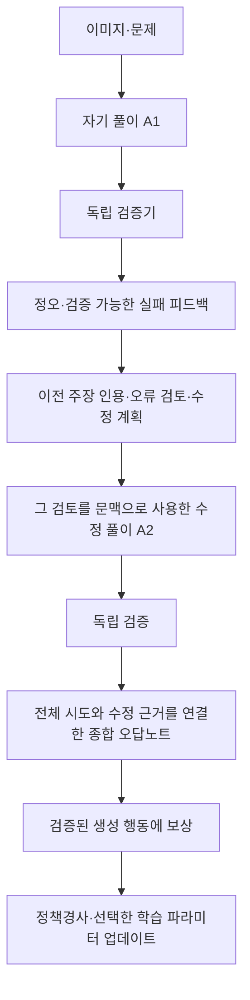

# 오답노트형 자기수정의 학습 방법과 공개 코드 검토

작성: 2026-10-26 KST · 내부 연구 문서 · 논문 원문·저자 저장소 조사

## 1. 현재 구현에서 확인한 것과 사용자가 원하는 것

사용자가 원하는 행동은 `문제 풀이 → 실패 확인 → 이전 풀이의 잘못된 주장·적용 과정을 되짚기 → 수정 근거를 써서 다시 풀기 → 여러 시도를 종합한 오답노트 → 해당 경험으로 가중치 학습`이다. 단순히 오류 항목에 표시하거나 마지막 답을 맞히는 것만으로 이 행동 전체를 입증하지 못한다.

현재 구현은 이전 풀이를 보존하여 재시도하고, 성공한 재시도를 포함한 전체 이력으로 노트를 생성한다. 따라서 이전 풀이를 전혀 보지 않는 시스템은 아니다. 다만 최신 실제 검증의 성공 범위는 더 좁다.

| 항목 | 최신 확인 범위 |
|---|---|
| 실제 pretrained Qwen3-VL-4B의 풀이·재시도·전체 이력 전달 | 확인 |
| 독립 검증된 노트 판정의 RL 기울기 기여 | 오류/미확정 판정 40토큰에서 확인 |
| 실제 optimizer 업데이트·저장·새 프로세스 재로딩 | 확인 |
| 정확한 전체 오답노트 | 0/4 |
| 이전 오류와 이후 수정의 연결을 학습 | 각 노트의 수정 관계가 모두 null로 미검증 |
| 최신 Vision 동결 경로 | 미검증; 최신 실제 성공은 Vision 포함 경로 |

근거: [프로젝트 최신 상태](../docs/PROJECT_STATUS.md), [실제 학습·재로딩 종료 원장](/home/jang2/mmdl-artifacts/notebook-rl-local-nf4-20261021/whole-assessment-unit-normalized-v58/functional-training-reload-closure-main-v1.json). 전체 업데이트에는 정답 보상도 포함되어 노트만의 최종 가중치 효과를 분리한 것은 아니다. NF4 기반 가중치는 동결이고 어댑터·Merger를 갱신했으며 전체 파라미터 학습은 아니다.

현재 기능 시험에서 성능 상승은 필수 조건이 아니다. 다만 **가중치가 변경됐다는 기능 증거**와 **실패 원인·수정 관계라는 원하는 행동에 학습 신호가 연결됐다는 증거**는 구분해야 한다. 후자의 공백을 단순히 점수 상승이 없다는 문제로 바꾸어 설명하면 안 된다.

## 2. 직접 관련된 논문과 코드

### Reflexion: 오답노트의 사용 방식에 가까우나 가중치 학습은 없음

실패 피드백을 바탕으로 반성문을 만들고 episodic memory에 보관하여 다음 시도의 문맥으로 사용한다. 논문의 verbal reinforcement learning은 여기서 정책경사로 모델 가중치를 업데이트한다는 뜻이 아니다. 실패 경험을 재사용하는 흐름의 참고자료로 적합하다.

- [논문 — Reflexion: Language Agents with Verbal Reinforcement Learning](https://arxiv.org/abs/2303.11366)
- [저자 공식 코드](https://github.com/noahshinn/reflexion): 이전 시도만 제공, 반성문만 제공, 둘 다 제공하는 전략이 구분되어 있다. 공개 실행 예제는 상용 API를 이용하므로 현재 로컬 Qwen에 바로 연결되는 학습 코드는 아니다.

### SCoRe: 추가 SFT 없이 실제 자기수정 능력을 학습하는 핵심 참고자료

자기 첫 풀이와 수정 풀이를 생성하고 두 단계의 온라인 정책경사 RL로 학습한다. Stage I은 첫 시도 분포를 KL로 제한하면서 두 번째 시도의 보상을 개선하고, Stage II는 두 시도를 함께 최적화하며 정오 변화에 따른 보상을 추가한다. 초기화를 추가 SFT로 수행하지 않는다. 실험은 Gemini의 수학·코딩 문제이며, 별도로 검증된 종합 오답노트나 Qwen의 시각 오류 설명을 입증한 연구는 아니다.

- [논문 §5, Appendix C](https://arxiv.org/html/2409.12917v2)
- 저자 제공 구현은 이번 조사에서 확인하지 못했다.
- [BY571/SCoRe](https://github.com/BY571/SCoRe)는 **제3자 구현**이다. 원 논문의 공식 코드로 인용하지 않는다. 저장소가 설명하는 LoRA 및 보상 관련 변형까지 동일 알고리즘으로 간주하면 안 된다.

### S²R: 검증·수정을 명시적으로 학습하지만 SFT·교사 데이터가 포함됨

실패 풀이, 검증, 수정 풀이를 연결한다. 그러나 최초 행동 초기화는 검증 문장과 마지막 정답 풀이에 대한 masked SFT다. Appendix A.1에는 GPT 기반 검증 생성·재서술도 명시되어 있다. 이후 RL을 수행하더라도 전체 절차는 사용자의 추가 SFT·교사 모방 금지 조건에 맞지 않는다.

- [논문 §2.2–2.3, Appendix A.1](https://arxiv.org/html/2502.12853v1)
- [저자 공식 코드](https://github.com/NineAbyss/S2R)
- [RL 시작 모델 설정](https://github.com/NineAbyss/S2R/blob/main/scripts/train_rl.sh#L50): policy와 reference가 SFT 이후 모델을 가리킨다.

### RISE: 자기 실패를 활용하지만 학습 손실은 보상 가중 지도 회귀

자신의 실패 이력에 교사 또는 best-of-N 자기 생성으로 얻은 개선 응답을 연결하고, 보상으로 가중한 지도 손실을 사용한다. 외부 교사를 없앤 self-distillation 조건도 토큰 모방 손실까지 없앤 것은 아니다. 이력 수집 구조는 참고할 수 있지만 현재 금지 조건에서 원래 학습기를 그대로 사용할 수 없다.

- [논문 — Recursive Introspection: Teaching Language Model Agents How to Self-Improve](https://arxiv.org/html/2407.18219v2)
- [저자 공식 코드](https://github.com/cmu-mind/RISE)
- [실제 compute_loss](https://github.com/cmu-mind/RISE/blob/main/FastChat/fastchat/train/train.py#L44): 모델의 supervised loss에 reward_weights를 적용한다.

### VRRL: 시각 자기수정 및 Qwen3-VL-4B 공개 구현이라는 직접적인 관련성

시각 피드백으로 답을 수정하고 종료 여부를 결정하도록 학습한다. RL에서는 일부 궤적 접두부의 직접 학습 신호를 마스킹하고 실패 이력을 다시 제공하여 회복 행동을 학습한다. 다만 Stage 1은 SFT이며, 공간 탐색의 Multi-SFT는 상위 모델의 수정 풀이를 증류한다. 정확한 자유 서술 오답노트를 독립적으로 인증하는 방식도 아니다.

- [논문 §3, Appendix D](https://arxiv.org/html/2607.02490v1)
- [저자 공식 코드](https://github.com/fc2869/VRRL)
- [공식 실행 안내](https://raw.githubusercontent.com/fc2869/VRRL/main/README.md): Qwen3-VL-4B Multi-SFT 및 VRRL 체크포인트와 4GPU 학습 스크립트가 있다. RL은 Multi-SFT 모델에서 시작한다. 공개 구현은 공간 탐색 중심이며 grounding 학습 스크립트와 SFT 설정에는 미공개 항목이 남아 있다.

따라서 “우리와 같은 모델용 코드가 있다”는 사실과 “우리 조건을 지키며 그대로 재현할 수 있다”는 결론을 구별한다. SFT 부분을 빼고 원본 Instruct에서 시작하는 것은 새 변형 실험이다.

### VL-Rethinker: 자기 생성이라도 SFT가 될 수 있다는 중요한 사례

초기 응답 뒤에 재검토 지시를 붙여 같은 모델이 검증·수정·재질문하도록 한다. 그러나 성공한 재검토 궤적에 추가 SFT 손실을 적용한다고 §3.3에 명시한다. 외부 교사 증류를 하지 않는다는 주장과 SFT를 하지 않는다는 주장은 다르다.

- [논문 §3.3](https://arxiv.org/html/2504.08837v3)
- [저자 공식 코드](https://github.com/TIGER-AI-Lab/VL-Rethinker)

### 함께 구분할 연구

| 연구 | 실제 성격 | 현재 조건에서의 의미 |
|---|---|---|
| [Self-Refine 논문](https://arxiv.org/abs/2303.17651) · [공식 코드](https://github.com/madaan/self-refine) | 동일 모델의 생성→피드백→수정. 추가 학습 없이 추론 시 수행 | 자기검토 호출 구조 참고; 파인튜닝의 대체는 아님 |
| [STaR 논문](https://arxiv.org/abs/2203.14465) · [공식 코드](https://github.com/ezelikman/STaR) | 성공한 자기 풀이를 선별하여 지도 미세조정. 실패 시 정답을 제공해 풀이를 다시 만드는 단계도 있음 | 스스로 만든 풀이여도 SFT이므로 원안 적용 제외 |
| [Vision-SR1 논문](https://arxiv.org/html/2508.19652v1) · [공식 코드](https://github.com/zli12321/Vision-SR1) | 시각 설명의 유용성을 후속 답변으로 평가하지만 cold-start SFT 후 RL | 순수 RL 오답노트 구현으로 소개하지 않음 |
| [R3V 논문](https://arxiv.org/html/2411.00855v1) · [공식 코드](https://github.com/njucckevin/MM-Self-Improve) | 자기 생성 rationale의 선택·수정을 지도 손실로 학습 | 자기개선이라는 명칭만으로 SFT 금지를 통과하지 않음 |

이 목록은 관련성이 높은 원문과 코드의 표적 조사 결과이며 모든 관련 연구를 망라한 것은 아니다. 논문에서 일부 아이디어를 차용하는 것과 그 논문의 전체 학습 절차·성능을 재현하는 것은 별개다.

## 3. 이것을 자기지도학습이라고 부를 수 있는가

**오답노트를 모델이 직접 작성한다는 사실만으로 자기지도학습이 되는 것은 아니다.** 데이터 생성 주체, 피드백 출처, 가중치를 바꾸는 목적함수를 함께 봐야 한다.

| 실제 수행 방식 | 정확한 설명 |
|---|---|
| 노트를 다음 프롬프트에 넣기만 함 | 추론 시 자기성찰·문맥 기반 적응. 가중치 파인튜닝 없음 |
| 자신이 만든 성공 풀이·노트를 정답 문장으로 놓고 모방 | 자기학습/self-training을 이용한 SFT 또는 자기증류 |
| 가려진 단어·이미지 일부를 원래 데이터에서 복원 | 전형적인 자기지도학습/SSL |
| 자기 풀이·노트의 검증 결과를 보상으로 정책경사 업데이트 | 자기수정 강화학습; 검증 가능 보상을 쓰면 RLVR |

SSL은 보통 원래 데이터의 관측 가능한 부분과 숨긴 부분 사이에서 학습 신호를 구성한다. 이 정의는 “모델이 자기 출력을 만든다”보다 구체적이다. [Meta FAIR의 자기지도학습 설명](https://ai.meta.com/blog/self-supervised-learning-the-dark-matter-of-intelligence/)

우리 프로젝트에 적절한 명칭은 **“자기 생성 풀이·오답노트를 활용한 검증 보상 기반 자기수정 강화학습”**이다. 실제 최신 성공 범위를 엄밀히 표현하면 **“검증된 노트 판정에 RL 학습 신호를 연결한 기능 검증”**이다. 정확한 종합노트와 수정 관계까지 학습했다고 확장하지 않는다.

정답표나 프로그램 검증기로 보상을 계산하므로 감독 신호 자체가 없는 학습도 아니다. 추가 SFT를 하지 않는다는 것은 정답 풀이 문장을 목표로 모방 학습하지 않는다는 뜻이다. 이미 배포된 Instruct 모델의 과거 학습 방식과 이번 프로젝트가 추가로 수행하는 학습 방식을 구분한다.

## 4. 우리에게 맞는 방향: 노트 작성과 실제 수정의 연결

아래는 논문 조사에 근거한 **설계 제안**이며 이번에 구현·실행한 변경은 아니다. SCoRe의 다중 시도 RL과 Reflexion의 실패 경험 활용을 참고하되, 그림 근거와 오류 관계의 독립 검증을 추가하는 방향이다. 어느 한 논문의 재현이라고 명명하지 않는다.

현재 재시도에도 오류 검토 지시는 있다. 추가로 확인해야 하는 것은 지시문의 존재가 아니라 **실제 검토 문장→수정한 주장→후속 풀이**의 연결이다. 마지막에 작성한 노트가 앞선 재시도를 일으킨 것처럼 시간 순서를 거꾸로 해석하면 안 된다.

오답노트의 내용은 다음과 같이 연결되어야 한다. 예시는 데이터셋에서 가져온 실제 결과가 아닌 설명용이다.

> 시도 1의 “B→A로 이동한다”는 문장을 근거로 선택했다. 그림의 화살표는 A→B이므로 해당 이동은 허용되지 않는다. 시도 2에서는 B→A 이동을 제거하고 도달 가능한 노드를 다시 계산했다. 다음에는 관측한 방향과 탐색에 사용한 방향이 같은지 확인한다.

이 정도의 설명에서는 오류 지점, 실제 이미지 사실, 사용한 규칙, 수정 행동을 각각 확인할 수 있다. 반면 “비전이 틀렸으므로 Vision을 학습한다”는 문장은 충분하지 않다. 모델이 A→B를 정확히 관측하고도 계산에서 B→A를 사용했다면 관측과 활용을 구분해야 한다. 이를 내부 Vision Encoder나 Merger의 유일한 책임으로 판정하지 않는다.

### 학습에서 유지할 경계

1. 정답·검증 메타데이터는 검증기에 둔다. 풀이 모델이 틀린 답을 제출한 후 올바른 답 자체를 받는 절차와, 정오 피드백만 받는 절차를 섞지 않는다.
2. 비판문·수정 풀이·노트는 모델이 생성한다. 사람이 정답 노트를 대신 채워 넣거나 상위 모델의 노트를 SFT 목표로 만들지 않는다.
3. 정답 회복과 설명 정확성을 따로 평가한다. 우연히 답을 맞혔다는 이유로 앞선 모든 풀이·노트에 정답 인증을 부여하지 않는다.
4. 검증 불가능한 자유 서술의 인과 설명에는 정확성 보상을 주었다고 주장하지 않는다. 프로그램으로 확인되는 사실·연산·참조 관계부터 다룬다.
5. 사후 노트만 별도로 보상하면 노트 판정 능력을 학습할 수는 있지만, 그 노트가 문제 해결을 개선했다는 증거는 아니다. 재풀이에 실제 사용되었는지를 별도로 기록한다.
6. 정책경사는 생성 행동의 확률을 보상에 따라 바꾼다. 잘못된 이전 풀이를 문맥으로 제공하는 것과 그 잘못된 문장을 모방 목표로 학습하는 것을 구분한다.
7. 수정 성공만 보상하여 첫 시도의 고의적 오답을 유리하게 만들지 않는다. 첫 시도 정답과 정답 유지도 포함한 목적함수, 이미 틀린 동일 이력에서의 수정 비교가 필요하다. 정확한 가중치는 아직 확정하지 않는다.

### 가장 작은 후속 기능 검증

기존 입력 격리, 전체 이력 저장, 검증기, 정책경사, 체크포인트·재로딩 코드를 재사용한다. 저장소를 새 RL 프레임워크로 옮기는 것이 첫 단계일 필요는 없다.

- 짧고 검증 가능한 실패 이력에서 모델이 오류 주장과 수정 행동을 실제 생성하는지 확인한다.
- 그 원문이 후속 수정 입력에 들어갔는지, 무엇이 달라졌는지 기록한다.
- **그 오류·수정 관계의 실제 생성 토큰**에 보상 계수가 생기고, 기존 정오 보상·KL과 구분되는 기울기 기여가 있는지 확인한다.
- 해당 경로의 실제 업데이트·저장·새 재로딩을 확인한다. 최신 Vision 동결 경로도 별도 기능 확인한다.

이 단계의 합격에 MMMU 점수 상승을 요구하지 않는다. 기능이 연결된 다음에 노트 제공/미제공 조건, 새 문제 첫 시도, 오답→정답과 정답→오답, 계산량을 비교해야 학습 효과를 논할 수 있다. 기존 V8 558/900 및 과거 원문은 별도 baseline으로 보존한다.

## 5. 인용과 적용 판단

발표에서는 Reflexion을 **실패 경험을 반성문으로 재사용하는 선행연구**, SCoRe를 **추가 SFT 없이 다중 시도 자기수정을 학습하는 선행연구**, VRRL을 **시각 피드백을 이용한 수정 행동 학습 및 같은 계열 모델의 구현 사례**로 인용할 수 있다. VRRL·S²R·RISE·VL-Rethinker의 SFT 의존성은 함께 밝힌다.

우리의 전체 제안을 “이미 논문에서 효과가 검증된 오답노트 파인튜닝”이라고 소개하면 안 된다. 문헌은 부품의 가능성을 뒷받침하지만, 정확한 종합노트·모듈 라우팅·Qwen3-VL-4B NF4 학습을 합친 현재 방식의 효과를 대신 검증하지 않는다.

이번 작업은 논문·공개 코드 및 기존 로컬 상태를 읽고 이 문서를 저장한 조사다. 학습 코드 수정, GPU 실행, 모델 취득, 데이터 비중복 전수검사, GitHub 게시는 수행하지 않았다. 각 저장소의 실제 설치·실행과 현재 로컬 파이프라인 호환성은 미검증이다.
