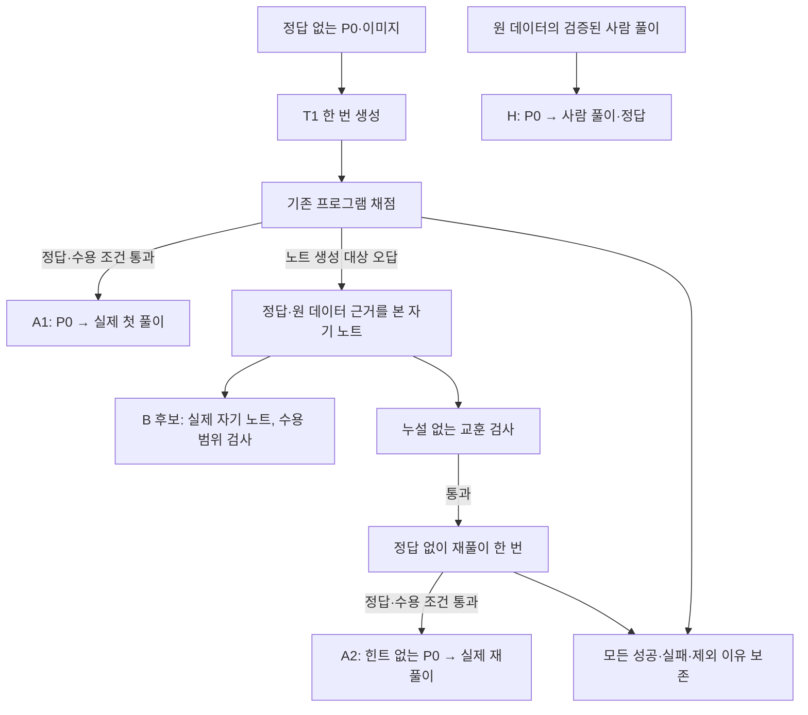

# Qwen3-VL-4B 오답노트형 자기주도학습 v1–v13 심층 재검토와 V8 65·67점 개선 연구

작성일: 2026-11-13, Asia/Seoul.
대상 저장소: `/mnt/c/projects/multimodel`의 내부 실험 작업공간.
대상 모델: `Qwen/Qwen3-VL-4B-Instruct`의 과제 지정 revision.
목적: 실패 원인과 개선 후보를 근거 수준별로 구분하고 다음 실험의 판정 기준을 제안한다.
산출물: 이 Markdown 문서 한 개.
이번 작업에서 새 GPU 학습, 새 MMMU 생성 평가, 유료 API 호출은 하지 않았다.
교수님 제출용 `MMDL/`, V8 파서, 제출 점수 558/900은 변경하지 않았다.
이 문서의 제안은 연구 설계이며 실행 성공 보고가 아니다.

<details>
<summary>목차: 결과 → 구현 → 데이터 → 문헌 → 개선 설계</summary>

- [1. 먼저 답할 결론](#1-먼저-답할-결론)
- [2. 읽는 방법과 근거 등급](#2-읽는-방법과-근거-등급)
- [3. 목표 점수를 먼저 정확히 정의한다](#3-목표-점수를-먼저-정확히-정의한다)
- [4. 공식 67.4와 우리 V8 62.0은 같은 측정이 아니다](#4-공식-674와-우리-v8-620은-같은-측정이-아니다)
- [5. 프로젝트 규칙과 후보 방법의 경계](#5-프로젝트-규칙과-후보-방법의-경계)
- [6. v1–v13 실행 이력과 저장 평가의 전수 재검산](#6-v1v13-실행-이력과-저장-평가의-전수-재검산)
- [7. 손실·기울기·프롬프트·학습 경로의 코드 감사](#7-손실기울기프롬프트학습-경로의-코드-감사)
- [8. 실제 학습 문항·참고 정보·노트 품질의 감사](#8-실제-학습-문항참고-정보노트-품질의-감사)
- [9. 관련 논문 20편: 실제 방법과 프로젝트 적합성](#9-관련-논문-20편-실제-방법과-프로젝트-적합성)
- [10. 학습 자료 후보를 원 출처까지 확인한 결과](#10-학습-자료-후보를-원-출처까지-확인한-결과)
- [11. 근본 원인 후보의 우선순위와 반증 방법](#11-근본-원인-후보의-우선순위와-반증-방법)
- [12. 권장 실험안: 근거 중심 자기 오답노트 SFT](#12-권장-실험안-근거-중심-자기-오답노트-sft)
- [13. RL을 유지한다면 바꿀 우선순위](#13-rl을-유지한다면-바꿀-우선순위)
- [14. 65·67점을 목표로 하는 최소 인과 실험](#14-6567점을-목표로-하는-최소-인과-실험)
- [15. 코드 변경으로 이어질 경우의 최소 범위](#15-코드-변경으로-이어질-경우의-최소-범위)
- [16. 비용·시간·데이터 효율](#16-비용시간데이터-효율)
- [17. 지금 단계에서의 구체적 결정 제안](#17-지금-단계에서의-구체적-결정-제안)
- [18. 보고서의 한계와 재현 범위](#18-보고서의-한계와-재현-범위)

</details>

## 1. 먼저 답할 결론

**현재 가장 설득력 있는 문제는 역전파가 작동하지 않는 것이 아니라, 오답을 고칠 믿을 만한 정보가 학습 목표로 충분히 전달되지 않는 것이다.**
기존 파이프라인은 실제 생성·갱신·저장·재로딩까지 수행했다.
하지만 이 사실만으로 새로운 문항의 지각·지식·추론 능력이 좋아졌다고 할 수 없다.
현재 기록에서는 답을 끝내는 행동 변화가 내용 정확도 변화보다 훨씬 뚜렷하다.
이 관찰을 모든 자기개선 학습의 불가능성으로 확대해서도 안 된다.

권장 방향은 **사람이 작성한 문제별 풀이와 검증 가능한 시각·연산 근거를 중심으로 한 단일 응답 SFT를 먼저 분리해 검증하고, 자기 노트가 추가로 도움이 되는지 대조하는 것**이다.
노트는 계속 모델 자신이 쓴다.
상위 모델이 풀이를 대신 쓰거나 고쳐 주는 과정은 넣지 않는다.
정답을 본 모델의 사후 설명을 정답 없는 첫 풀이의 모범답안으로 되돌리지 않는다.
정답 없이 교훈만 보고 다시 푸는 횟수는 허용된 한 번을 유지한다.
MMMU 평가 입력은 그대로 P0이며 노트·정답·검색·도구를 넣지 않는다.

RL을 함께 쓸 경우에도 정답·형식·길이 보상을 풀이 전체 또는 고정 구간의 토큰에 연결하는 현재 신호가 충분한지부터 검증해야 한다.
특히 `Wait` 위치나 답 길이는 오류 위치의 정답 라벨이 아니다.
논문에서 사용하는 GRPO·RLOO·다수 후보 필터링을 그대로 가져오면 현재 단일 답 규칙과 충돌하는 경우가 많다.
새 알고리즘 이름을 붙이는 일보다 정보의 출처, 손실의 입력, 오류에 대한 신호의 정확도가 우선이다.

**65·67점 달성 방법이 이미 입증되었다고 말할 수는 없다.**
반대로 기존 문서의 “최대 약 576점”, “65점 달성 확률 1% 미만”, “규칙 안에서 도달 불가”도 실험으로 확정된 상한은 아니다.
R2와 B2의 이미지 조건 차이, B2와 v13의 실행 동시 처리 수 차이, 잘림 집단의 분모 차이, 여러 변경을 함께 적용한 실험이 섞여 있기 때문이다.
따라서 이번 결론은 “불가능”도 “다음 판이면 성공”도 아니다.
검증 가능한 개선 경로는 남아 있지만, 새 정보와 적절한 대조군 없이 같은 형태를 더 오래 돌릴 근거는 약하다.

## 2. 읽는 방법과 근거 등급

문서의 사실·해석·제안은 다음 표기로 구분한다.

| 표기 | 의미 | 허용되는 주장 |
| --- | --- | --- |
| `[재계산]` | 보존된 행·평가 결과를 이번 작업에서 직접 집계 | 해당 파일과 분모에서 실제 나온 수치 |
| `[코드확인]` | 함수·호출자·설정에서 확인 | 구현된 계산과 조건 |
| `[기록]` | 과거 문서나 실행 receipt에 남아 있음 | 당시 보고 내용; 이번 재실행과 구별 |
| `[문헌]` | 논문·저자 페이지·공식 코드에서 확인 | 그 연구의 조건에서 보고된 방법과 결과 |
| `[해석]` | 둘 이상의 관찰로 지지되지만 요인 분리가 안 됨 | 우선 검증할 설명 |
| `[제안]` | 실행하지 않은 변경·실험 설계 | 기대할 작동 원리와 기각 조건 |
| `[미확인]` | 원문·로그·통계가 부족 | 확인 전 단정하지 않음 |

신뢰도 “높음”은 파일·코드·산술이 서로 맞는 경우다.
신뢰도 “중간”은 관찰과 설명은 맞지만 대조 실험이 없는 경우다.
신뢰도 “낮음”은 타 모델·타 과제의 논문을 현재 과제로 옮기는 기대다.
이 등급은 65점 달성 확률을 숫자로 추정한 것이 아니다.
AI가 노트 내용을 검토한 결과는 전부 `human_verified=false`다.
데이터셋의 원래 사람 작성 라벨과 이번 AI 검토를 서로 혼동하지 않는다.

### 2.1 이번에 구분해야 하는 세 가지 질문

첫째, 파이프라인이 실제로 가중치를 바꾸었는가.
둘째, 바뀐 가중치가 올바른 교정 내용을 학습했는가.
셋째, 그 교정이 새로운 문제의 정답 없는 첫 풀이로 전이되었는가.
첫 질문의 PASS가 두 번째와 세 번째 질문의 PASS를 뜻하지 않는다.
수백 개 CPU 시험은 계약·마스킹·저장·호출 경로의 신뢰성을 높인다.
그 시험이 자연어 풀이의 사실성이나 MMMU 향상을 증명하지는 않는다.
노트의 문법 통과도 내용의 정확성 인증이 아니다.
학습 손실 감소도 독립 평가 정확도 상승을 보장하지 않는다.

### 2.2 “모두 분석”의 범위

과거 v1–v13의 설계·실행 결과·전환 이유를 연결해 검토한다.
이전 `notebook_rl`의 V1–V59는 현재 SINGLE 버전 번호와 다른 계보다.
실행 없이 계획·CPU 검사만 있었던 판은 실제 학습 결과로 세지 않는다.
부분 평가인 v9는 완료된 900문항 평가와 별도다.
완료된 평가의 집계와 최신 세 실행의 학습 행은 원문 파일 단위로 확인한다.
모든 체크포인트를 GPU에 다시 올려 과거 실험을 재현하지는 않았다.
전체 노트의 모든 자연어 주장을 사람이 검증한 것도 아니다.
이 범위 제한은 결과 해석에 직접 반영한다.

## 3. 목표 점수를 먼저 정확히 정의한다

900문항에서 한 문항은 약 0.1111%p다.
사용자의 “넘는다”와 과거 계획의 “이상”은 정수 문항 기준으로 다르다.

| 목표 | 필요한 최소 정답 | B2 558 대비 순증 | v13 555 대비 순증 |
| --- | ---: | ---: | ---: |
| 65% 이상 | 585 | 27 | 30 |
| 65% 초과 | 586 | 28 | 31 |
| 67% 이상 | 603 | 45 | 48 |
| 67% 초과 | 604 | 46 | 49 |
| 67.4% 이상 | 607 | 49 | 52 |

이 문서에서 엄격한 성공 목표는 65% 초과=586, 67% 초과=604로 쓴다.
공식 비교값 67.4를 같은 숫자로 넘기려면 607/900이 필요하다.
“공식 67점”을 603, 604, 607 중 어떤 것으로 썼는지 반드시 함께 적어야 한다.
과거 v13 계획은 585 이상을 목표로 등록했다.
새 정의를 과거 판정에 소급 적용하지 않는다.

### 3.1 새 정답과 기존 정답 보존을 함께 계산해야 한다

기준 B2에서 틀린 문제를 새로 맞힌 수를 `G`, 맞았던 문제를 잃은 수를 `L`이라고 하자.
새 점수는 `558 + G - L`이다.
v13은 `G=61`, `L=64`라서 `555`가 되었다.
새로 맞힌 61개만 제시하면 학습 효과를 크게 과장한다.
잃은 64개만 제시해 모든 변화가 손해라고 말해도 잘못이다.

| 기존 정답 손실 L | 65% 초과에 필요한 G | 67% 초과에 필요한 G | 67.4% 이상에 필요한 G |
| ---: | ---: | ---: | ---: |
| 0 | 28 | 46 | 49 |
| 10 | 38 | 56 | 59 |
| 20 | 48 | 66 | 69 |
| 40 | 68 | 86 | 89 |
| 64 | 92 | 110 | 113 |

이 표는 예상치가 아니라 목표를 만족하는 산술 조건이다.
v13의 새 정답 61개가 그대로 유지된다고 가정하면 65% 초과에는 손실을 33개 이하로 줄여야 한다.
같은 가정에서 67% 초과에는 손실을 15개 이하로 줄여야 한다.
그러나 모델을 바꾸면 G와 L이 함께 바뀐다.
기존 실행의 좋은 문항만 골라 조합하는 방법은 금지되어 있으며 이 표도 그런 방법을 제안하지 않는다.
실제 개선 목표는 “새 교정량 증가”와 “기존 지식·풀이 보존”의 동시 달성이다.

### 3.2 한 번의 점수와 일반적인 개선 증거

v13 대 B2의 짝지은 정오 변화는 +61/−64다.
정확 이항형 McNemar 검정의 양측 p값은 약 0.85812다.
차이 −0.3333%p의 정규 근사 95% 구간은 약 −2.7681~+2.1014%p다.
이 구간은 문항의 표본 변동을 가정한 기술적 구간이다.
동일 모델을 여러 번 실행한 seed·GPU·동시 처리 변동의 실측 구간이 아니다.
유의하지 않다는 결과는 “두 모델이 같다”는 동등성 증명이 아니다.
현재 자료로 유의한 개선을 입증하지 못했다는 뜻이다.
동등성을 주장하려면 허용 차이를 미리 정한 별도 설계가 필요하다.

### 3.3 실험을 많이 한 뒤의 해석

여러 버전을 보고 가장 높은 점수만 강조하면 선택 편향이 생긴다.
MMMU validation을 수차례 분석한 사실 자체를 감출 수 없다.
학습 원문으로 넣지 않았다는 데이터 오염 방지와, 평가 결과를 보고 설계를 바꾸는 적응적 과적합은 다른 문제다.
앞으로는 외부 개발 자료에서 방법을 정하고 MMMU에는 봉인된 최종 모델 한 개만 가져간다.
새 실험의 대조 조건을 MMMU 점수에 따라 변경하지 않는다.
현재 결과에 맞춘 과목별 표본 교체도 하지 않는다.
과거 실행들의 문항별 최고 답을 합친 값은 진단용 oracle 상한일 뿐 보고 점수가 아니다.

## 4. 공식 67.4와 우리 V8 62.0은 같은 측정이 아니다

Qwen 공식 MMMU 실행 예시는 P0 계열 입력, sampling, 별도 judge 기반 추출 경로를 제공한다.
고정한 공식 저장소의 `eval_utils.py`는 규칙 추출 실패 후 judge를 호출한다.
judge 재시도 후에도 실패하면 선택지 목록에 `Z`를 더한 집합에서 임의로 고르는 경로가 있다.
우리 V8의 파싱 실패=오답과 그대로 같지 않다.
근거: [Qwen MMMU README, 고정 commit](https://github.com/QwenLM/Qwen3-VL/blob/96588727e44c78b25ba03ea03b8e12f7e64fd0da/evaluation/mmmu/README.md), [공식 추출 코드](https://github.com/QwenLM/Qwen3-VL/blob/96588727e44c78b25ba03ea03b8e12f7e64fd0da/evaluation/mmmu/eval_utils.py).

하지만 이것만으로 공식 점수와 우리 점수의 차이 중 정확히 2.6%p가 채점기 때문이라고 할 수 없다.
같은 원응답에 두 평가기를 완전히 적용한 통제 결과와 공식 원응답이 없기 때문이다.
“V8 미파싱 문항마다 1/K의 정답 기대값을 더한다”는 산술은 실제 공식 judge 흐름을 재현한 것이 아니다.
judge가 어떤 답을 추출할지, `Z`가 선택될지, 원래 생성된 답이 무엇인지를 생략한다.
따라서 +23.7개 같은 값은 가정 계산으로만 표시해야 한다.
공식 67.4를 “우리 원본이 V8로 반드시 낼 수 있는 점수”라고 부르는 것도 부정확하다.
목표 607은 유효한 목표지만, 공개 점수만으로 도달 가능성이나 비용을 보증할 수 없다.

Qwen 기술 보고서는 SFT·증류·RL을 포함한 큰 학습 체계를 설명한다.
현재 과제는 그중 상위 모델 증류를 다시 수행할 수 없다.
따라서 보고서의 전체 recipe를 그대로 재현한다는 접근은 규칙에 맞지 않는다.
근거: [Qwen3-VL Technical Report](https://arxiv.org/html/2511.21631v2).

### 4.1 앞으로도 바꾸지 않을 평가 조건

모델의 기반 revision과 processor/tokenizer/chat template를 유지한다.
P0, 보기 순서, 이미지 참조 순서를 유지한다.
V8 파서와 무작위 fallback 없음 규칙을 유지한다.
최종 과제 비교는 B2의 32K 출력·공식 이미지 범위를 명시한다.
학습 중의 8K 생성 제한과 최종 B2 평가 제한을 혼동하지 않는다.
master seed 3407과 샘플별 seed 식을 유지한다.
각 문항은 한 번 생성한 답 하나로 채점한다.
같은 seed를 썼어도 백엔드·GPU·배치가 다르면 같은 난수 소비를 보장하지는 않는다.
새 결과의 환경과 동시 처리 수는 비교 한계로 공개한다.
파서를 느슨하게 바꿔 점수를 올리는 방법은 개선 후보에 포함하지 않는다.

## 5. 프로젝트 규칙과 후보 방법의 경계

최신 명시 지시와 기존 금지 사항을 함께 적용한다.
“RL이 안 되면 SFT”라는 요청은 새로운 손실 후보를 조사할 근거다.
새 GPU 실행·과제 평가·학습 데이터 예외까지 자동 승인한 것은 아니다.
현재 보고서는 허용 범위에서 준비할 방법과 별도 결정이 필요한 확장을 구분한다.

| 항목 | 이번 연구의 처리 |
| --- | --- |
| 상위 모델이 작성한 풀이·teacher rationale | 학습 금지 |
| 동일 Qwen이 정답을 보고 쓴 자기 노트 | 허용된 노트 단계에서 사용 |
| 정답을 본 뒤 만든 수정 풀이를 A로 학습 | v2 이후 금지 유지 |
| 데이터셋이 제공한 사람 작성 풀이 | 2026-11-11 허용; 출처 검증 필요 |
| 정답 없이 교훈만 보고 한 번 재풀이 | 허용된 A2 경로 유지 |
| 무교훈 재풀이 대조 | 진단 전용; 학습·평가 답 선택에 미사용 |
| best-of-N·다수결·reranker·정답 보고 후보 선택 | 금지 |
| MMMU/Pro의 모든 split·파생물 학습 | 금지 |
| 오염 경고를 무시하거나 임계값 완화 | 금지 |
| 사람이 쓴 기존 데이터의 원래 train split | 검증·동결 후 후보 가능 |
| HF 자동 생성 train 이름을 저자 승인으로 간주 | 금지; 의미·권한·분할을 따로 확인 |
| 과거 품질 차단 출처를 새 표본으로 재승인 | 기존 차단을 유지 |
| 임의 합성 문제로 대학 과목 빈칸 채우기 | 기존 데이터셋 우선 정책과 충돌 가능; 기본안에서 제외 |
| self-distillation을 몰래 다시 도입 | 과거 미사용 결정 유지; 별도 결정 없이는 기본안 제외 |
| RL+SFT 계수·학습 순서·중단 기준 변경 | 새 protocol·고정 계획으로 제안 |
| 토큰·해상도·정밀도 자동 축소 | 하지 않음 |
| 새 RunPod 및 900문항 평가 | 사용자 실행 지시 이후만 가능 |

### 5.1 “문제를 낭비하지 않는다”의 정확한 뜻

모든 문항의 생성·채점·노트·재풀이 결과와 제외 사유를 보존한다는 뜻은 달성할 수 있다.
모든 문항에서 정답을 고칠 유효한 기울기를 얻는다는 뜻은 보장할 수 없다.
정답만 있고 설명이 없는 어려운 문제에서 모델이 그럴듯한 거짓 노트를 쓰면 정보가 새로 생기지 않는다.
그 노트를 강제로 SFT에 넣으면 학습 행 수는 늘지만 오류도 학습할 수 있다.
KL이나 첫 토큰 보존만 적용된 문항을 “오답을 배운 문항”으로 세지 않는다.
무손실 보존과 무조건 학습을 구분하는 것이 이번 제안의 출발점이다.

### 5.2 강제로 전부 학습시키는 대안의 위험

오답 전체 음의 보상은 무엇이 틀렸는지 알려 주지 않는다.
정답만 짧게 붙이는 SFT는 기존 답 길이 축소 문제를 되풀이할 수 있다.
답을 넣어 만든 모델 설명을 다시 배우는 것은 금지된 수정 풀이 경로를 되살릴 수 있다.
외부 LLM이 노트의 빈칸을 채우는 것도 금지된 튜터 사용이다.
남는 합법적 정보는 사람 작성 풀이, 사람 주석, 허용된 프로그램 검증, 실제 자기 재풀이 성공이다.
그 정보가 없는 행은 실패를 보존하고 별도 원장에 남기는 것이 정직한 처리다.

## 6. v1–v13 실행 이력과 저장 평가의 전수 재검산

### 6.1 실측 감사 범위와 판정 원칙

이 절은 오답노트 v1–v13의 저장 결과를 읽기 전용으로 감사한 결과다.
새 모델 생성·학습·GPU 실행·데이터 다운로드·유료 API는 하지 않았다.
저장 benchmark 질문·정답·응답 원문은 이 절에 옮기지 않았다.
현재 V8 채점기를 저장 원문에 CPU로 재실행했다.
집계 대상 완료 실행 10개는 각각 동일한 MMMU validation ID 900개를 가진다.
10개 실행 전체 9,000개 응답에서 저장 정오와 재채점 정오의 불일치는 0이다.
같은 검사에서 `parse_status` 불일치도 0이다.
같은 검사에서 `parsed_answer` 불일치도 0이다.
따라서 아래 완료 실행 수치는 기존 문서의 숫자를 단순히 전사한 것이 아니다.
재채점 소스는 `src/mmdl/evaluation/final_answer_parser_v8.py`다.
해당 파일 SHA256은 `2beb1230283cb882f47d6e8af72b01180847fd7aa4b7ac640a5173e391f3f891`이다.
검사 스크립트는 `/home/jang2/mmdl-artifacts/research-self-note-v1-v13-20261113/rescore_parity.py`다.
결과 영수증은 `/home/jang2/mmdl-artifacts/research-self-note-v1-v13-20261113/rescore_parity.json`이다.
통계 스크립트는 `/home/jang2/mmdl-artifacts/research-self-note-v1-v13-20261113/results_aggregate.py`다.
통계 출력은 `/home/jang2/mmdl-artifacts/research-self-note-v1-v13-20261113/results_aggregates.json`이다.
이 검사는 이미지·응답을 다시 생성한 재현 실행이 아니다.
기존 checkpoint의 학습 성공·모델 효과와 채점 재실행 성공은 별개다.
아래 exact p는 정오가 바뀐 문항에 대한 양측 exact McNemar 검정이다.
단, 균등 추측 비교에서는 문항별 보기 수를 반영한 Poisson-binomial 단측 꼬리를 사용했다.
여러 버전의 사후 비교이므로 p를 확증 시험의 결과로 제시하지 않는다.

### 6.2 버전 번호는 하나의 연속된 동일 실험을 뜻하지 않는다

초기 오답노트 SFT v1·v2·v3와 SINGLE v1·v2·v3의 이름이 겹친다.
문서에는 이름만 `v3`라고 쓰지 말고 경로·protocol·실행 상태를 함께 쓴다.
초기 v3는 실제 NF4 무갱신 역전파 검증까지 진행됐다.
초기 v3를 학습 완료 모델이나 900문항 평가 모델로 표에 올리면 안 된다.
SINGLE v3는 top-k/top-p 생성 확률 재계산 등을 고친 별도 계열이다.
기각된 다중 응답 RL+SFT v4와 실행된 SINGLE v4도 구분해야 한다.
기각된 v4는 복수 첫 풀이·복수 재풀이에서 답을 골라 쓰는 설계였다.
그 설계는 단일 답 규칙 위반으로 실행하지 않았다.
그 사실을 SINGLE v4의 실제 학습 결과 522/900과 혼동하면 안 된다.
근거: `docs/PROJECT_STATUS.md:642` 및 `claudedocs/analysis_self_note_mmmu_root_causes_20261103.md:984`.

| 계열·버전 | 실제 진행 범위 | MMMU 판정에 사용할 수 있는 결과 |
|---|---|---|
| 초기 SFT v1 300 | 학습·저장·재로딩·오답342 평가 | 전체900 점수 없음 |
| 초기 SFT v1 3,417 | 전체학습·저장·재로딩·8K 900 | 537/900 |
| 초기 SFT v2 | 교훈 재풀이·학습·재로딩·8K 900 | 544/900 |
| 초기 SFT v3 | CPU·실제 NF4 생성·수용·무갱신 backward | 학습 checkpoint·900 점수 없음 |
| SINGLE v1–v3 | 로컬 계약·채점·확률 재생 진단 | 전체900 점수 없음 |
| SINGLE v4 | 300 파일럿 후 slot75에서 정지·8K 900 | 522/900 |
| SINGLE v5 | 0번 묶음 뒤 사용자 중단 | 전체900 점수 없음 |
| SINGLE v6 | 같은64문항 첫 주기 | 전체900 점수 없음 |
| SINGLE v7 | 같은64문항 둘째 주기 | 전체900 점수 없음 |
| SINGLE v8 시험 | 같은64문항 셋째 주기 | 전체900 점수 없음 |
| SINGLE v8 본학습 | slot27 재생 검사 실패로 정지 | 자동 평가 미실행 |
| SINGLE v9 | slot96 학습·B2 622/900에서 예산 종료 | 397/622, 전체 점수 판정 불가 |
| SINGLE v10 | 구현·자료·CPU 준비 | 독립 본학습·900 평가 없음 |
| SINGLE v11 | slot22 잘림 guard 정지 | 900 평가 없음 |
| SINGLE v11b | slot156 형식 guard 정지·8K 900 | 552/900 |
| SINGLE v11c | v11b에서 이어 slot169 guard 정지·8K 900 | 552/900 |
| SINGLE v12 | 70묶음 정상 종료·8K 900 | 522/900 |
| SINGLE v13 | 64묶음 정상 종료·B2 900 | 555/900 |

이 표의 v5·v6·v7·v8·v10·v11에 전체 정확도를 채워 넣는 것은 증거를 만드는 일이다.
v9의 397/622는 완료한 문항만의 정확도다.
v9의 남은278문항에는 오래 걸린 과목과 긴 풀이가 몰렸다.
따라서 397/622를 900개 비율로 외삽하거나 F0 전체558과 비교하지 않는다.
v9의 같은622문항 F0는393이며 기록상 획득35·손실31·순+4다.
이는 전체 개선의 증거가 아니라 미완료 부분집합의 기술 통계다.
`docs/PROJECT_STATUS.md:191`은 그 중도 종료와 선택 편향을 이미 명시한다.
후속 정정에 따르면 v9 학습 고유문항은1,532다.
slot 수96에 일괄16을 곱한1,536은 파일럿 마지막 묶음12개를 반영하지 않은 숫자다.
근거: `docs/PROJECT_STATUS.md:209`–`211`.
v11b도 같은 이유로156×16=2,496이 아니라2,492개의 고유 T1이다.
v11b의 전체 수는 동료의 원시 block 재집계와 결합해 사용한다.
이 감사의 v11b 기존 dynamics cache는 앞64묶음만 포함하므로 전체 학습량의 근거로 사용하지 않았다.

### 6.3 먼저 평가 조건을 분리해야 한다

8K F0는 미학습 모델541/900이다.
기존 제출 B2는 미학습 모델558/900이다.
R2는 미학습 모델554/900이다.
세 실행은 같은 모델 revision이더라도 같은 평가 protocol의 독립 반복이 아니다.
8K는 출력 상한8192와 이미지262144–1310720을 사용한다.
B2는 출력 상한32768과 공식 이미지1003520–4014080을 사용한다.
R2는 출력 상한32768이지만 이미지262144–1310720을 사용한다.
따라서 B2와 R2의 차이에는 이미지 설정과 실행 차이가 함께 들어 있다.
8K와 B2의 차이에는 토큰·이미지·실행 환경 차이가 함께 들어 있다.
같은 master seed도 backend의 실행 궤적과 sampling 결과를 동일하게 만들지 않는다.
F0 8K→B2는 획득74·손실57·순+17이며 exact p=.1619다.
이 값은 순수한 토큰 확대 효과17개를 증명하지 않는다.
B2→R2는 획득57·손실61·순−4이며 exact p=.7826이다.
이 값은 공식 이미지 budget의 효과가 정확히4개라는 인과 추정이 아니다.
R2→v13은 획득61·손실60·순+1이며 exact p=1이다.
이 값도 v13과 R2가 같은 정책·같은 protocol이라는 증거는 아니다.
근거: `AGENTS.md` §6의 baseline 표와 이 감사 집계 JSON의 `pairs`.

#### 6.3.1 v13도 B2와 실행 조건 전체가 같지는 않다

v13은 P0·V8·32K 출력·공식 이미지 범위·sampling·seed를 B2 기준으로 맞췄다.
그러나 실제 `backend.json`의 `max_num_seqs`는 원 B2가 2, v13이 16이다.
v13의 resolved 설정에 있는 `batch_size: 32`는 실제 엔진 동시 처리 수 16과 구별해야 한다.
v13의 `variant_registration.json`은 `slots=16`, `slots_source=auto`를 기록한다.
두 실행 모두 vLLM 0.11.0·문맥 40960·같은 chat-template SHA를 기록한다.
GPU도 기존 B2의 RTX 3090과 v13의 A40으로 다르다.
따라서 본문의 B2 조건군은 주요 입력·생성·채점 설정을 가리키며 실행 환경의 완전한 통제를 뜻하지 않는다.
짝 비교는 보존된 두 출력의 차이를 기술하지만 그 차이를 순수한 학습 인과효과로 분해하지 못한다.
동시 처리 수 때문에 몇 점이 바뀌었는지는 현재 자료에서 측정하지 않았다.
이 차이를 실패의 확정 원인이나 v13의 숨은 개선 증거로 사용하지 않는다.
대조 근거와 두 backend 해시는 비공개 증거 폴더의 `backend_comparison.json`에 보존했다.
후속 최종 평가에서는 비교 기준의 실행 동시 처리 수·GPU 차이도 사전에 고정하거나 차이로 공개해야 한다.

### 6.4 10개 완료 실행의 재검산 성적표

| 실행 | 조건군 | 정답 | 정확도 | 출력 중앙값 | raw 길이한도 | 한도 중 오답 | NO_PARSE |
|---|---|---:|---:|---:|---:|---:|---:|
| F0 | 8K | 541 | 60.11% | 444 | 111 | 109 | 121 |
| 초기 v1 | 8K | 537 | 59.67% | 299.5 | 82 | 81 | 104 |
| 초기 v2 | 8K | 544 | 60.44% | 464.5 | 98 | 92 | 111 |
| SINGLE v4 | 8K | 522 | 58.00% | 315 | 17 | 17 | 98 |
| SINGLE v11b | 8K | 552 | 61.33% | 357 | 70 | 67 | 82 |
| SINGLE v11c | 8K | 552 | 61.33% | 349.5 | 67 | 63 | 86 |
| SINGLE v12 | 8K | 522 | 58.00% | 378.5 | 97 | 95 | 112 |
| SINGLE v13 | B2 | 555 | 61.67% | 405.5 | 27 | 26 | 49 |
| 제출 F0 B2 | B2 | 558 | 62.00% | 449 | 90 | 85 | 97 |
| R2 | 32K·작은 이미지 | 554 | 61.56% | 452 | 75 | 74 | 92 |

raw 한도 종료와 한도 종료 중 오답은 다르다.
V8은 한도 종료여도 유효한 최종답이 있으면 정답으로 채점한다.
따라서 B2의 raw cap90 중5개는 정답이다.
v13의 raw cap27 중1개도 정답이다.
기존 문서의85→26은 raw cap 수가 아니라 오답 cap 수다.
`docs/PROJECT_STATUS.md:423`은85→26을 한도 수로 적지만 이후 분석은90→27을 사용한다.
두 표현을 같은 열에 놓지 말고 정의를 고정해야 한다.
`NO_PARSE`97→49와 “끝난 뒤 미파싱”21→25도 다른 분모다.
전자는 모든900응답의 parser 상태다.
후자는 이미 정답·한도종료 등을 우선 분류한 배타적 오류 분해다.
정답·오답·cap·NO_PARSE를 배타적이라 가정해 무조건 합산하면 중복 또는 누락이 생긴다.

### 6.5 짝 비교는 전체 점수와 획득·손실을 함께 본다

| 참조→학습 | 획득 | 손실 | 순변화 | 차이 pp | 양측 exact p | 문항표본 정규근사95% CI pp |
|---|---:|---:|---:|---:|---:|---|
| F0 8K→초기v1 | 70 | 74 | −4 | −0.44 | .8027 | −3.06~+2.17 |
| F0 8K→초기v2 | 65 | 62 | +3 | +0.33 | .8592 | −2.12~+2.79 |
| F0 8K→SINGLEv4 | 83 | 102 | −19 | −2.11 | .1856 | −5.07~+0.85 |
| F0 8K→v11b | 70 | 59 | +11 | +1.22 | .3787 | −1.25~+3.69 |
| F0 8K→v11c | 76 | 65 | +11 | +1.22 | .3998 | −1.36~+3.81 |
| F0 8K→v12 | 46 | 65 | −19 | −2.11 | .0871 | −4.40~+0.18 |
| v11b→v11c | 52 | 52 | 0 | 0.00 | 1.0000 | −2.22~+2.22 |
| v11b→v12 | 41 | 71 | −30 | −3.33 | .0059 | −5.63~−1.04 |
| v11c→v12 | 41 | 71 | −30 | −3.33 | .0059 | −5.63~−1.04 |
| F0 B2→v13 | 61 | 64 | −3 | −0.33 | .8581 | −2.77~+2.10 |

CI는 `D_i∈{−1,0,+1}`의 문항별 평균에 대한 정규근사다.
표준오차는 `sqrt((mean(D_i²)−mean(D_i)²)/900)`로 계산했다.
이 CI는 같은900문항의 seed 재실행 변동을 실측한 구간이 아니다.
과목별·출처별 의존성과 학습 재실행 분산까지 포괄하지 않는다.
단일 seed에서 p가 크다는 이유로 두 모델이 동등하다고 인증하지 않는다.
동등성 검정을 하려면 사전 허용차와 적절한 실험 설계가 필요하다.
v13의 안전한 표현은 “이 실행에서 개선을 입증하지 못했다”다.
“원본을 다시 돌린 것과 동일함이 입증됐다”는 표현은 피한다.
`p=.8581`은 우연이 원인일 확률85.8%가 아니다.
여러 버전을 같은 benchmark에 반복해 분석한 선택 효과도 남는다.
관측상 최고 점수의 버전을 고르는 행위는 단일 사전등록 체크포인트 규칙과 별개다.

### 6.6 초기300문항 문턱은 효과 인증과 다르다

과거 오답342문항에서 F0의 seed별 정답 수는57·63·49다.
300문항 노트 모델의 대응 정답 수는79·67·64다.
평균56.33→70.00은 정확도56.33%→70.00%가 아니다.
평균 정답 개수의 변화13.67개다.
342분모 정확도는16.47%→20.47%이며 차이는4.00%p다.
seed3407은 획득49·손실27·순22·exact p=.01544다.
seed3408은 획득39·손실35·순4·exact p=.72755다.
seed3409는 획득34·손실19·순15·exact p=.05344다.
같은342문항×3seed를 독립1,026문항으로 보고 검정하지 않는다.
그342개는 B2가 한 번 틀린 문항을 골라 만든 군이다.
다른 미학습 실행도 일부를 맞히므로 “오답0→정답70”이 학습 이득이 아니다.
300 노트 모델은 나머지558문항을 평가하지 않았다.
따라서 그 모델의 전체900 정확도와 보존 손실은 알 수 없다.
순수 풀이 arm69개와 노트 arm79개의 비교도 획득29·손실19·p=.19341이다.
이 대조군은 B 제거와 동시에 A의 Vision route·정규화를 바꾼다.
따라서 +10을 노트 내용만의 인과 효과로 분리할 수 없다.
근거: `claudedocs/analysis_self_note_mmmu_root_causes_20261103.md:66`–`81`.

### 6.7 8K에서 보이는 잘림 회복과 보존 손실

아래 군은 미학습 F0 8K의 실제 응답 길이로 고정했다.
각 행의 열 사이 정답수는 같은 문항 집합에서 비교한 값이다.

| F0 8K 길이군 | N | F0 | 초기v1 | 초기v2 | SINGLEv4 | v11b | v11c | v12 |
|---|---:|---:|---:|---:|---:|---:|---:|---:|
| <32 | 36 | 25 | 27 | 25 | 25 | 25 | 25 | 25 |
| 32–511 | 448 | 326 | 317 | 324 | 292 | 320 | 318 | 319 |
| 512–8191 | 305 | 188 | 173 | 179 | 169 | 186 | 183 | 165 |
| 8192이상 | 111 | 2 | 20 | 16 | 36 | 21 | 26 | 13 |

SINGLEv4는 cap군에서+34지만 나머지군에서−53이어서 전체−19다.
v11b는 cap군에서+19이고 나머지군에서−8이어서 전체+11이다.
v11c는 cap군에서+24이고 나머지군에서−13이어서 전체+11이다.
v12는 cap군에서+11이고 나머지군에서−30이어서 전체−19다.
이는 “잘림만 줄이면 전체 점수가 오른다”는 충분조건을 부정한다.
하지만 cap군의 낮은 F0정답률에는 군 선택에 따른 평균 회귀가 들어 있다.
따라서 이 분해만으로 cap회복 전체를 학습의 인과 효과라 부르지 않는다.
같은 이유로 나머지군 순손실 전부를 학습 손상으로 확정하지 않는다.
그 두 방향을 사후 R2 보정으로 정확히 제거할 수도 없다.
R2는 같은8K protocol의 미학습 반복이 아니기 때문이다.
길이군 통계는 실패 위치를 찾는 진단이지 원인별 효과 분해가 아니다.

### 6.8 v13의33% 대26%는 분모를 맞춰야 한다

B2 raw 한도종료90문항에서 v13은24개를 맞혔다.
그90문항 중 v13이 raw 한도에 다시 걸리지 않은 것은68개다.
완결68개 중 정답은23개다.
따라서 완결 응답 정답률은23/68=33.82%다.
그 동일한68문항의 보기 수를 반영한 균등 추측 기대는16.8667개다.
같은 분모의 균등 추측 기대 정확도는24.80%다.
전체90문항의 추측 기대23.2833/90=25.87%는 다른 비교값이다.
따라서 기존 문서의33%와26%는 엄밀히 같은 문항 분모가 아니다.
23/68의 Wilson95% 구간은23.71~45.66%다.
각 문항을 독립 균등추측한다는 모형에서23개 이상일 단측 확률은.05579다.
이는 무작위와 동일함을 증명하지 않는다.
또한 모델이 무작위로 답한다는 생성 기제 진단도 아니다.
조건부 완결 집합은 모델의 종료 행동으로 선택됐다는 한계가 있다.

정답이었던 raw cap5개를 제외하면 B2의 오답 cap은85개다.
그85개 중 v13이 끝낸 것은64개다.
완결64개 중 정답은19개다.
따라서 이 정의에서는19/64=29.69%다.
동일한64문항의 추측 기대는15.7833개, 즉24.66%다.
19/64의 Wilson95% 구간은19.91~41.77%다.
균등추측 모형의19개 이상 단측 확률은.20746이다.
완결 중 PARSED만 고르면19/57=33.33%가 되지만 또 다른 분모다.
그57문항의 추측 기대는14.2833개, 즉25.06%다.
PARSED여부로 다시 조건화한 수치를 전체 완결 성공률로 쓰지 않는다.
균등추측은 분석용 가상 모형이며 평가 답을 실제로 추측해 채우자는 제안이 아니다.
주관식은 이 가상 계산에서 성공확률0으로 두었다.
따라서 이 계산은 공식 Qwen fallback·judge를 재현하는 계산이 아니다.

### 6.9 576·583·585는 어떤 종류의 숫자인가

B2의 다른 810문항 결과를 그대로 보존한다고 가정하자.
raw cap 90개 중 기존 정답 5개를 빼면 보존된 정답은 553개다.
90개를 모두 균등 추측 정확도로 끝낸다는 가정의 기대값은 553+23.2833=576.2833이다.
90개 모두에 v13 완결 68개의 정확도 23/68을 외삽하면 553+90×23/68=583.4412다.
이 두 숫자는 특정 정확도를 고정한 조건부 시나리오다.
내용 개선의 수학적 상한이나 모든 준수 학습법의 성능 상한이 아니다.
cap 90개를 모두 맞히고 나머지를 보존하는 산술상 상한은 643이다.
이 643은 달성 가능성 주장이나 정답을 이용한 선택 제안이 아니다.
단지 576을 논리적 최대라고 부를 수 없음을 보이는 계산이다.
현재 v13의 raw cap 27개를 모두 새로 맞히고 나머지를 보존하는 산술값은 581이다.
현재 그 27개 중 1개는 이미 정답이므로 555+27−1=581이다.
따라서 v13에서 남은 raw cap만 완벽히 고쳐서는 65%, 즉 585개에 못 미친다.
그 경우 추가로 최소 4개 이상의 다른 오답도 고쳐야 585에 닿는다.
65%를 엄격히 넘으려면 586개이므로 추가로 최소 5개가 필요하다.
하지만 다른 오답을 고칠 수 없다는 정리는 어디에도 없다.
18개·28개 “known 문항”도 여러 8K checkpoint의 결과로 사후 정의한 경험적 군이다.
그 군의 크기를 모델이 원리적으로 알 수 있는 문제의 총수로 해석하지 않는다.
여러 실행 중 한 번 맞은 답을 모은 oracle 합집합도 제출 점수나 허용 평가법이 아니다.
현재 자료가 지지하는 결론은 “관측한 방식에서 65·67을 뒷받침할 효과를 보지 못했다”다.
“규칙 안에서 585가 불가능하다”는 전면적 불가능성 주장은 증거를 넘는다.
근거: `claudedocs/analysis_v13_b2_result_20261113.md:24`와 aggregate `finishing_scenarios`.

### 6.10 출처·순서·목표 문체는 서로 얽혀 있었다

초기 v1의 ScienceQA 936문항 첫 풀이 정답률은 93.8%였다.
전체 3,417문항의 약 27%가 이 쉬운 출처였다.
풀이 학습 행 2,512개 중 1,983개, 약 79%는 이미 맞힌 문항에서 나왔다.
반면 원래 cap 283문항 중 풀이 행이 남은 것은 60개, 약 21%였다.
어려운 문항은 노트도 끝내지 못하거나 고친 답도 틀려 탈락했다.
따라서 노트 학습 표본은 모든 실패를 대표하지 않는다.
정답을 본 후 고쳐 쓴 풀이 1,082행의 길이 중앙값은 98.5토큰이었다.
별도 집계된 첫 풀이 1,430행의 중앙값 190토큰보다 짧았다.
고쳐 쓴 풀이의 86.5%는 200토큰 미만이었다.
이 문체 차이와 출력 축소의 방향은 일치하지만 인과 원인은 분리되지 않았다.
근거: `claudedocs/analysis_self_note_failure_20261102.md:93` 및 `:112`.
초기 v1의 후반 417문항은 geometry·gvlqa·ssmr·chebi에 몰렸다.
300 모델과 3,417 모델은 자료량·update 수·노출 분포가 모두 달랐다.
38회 대 428회 update를 동일 학습률로 비교한 것은 순수 데이터 규모 실험이 아니다.
근거: `claudedocs/analysis_self_note_failure_20261102.md:153`.
v10 순서는 ScienceQA·AI2D·CLEVR 832행을 위치 2668–3499로 옮겼다.
v11b의 중단 시점에는 그 쉬운 꼬리를 대부분 아직 학습하지 않았다.
v12는 순서를 다시 바꿔 앞 1,116문항에 ScienceQA 316과 AI2D 120을 포함했다.
동시에 성실 오답 감점·B 수용·H 행·누설 규칙도 바꿨다.
따라서 v12 하락을 H 행 하나나 감점 축소 하나의 효과로 확정할 수 없다.
근거: `docs/PROJECT_STATUS.md:166`, `:338`, `:374`.
사람 풀이를 쓰는 것 자체가 해롭다는 결론도 v12 한 실행에서 나오지 않는다.
사용한 사람 풀이의 분야·길이·중복·가중·학습량이 함께 작용한다.
검증된 사람 풀이 사용 허용은 좋은 감독 신호를 찾을 수 있는 선택지이며 성공 보장은 아니다.

### 6.11 v13 학습 기록에서 직접 확인한 것

원시 campaign의 64개 `rows-*.json`에서 RL 행만 읽었다.
고유 T1 문항은 1,020개였고 중복 ID는 0개였다.
T1 정답 592개, 오답 251개, cap 99개였다.
나머지는 최종답 형식 실패 20개·미검증 28개·복수답 형식 실패 30개였다.
정답률 592/1020=58.04%는 다른 문항을 한 번씩 푼 온라인 혼합 지표다.
학습 전후 같은 문항의 성능 차이가 아니다.
원시 `update-stats.json`의 window 행 합은 99개였다.
52묶음 전에는 cap 94/828=11.35%였다.
52묶음부터는 cap 5/192=2.60%였다.
이 늦은 하락은 실제로 저장된 행에서 재현된다.
그러나 52라는 분할점은 결과를 본 뒤 고른 변화점이다.
그 지점의 p값을 사전 등록 시험 p값처럼 해석하지 않는다.
서로 다른 문항·난도·template가 순서에 따라 들어가므로 학습 인과 효과가 완전히 분리되지 않는다.
v13 출처는 geometry 386·ssmr 250·gvlqa 150·ptbxl 70·nctcrc 60·chartqa 54·chebi 50이었다.
일곱 출처로 좁혔지만 MMMU 30과목의 지식 범위를 전부 포함한 것은 아니다.
기존 분석의 KL 비중·기울기 몫은 일부가 loss 또는 logit-gradient 대용치다.
loss 값이 작다고 전체 파라미터 기울기 기여가 그 비율만큼 작다고 단정하지 않는다.
실제 성분별 VJP·cosine·norm 없이 “노트가 전혀 학습되지 않았다”도 단정하지 않는다.
반대로 비영 기울기가 있다고 노트 내용이 정확하거나 성능으로 전이됐다고 말하지 않는다.

### 6.12 기존 v13 설명에서 강도를 낮춰야 할 주장

“원본이 끝내던 815문항에서 −22는 실제 손해가 아니다”는 너무 강하다.
참조 응답으로 군을 나누면 평균 회귀가 생긴다는 지적은 타당하다.
하지만 참조 정답 64개를 잃은 사실은 그 실행의 실제 결과다.
얼마가 sampling이고 얼마가 정책 변화인지는 이 설계로 식별되지 않는다.
“되묻기 감점이 재확인을 눌렀다” 가설도 완전히 기각됐다고 인증하기 어렵다.
초반 Wait 빈도와 최종 정오의 빈도만으로 모든 재확인 행동의 질을 측정하지 못한다.
기존 수치는 그 가설을 주원인으로 지목할 근거가 약하다는 방향이다.
독립 반복·내용 판정·적절한 대조 없이 “감점 영향 0”을 입증하지 않는다.
“끝낸 답은 무작위와 같으므로 모델이 문제를 모른다”는 지식 상태 추론이다.
잘못된 시각 관측·출력 선언 실패·불안정한 계산·sampling도 같은 현상을 만들 수 있다.
일관된 오답은 지식 오류 가능성을 높이지만 오류 원인 단독 인증은 아니다.
“다섯 버전 모두 말투와 길이만 바뀌었다”도 작동 기제 주장으로는 과하다.
안전한 표현은 “전체 정답의 유의한 순증을 관측하지 못했고 길이·종료 행동 변화가 뚜렷했다”다.
“한 번 평가 표준편차 7.7문항”은 같은 protocol 반복 측정에서 얻은 추정치가 아니다.
이질 실행의 불일치 수에서 sampling 오차를 가정해 역산한 모형값이다.
`sqrt(p(1−p)/900)`의 1.6%p도 문항 표본 오차이지 seed 변동 측정치가 아니다.
v11b↔v11c 불일치 104개 역시 체크포인트가 달라 순수 재실행 오차가 아니다.

### 6.13 공식 67.4와 V8 점수의 격차에 대한 주의

공식 67.4는 과제의 외부 비교값이다.
현재 환경의 미학습 원본을 공식 pipeline으로 독립 재현한 67.4가 아니다.
V8의 NO_PARSE에 1/K를 더하는 산술은 가상 균등 추측 기대값이다.
실제 Qwen 공식 코드는 조건부 judge·여러 시도·추측 fallback 절차를 포함한다.
이번 보고서의 별도 공식 코드 대조에 따르면 fallback은 `choices+['Z']`에서 뽑는다.
따라서 동일 분모에서 1/K가 공식 fallback의 정확한 기대값은 아니다.
judge 호출이 언제 성공하는지와 해당 응답의 정오도 알아야 공식 점수 차이를 추정할 수 있다.
“5.4점 중 2.6점은 채점 방식 때문”이라는 인과 기여는 현재 증거로 확정하지 않는다.
정확한 표현은 “미파싱 객관식을 가상 균등 추측으로 메우면 약 2점대 기대 점수가 생긴다”다.
이 산술을 V8 성능 향상이나 허용된 평가 수정으로 제안하지 않는다.
금지된 judge·무작위 답 선택을 도입해 목표를 맞추면 원래 목표 달성이 아니다.

### 6.14 재현 명령과 한계

통계 스크립트는 임시 분석 경로에서 exit 0으로 완료했고, 아래 경로에 보존했다.
보존 시 변경은 분석 출력 경로뿐이며 원본·보존본 해시는 `evidence_manifest.json`에 기록했다.
재현 명령: `python3 /home/jang2/mmdl-artifacts/research-self-note-v1-v13-20261113/results_aggregate.py`.
스크립트는 ID 고유성·900행·동일 ID 집합·정오 bool형을 assert한다.
exact 검정 함수는 기지값 p(5,0)=.0625와 무불일치 p=1을 assert한다.
`PYTHONPATH=/mnt/c/projects/multimodel/src python3 /home/jang2/mmdl-artifacts/research-self-note-v1-v13-20261113/rescore_parity.py`로 재채점 검사를 재현할 수 있다.
v9 미완료 622행은 이 감사의 10개 완료 실행 재채점 집합에 포함하지 않았다.
v9의 397/622와 paired 35/31은 정본 원장의 기록값으로 표시했다.
v5–v8·v10·v11의 900 점수는 없으므로 만들지 않았다.
초기 v3의 실제 backward는 기능 증거지만 가중치 갱신과 평가 증거는 아니다.
benchmark 오답 내용을 새 학습 자료로 바꾸는 것은 검토하지 않았다.
관측한 raw 응답 분해를 학습 target·정답 선택 규칙으로 전환하지 않았다.
수치가 다른 조건을 가졌다는 표시는 결과가 실패했다는 사실을 감추기 위한 것이 아니다.
최종 결론은 “실제 구현과 학습은 작동했지만 이 기록에서 MMMU 개선을 입증하지 못했다”다.
65·67 달성을 약속할 근거도 없고 규칙 안 모든 방법이 불가능하다고 증명할 근거도 없다.
다음 실험을 설계한다면 내용 감독 신호의 품질·분야 범위·대조 설계부터 확인해야 한다.
새 실행은 이번 감사의 범위가 아니다.

## 7. 손실·기울기·프롬프트·학습 경로의 코드 감사

### 7.1 감사 범위와 판정 방법

- 이 보고서는 코드·저장 행·갱신 통계를 읽기만 한 조사다.
- 저장소 코드, 계획, README, 원장, 체크포인트를 수정하지 않았다.
- GPU 실행, 모델 로딩, 새 생성, 재학습, 유료 API 호출, commit/push를 하지 않았다.
- 작업 시작 branch는 상위 feat/mmmu-baseline, MMDL_test feat/workspace-repro였다.
- 상위에는 기존 변경·미추적 파일이 많으며 어느 것도 되돌리지 않았다.
- Serena initial_instructions를 읽고 symbol overview→symbol body→caller 순으로 추적했다.
- 의미 판독을 사람 검증으로 올리지 않는다. 이 조사는 human_verified=false다.
- [코드확인]은 실행되는 식·조건·입출력 경로를 확인했다는 뜻이다.
- [재계산]은 저장 JSON 전수 집계이며, 새 모델 성능 측정이 아니다.
- [설계위험]은 코드가 의도대로 작동해도 목표와 어긋날 수 있다는 뜻이다.
- [미검증가설]은 독립 대조가 없어 원인이라고 확정할 수 없는 설명이다.
- 주요 코드 범위는 fine_tuning/error_note/{single.py,rl.py,train.py,train_v4.py,contract.py,protocol.py}다.
- 연결 범위는 error_note/single_campaign.py와 notebook_rl/{policy.py,checkpoint.py}다.
- 회귀 검사 이름은 읽었으나 이 감사에서 모델/CPU pytest를 다시 실행하지 않았다.

### 7.2 현재 코드와 과거 실행을 묶는 근거

- 현재 상위 single.py/train_v4.py/rl.py/contract.py/protocol.py는 MMDL_test 동일 파일과 SHA256이 같다.
- MMDL_test HEAD=e4bbb6c는 평가 commit이며 학습 commit 552b260과 위 학습 파일 diff가 없다.
- v11b 원장 source.base_commit=1c6863f870a2389476b05a6ac1b09ec550c086e5다.
- v11c 원장 source.base_commit=60d94c68bc8d9222477e45146909462f6cfa9e5c다.
- v12 원장 source.base_commit=f33baf286b6827087fb1e7bdf5422e355d992a7c다.
- v13 원장 source.base_commit=552b26049c7c98f8f13df13bae15caf962ec07dc다.
- 각 실행 campaign-plan.json source.actual_files의 위 5개 파일 SHA를 git show 해당 commit 내용과 대조했다.
- 네 실행×5개=20개 모두 일치했다. 단순 최신 코드를 과거 실행에 투영하지 않았다.
- v11b와 v11c의 위 5개 학습 파일 SHA는 같다. 차이는 warm-start/실행 경로 쪽이다.
- v11→v11b diff는 LOOP 행을 2,048토큰 cap에서 면제한 변경을 포함한다.
- v12→v13 diff는 reward gate·praise·spiral window를 추가하며 이전 계약 분기를 유지한다.
- 초기 v1/v2/SINGLE v4/v9 수치는 기존 분석을 인용하며 이번 전수 집계는 v11b/c/v12/v13만이다.
- source.identity 자체는 base_commit만으로 clean tree를 보증하지 않는다고 명시한다.
- 그래서 실제 파일 SHA를 대조한 범위와 전체 실행 환경의 무결성 인증은 구별한다.

### 7.3 재계산 원장과 재현 파일

- 재계산 스크립트: /home/jang2/mmdl-artifacts/research-self-note-v1-v13-20261113/audit_loss_counts.py.
- 재계산 결과: /home/jang2/mmdl-artifacts/research-self-note-v1-v13-20261113/audit_loss_counts.json.
- 스크립트는 행 수, action/support 길이, RL 분모, 실제 갱신·생성 T1 개수에 assert를 둔다.
- 원장 공통 root는 /home/jang2/mmdl-artifacts/self-note-single-20261105/다.
- v11b 입력은 pod-v11b-c6oh363fiko7tc/final/extract/single-v11b/campaign/다.
- v11c 입력은 pod-v11c-lsthaknal3tff1/final/extract/single-v11c/campaign/다.
- v12 입력은 pod-v12-lhi0arls1o0lbl/final/extract/single-v12/campaign/다.
- v13 입력은 pod-v13-v3detjqj9cmiyi/final/extract/single-v13/campaign/다.
- 각 block-*/update-stats.json이 존재하는 완료 block만 집계했다.
- 갱신되지 않은 마지막 부분 생성물을 처리 학습 수에 넣지 않았다.
- v11b는 156묶음·156 update지만 T1/RL은 2,492문항이다.
- 156×16=2,496이라는 문서 수치는 18번 묶음 12문항을 무시한 4문항 과대계산이다.
- 같은 이유로 이전 v9의 96묶음도 1,536이 아니라 1,532였다는 정정과 일관된다.
- v11c는 이전 모델에 이어 13묶음·208문항·13 update를 더했다.
- v12는 70묶음·1,116문항·70 update다.
- v13은 64묶음·1,020문항·64 update다.

### 7.4 모든 문항이 같은 학습을 받았는가

- 답은 아니다. 입력 소비, 보상 부호, SFT 채택, 시각 경로는 별개다.
- v11b RL 2,492행 중 양수 902, 음수 842, 0은 748행이다.
- v11b A1=902, A2=159, B=137행이다.
- v11b 0인 748행에는 A1/A2/B가 하나도 없다. 기본적으로 KL/첫4토큰 anchor만 남는다.
- v11b 음수 842행은 잘린 q 대신 raw p를 써서 과거 singleton-support 0기울기 문제를 피한다.
- v11c 추가분은 양수86/음수55/0 67, A1 86/A2 12/B 10이다.
- v12는 양수627/음수100/0 389, A1 627/A2 50/B 137/H 267이다.
- v12 0인 389행 중 240행은 SFT도 없다. 나머지는 B/H/A2로 다른 감독을 받을 수 있다.
- v13은 양수220/음수149/0 651, A1 220/A2 47/B 208, H 0이다.
- v13 0인 651행 중 477행에는 SFT도 없다.
- 따라서 “3,500개 중 30여개만 학습”은 어떤 최신 실행에도 맞지 않는다.
- 반대로 “RL 행이 있으니 모두 오류 내용을 배웠다”도 틀리다.
- 0보상 KL-only 문항은 현재 과제의 올바른 대안을 새로 알려 주지 않는다.
- 음의 전체 궤적 학습도 “무엇이 맞는가”를 직접 알려 주지 않는다.
- A2는 첫 오류의 내용 교정, 형식 교정, 우연한 다른 답을 한 종류로 묶는다.
- 오류를 실제로 교정했는지는 행수만으로 인증할 수 없다.

### 7.5 T1 보상은 정확도 하나의 함수가 아니다

- single.py:170–242는 원래 T1·종료 사유·반복·길이·답 부정 표현으로 decision을 재구성한다.
- CORRECT여도 짧음·반복·길이초과·답 부정 등은 양의 보상/A1에서 제외될 수 있다.
- v11은 REASONED_WRONG와 TRUNCATED_NO_LOOP까지 −0.5를 주었다(protocol.py:192–193).
- v12는 REASONED_WRONG를 0으로 되돌리고 CONTAINED_OPEN도 0으로 둔다(protocol.py:202–207).
- v13은 256토큰 이상 수용 정답만 +1이고 더 짧은 정답은 0이다(protocol.py:211–217).
- v13 LOOP/TRUNCATED_NO_LOOP는 −1이고 특정 window만 감점한다(single.py:268–280).
- [코드확인] 보상은 V8 정오+형식/길이의 합성 목표이므로 “정답률 RL”이라는 이름만으로 해석하면 안 된다.
- [설계위험] 256토큰 정답 조건은 내용 정확성보다 장문 형식을 보존하려는 의도적 편향이다.
- [설계위험] 255토큰과 256토큰의 보상 단절은 의미 차이와 무관한 경계다.
- [미검증가설] 이 단절이 실제로 장문화를 유발했는지는 같은 데이터·다른 임계값 대조가 필요하다.
- [코드확인] v13 T1 정답592개 중 +1/A1은220개다. 정답372개를 무조건 버그로 부르면 안 된다.
- 이들은 짧은 답·행 수용 조건 등 현재 사전 규칙에 따른 0일 수 있다.
- 모든 CORRECT가 짧아서 0이라고 세분 없이 단정하지 않는다.

### 7.6 q 분포와 singleton support의 정확한 의미

- rl.py:55–70는 생성 때 저장한 top-k/top-p support 안에서 log q를 다시 정규화한다.
- 식은 log q(a)=z_a/T−logsumexp(z_s/T, s∈S)이며 presence penalty를 먼저 뺀다.
- S={a}이면 log q(a)=0이고 모든 logit 미분도 정확히 0이다.
- 이 현상은 loss scalar가 작아서 기울기가 작다는 추정이 아니라 식으로 확인되는 0이다.
- v9 기록의 전체 token84.1% singleton은 과거 조사 재계산이며 최신 실행에 그대로 대입하지 않는다.
- 이번 v11b 양수 token245,388 중 singleton195,043=약79.5%다.
- v12 양수 token161,811 중 singleton131,965=약81.6%다.
- v13 양수 token121,623 중 singleton92,884=약76.4%다.
- 따라서 양의 q-PG가 작동할 수 있는 위치는 양의 token 중 각각 약20.5/18.4/23.6%다.
- 이것은 파라미터 기울기 비율이 아니다. 다른 위치의 민감도와 Jacobian이 다르다.
- A1 SFT는 raw full-vocabulary NLL이므로 같은 singleton token에서도 일반적으로 기울기가 있다.
- “양의 RL이 sparse함”과 “그 token이 학습 전혀 안 됨”은 다르다.
- [설계위험] 이미 강하게 확신한 정답 위치는 q-PG보다 A1이 주로 바꾸는 구조다.
- [설계위험] 양수는 q, 음수는 p여서 부호별 목적함수의 위치·크기가 대칭이 아니다.

### 7.7 raw p 음수 항은 복구이지만 정확한 on-policy REINFORCE와 구분해야 한다

- train_v4.py:327–339는 같은 logits에서 저장 q와 raw p를 함께 만든다.
- train_v4.py:674–693는 A>0이면 q, A<0이면 p를 선택한다.
- raw p는 temperature1·presence 없음·전체 어휘의 log_softmax다.
- 생성 행동은 temperature0.7·top-p0.8·top-k20·presence1.5인 q에서 나왔다.
- 따라서 음수 항은 E_q[A∇log p]인 선택적 궤적 억제 surrogate다.
- 이를 raw p에서 표본을 얻은 unbiased REINFORCE라고 부를 수 없다.
- 한 묶음 한 update라 old/current ratio가 꼭 필요한 PPO 상황은 아니다.
- 저장 q를 재생해 같은 정책을 확인한 뒤 한 번 미분하므로 PPO clipping 부재 자체는 버그가 아니다.
- 그러나 q와 p의 차이는 “old/current가 같다”로 사라지지 않는다.
- raw p return을 최적화하려면 행동분포 차이까지 다뤄야 하며 top-p 바깥 support 누락도 남는다.
- [설계확인] protocol.py:194–198은 q-only 계획의 명시적 예외로 이미 기록했다.
- 그러므로 현재 코드가 계획을 몰래 위반했다고 보고하면 잘못이다.
- [설계위험] 분포 차이로 얻는 bias와 singleton 복구의 이익 중 무엇이 큰지 실측되지 않았다.
- 최소 진단은 같은 저장 행에서 q/p logit-gradient norm·방향·support 크기를 분리 집계하는 것이다.
- 그 진단은 추가 답 생성 없이 가능하지만 실제 Qwen backward는 별도 승인 범위다.

### 7.8 전체 오답을 내리는 것의 한계

- v11b 음수 token1,231,948 중 singleton1,001,377이지만 raw p라 q의 0기울기 제한은 없다.
- 그렇다고 모든 음수 token이 틀린 내용은 아니다.
- 잘못된 최종 선택 앞의 올바른 이미지 관찰·산술·개념 설명도 같은 음수 advantage를 받는다.
- 이 항은 “이 전체 행동열의 가능성을 낮추라”이지 “이 틀린 한 사실을 바꾸라”가 아니다.
- 신뢰할 수 있는 오류 위치가 없으므로 sequence reward의 credit assignment 문제가 남는다.
- [미검증가설] v11b/c에서 중간·긴 풀이 손실에 전체 억제가 기여했을 가능성이 있다.
- 그러나 v12의 −0.5 제거와 데이터/H/B 변경이 동시에 일어나 그 가설을 식별하지 못했다.
- v12가 더 나빠졌다고 “성실한 오답 감점이 필요하다”를 단독 인과로 확정할 수 없다.
- 반대로 감점을 뺐는데도 실패했다고 “감점 문제는 전혀 아니다”도 말할 수 없다.
- 올바른 대안은 같은 데이터·업데이트수에서 REASONED_WRONG 계수 하나만 바꾸는 대조다.
- 현재 사용자의 중단 결정을 넘어서 새 대조를 자동 실행해서는 안 된다.

### 7.9 v13 window가 달성한 것과 달성하지 못한 것

- protocol.py:220–228은 세 번째 Wait token부터 최대2,048token 구간을 고른다.
- 세 번 미만이면 min(1024,n//2)부터 고른다.
- 소문자 wait·다른 재고 표현·의미 있는 검산과 무의미 반복의 구분은 하지 않는다.
- train_v4.py:683–690는 해당 raw p token만 감점하고 row cap을 적용하지 않는다.
- v13 실제 window는99행·202,752token, 즉 모든 해당 행에서2,048token이다.
- 이는 LOOP47+TRUNCATED_NO_LOOP52행과 일치한다.
- [코드확인] 이99행의 window 밖 첫 풀이 token에는 이 음수 PG가 직접 걸리지 않는다.
- 다만 shared parameter 업데이트는 다른 문맥의 첫 풀이에도 영향을 줄 수 있다.
- “첫 풀이 전체가 영향을 안 받는다”는 주장은 부정확하다.
- marker가 빠르거나 fallback이 쓰이면 의미 있는 첫 유도 일부도 window에 들어갈 수 있다.
- README:371–372의 “첫 풀이 부분은 깎이지 않는다”는 의미 경계를 보증하는 표현으로 읽으면 과하다.
- [확인된 문서 한계] 코드가 보증하는 것은 token-index window 밖의 직접 손실 제외뿐이다.
- v13가 끝맺기를 늘렸지만 내용 정답을 늘리지 못한 결과와 이 제한은 양립한다.
- “더 빨리 끝남”만으로 정답으로 가는 새로운 시각·지식 정보를 주지 못한다.

### 7.10 SFT 가중치는 최신 버전에서 어떻게 달라졌는가

- train.py:188–202는 각 행 target token 평균 NLL을 계산한다.
- train_v4.py:721–735는 A1/B/H를 종류별 전체합, A2를 행당 가중으로 둔다.
- 현재 A1=.05, A2=.35 per_row, B=.05, v12 H=.02다(protocol.py:199–209).
- v9 분석에서 A2=.5 per_kind_total이던 것을 현재 행당 .35와 혼동하면 안 된다.
- A2 1행 있는 묶음의 A2 총계수=.35, 4행이면1.4다.
- A1이1행이든12행이든 A1 총계수는.05다.
- 따라서 같은 묶음 안에서도 A2 통과 개수가 loss scale을 바꾼다.
- row-mean NLL이므로 긴 목표라고 자동으로 총가중이 더 크지는 않다.
- 반대로 긴 목표 안의 최종답 한 token은 더 작은 비중을 가진다.
- A2가 길어지면 형식·접속어·일반 추론token이 답 token보다 훨씬 많이 들어간다.
- [설계위험] “운 좋은 한 재풀이”의 전체 문체를 강하게 따라 쓰게 할 수 있다.
- v13 가중 손실 합은 A2=7.253, B=1.305, A1=0.850이다. 이 숫자만으로 gradient 지배를 확정하지 않는다.
- signed PG합−3.397 역시 PG가 꺼졌다는 뜻이 아니다.
- 양/음 PG는 서로 다른 parameter 방향으로 움직일 수 있고 scalar끼리만 상쇄될 수 있다.
- AdamW·gradient clipping 때문에 loss계수 비율조차 최종 update 비율과 같지 않다.

### 7.11 B 노트 SFT는 첫 풀이를 직접 지도하는가

- single.py:148–167에서 B prompt만 원래 note prompt를 유지한다.
- B 입력에는 문제·이미지·틀린 T1·채점결과·정답·참고 정보가 들어간다(contract.py:330–343).
- B 목표는 모델이 그 조건 아래 쓴 전체 노트다.
- 평가 입력 P0에는 정답·오답 T1·노트쓰기 지시가 없다.
- 따라서 B는 “정답을 보고 오류 노트를 작성하는 능력”을 직접 지도한다.
- B→첫 풀이 개선은 shared weights를 통한 간접 전이다.
- 이를 자동으로 “정답 없이 오류를 찾아 고치는 능력”의 감독이라고 말할 수 없다.
- v11b B는 A2가 통과한 문항을 중심으로 만들었다.
- v12/v13은 재풀이 성패와 무관하게 수용 노트를 B 후보로 넓혔다(single.py:590–601).
- v13 note400→resolve311→resolve정답96→A2 47, B208이다.
- B208 중 상당수는 정답 재풀이를 만들지 못한 노트이며 내용 유효성이 별도 검증되지 않는다.
- note_program_decision은 형식·누설만 검증한다(single.py:360–384).
- note_cause_problem도 원인 tag·형식 관계를 볼 뿐 실제 시각 사실의 정오를 전수 검사하지 않는다.
- [설계위험] 잘못된 자기 진단을 정답을 본 조건에서 유창하게 쓰는 습관을 강화할 수 있다.
- [미검증가설] B 확대가 v12의 정확도 하락을 일으켰다는 인과는 증명되지 않았다.
- 최소 대조는 같은 행·동일 update수에서 B계수0 대 .05 하나만 비교하는 것이다.

### 7.12 A2는 힌트를 제거한 첫 풀이 학습이지만 입력 이동이 남는다

- resolve_prompt_single은 교훈+풀이 지시+P0로 다시 푼다(contract.py:576–579).
- 재풀이에는 gold를 직접 넣지 않고 수용 교훈만 넣는다(single.py:543–547).
- A2행을 만들 때 prompt는 record.p0_text로 바꾼다(single.py:160–165).
- 목표 token은 실제 resolve 원문 그대로다. 강제로 고친 정답·풀이를 넣지 않는다.
- encode_single_row는 A2에서 새 P0 prompt에 실제 token을 이어 붙인다(train_v4.py:260–290).
- 따라서 A2는 P0→힌트 조건에서 성공한 원래 token을 teacher-forcing하는 직접 첫 풀이 감독이다.
- 이 자체는 사용자가 허용한 방식이며 prompt 변경이 코드 실수라는 뜻은 아니다.
- 그러나 생성분포 π(y|교훈,P0)와 학습분포 π(y|P0)가 다르다.
- 힌트가 없으면 특정 사실·규칙을 스스로 떠올려야 하는 추가 부담이 생긴다.
- 정답률 통과는 “힌트 없는 정책이 같은 사실을 다시 얻을 수 있음”을 인증하지 않는다.
- a2_target_problem은 교훈 언급·답 부정 등 일부 표면 지시를 걸러낸다.
- 그것이 풀이의 모든 전제·시각 관찰의 정확성을 보증하지 않는다.
- 가장 작은 진단은 같은 실제 A2 token의 hint-on/off NLL 차이와 답 token 위치를 읽는 것이다.
- 그 차이가 커도 원인 증거는 아니며 정답/실패 재풀이군을 함께 비교해야 한다.
- 추가 답 선택이나 self-distillation을 이 진단 이름으로 몰래 넣어서는 안 된다.

#### 7.12.1 정답 재풀이도 모두 A2가 되는 것은 아니다

- v11b 재풀이 정답214개 중 A2는159개이고55개는 프로그램 관문에서 제외됐다.
- 저장 원문에 현재 v4.target_problem을 재적용하면 반복32/너무짧음8/너무김4/기타언급11이다.
- v12 재풀이 정답66개 중 A2는50개, 제외16개는 반복9/너무김2/기타언급5다.
- v13 재풀이 정답96개 중 A2는47개, 제외49개는 반복31/너무김11/기타언급7이다.
- 이 추가 집계는 /home/jang2/mmdl-artifacts/research-self-note-v1-v13-20261113/a2_rejected_correct_reasons.json에 있다.
- v4.py:206–225의 순서대로 종료·정오·32~4096token·반복·block반복·loop를 확인한다.
- A2 성공96을 그대로 학습자료96으로 말하면 실제 학습 가능량을 약2배 과대평가한다.
- 반대로 정답 풀이49개를 버렸다는 이유만으로 관문을 느슨하게 해서는 안 된다.
- 반복·길이 제한은 사전 계약이며 오류 재료를 억지 통과시키지 말라는 사용자 규칙이 유지된다.
- [설계위험] 첫 풀이 generation8192와 SFT target4096 상한의 차이로 긴 성공도 학습되지 않는다.
- 길이 상한 변경은 기존 결과를 보존한 새 protocol과 사용자 결정으로만 다뤄야 한다.
- v13 window99개 중9개는 Wait3회 미만 fallback이며 시작index 범위는227~2219였다.
- 따라서 의미상 첫 유도 보존이라는 해석보다 정해진 token window 억제라는 설명이 정확하다.

### 7.13 H는 정답 조건 입력에만 노출되는가 — 아니다

- human_row는 prompt=record.p0_text로 고정한다(single.py:387–402).
- 목표는 사람이 쓴 lecture·solution·Final Answer 조합이다(contract.py:552–564).
- _encode_human_row는 P0 입력만 준비하고 target token과 EOS를 붙인다(train_v4.py:237–257).
- 그러므로 H가 “정답을 봐야만 푸는 조건부 노트 학습”이라는 비판은 틀렸다.
- H는 이 파이프라인에서 사람 작성 지식을 첫 풀이에 직접 주는 허용 경로다.
- 다만 현재 HUMAN_SOLUTION_FIELDS는 ScienceQA만 매핑한다(references.py:64–73).
- v12 ScienceQA316문항 중 H가 채택된 것은267행이다.
- 비어 있는 solution, 32token 미만, 특수token 등 기준을 통과하지 못하면 H가 없다.
- H계수는 계획 초기.10에서 실제.02로 줄었으며 실제 봉인 protocol도.02다.
- README:355는 NF4 측정에서.10의 H기울기가PG보다7배라 줄였다고 적는다.
- 현재 train_v4.py:563–564 docstring과:456 오류문구에는 여전히.10이 남는다.
- [확인된 문서 결함] 실제 계약.02와 일부 설명.10이 불일치한다. 실행값 오류는 아니다.
- H는 LM route이고 PG·KL·anchor·replay 대상이 아니다(train_v4.py:552–582).
- 따라서 H행 내용에 대한 직접 F0 KL은 없고 T1 prefix쪽 KL만 간접 규제한다.
- [설계위험] lecture의 일반 설명·답 표기 스타일이 전문 시각 문제로 전이되지 않을 수 있다.
- [미검증가설] H가 v12 하락 원인인지 여부는 H단독 대조가 없어서 미정이다.

### 7.14 Vision adapter는 실제 어디서 배우는가

- VisionRoute.apply는 Vision adapter의 requires_grad만 바꾼다(notebook_rl/policy.py:42–52).
- OFF는 이미 학습된 Vision adapter의 forward를 끄는 기능이 아니다.
- PG/KL/anchor forward는 route.apply(False)를 사용한다(train_v4.py:628,662).
- A1/H도 ROUTE_LM이므로 Vision adapter로 역전파되지 않는다.
- FULL이 가능한 것은 MISREAD를 자기 신고한 A2/B뿐이다(single.py:160–166).
- 즉 “모든 이미지 오답에 RL로 Vision을 고친다”는 현재 구현 설명으로 맞지 않는다.
- v11b FULL A2=33/B=31, FULL행 있는 묶음32/156이다.
- v12 FULL A2=11/B=54, FULL묶음37/70이다.
- v13 FULL A2=12/B=87, FULL묶음47/64다.
- v13 직접 P0→정답 재풀이의 Vision adapter 감독12행보다 정답 조건 노트 감독87행이7.25배 많다.
- 이는 Vision adapter의 첫 풀이 교정 목표와 실제 감독량의 간극이다. Merger는 별도로 모든 LM route에서 배운다.
- MISREAD는 독립 이미지 정오 인증이 아니라 모델 자기 신고다.
- [설계위험] 잘못된 자기 신고가 Vision을 갱신하거나 필요한 갱신을 막을 수 있다.
- [검증한계] FULL행 존재는 Vision gradient의 실제 크기·방향·효과를 보증하지 않는다.
- 전체 update-stats에는 route별 실제 gradient norm/cosine/ΔW 기여가 기록되지 않는다.
- 작은 proof 함수는 component norm을 측정하지만 모든 본학습 block의 의미 효과를 인증하지 않는다(single.py:668–718).

### 7.15 고정 가중치·Merger·최적화의 구체적 의미

- configure_policy는 원본 전체를 freeze하고 LoRA와 modules_to_save만 학습한다(policy.py:72–124).
- LoRA r16/alpha32/dropout0이며 원래 lm_head도 freeze된다.
- 학습 numel은 L33,030,144/M109,105,152/V2,359,296이다(protocol.py:48–52).
- 총144,494,592 중 약75.5%가 Merger다. “작은 LoRA만”이라는 설명은 부정확하다.
- Merger는 일반 LM route에서도 학습되므로 시각-언어 연결은 Vision OFF여도 변한다.
- AdamW lr L5e-5/M1e-5/V1e-5, betas.9/.95, decay0이다.
- group별 clip norm1이며 전체 component를 더한 뒤 한 번 optimizer.step한다(single.py:739–750).
- clipping은 group별 총합에 걸리므로 각 손실 단독 norm만으로 실제 기여를 가산할 수 없다.
- no-gradient block은 optimizer step 없이 scheduler만 진행하도록 구현했다(single.py:743–752).
- 실제 이번 집계의 모든 완료 block은 has_gradient=true였다.
- V grad가 None인 LM-only block에서는 V Adam 상태가 보통 갱신되지 않지만 전역 LR 스케줄은 진행한다.
- 따라서 Vision의 실제 update회수와 전역 scheduler 슬롯은 동일하지 않다.
- v12/v13은219-step schedule을 유지하고70/64에서 끝났다.
- 마지막 학습률은0에 수렴한 상태가 아니라 약71~74% 수준이었다(checkpoint.py:125–130).
- 이 차이는 사전 고정된 실행 선택이지 사후 발명된 원인이라고 단정할 수 없다.
- [설계위험] 짧은 실험과 긴 실험은 sample수뿐 아니라 누적학습률·종료LR도 함께 다르다.

### 7.16 KL·anchor·재생·마이크로배치

- _single_raw_kl은 KL(F0||현재)를 전체 어휘로 정확히 계산한다(train_v4.py:342–382).
- F0는 disable_adapter와 원래 Merger를 사용하며 원래 Merger hash도 확인한다(:310–324).
- 이 KL은 현재 생성 T1의 prefix들에서만 계산한다. 모든 가능한 P0 경로의 보존은 아니다.
- 일반 KL항은 .02/(B×1024), 첫4위치 anchor는 .5/B다(:709–716).
- 같은 위치 KL에 대한 anchor/일반KL 계수비는25,600배다.
- 이는 일반 KL 대비 첫 위치에 큰 계수를 주는 구조다. PG와의 실제 기울기 강도 비교는 별도 측정이 필요하다.
- 이는 “내용 전부를 F0에 고정한다”는 뜻은 아니다. 직접 anchor는4위치뿐이다.
- 첫 F0시점 KL=0은 정상이다. KL이 처음0이라고 규제가 꺼졌다는 결론은 틀리다.
- singleton/padded forward는 target부분만 slice하여 prompt와 pad를 loss에서 뺀다(train.py:131–169).
- 원래 EOS도 actual action에 있으면 보존한다(train_v4.py:260–290).
- 잘림에는 실제 생성하지 않은 EOS를 새로 붙이지 않는다.
- 그러므로 종료 실패의 negative항은 EOS를 정답 위치에 직접 가르치지 않는다.
- microbatch는 route를 맞춰 나누고 고정B 및 전역kind 행수를 유지한다(:587–609,:721–737).
- 배치를 더 나눴다고 의도적으로 가중치를 재정규화하는 흔한 버그는 확인되지 않았다.
- 재생 실패행은 PG/KL/anchor에서만 제외하고 고정 분모를 남긴다(:647–669).
- v11b 제외2행, v11c/v12/v13은 이번 집계에서0행이다.
- 이 드문 제외로 v12/v13 전체 실패를 설명할 근거는 없다.

### 7.17 현재 근거가 지지하는 가장 작은 다음 실험 제안

- 사용자는11-13 멈춤을 결정했으므로 아래는 실행 승인이 아닌 후속 선택지다.
- 먼저 기존 저장본으로 loss량 대신 component별 실제 gradient norm·방향·clip빈도를 계측하도록 설계한다.
- 허용되면 소수 고정 외부문항에서 A1/A2/B/H/PG/anchor의 pairwise cosine을 기록한다.
- 목적은 어떤 항이 나쁜지 추측을 반복하지 않고 같은 parameter 공간 충돌을 확인하는 것이다.
- 단 이 계측도 실제 Qwen backward이면 로컬/클라우드 승인 조건을 그대로 지킨다.
- 가장 작은 인과 실험은 하나의 F0·동일 데이터·동일step·동일seed에서 B만0/.05로 비교하는 것이다.
- 이 대조는 “노트쓰기”가 첫 풀이를 돕는지 해치는지 분리한다.
- 두 번째는 A2 고정종류합 대 현재 행당.35를 비교하되 다른 계수를 동시에 바꾸지 않는 것이다.
- 세 번째는 독립된 사람 풀이 학습자료를 추가하더라도 먼저 H효과를 외부 dev에서 측정하는 것이다.
- H는 정답조건 노트가 아닌 P0 직접감독을 유지하며 출처·사람작성 여부·오염제외를 고정한다.
- benchmark유사 문제를 만들어 넣거나 MMMU 응답으로 교훈을 만드는 경로는 금지 유지다.
- 무교훈 재풀이 대조는진단전용이며 그중 좋은 답을 학습·평가답으로 고르면 안 된다.
- 여러 체크포인트/seed 중 최고를 골라65/67이라고 보고하는 경로도 금지다.
- 65%=585/900, 67%=603/900, 67.4초과는607/900이므로 목표를 혼동하지 않는다.
- 현재 손실의 위생 수정만으로+30~+52문항을 보장하는 근거는 없다.
- 합법적 가능성은 정확한 외부 human rationale·시각 판독자료의 직접P0감독과 보존검증을 결합하는 쪽이다.
- 그 가능성은 실제외부dev 개선·보존·출력길이 조건을 통과한 뒤에만 유료MMMU1회로 검증해야 한다.
- 더 많은 행을 쓰거나 기울기0을 없앤다는 수치만으로67도달가능성을 올려 보고해서는 안 된다.

### 7.18 최종 판정

- 확인된 핵심은 “학습이 안 돌아감”이 아니라 “첫 풀이 정답을 가르치는 정보와 목적함수의 불일치”다.
- raw 음수 행·A2·B·H·Merger는 실제 최적화 경로에 연결되며 0 scalar 주장을 되풀이할 이유가 없다.
- 그러나 Vision adapter 직접 교정 행이 매우 적고 노트 학습은 정답 조건 문맥이며 재풀이는 힌트 조건에서 선택된다.
- 형식·끝맺기 변화는 그 구조가 만들기 쉬운 효과이며 새 내용 정확성 향상은 별도 실증이 필요하다.
- 코드의 존재·행 수·가중치 변경·재로딩 PASS는 MMMU 65/67 개선 증거와 구분해야 한다.
- 미실행: GPU/훈련/pytest 재실행·새 논문 확인. 위험: gradient 기여와 v12 하락 단독 원인은 독립 대조 없이 미확정이다.

## 8. 실제 학습 문항·참고 정보·노트 품질의 감사

작성 기준: 2026-11-13, 읽기 전용 분석. 새 학습·GPU·다운로드·공개 게시·프로젝트 파일 수정은 하지 않았다.
이 부분은 v1–v13 전체 보고서 중 실제 데이터와 노트 품질에 관한 독립 감사다.
최종 결론: 현재 데이터와 수용 체계에서 65/67점 상승을 약속할 근거는 없다.
개선 실패를 “자료가 적어서” 한 문장으로 설명할 수 없다. 쉬운 자료·단답 자료·실제 참고 정보 부족·오답노트 오류가 동시에 관측된다.
학습 행 수와 가중치 변경은 검증되었지만, 올바른 원인을 설명하는 노트가 누적되었다는 증거는 별도로 부족하다.

### 8.1 이번에 실제로 대조한 파일과 검증 범위

저장 원장 ROOT=/home/jang2/mmdl-artifacts/self-note-single-20261105.
V11=ROOT/pod-v11b-c6oh363fiko7tc/final/extract/single-v11b/campaign.
V12=ROOT/pod-v12-lhi0arls1o0lbl/final/extract/single-v12/campaign.
V13=ROOT/pod-v13-v3detjqj9cmiyi/final/extract/single-v13/campaign.
POOL=ROOT/v10-weak-v1/lot-v10.
각 완료 block의 binding.json, phase.json, rows-*.json, update-stats.json을 모두 읽었다.
실제 사용량은 update-stats.json이 있는 block만 센다. 생성 중이던 문항을 학습 완료로 세지 않았다.
v11b는 block-0부터 block-155까지 156개, v12는 block-0부터 block-69까지 70개, v13은 block-0부터 block-63까지 64개다.
v11b block-156에는 binding/phase/requests만 있고 rows/update-stats가 없어 완료 집계에서 제외했다.
각 block의 실제 rows kind 계수와 update-stats.rows_by_kind를 Counter로 비교해 모두 일치했다.
각 binding.items 수와 phase.records 수를 비교해 모두 일치했다.
각 캠페인의 실제 binding 순서를 동결 order의 앞부분과 대조해 완전 일치했다.
각 실행 내 실제 problem_id 중복은 0개다. v11b/v12/v13의 전체 order는 같은 3,500 ID 집합이다.
검증 산출물: /home/jang2/mmdl-artifacts/research-self-note-v1-v13-20261113/data_execution_checks.json:1.
주 집계: /home/jang2/mmdl-artifacts/research-self-note-v1-v13-20261113/data_aggregate.json:1.
재실행 명령: python /home/jang2/mmdl-artifacts/research-self-note-v1-v13-20261113/data_aggregate.py.
수동 표본은 버전·층마다 SHA256("3407:"+problem_id) 오름차순 앞 2개로 고정했고 표본 교체를 하지 않았다.
층은 누설 거절·B 채택·A2 채택·B만 채택·프로그램 통과/B 미채택이다.
층 간 중복을 제거한 실제 응답 묶음은 21개이며, 이 표본으로 전체 의미 오류율을 추정하지 않는다.
표본 원문 원장: /home/jang2/mmdl-artifacts/research-self-note-v1-v13-20261113/data_sample_reading.txt:1.
원본 이미지 직접 열람은 SSMR 2장·Geometry3K 1장·ChartQA 1장, 합계 4장이다.

### 8.2 먼저 바로잡아야 하는 실측 숫자

v11b는 156×16=2,496문항이 아니라 실제 2,492문항이다.
300문항 파일럿을 닫는 block 한 개가 12문항이므로 4문항 차이가 난다.
이 차이는 성적표 900문항 수와 무관하며, 학습 처리량·노트 수용률 분모를 정정하는 문제다.
근거: V11/block-18/binding.json:1 및 완료 block binding 156개 합계, data_execution_checks.json의 actual_items=2492.
v12의 실제 1,116문항과 v13의 실제 1,020문항은 계획과 일치했다.
계획 근거: /mnt/c/projects/multimodel/claudedocs/plan_v12_20261111.md:22.
계획 근거: /mnt/c/projects/multimodel/claudedocs/plan_v13_20261112.md:18.
| 실행 | 완료 갱신 | T1/RL 문항 | A1 | A2 | B | H |
| --- | ---: | ---: | ---: | ---: | ---: | ---: |
| v11b | 156 | 2492 | 902 | 159 | 137 | 0 |
| v12 | 70 | 1116 | 627 | 50 | 137 | 267 |
| v13 | 64 | 1020 | 220 | 47 | 208 | 0 |
A1은 맞힌 첫 풀이지만 길이·정상 종료·반복 조건을 추가 통과한 행이다.
A2는 교훈을 붙인 1회 재풀이가 정답·프로그램 조건을 통과해 P0 입력에 붙인 학습 목표다.
B는 노트 학습 행이며 v12부터 재풀이 정답을 필요조건으로 삼지 않는다.
H는 ScienceQA 원자료의 사람 작성 lecture·solution 목표다. H는 모델 노트가 아니다.
이 표의 RL은 각 T1이 보존된 행 수다. 모든 RL 행이 비영 보상·동일 학습 신호를 낸다는 뜻이 아니다.
행 종류의 개수는 정보량도 아니고 최종 gradient 방향의 비율도 아니다.

### 8.3 실제 출처별 분포

아래 n은 실제 T1 문항, 정답은 저장된 T1 status=CORRECT, 잘림은 status=TRUNCATED다.
중앙값은 실제 completion_tokens이며, 문항 난도를 직접 측정한 값은 아니다.

#### v11b

| 출처 | n | T1 정답 | T1 잘림 | 길이 중앙값 | A1 | A2 | B | H |
| --- | ---: | ---: | ---: | ---: | ---: | ---: | ---: | ---: |
| hf-chartqa | 607 | 423 | 1 | 95 | 229 | 61 | 58 | 0 |
| hf-geometry3k | 362 | 192 | 25 | 683.0 | 136 | 19 | 15 | 0 |
| hf-mapqa | 420 | 315 | 2 | 11.0 | 61 | 27 | 19 | 0 |
| hf-nctcrc | 218 | 158 | 0 | 186.0 | 157 | 3 | 3 | 0 |
| hf-ssmr | 233 | 109 | 41 | 1716 | 55 | 13 | 7 | 0 |
| hf-gvlqa | 140 | 113 | 4 | 313.0 | 69 | 4 | 4 | 0 |
| hf-slake | 202 | 87 | 0 | 80.0 | 19 | 23 | 23 | 0 |
| hf-ptbxl | 207 | 124 | 0 | 243 | 124 | 5 | 5 | 0 |
| hf-chebi-role | 47 | 20 | 6 | 438 | 18 | 4 | 3 | 0 |
| hf-plantvillage | 56 | 37 | 0 | 115.0 | 34 | 0 | 0 | 0 |

#### v12

| 출처 | n | T1 정답 | T1 잘림 | 길이 중앙값 | A1 | A2 | B | H |
| --- | ---: | ---: | ---: | ---: | ---: | ---: | ---: | ---: |
| hf-ai2d | 120 | 114 | 0 | 128.0 | 108 | 2 | 3 | 0 |
| hf-chartqa | 35 | 23 | 0 | 118 | 14 | 6 | 6 | 0 |
| hf-geometry3k | 200 | 116 | 19 | 632.0 | 84 | 13 | 40 | 0 |
| hf-gvlqa | 100 | 79 | 1 | 322.5 | 48 | 3 | 14 | 0 |
| hf-nctcrc | 60 | 45 | 0 | 190.5 | 43 | 0 | 6 | 0 |
| hf-ptbxl | 90 | 50 | 0 | 263.5 | 50 | 5 | 10 | 0 |
| hf-scienceqa | 316 | 300 | 0 | 142.0 | 230 | 3 | 6 | 267 |
| hf-ssmr | 90 | 40 | 29 | 1719.5 | 22 | 6 | 22 | 0 |
| hf-chebi-role | 30 | 13 | 3 | 511.0 | 11 | 3 | 11 | 0 |
| hf-plantvillage | 25 | 15 | 0 | 147 | 14 | 2 | 5 | 0 |
| hf-clevr | 15 | 13 | 0 | 4 | 0 | 1 | 1 | 0 |
| hf-mapqa | 20 | 10 | 0 | 148.0 | 2 | 4 | 8 | 0 |
| hf-slake | 15 | 5 | 0 | 158 | 1 | 2 | 5 | 0 |

#### v13

| 출처 | n | T1 정답 | T1 잘림 | 길이 중앙값 | A1 | A2 | B | H |
| --- | ---: | ---: | ---: | ---: | ---: | ---: | ---: | ---: |
| hf-chartqa | 54 | 34 | 0 | 104.0 | 3 | 9 | 13 | 0 |
| hf-chebi-role | 50 | 20 | 9 | 1581.0 | 5 | 10 | 20 | 0 |
| hf-geometry3k | 386 | 225 | 31 | 648.5 | 116 | 21 | 72 | 0 |
| hf-gvlqa | 150 | 114 | 3 | 307.0 | 34 | 0 | 24 | 0 |
| hf-nctcrc | 60 | 45 | 1 | 195.5 | 5 | 1 | 2 | 0 |
| hf-ptbxl | 70 | 41 | 0 | 273.5 | 26 | 1 | 13 | 0 |
| hf-ssmr | 250 | 113 | 55 | 1774.5 | 31 | 5 | 64 | 0 |
v11b에는 ScienceQA·AI2D·CLEVR가 한 개도 들어가지 않았다. 쉬운 출처를 마지막으로 옮긴 order의 앞 2,492개만 학습했기 때문이다.
v11b의 ChartQA·MapQA·SLAKE 합계는 1,229/2,492=49.32%다. 세 출처의 주된 목표는 값·범위·짧은 명칭이다.
v12에는 ScienceQA 316+AI2D 120=436/1,116=39.07%가 들어갔다.
v12에서 이 두 출처 T1 정답은 414/436=94.95%다. 새 지식을 배워야 할 오류보다 현재 출력 재강화가 많이 생성된다.
v12 A1 627행 중 ScienceQA·AI2D가 338행(53.91%)이다.
v12의 잘림 52개는 SSMR29·Geometry3K19·ChEBI3·GVLQA1이다. 공학 전공 과목의 잘림 사례를 직접 학습한 것은 아니다.
v13은 Geometry3K386·SSMR250·GVLQA150·ChEBI50=836문항을 모두 앞에 배치했다.
v13의 추가 184문항은 PTB-XL70·NCT-CRC60·ChartQA54다. 같은 3,500개를 새로 늘린 것은 아니다.
v13의 T1 잘림은 99/1,020=9.71%다. 더 어려운 출처 비중을 높였기 때문에 v12와 단순 비교하면 교란된다.
v13은 잘림이 더 많은 자료를 썼지만 MMMU B2 개선은 입증하지 못했다. 자료 재배치만으로 내용 신호의 정확성이 생기지 않는다.

### 8.4 MMMU 30과목과 학습 자료의 간극

다음은 manifest의 subject 태그 집계다. 같은 태그라고 동일 대학 수준·동일 문제 유형이라는 뜻은 아니다.
POOL 열은 전체 3,500문항, 나머지는 실제 완료 갱신에 들어간 문항이다.
자료는 문제 결과를 보고 바꾸지 않았으며, 태그 오류를 이 감사에서 새로 고치지 않았다.
| MMMU 과목 | POOL | v11b | v12 | v13 |
| --- | ---: | ---: | ---: | ---: |
| Accounting | 0 | 0 | 0 | 0 |
| Agriculture | 60 | 56 | 25 | 0 |
| Architecture_and_Engineering | 0 | 0 | 0 | 0 |
| Art | 0 | 0 | 0 | 0 |
| Art_Theory | 0 | 0 | 0 | 0 |
| Basic_Medical_Science | 414 | 393 | 72 | 60 |
| Biology | 160 | 0 | 143 | 0 |
| Chemistry | 48 | 0 | 36 | 0 |
| Clinical_Medicine | 36 | 27 | 3 | 0 |
| Computer_Science | 150 | 140 | 100 | 150 |
| Design | 0 | 0 | 0 | 0 |
| Diagnostics_and_Laboratory_Medicine | 222 | 207 | 90 | 70 |
| Economics | 22 | 18 | 0 | 2 |
| Electronics | 0 | 0 | 0 | 0 |
| Energy_and_Power | 0 | 0 | 0 | 0 |
| Finance | 0 | 0 | 0 | 0 |
| Geography | 520 | 233 | 109 | 0 |
| History | 60 | 0 | 1 | 0 |
| Literature | 19 | 0 | 0 | 0 |
| Manage | 573 | 537 | 32 | 47 |
| Marketing | 9 | 9 | 0 | 0 |
| Materials | 0 | 0 | 0 | 0 |
| Math | 466 | 362 | 215 | 386 |
| Mechanical_Engineering | 0 | 0 | 0 | 0 |
| Music | 250 | 233 | 90 | 250 |
| Pharmacy | 50 | 47 | 30 | 50 |
| Physics | 192 | 0 | 162 | 0 |
| Psychology | 0 | 0 | 0 | 0 |
| Public_Health | 0 | 0 | 0 | 0 |
| Sociology | 249 | 230 | 8 | 5 |
전체 POOL 0문항은 12과목이다: Accounting·Architecture_and_Engineering·Art·Art_Theory·Design·Electronics·Energy_and_Power·Finance·Materials·Mechanical_Engineering·Psychology·Public_Health.
v11b 실제 학습에서 0문항인 과목은 17개다. 전체 POOL 커버리지와 실제 실행 커버리지를 구분해야 한다.
v12 실제 학습에서 0문항인 과목은 15개다. 전체 POOL 커버리지와 실제 실행 커버리지를 구분해야 한다.
v13 실제 학습에서 0문항인 과목은 21개다. 전체 POOL 커버리지와 실제 실행 커버리지를 구분해야 한다.
비어 있는 공학 5과목(건축·전자·에너지·재료·기계)은 특히 구조적 공백이다.
원본 MMMU 8K에서 이 다섯 과목 150문항 중 69개가 잘렸다는 기존 분석과 방향이 맞는다.
근거: /mnt/c/projects/multimodel/claudedocs/research_v12_drop_and_67_path_20261112.md:57.
Physics 태그가 있어도 ScienceQA의 자석·물질 상태·온도 비교를 대학 전자회로나 열역학 근거로 확대하면 안 된다.
Computer_Science 태그의 GVLQA는 그래프 문제다. 운영체제·컴퓨터 구조·전문 알고리즘 전반을 덮는다는 뜻이 아니다.
Basic_Medical_Science의 조직 사진과 PTB-XL의 ECG는 임상 지식을 일부 다루지만 MMMU 전체 의료 문제와 같은 분포가 아니다.
Manage·Sociology 태그의 ChartQA는 수치 읽기이지 경영 이론·사회학 개념 지도학습을 뜻하지 않는다.
새 자료의 목표는 빈 태그 채우기가 아니라 실제 필요한 개념·관측·풀이의 검증 가능한 학습 목표를 확보하는 것이다.

### 8.5 오답에서 학습 행까지의 실제 수용 깔때기

| 실행 | T1 비정답 | 생성 노트 | 프로그램 통과 | 재풀이 CORRECT | A2 | B |
| --- | ---: | ---: | ---: | ---: | ---: | ---: |
| v11b | 914 | 842 | 583 | 214 | 159 | 137 |
| v12 | 293 | 277 | 192 | 66 | 50 | 137 |
| v13 | 428 | 400 | 311 | 96 | 47 | 208 |
비정답 중 노트가 없는 차이는 UNVERIFIABLE이다: v11b72·v1216·v1328이다. 이를 노트 생성 실패로 합치면 안 된다.
v11b 프로그램 통과 노트의 재풀이 정답률은 214/583=36.71%다. 이 중 A2는 159행이다.
v12 프로그램 통과 노트의 재풀이 정답률은 66/192=34.38%다. 이 중 A2는 50행이다.
v13 프로그램 통과 노트의 재풀이 정답률은 96/311=30.87%다. 이 중 A2는 47행이다.
정답률 차이는 출처·모델·순서가 달라 인과 비교가 아니다.
v13의 재풀이 CORRECT96→A2 47 탈락은 49개다. 최종답 정답과 훈련 수용 조건은 다르다.
v12 재풀이 192개 중 33개(17.19%)는 잘렸다. 교훈 제공이 종료를 보장하지 않는다.
v13 재풀이 311개 중 52개(16.72%)도 잘렸다.
v11b에서는 B137개 전부 재풀이 CORRECT지만, 노트의 의미가 맞다는 별도 인증은 아니다.
v12 B137개에는 재풀이 INCORRECT64·TRUNCATED19·INVALID_MULTIPLE3·UNVERIFIABLE2가 포함된다.
v13 B208개에는 재풀이 INCORRECT100·TRUNCATED33·INVALID_MULTIPLE6·UNVERIFIABLE2·INVALID_NO_FINAL2가 포함된다.
v13 B208개 중 재풀이 CORRECT는 65개(31.25%)다. 나머지 143개를 올바른 수정 노트라고 부를 수 없다.
v13에서 B는 있지만 A2가 없는 문항은 171개다. A2가 있지만 B가 없는 문항도 10개다.
B 수용 조건은 일반 교훈·형식·프로그램 검사이며 정확한 영상 관측과 개념 설명의 전수검증이 아니다.
raw note_audits.accepted=false/MISSING_REVIEW와 note_decisions.accepted=true/method=program은 동시에 존재한다.
v12의 통과 노트192개와 v13의 통과 노트311개 전부 이 구분을 보인다. raw audit false가 실행 차단을 뜻하지 않는다.
이는 사용자 승인된 프로그램 검사 경로이며, 의미 검증을 수행했다고 보고할 수 없다는 뜻이다.
계획 근거: /mnt/c/projects/multimodel/claudedocs/plan_v12_20261111.md:16.

### 8.6 누설 거절은 필요한 제약이며 손실된 내용 신호와 구별한다

v11b 노트 거절은 259개, v12는 85개, v13은 89개다.
그중 NOTE_FORMAT_INVALID는 각각 38·13·32개다.
나머지는 NOTE_HINT_LEAK·정답 글·어간·보기 글·정답 단정 표현 등 누설 계열이다.
v12는 형식13/누설72, v13은 형식32/누설57이다.
상세 reason별 실제 계수는 data_aggregate.json의 note_rejected에 보존했다.
NCT-CRC에서 v11b 노트60→통과7, PTB-XL83→통과7이다. 교훈이 구체적일수록 정답 분류명을 담아 차단되기 쉽다.
v12에서도 NCT15→통과6, PTB-XL40→통과12다. 누설 규칙 v2가 신호 부족을 해결하지 못했다.
그러나 이를 이유로 정답 누설 필터를 풀자는 결론은 나오지 않는다. 그 경우 A2가 자가 수정인지 답 암시 추종인지 더 구분하기 어렵다.
누설 규칙을 통과해도 “전문 데이터베이스를 확인하라” 수준의 교훈은 도구 없는 재풀이에 실행 가능한 정보를 주지 못한다.
정답을 본 노트 전체에 답을 언급하는 것은 노트 입력 계약상 가능하다. 재풀이에 전달하는 Lesson의 누설 여부와 구분한다.
이번 감사는 누설 임계값·오염 판정·표본 순서를 변경하지 않았다.

### 8.7 계획에 있던 참고 정보와 실제 제공 범위

v11 계획은 ScienceQA lecture/solution·CLEVR program/scene·SLAKE metadata·ChEBI description·PTB-XL report·SSMR abc_context 지원을 명시한다.
근거: /mnt/c/projects/multimodel/claudedocs/plan_v11_20261108.md:26.
그러나 보충 원장 v11-ref-v1/note-reference-supplement-v1.json에는 PTB-XL222개만 있다.
같은 파일 missing에는 SSMR250개가 전부 들어 있다. abc_context 코드 경로의 존재가 실제 제공을 뜻하지 않는다.
실제 note.prompt의 Reference from the dataset 표지를 모두 세어 SSMR 참고 정보는 세 버전 전부 0임을 확인했다.
v11b 실제 노트842개 중 참고 정보 표지는 225개다: SLAKE115·PTB-XL83·ChEBI27.
v12 실제 노트277개 중 참고 정보 표지는 85개다: PTB-XL40·ScienceQA16·ChEBI17·CLEVR2·SLAKE10.
v13 실제 노트400개 중 참고 정보 표지는 59개다: PTB-XL29·ChEBI30.
참고 표지가 있다고 사람 풀이가 있는 것은 아니다. SLAKE의 현행 triple은 자리표시이며 metadata만 남는 경우다.
Geometry3K와 GVLQA는 실제 노트에서 사람 작성 또는 프로그램 검증 풀이가 제공된 건수가 0이다.
원본 source-provenance는 3,500개 중 2,554개를 LABEL_ONLY로 기록했다. 라벨만으로 정확한 오류 설명을 만들라는 상황이 지배적이다.
근거: POOL/source-evidence-easy-last/summary.json:111.
이 숫자는 v11 보충 이전 정본 상태다. PTB-XL222개 보충 뒤에도 SSMR과 그래프·기하 대부분은 라벨만 제공된다.
참고 정보가 없는 오답에서 모델은 정답을 전제로 그럴듯한 설명을 뒤에서 구성할 수 있다. 실제 표본에서 그 현상이 보인다.

### 8.8 사람 풀이 H267행의 실제 다양성

v12 H267행은 전부 ScienceQA다. 상위 모델 설명을 학습한 것이 아니다.
프로토콜이 v12에서 처음 이 경로를 허용했고, 실행 가중은 계획 초안0.10에서 실제0.02로 낮아졌다.
초안0.10만 읽어 실측 H 가중치로 보고하면 안 된다. 실제 update-stats.sft.H.weight=0.02를 대조했다.
근거: /mnt/c/projects/multimodel/docs/PROJECT_STATUS.md:348 및 V12/block-0/update-stats.json:1.
H267개의 서로 다른 lecture 전체 문자열은 53개, 서로 다른 solution 전체 문자열은 219개다.
가장 흔한 동일 lecture는 입자 운동·온도34회, 물체 성질26회, 용액 농도17회, 지도 방위16회다.
비슷한 물체 성질 lecture는 문구 차이에 따라 여러 문자열로 나뉜다. 따라서 53도 독립 개념53개라는 뜻은 아니다.
실제 skill 상위는 물체 성질 비교49·입자 운동/온도34·자기력 크기21·용액 농도17·기본 방위16이다.
이 분포는 사람이 쓴 풀이의 사용 허용과 별개로, 대학 MMMU 과목에 필요한 내용과 거리가 있음을 보여 준다.
v12 weighted_loss 합은 A2 8.6445·H2.0447·B1.1171·A1 0.7615다.
H 가중은 종류 합0.02지만 집계된 가중 손실은 A1보다 크다.
높은 NLL이 강의 문체 때문인지, 내용 난도·길이·목표 분포 때문인지는 분리하지 않았다.
손실 합은 gradient norm 또는 MMMU 하락 인과효과가 아니다. H가 악영향의 원인이라고 단정할 수 없다.
H의 문제를 사람 풀이 일반의 실패로 확대하면 안 된다. 이번에 쓴 H의 난도·과목·중복이 좁았다는 것이 확인된 사실이다.
사람 풀이를 다시 시도하려면 초등 과학 H를 늘리기보다 허용된 원저자 풀이가 실제 부족 과목을 설명하는지 먼저 확인해야 한다.

### 8.9 고정 실제 표본에서 드러난 노트 품질

다음 사례는 교정 목표를 새로 만들지 않고 저장 원문·정답·재풀이를 읽은 AI 판독이다. human_verified=false.
사례의 전체 문제·노트·풀이 끝은 data_sample_reading.txt에 있으며 부모 보고서에는 짧게 요약하는 것이 적절하다.
① v11b SSMR011382: 첫 풀이 TRUNCATED→재풀이 CORRECT, A2만 채택. 노트는 “두 sharp=G major/E minor”라고 쓴다.
이론 설명이 틀린 상태에서도 최종 객관식 B를 맞힐 수 있다. 정답 일치가 과정 정확성 인증이 아님을 보여 준다.
② v11b MapQA007017: 노트에 정답 범위는 있지만 Lesson은 “범례를 정확히 대조하라”다. 재풀이가 같은 오답 범위를 반복했다.
누설 없는 일반 교훈과 실제 시각 식별 능력 개선 사이가 연결되지 않는다.
③ v11b ChartQA000982: 원래 “three colored lines”로 맞는 수를 말했지만 채점 INCORRECT였다. 노트는 내용이 아닌 형식 교정을 학습한다.
재풀이 Final Answer:3으로 A2/B가 채택되었다. 이를 새 시각 지식 획득으로 부르면 과장이다.
④ v11b ChartQA000966: 연도2020을 명시하는 A2/B가 채택되었지만 원문과 재풀이 모두 Q4를 4분기로 잘못 해석했다.
이미지의 날짜는 April이고 Q4는 출처 문항 표기다. 최종 연도가 맞아도 설명의 날짜 해석 오류는 남았다.
⑤ v11b NCT008114: 점액과 조직 잔해를 구별하는 Lesson이 보기 내용과 정답을 직접 설명해 누설 거절되었다.
원본 문제를 풀 수 있는 분류 규칙과 정답 클래스 암시 사이가 가깝다. 거절은 보존되었고 A2는 만들지 않았다.
⑥ v11b NCT008169: 암 관련 stroma를 직접 이름 붙이는 Lesson으로 누설 거절되었다. 재풀이를 실행하지 않았다.
⑦ v12 SLAKE010843: 처음부터 pneumothorax 설명은 있었고 결론 형식만 불명확했다. 재풀이 정답 후 A2/B가 채택되었다.
이 사례 역시 진단 지식 교정과 파서에 맞는 최종답 형식 교정을 분리해야 한다.
⑧ v12 SSMR010923: B는 채택되었지만 재풀이가 기존 오답 A를 유지했다. 노트는 조표가 없는 이미지에서 조표 필수론을 만든다.
직접 연 악보는 음표 옆 임시표가 있는 그림이다. 노트의 지식 설명과 관측이 함께 흔들린다.
⑨ v12 Geometry004784: 노트가 정답12의 식5y=60을 쓰지만 Lesson만 받은 재풀이가5y=55→11을 냈다. B만 학습되었다.
정답을 본 전체 설명의 정답성과 답을 제거한 교훈의 충분성은 다른 문제다.
⑩ v12 Geometry004396: A2 정답14가 나왔지만 노트는 현의 잘못된 곱 조합들을 시도해 양수 해를 고르는 설명을 한다.
도형의 실제 한 현을 이루는 선분 결합을 고정해야 하는데 숫자 해의 양수성으로 식을 선택한다. 최종답만의 검사 한계다.
⑪ v12 NCT008114: v11b와 같은 실제 ID의 노트도 누설 거절되었다. 버전 변경이 이 문항에 유효한 교훈을 만들지 못했다.
⑫ v12 AI2D000006: 노트가 보기B를 다시 이름 붙이고 여러 답이 타당하다고 서술해 누설 거절되었다. 내용을 고쳐 넣지 않았다.
⑬ v12 SSMR010917: 노트 프로그램 통과지만 B는 없고 재풀이도 TRUNCATED다. 높은 음자리표의 선을 G,B,D,F,A로 쓰는 오류가 재풀이에 남았다.
⑭ v13 SSMR010923: 노트가 반복해서 채점기가 틀렸다고 주장했다. 프로그램 통과 후에도 B는 채택되지 않았고 재풀이 오답이었다.
검사 종류마다 수용 범위가 달라 “노트 통과율” 하나로 내용 정확성을 대변할 수 없다.
⑮ v13 SSMR011394: 노트의 “5반음=장5도” 등 설명이 틀렸지만 재풀이의 객관식 A는 맞았다. 길이 등 조건으로 A2는 없다.
⑯ v13 ChEBI003369: 데이터셋 description이 antineoplastic이라고 알려 줬지만 Lesson은 데이터베이스를 보라고만 했다.
도구가 없는 재풀이에서는 anti-HSV-1 오답을 반복했다. B는 채택되었으나 사실 지식이 재풀이로 전달되지 않았다.
⑰ v13 SSMR011382: B가 채택된 노트가 “E minor는 A-flat이 필요”라고 썼고 재풀이도 TRUNCATED였다.
위치 오독·이론 착각을 “조표와 임시표를 대조하라”는 일반 문장으로 감추는 사례다.
⑱ v13 SSMR011358: “줄기 없는 빈 음표=반음표”라고 쓰고 보기를 직접 열거해 누설 거절되었다. 설명 자체도 불안정하다.
⑲ v13 SSMR010948: 낮은 선을 G라고 잘못 읽고 D→G를 장2도라고 쓰는 Lesson이 누설 거절되었다.
거절된 응답도 원문 보존이 필요하다. 포맷 또는 누설 거절을 올바른 의미 판단으로 바꾸어 말하지 않는다.
⑳ v13 Geometry004521: 실제 이미지에서 x는 할선 내부 구간이다. 재풀이가14²=7(7+x)→21로 바뀌어 A2/B가 채택되었다.
이 사례는 실제 내용 교정의 후보지만 무교훈 재풀이와 비교하지 않아 Lesson의 인과효과는 미확정이다.
㉑ v13 Geometry004643: 첫 풀이에서738 miles와boxed738을 함께 써 INVALID_MULTIPLE, 재풀이738로 A2/B가 채택되었다.
풀이 핵심 계산은 처음부터 맞았다. A2 개수를 “틀린 수학을 고친 수”로 읽으면 안 된다.
표본은 형식 교정·거짓 원인 설명·일반적인 조언·실제 내용 교정 후보가 섞여 있음을 보여 준다.
이 21개로 전체 B/A2의 오류율을 발표할 수는 없지만 “프로그램 통과는 의미 검증이 아니다”라는 반례는 충분하다.

### 8.10 교훈 효과와 무작위 재풀이 회복을 구별하는 증거

실제로 허용·실행된 무교훈 대조는 로컬 NF4 3문항뿐이다.
파일: ROOT/v12/local-nf4-16/runtime/diagnostic-no-lesson-control.json:1.
결과는 교훈 있음1/3·없음0/3이며 training_rows=0, diagnostic_only=true다.
ChartQA000545만 교훈군 정답/무교훈군 오답이고 Geometry004299·004300은 양쪽 모두 오답이다.
대조는 seed_stage=control로 별도 생성되었다. 한 문항 차이를 동일 난수하의 순수 효과로 읽으면 안 된다.
3문항으로 50·159개의 A2 대부분이 교훈의 효과인지 샘플링 회복인지 판단할 수 없다.
본학습 중 반복된 “T1오답→교훈 재풀이 정답”은 무교훈 대조가 없으므로 생성 흔들림과 섞여 있다.
정답 선택형 문항은 재추첨만 해도 일정 비율 회복된다. 특정 수치의 기대 회복률은 보기 수·오답 상관에 따라 달라진다.
허용된 진단 대조는 같은 동결 모델·같은 문제·같은 출력조건·사전 seed 규칙으로 배정하고 선택 없이 전부 보존해야 한다.
이를 학습용 여러 답 중 선택으로 바꾸면 안 된다. 진단 출력은 학습·평가 점수에 넣지 않는 기존 승인을 유지해야 한다.
평가 900문항을 반복해 좋은 checkpoint/seed를 고르는 대조는 금지다.
따라서 현재 증거에서 “노트가 모델을 가르쳤다”는 표현보다 “노트 경로의 학습 행이 실제 갱신에 사용되었다”가 정확하다.
추가 교차확인: v11b·v13의 같은 학습 ID966개에서 T1정오 +85/−82, 순+3이다.
v12·v13의 같은 학습 ID585개에서 +47/−48, 순−1이다. 단순 공유문항 대조에서도 큰 내용 개선은 보이지 않는다.
각 ID를 푼 시점의 정책·학습이력·출처순서가 달라 이 수치는 통제 실험이나 교훈 인과효과가 아니다.

### 8.11 실제 허용 출처와 권리·라벨 출처

POOL/train/lineage.jsonl 3,500행은 ID중복0·split=train3500·benchmark_derived=false3500이었다.
label_provenance는 HUMAN2,570·PROGRAM930이다. 이 필드만으로 개별 문항의 정확성과 저작권 허용 범위를 재인증한 것은 아니다.
아래 license는 동결 manifest에 저장된 선언이다. 법률 검토나 원저작물 재배포 권한 전체 검증이 아니다.
| 출처 | n | 라벨 출처 | manifest license |
| --- | ---: | --- | --- |
| hf-ai2d | 150 | HUMAN | CC-BY-SA-4.0 |
| hf-chartqa | 650 | HUMAN | GPL-3.0 |
| hf-chebi-role | 50 | HUMAN | MIT (ChEBI CC-BY-4.0, PubChem public domain) |
| hf-clevr | 80 | PROGRAM | CC-BY-4.0 |
| hf-geometry3k | 386 | HUMAN | MIT |
| hf-gvlqa | 150 | PROGRAM | MIT |
| hf-mapqa | 450 | PROGRAM | CC-BY-SA-4.0 |
| hf-nctcrc | 234 | HUMAN | CC-BY-4.0 |
| hf-plantvillage | 60 | HUMAN | CC-BY-SA-3.0 |
| hf-scienceqa | 602 | HUMAN | CC-BY-NC-SA-4.0 |
| hf-slake | 216 | HUMAN | CC-BY-4.0 |
| hf-ssmr | 250 | PROGRAM | MIT |
| hf-ptbxl | 222 | HUMAN | CC-BY-4.0 |
ScienceQA의 사람 풀이 허용은 2026-11-11 사용자 결정이며, IXL curriculum 출처와 비상업·동일조건 표시를 별도로 보존해야 한다.
ChartQA는 사람 작성 질문 subset이라는 현행 출처 선언을 유지해야 한다. 자동 생성·LLM 증강 부분을 섞으면 다른 출처가 된다.
Geometry3K의 현재 HF mirror는 원문·답만 있어, 원저자 logic forms/풀이가 있는지 확인한 뒤 사용할 수 있는 범위를 구분해야 한다.
GVLQA·SSMR·CLEVR의 PROGRAM은 dataset creators의 프로그램 생성이다. Codex가 새 정답·해설을 지어내도 된다는 승인이 아니다.
source-provenance에는 human_verified=false와 training_permission_granted=false가 있다. 이 둘은 원저자 라벨 HUMAN과 별개 필드다.
원자료 HUMAN은 원래 라벨 작성 계보이고 human_verified=false는 이번 팀의 사람 검증을 하지 않았다는 뜻이다.
현재 사용자 승인된 학습 허용 여부는 승인 manifest·프로토콜까지 대조해야 하며 raw 참고정보 파일 하나만으로 판단하면 안 된다.

### 8.12 기존 차단은 그대로 유지해야 한다

known-quality-blocks-v9.json은 DECLARED_KNOWN_BLOCKS_NOT_SOURCE_APPROVAL 상태다. 차단 목록이 있다고 출처 전체가 승인된 것은 아니다.
hf-bonemarrow는 최초60개 중3실패의 출처 차단을 유지한다. 나중60개 중1실패를 이유로 재개하면 통과할 때까지 재표본이 된다.
hf-cooperhewitt F4/60·hf-crello F3/60의 출처 차단을 유지한다.
hf-met·hf-tatqa·hf-tatqa-table의 source hold도 유지한다. 과목 공백을 메우려는 필요가 해제를 자동 승인하지 않는다.
Geometry 숫자 정답이 질문에 있는7family·불명확 질문1family, ChartQA 계약미지원22family 등 개별 차단도 유지한다.
이미 경고된 DUPLICATE·UNRESOLVED family를 새 자료라고 다시 넣거나 임계값을 바꾸지 않는다.
새로운 원문/풀이가 발견되어도 기존 잘못된 라벨을 AI가 고쳐 통과시키는 방식은 금지다.
실제 학습 중 이 차단 출처들이 0개였다는 것은 이번 source별 집계와 manifest를 함께 대조해 확인했다.

### 8.13 규칙을 지키는 데이터 경로 제안과 판단 한계

즉시 더 학습할 데이터 선택을 추천하는 것이 아니라, 다음 투자를 판단하기 위한 필요조건을 제안한다.
우선순위1: 기존 허용 자료에서 실제 원저자 관측·계산·풀이가 있고 현재 노트 입력에서 빠진 필드의 존재와 권한을 조사한다.
SSMR abc_context는 이번 실행에 실제로 없었다. 별도 원저자 ABC/규칙 산출물이 있으면 해시·native ID 결합을 먼저 검증해야 한다.
Geometry3K는 진짜 저자 logic forms가 있는지 확인하고, 현재 문제·이미지와 같은 revision임을 확인해야 한다.
GVLQA는 원저자 그래프 구조·정답 계산 근거를 재현할 수 있는지 확인해야 한다. 정답 숫자만 맞추는 검증보다 구체적이다.
이 정보도 프로그램 생성 주석이면 H 사람풀이 행으로 올리지 않는다. 노트 참고 입력 허용 범위와 다음 토큰 목표 허용 범위를 분리한다.
우선순위2: 공학·재료·회계·경제 등 실제 빈 영역에 원저자 또는 사람이 작성한 풀이가 있는 train 자료를 찾는다.
필수 확인은 train split·저자/라벨 계보·강한 모델 생성 여부·이미지 권리·풀이 라이선스·고정 revision·bench 중복이다.
EEE-Bench·PhysUniBench·MedXpertQA-MM·FinMME 등의 이름만으로 채택할 수 없다. train 부재·평가 전용이면 현행 계약이 거절한다.
TAT-DQA와 금융 표 자료도 기존 보류·품질 차단·PDF 원문 조건을 우회해 바로 넣으면 안 된다.
새 자료의 과목 이름이 대학 전공이어도 풀이가 상위 모델 생성이면 사용자 금지에 걸린다.
반대로 사람이 쓴 원저자 풀이는 허용되어 있으므로 “설명 SFT 자체가 금지”라고 결론 내리면 잘못이다.
현재 H 실패는 특정 초등 과학 분포의 좁은 실행이며, 대학 사람 풀이 SFT 전체에 대한 반증이 아니다.
우선순위3: 의미 검사가 가능한 외부 train/dev 소규모 시험을 사전 고정해, 형식 교정과 내용 교정을 별도로 센다.
정답률뿐 아니라 원래 올바른 관측 유지·교정한 식의 타당성·최종답 명료성·교훈 누설·종료·원본 능력 손실을 확인해야 한다.
학습 문항 재시험은 사용자 허용 범위·현재 봉인 계획 변경 여부를 먼저 정리해야 한다. v13에는 실제로 넣지 않았다.
근거: /mnt/c/projects/multimodel/claudedocs/plan_v13_20261112.md:30.
이 제안은 데이터 양 증가나 손실 가중 변경을 자동 승인하거나 65/67점을 예측하는 것이 아니다.
목표를 이상으로 정의하면 585/603개, 엄격한 초과로 정의하면 586/604개다. 본문의 개선 계획은 엄격한 초과 기준을 사용한다.
이만큼의 순 내용 개선을 현행 데이터·노트로 실증한 기록은 없다.
원본 정답을 잃는 문제까지 포함한 순이득이 필요하므로 “예전 오답만 몇 개 회복”으로 목표 달성을 말하면 안 된다.

### 8.14 결론의 강도와 하지 않은 확인

확실: 실제 완료 행·출처·subject·수용 깔때기·참고 정보 제공 건수·동결 순서 일치는 저장 산출물에서 재계산했다.
확실: 단일 정답 채점은 노트의 모든 이론·관측·원인 설명을 검증하지 못하며, 실제 반례가 여러 개 있다.
확실: 무교훈 대조3문항으로는 Lesson의 인과효과를 입증하지 못한다.
확실: v11 계획의 SSMR 참고정보 지원은 실제250개 모두 누락이었고, 문서·코드 존재와 실행 범위가 다르다.
유력 가설: 대학 전공 내용 부족과 구체적 수정 지식 부족이 내용 전이의 병목이다. 한 번에 여러 요소가 바뀌어 단일 원인으로 확정할 수 없다.
미확정: H267의 독립 인과효과, 모든 B/A2의 의미 정확도, 새 자료를 추가했을 때의 MMMU 개선 폭.
실행하지 않음: 새 모델 생성·GPU·대규모 다운로드·외부 유료 judge·오염 검출 재실행·새 학습·새900평가.
검증하지 않음: 라이선스 법률 해석·전체3,500 이미지 사람 검수·전체 노트 자연어 추론의 정확성.
위 한계를 숨기지 않은 채 기능 구현 완료와 성능 개선 미입증을 각각 보고하는 것이 적절하다.

## 9. 관련 논문 20편: 실제 방법과 프로젝트 적합성

문헌 조사 부록: 자기 오답노트와 RL+SFT 실패를 해석하는 18개 중심 연구 묶음
조사 기준일은 2026-11-13이며, 아래 날짜는 최초 공개일과 읽은 버전을 구분한다.
판정은 논문의 성과와 프로젝트에서의 사용 가능성을 따로 다룬다.
[원문 사실]은 논문·공식 구현에서 확인한 내용이다.
[적합성]은 현재 프로젝트 규칙과 대조한 판단이다.
[추론]은 프로젝트로 옮길 때의 가설이며, 논문이 Qwen3-VL-4B/MMMU 개선을 입증했다는 뜻이 아니다.
여러 개를 생성한 뒤 정답을 고르는 pass@k·다수결·oracle 종료는 단일 응답 점수와 합치지 않는다.
과거 계획에서 미사용으로 정한 자기증류는 현재 기본안에서 제외한다. 같은 모델의 자기증류 자체를 상위 모델 금지와 동일한 영구 금지라고 해석하지는 않는다.
새 실험·설치·유료 호출은 수행하지 않았고, 검색·원문·공식 README만 확인했다.

### 9.1 STaR: Bootstrapping Reasoning With Reasoning

최초 공개: 2022-03-28; 확인한 arXiv 버전은 v2(2022-05-20)다.
원문: [STaR](https://arxiv.org/abs/2203.14465).
[원문 사실] 소수의 풀이 예제와 많은 문제·정답으로 추론 데이터를 확장한다.
[원문 사실] 정답 없이 생성한 풀이가 틀리면 정답을 조건으로 다시 풀이를 생성한다.
[원문 사실] 최종답이 맞은 풀이를 모아 지도학습하고 이 과정을 반복한다.
[원문 사실] 목표는 자신이 쓴 추론으로 다음 문제의 추론 성능을 높이는 것이다.
[적합성] 정답을 본 재작성 풀이를 학습하는 원형은 현재 버전 2와 충돌한다.
[적합성] 정답인 첫 풀이만 학습하는 부분은 기존 A1과 유사하다.
[적합성] 정답 누설 없는 교훈 뒤 한 번 재풀이한 정답을 P0에 붙이는 것은 프로젝트의 별도 변형이다.
[추론] 이 변형에 원래 STaR의 성과 수치를 그대로 인용할 수 없다.
[추론] 최종답 정답 여부는 풀이의 모든 단계가 정확하다는 검증이 아니다.
[추론] A1만 과도하게 남으면 원래 쉬운 문제에 학습량이 쏠릴 수 있다.
[검증 질문] 어려운 오답에서 실제로 새 정답 풀이가 얼마나 생기는지 먼저 집계해야 한다.
[판정] 원형 도입 금지; 제한된 수용 규칙의 선행연구로만 사용한다.

### 9.2 Self-Refine: Iterative Refinement with Self-Feedback

최초 공개: 2023-03-30; 확인 버전은 v2(2023-05-25)다.
원문: [Self-Refine](https://arxiv.org/abs/2303.17651).
공식 코드: [madaan/self-refine](https://github.com/madaan/self-refine).
[원문 사실] 하나의 모델이 초안·피드백·수정을 번갈아 생성한다.
[원문 사실] 추가 지도학습이나 강화학습 없이 시험 중 프롬프트를 늘려 개선한다.
[원문 사실] 피드백은 문제 위치와 고치는 방법처럼 실행 가능한 내용을 지향한다.
[원문 사실] 강한 언어모델의 다양한 작업에 대한 결과다.
[적합성] 가중치가 바뀌지 않으므로 과제의 실제 파인튜닝 완료 근거가 아니다.
[적합성] 시험 중 피드백·수정을 반복하는 원형 평가는 단일 P0 응답 규칙과 맞지 않는다.
[적합성] 학습 자료의 교훈 구조를 설계하는 참고는 가능하다.
[추론] “반성 문장이 있다”는 것과 “독립 첫 시도가 개선된다”는 것은 다르다.
[추론] 같은 모델의 근거 없는 비판은 맞은 풀이도 틀리게 바꿀 수 있다.
[검증 질문] 노트가 없을 때와 있을 때의 재풀이를 진단용으로 비교할 수 있다.
[검증 질문] 노트 생성 수 대신 정답 누설·허위 교정·반복을 별도 측정해야 한다.
[판정] 최종 평가 도입 금지; 학습 자료의 구성 가설에 한정한다.

### 9.3 Reflexion: Language Agents with Verbal Reinforcement Learning

최초 공개: 2023-03-20; 확인 버전은 v4(2023-10-10)다.
원문: [Reflexion](https://arxiv.org/abs/2303.11366).
공식 코드: [noahshinn/reflexion](https://github.com/noahshinn/reflexion).
[원문 사실] 실패 피드백을 언어로 반성하고 episodic memory에 보관한다.
[원문 사실] 후속 시도의 행동은 기억을 문맥에 넣어 바꾼다.
[원문 사실] 제목의 reinforcement는 파라미터 갱신을 뜻하지 않는다.
[원문 사실] 공식 README도 이전 시도·반성·둘 다를 넣는 조건을 구분한다.
[적합성] 문맥 기억만으로 과제의 fine-tuning 요구를 충족할 수 없다.
[적합성] 최종 MMMU 입력에 기억을 붙이면 P0 조건이 달라진다.
[적합성] 학습용 실패 이력과 노트 프롬프트의 구분에는 참고할 수 있다.
[추론] 같은 문항 재시도 성공은 미학습 문제의 첫 시도 개선과 다르다.
[추론] 언어 기억을 별도 손실로 학습해도 그 지식의 P0 전이는 따로 검증해야 한다.
[검증 질문] 노트 토큰에 손실이 걸렸다는 사실만으로 전이가 있었다고 말할 수 없다.
[검증 질문] 성공한 후속 시도와 첫 시도 평가의 ID·입력·허용 정보 차이를 남겨야 한다.
[판정] 기억 기반 최종 평가 제외; 개념 설명에 사용한다.

### 9.4 Large Language Models Cannot Self-Correct Reasoning Yet

최초 공개: 2023-10-03; 확인 버전은 v2(2024-03-14), ICLR 2024다.
원문: [Intrinsic self-correction 연구](https://arxiv.org/abs/2310.01798).
[원문 사실] 외부 피드백 없는 intrinsic self-correction을 중심으로 검토한다.
[원문 사실] 초기 답을 스스로 검토하게 해도 추론 성능이 잘 오르지 않았다.
[원문 사실] 일부 조건에서는 이미 맞은 답이 오답으로 바뀌었다.
[적합성] 현재 프로젝트는 채점 뒤 gold를 보므로 동일 설정이 아니다.
[적합성] 따라서 이 논문만으로 현재 방식의 불가능을 증명할 수 없다.
[적합성] 동시에 “반성하면 반드시 개선된다”는 전제의 반례로는 중요하다.
[추론] 노트의 비판 능력과 실제 문제 해결 능력이 함께 제한될 수 있다.
[추론] 모델이 자신 있게 쓴 오답 원인도 독립 사실 검증 없이는 가설이다.
[검증 질문] 오답 원인을 모델 자기신고와 관측 근거로 구분해야 한다.
[검증 질문] 맞은 풀이를 틀렸다고 비판하는 비율도 기록해야 한다.
[검증 질문] 정답 회복만 집계하면 맞았던 문제의 손실을 놓친다.
[판정] 불가능 정리가 아닌 범위가 제한된 경험적 경고다.
[보고 권고] “자기교정 실패 사례와 부합한다” 정도로 표현한다.

### 9.5 ReST와 ReST-EM: 검증된 자가 생성 풀이의 반복 학습

ReST 최초 공개는 2023-08-17이며 원래 중심 작업은 기계번역이다.
원문: [Reinforced Self-Training](https://arxiv.org/abs/2308.08998).
ReST-EM 최초 공개는 2023-12-11; 확인 버전은 v4(2024-04-18)다.
원문: [Beyond Human Data](https://arxiv.org/abs/2312.06585).
[원문 사실] ReST-EM은 생성→binary feedback 필터→지도학습을 반복한다.
[원문 사실] 수학·코드처럼 결과를 검사할 수 있는 작업에서 평가했다.
[원문 사실] 알고리즘은 문맥당 N개 생성을 허용하며 다수결 지표도 별도 보고한다.
[적합성] 검증된 자기 풀이의 지도학습이라는 핵심은 관련이 있다.
[적합성] N개 중 유리한 풀이를 고르는 원형은 현재 단일 답 제한과 충돌한다.
[적합성] N=1과 고정 문항 순서로 제한하면 별도 알고리즘 조건이 된다.
[추론] 필터 뒤 데이터가 적으면 학습량보다 수용 자료의 편향이 중요하다.
[추론] 원래 못 풀던 문제를 정답으로 바꾸는 신호가 없으면 재학습은 기존 능력을 재분배할 수 있다.
[검증 질문] 출처별 생성 수·정답 수·수용 토큰 수를 함께 보아야 한다.
[검증 질문] 전체 토큰 중 쉬운 정답 풀이가 차지하는 비중을 확인해야 한다.
[판정] 단일 생성 부분만 참고; 원형 수치·다수결 성과는 이전 불가다.

### 9.6 RISE: Recursive Introspection

최초 공개: 2024-07-25; 확인 버전은 v2(2024-07-26)다.
원문: [Recursive Introspection](https://arxiv.org/abs/2407.18219).
공식 코드: [cmu-mind/RISE](https://github.com/cmu-mind/RISE).
[원문 사실] 이전 실패와 피드백이 문맥에 누적되는 multi-turn MDP로 학습한다.
[원문 사실] 더 강한 모델이 개선 응답을 주는 distillation 경로가 있다.
[원문 사실] 자기 모델 경로도 N개 후보에서 보상이 가장 큰 응답을 쓴다.
[원문 사실] 공식 예제는 GPT-3.5 교사 또는 best-of-16을 명시한다.
[원문 사실] 평가에는 다수결과 정답 검증기 기반 조기종료가 포함된다.
[적합성] 교사·후보 선택·평가 재시도라는 세 조건 모두 원형 도입을 막는다.
[추론] 참고할 것은 “학습 때 실제로 하는 실수의 분포를 맞춘다”는 문제 설정이다.
[추론] 제한을 모두 제거한 변형은 RISE 재현이라고 부를 수 없다.
[검증 질문] 학습 전 수집한 오답과 현재 정책의 오답이 얼마나 달라졌는지 확인할 수 있다.
[검증 질문] 같은 노트 프롬프트 성능보다 P0 첫 시도 효과가 최종 기준이다.
[판정] 원형 금지; on-policy 문맥 불일치 분석에만 사용한다.
[보고 권고] RISE 성과를 현재 규칙 안의 기대 상승폭으로 제시하지 않는다.

### 9.7 SCoRe: Training Language Models to Self-Correct via Reinforcement Learning

최초 공개: 2024-09-19; 확인 버전은 v2(2024-10-04)다.
원문: [SCoRe](https://arxiv.org/abs/2409.12917).
[원문 사실] offline 자기교정 SFT는 정책 분포 불일치와 행동 붕괴에 취약했다.
[원문 사실] Stage I은 첫 시도를 기저 정책에 KL로 묶고 두 번째 시도를 개선한다.
[원문 사실] Stage II는 두 시도의 보상과 교정 진전 보상을 함께 최적화한다.
[원문 사실] 교정에 특화한 두 단계가 단순 multi-turn RL보다 중요했다.
[원문 사실] 중심 실험은 Gemini 계열의 수학·코드 자기교정이다.
[적합성] 자기 데이터와 결과 보상이라는 점은 관련된다.
[적합성] 두 번째 답의 정확도가 중심인 원래 목표는 P0 단일 첫 응답 목표와 다르다.
[추론] 성공적인 “수정 모델”도 더 좋은 “첫 시도 모델”과 동일하지 않다.
[추론] 프로젝트의 RL+SFT 실패를 SCoRe 하나로 해결된다고 할 수 없다.
[검증 질문] 첫 시도 정확도와 수정 정확도를 별도 곡선으로 보아야 한다.
[검증 질문] 학습 신호가 A1/A2/B 또는 RL/KL 중 어디에서 왔는지 분해해야 한다.
[판정] 분포 불일치·행동 붕괴의 선행 근거; 원형 성과 이전은 미검증이다.
[보고 권고] “노트를 넣으면 된다”보다 “교정 행동과 첫 시도 목표가 다르다”를 강조한다.

### 9.8 RLOO와 REINFORCE++: 단일 응답 조건의 분산 감소

RLOO 관련 논문 최초 공개는 2024-02-22다.
원문: [Back to Basics](https://arxiv.org/abs/2402.14740).
[원문 사실] RLOO는 같은 문제의 k개 응답에서 나머지 k-1개 보상을 baseline으로 쓴다.
[적합성] k=1에는 leave-one-out baseline이 정의되지 않는다.
REINFORCE++ 최초 공개는 2025-01-04; 현재 확인 버전은 v9(2025-11-10)다.
원문: [REINFORCE++ v9](https://arxiv.org/abs/2501.03262v9).
[원문 사실] v9는 전역 batch의 advantage 정규화를 중심으로 방법을 정리한다.
[원문 사실] k≥1 일반형과 k>1 baseline형을 구분한다.
[원문 사실] 공식 구현 위치는 [OpenRLHF](https://github.com/OpenRLHF/OpenRLHF)다.
[적합성] 단일 응답 k=1형만 현재 제약과 구조상 양립할 여지가 있다.
[추론] 16개 서로 다른 문제의 batch 정규화는 큰 전역 batch의 이론 조건과 다르다.
[추론] 출처·난도·응답 길이가 섞이면 batch 통계가 정책 신호를 왜곡할 수 있다.
[검증 질문] 정규화 전후 reward·advantage·길이별 기여량을 저장해야 한다.
[판정] k=1 안정화는 실험 가설; 노트 정확성이나 MMMU 상승을 보장하지 않는다.
[인용 주의] 검색에 남은 v1 제목과 저자 수를 v9 방법 설명에 혼합하지 않는다.

### 9.9 SDPO: Reinforcement Learning via Self-Distillation

최초 공개: 2026-01-28; 확인 버전은 v2(2026-02-16)다.
원문: [SDPO](https://arxiv.org/abs/2601.20802).
공식 코드: [lasgroup/SDPO](https://github.com/lasgroup/SDPO).
[원문 사실] 실행 오류 같은 rich feedback을 본 같은 모델을 self-teacher로 삼는다.
[원문 사실] 원래 정책의 토큰 분포를 feedback-conditioned 분포 쪽으로 학습한다.
[원문 사실] scalar-only 환경에서는 같은 문제의 성공 rollout을 피드백으로 재사용한다.
[원문 사실] 이산 정오보다 조밀한 토큰 수준 credit을 얻는 것이 목적이다.
[원문 사실] 공식 README의 주요 비교는 avg@16·시간 안 최고 정확도 등을 사용한다.
[적합성] 외부 상위 모델이 없다는 사실과 자기증류 허용 여부는 다른 문제다.
[적합성] 과거 미사용 결정과 원형의 다중 후보 구성을 고려해 현재 기본안에서는 제외한다. 상위 모델 금지와 같은 규칙으로 묶지는 않는다.
[적합성] 성공한 형제 rollout 재사용·test-time learning도 현재 방식과 충돌한다.
[추론] 읽은 gold·교훈이 조밀한 신호로 바뀌지 않는 문제를 설명하는 비교 대상으로 유용하다.
[검증 질문] 허용된 B 노트 loss가 P0 풀이 토큰을 실제로 바꾸는지는 별도다.
[판정] 현재 채택 제외; 새 사용자 결정 없이는 구현·실행하지 않는다.
[범위] Qwen3-VL-4B와 고정 B2/MMMU 900에서의 증거는 없다.

### 9.10 SDFT: Self-Distillation Enables Continual Learning

최초 공개: 2026-01-27; 확인 버전은 v2(2026-08-07)다.
원문: [SDFT](https://arxiv.org/abs/2601.19897).
공식 코드: [Self-Distillation](https://github.com/idanshen/Self-Distillation).
[원문 사실] demonstration을 본 같은 모델과 보지 않은 정책의 분포를 맞춘다.
[원문 사실] 학생은 자신의 정책에서 응답을 샘플하므로 on-policy 학습이다.
[원문 사실] 논문 이론은 reverse KL로 전개되지만 실험은 per-token forward KL이었다.
[원문 사실] 공식 README도 이 구현·서술 차이를 정정 공지한다.
[원문 사실] 작은 모델의 약한 in-context 능력은 유효한 teacher 신호를 제한한다.
[원문 사실] 추가 문맥을 암시하는 말버릇이 학생에 남는 부작용도 보고한다.
[적합성] 사람 작성 풀이가 허용되어도 자기증류까지 자동 허용되는 것은 아니다.
[적합성] 과거 미사용 결정을 따라 현재 기본안에서 제외된 방법으로 분류한다.
[추론] 조건부 설명을 힌트 없는 정책으로 옮길 때의 불일치를 설명한다.
[검증 질문] 프롬프트의 정답·예제·노트를 보지 않고도 유효한 행동이 남는지 확인해야 한다.
[판정] 현재 도입 제외; forgetting·조건부 문체 전이의 비교 문헌이다.
[범위] SFT보다 우수한 일부 결과가 모든 SFT 실패 원인을 확정하지 않는다.

### 9.11 Unlikelihood Training: 반복과 오답 감점은 서로 다른 손실이다

최초 arXiv 공개: 2019-08-12; 확인 버전은 v2(2019-09-26)다.
arXiv 제목은 Neural Text Generation with Unlikelihood Training으로 등록되어 있다.
원문: [Unlikelihood training](https://arxiv.org/abs/1908.04319).
본문·ICLR 표기는 Neural Text deGeneration with Unlikelihood Training이다.
[원문 사실] 반복 등 원하지 않는 토큰·시퀀스의 확률을 낮추는 목적함수를 연구한다.
[원문 사실] 긍정 target의 likelihood와 부정 candidate의 unlikelihood를 구분한다.
[원문 사실] 중심 목표는 자연어 생성의 반복·퇴화를 줄이는 것이다.
[적합성] “Wait 세 번째부터 감점”은 논문의 반복 정의와 동일하지 않다.
[적합성] 전체 오답에 음의 reward를 주는 policy gradient와도 수식이 다르다.
[추론] 반복 제어를 정답 지식 학습으로 설명하면 목적이 뒤섞인다.
[추론] 정당한 재검토·변수 재사용까지 반복으로 잘못 처벌할 수 있다.
[검증 질문] 반복 판정 precision과 잘못 억제한 정상 풀이 사례가 필요하다.
[검증 질문] 반복이 줄면서 완결 정답이 늘었는지 별도 측정해야 한다.
[판정] 반복 억제의 참고 근거; MMMU 추론 개선의 직접 증거는 아니다.
[인용 주의] 2019 arXiv 메타데이터와 회의 본문 제목 차이를 숨기지 않는다.

### 9.12 The Surprising Effectiveness of Negative Reinforcement in LLM Reasoning

최초 공개: 2025-06-02; 확인 버전은 v2(2025-10-25), NeurIPS 2025다.
원문: [Negative Sample Reinforcement](https://arxiv.org/abs/2506.01347).
공식 코드: [RLVR-Decomposed](https://github.com/TianHongZXY/RLVR-Decomposed).
[원문 사실] 정답 강화 PSR과 오답 억제 NSR의 기여를 분리한다.
[원문 사실] Qwen3-4B를 포함한 텍스트 수학 모델에서 NSR을 시험했다.
[원문 사실] NSR은 기존 prior 안에서 다른 가능성으로 확률을 재분배한다고 분석한다.
[원문 사실] PSR의 과도한 분포 집중과 다양성 손실을 함께 살폈다.
[원문 사실] NSR·entropy regularization·unlikelihood는 기울기가 다르다고 구분한다.
[적합성] 단일 응답의 오답 감점은 구조상 가능하지만 이미 v11·v13과 겹친다.
[추론] 기존 프로젝트가 해 본 음의 보상을 새로운 해결책으로 다시 이름 붙이면 안 된다.
[추론] Qwen3-4B 텍스트 모델 결과는 Qwen3-VL-4B 결과와 동일하지 않다.
[검증 질문] 실제 오답 감점이 어떤 토큰을 억제했는지 점검해야 한다.
[검증 질문] 길고 유효한 부분 추론까지 함께 억제했을 가능성을 배제해야 한다.
[판정] 기전 비교에 중요; 재시도 승인이나 개선 보증의 근거는 아니다.
[범위] pass@256 성과는 최종 단일 seed 점수로 이전하지 않는다.

### 9.13 Vision language models are blind

최초 공개: 2024-07-09; 확인 버전은 v6(2025-03-27)다.
전체 제목은 Vision language models are blind: Failing to translate detailed visual features into words다.
원문: [VLMs are Blind](https://arxiv.org/abs/2407.06581).
공식 자료: [BlindTest 프로젝트](https://vlmsareblind.github.io/).
[원문 사실] 교차선·겹침·원 개수 같은 단순하고 정밀한 시각 과제를 만든다.
[원문 사실] 가까이 있거나 겹친 도형에서 여러 VLM이 실패했다.
[원문 사실] 공간을 벌리면 성공이 늘어 단순 해상도 문제만으로 설명되지 않았다.
[원문 사실] 일부 linear probe에서는 encoder 안에 풀이에 필요한 정보가 남아 있었다.
[적합성] 벤치마크 원문을 학습 자료로 가져오는 근거가 아니다.
[추론] 시각 오답을 모두 vision encoder 단독 결함으로 단정하면 안 된다.
[추론] merger·언어 디코딩·공간 관계 읽기의 연결 문제도 후보가 된다.
[검증 질문] 이미지 관측 사실과 이후 계산을 분리한 진단이 필요하다.
[검증 질문] 오답노트의 “이미지 오독” 자기신고만으로 원인을 인증하지 않는다.
[판정] 시각 병목의 가능성을 지지하지만 현재 모델의 원인을 확정하지 않는다.
[범위] 다른 모델·단순 도형 결과에서 MMMU 전체 오류 비율을 추정할 수 없다.

### 9.14 Disentangling Perception and Reasoning in Multimodal LLMs via Reward Design

최초 공개: 2026-01-01; 확인 버전은 v3(2026-10-31)다.
원문: [Perception versus reasoning reward](https://arxiv.org/abs/2601.00215).
[원문 사실] 시각 퍼즐을 동등한 결정적 텍스트 표현으로 바꾸어 병목을 비교한다.
[원문 사실] Qwen2.5-VL-7B에 여섯 보상 설계를 적용했다.
[원문 사실] 시각 묘사·단계 구조·정답·부분점수 등을 달리 보상한다.
[원문 사실] 긴 구조화된 추론이 생겨도 최초 이미지 오독이 남는 사례가 있었다.
[원문 사실] 어떤 단일 보상도 모든 범주를 개선하지 못했다.
[원문 사실] in-domain 정확도 개선과 cross-domain 손실의 교환이 관측됐다.
[적합성] 현재 자가노트 규칙과 동일한 알고리즘이 아니다.
[적합성] visual tag·고유 시각 문구 보상은 관측 사실의 정오 검증이 아니다.
[추론] 형식 보상 통과를 시각 이해 개선으로 바꾸어 보고하면 안 된다.
[검증 질문] 사람·프로그램 출처의 관측 target이 있는 데이터부터 기전을 분리할 수 있다.
[검증 질문] 그런 target이 없는 실제 문항은 “관측 미검증”으로 남겨야 한다.
[판정] 2026년의 관련 반례; 현재 실패 원인의 확정 판정은 아니다.
[범위] 합성 퍼즐의 상승폭을 MMMU 65·67점 예상치로 사용할 수 없다.

### 9.15 SRPO: Enhancing Multimodal LLM Reasoning via Reflection-Aware Reinforcement Learning

최초 공개: 2025-06-02; 확인 버전은 v3(2025-10-05), NeurIPS 2025다.
원문: [SRPO](https://arxiv.org/abs/2506.01713).
[원문 사실] reflection 학습과 reflection-aware GRPO를 결합한 두 단계다.
[원문 사실] 첫 단계의 reflection dataset은 advanced MLLM의 지도로 만든다.
[원문 사실] 두 번째 단계는 간결하고 유효한 반성을 유도하는 보상을 쓴다.
[원문 사실] Qwen2.5-VL-7B·32B와 여러 시각 추론 벤치마크에서 시험했다.
[적합성] 상위 MLLM이 쓴 reflection을 학습시키는 원형은 명시적 금지다.
[적합성] 공개된 reflection 데이터라는 이유로 교사 rationale 금지가 사라지지 않는다.
[추론] 교사 없이 reflection을 모으는 변형은 논문의 주요 준비 단계를 제거한다.
[추론] 따라서 그런 변형의 효과는 새로 검증해야 한다.
[검증 질문] 타 논문의 데이터 안에 어떤 모델이 쓴 설명이 섞였는지 확인해야 한다.
[검증 질문] 사람 작성 설명과 상위 모델 작성 reflection을 구분해야 한다.
[판정] 원형 제외; 자기반성 멀티모달 연구의 경계 사례다.
[보고 권고] “관련 연구는 성공했으므로 같은 방식도 성공한다”는 논증에 쓰지 않는다.
[범위] 논문이 MMMU-Pro를 평가했다는 것과 그 자료를 학습에 써도 된다는 것은 다르다.

### 9.16 R-C2: Cycle-Consistent Reinforcement Learning Improves Multimodal Reasoning

최초 공개: 2026-03-26; 확인 버전은 v1, CVPR 2026 원문도 대조했다.
원문: [R-C2](https://arxiv.org/abs/2603.25720).
회의 원문: [CVPR 2026 R-C2](https://openaccess.thecvf.com/content/CVPR2026/html/Zhang_R-C2_Cycle-Consistent_Reinforcement_Learning_Improves_Multimodal_Reasoning_CVPR_2026_paper.html).
[원문 사실] 이미지와 텍스트 사이의 모순을 cycle-consistency 보상으로 활용한다.
[원문 사실] 답에서 질문을 역생성하고 다시 답을 만들어 일관성을 검사한다.
[원문 사실] 양 방향·동일 모달·교차 모달을 합친 네 cycle을 사용한다.
[원문 사실] 학습 실험은 modality별 네 rollout과 GRPO를 쓴다.
[적합성] 단일 답·한 번의 교훈 재풀이보다 생성 구조가 훨씬 크다.
[적합성] 원형을 그대로 현재 파이프라인에 넣을 수 없다.
[추론] 자가 일관성은 외부 정답성의 충분조건이 아니다.
[추론] 최초 답과 재구성 답이 같은 오류를 공유할 수 있다.
[검증 질문] 전사·관측의 양방향 일치와 gold 정답을 별도로 비교해야 한다.
[판정] 모달 불일치 진단의 연구 아이디어; 현재 실행 후보에서 제외한다.
[범위] 규칙을 바꾸지 않은 축소판이 유효하다는 증거는 없다.
[보고 권고] 다수결의 문제 제기는 유용하지만 다중 cycle을 단일 응답으로 표기하지 않는다.

### 9.17 Does Reinforcement Learning Really Incentivize Reasoning Capacity in LLMs Beyond the Base Model?

최초 공개: 2025-04-18; 확인 버전은 v5(2025-11-24), NeurIPS 2025다.
원문: [Limit of RLVR](https://arxiv.org/abs/2504.13837).
[원문 사실] 큰 k의 pass@k·coverage·perplexity로 능력 경계를 조사했다.
[원문 사실] 조사한 RLVR 설정은 pass@1을 높여도 큰 k에서 기저 모델보다 낮을 수 있었다.
[원문 사실] 일부 시각 추론에서도 유사한 현상을 보고한다.
[원문 사실] 주장은 검사한 학습 설정의 한계이며 모든 RL의 수학적 불가능 정리가 아니다.
[적합성] 현재 single-response 평가에서는 pass@1 방향이 더 직접적이다.
[적합성] 논문의 큰 k를 확인하려고 금지된 후보 선택 평가를 추가하면 안 된다.
[추론] 새 지식 없이 성공 경로의 확률을 높이는 것만으로도 첫 시도는 개선될 수 있다.
[추론] 그러므로 “기저 모델 안의 재분배”가 곧 학습 무의미를 뜻하지 않는다.
[검증 질문] 정답 증가와 기존 정답 손실을 함께 측정해야 한다.
[검증 질문] 출처·길이·시각 유형별로 재분배가 이득인지 손실인지 나누어야 한다.
[판정] 능력 확장 주장에 제동을 거는 근거; 62점이 절대 상한이라는 근거는 아니다.
[보고 권고] 아래 반론 연구를 함께 제시해야 논쟁을 공정하게 요약할 수 있다.
[범위] 모델·학습량·보상·평가가 다른 결과에서 현재 성적의 천장을 계산할 수 없다.

### 9.18 Reinforcement Learning with Verifiable Rewards Implicitly Incentivizes Correct Reasoning in Base LLMs

최초 공개: 2025-06-17; 확인 버전은 v2(2025-10-02)다.
원문: [CoT-Pass@K 연구](https://arxiv.org/abs/2506.14245).
[원문 사실] 최종답만 맞는 pass@k가 우연 정답·잘못된 풀이를 포함한다고 지적한다.
[원문 사실] 풀이와 최종답 모두를 보는 CoT-Pass@K를 제안한다.
[원문 사실] 적절한 학습 recipe에서는 reasoning boundary가 확장될 수 있다고 주장한다.
[원문 사실] 수학 풀이 검증에 LLM judge와 복수 판정을 사용한다.
[적합성] 이 판정 체계를 현재 V8 공식 점수로 대체할 수 없다.
[적합성] 승인 없는 외부 LLM judge 호출·복수 판정 추가는 허용되지 않는다.
[추론] 답 정답성과 풀이 정당성을 구분해야 한다는 지적은 현재 보고에 유효하다.
[추론] 반론의 존재는 “RL은 새 추론을 절대 못 배운다”는 결론을 막는다.
[검증 질문] 공개 데이터의 단계 정답성이 확인되지 않으면 미검증으로 남긴다.
[검증 질문] 일부 노트가 맞아 보인다는 AI 검토를 사람 인증으로 바꾸지 않는다.
[판정] 문헌 간 논쟁으로 제시; 현재 개선 입증의 대체 지표로 사용하지 않는다.
[보고 권고] 최종 MMMU 정답률과 설명의 질을 같은 숫자로 합치지 않는다.
[범위] 이론·다른 모델 실험 모두 특정 4B 멀티모달 모델의 상승 보장은 아니다.

### 9.19 문헌을 프로젝트 실패와 연결한 종합 판단

문헌 전체는 “자기반성을 많이 쓰면 첫 시도 성능이 오른다”는 단순 규칙을 지지하지 않는다.
자료 생성 때 보이는 gold·노트·이력은 최종 P0 입력에 없으므로 조건부 이득의 전이를 확인해야 한다.
학습 objective에 반성 토큰을 넣었다는 사실만으로 그 반성이 유효한 문제 해결 지식이 된 것은 아니다.
자가 피드백은 노트 생성·내용 정확성·실제 gradient·새 문항 전이를 네 단계로 분리해야 한다.
처음부터 정답인 쉬운 문제를 많이 학습하면 학습 손실은 줄어도 어려운 오답 수용은 늘지 않을 수 있다.
틀린 답 전체를 억제하면 공통된 정상 풀이 토큰도 영향을 받는다.
반대로 정답 답변 전체를 강화하면 우연 정답·잘못된 중간 단계까지 함께 강화할 수 있다.
어느 방향이 실제 지배적인지는 논문 이름으로 판정하지 못하고 저장 로그·기여량으로 확인해야 한다.
성공한 교정과 원래 정답의 보존을 함께 봐야 한다.
잘림을 줄이는 훈련은 종료 행동을 바꾼 것이며, 끝난 답의 정확성이 같이 늘어야 추론 개선으로 해석할 수 있다.
반복을 줄인 뒤 짧은 오답이 늘었다면 목적함수 정렬이 실패했을 가능성이 남는다.
긴 답·짧은 답 어느 쪽도 정확성의 충분조건이 아니다.
학습 자료 source mixing과 샘플 수보다 loss에 기여한 토큰·route·난도별 비중을 함께 확인해야 한다.
고정 자료 순서는 재현성을 주지만 출처별 후반 집중이 없다는 보장은 아니다.
노트의 vision 자기신고는 모듈의 실제 인과 책임을 정하지 못한다.
시각 관련 논문도 encoder·merger·언어 디코더의 책임을 한 숫자로 분리하지 못한다.
관측 target이 있는 공개·프로그램 자료에서 사실 읽기와 규칙 적용을 따로 평가하는 것이 더 직접적이다.
벤치마크 오답을 학습 데이터로 되돌리는 것은 어떤 자기교정 논문으로도 허용되지 않는다.
사람 작성 풀이가 새 지식을 공급할 가능성은 있지만 단답 축소·분포 이동·망각을 상쇄하는지는 미검증이다.
상위 교사의 해설을 쓰면 쉬워지는 문헌상의 경로는 현재 규칙 밖이므로 성공 가능 경로로 제안하지 않는다.
SDFT·SDPO도 자기 모델이라는 이유만으로 정책상 승인된 변형이 되지 않는다.
REINFORCE++의 단일 응답형은 구조적으로 맞을 수 있으나 16문항 batch의 결과는 새 실험이다.
기존 실패와 겹치는 음의 보상·반복 감점을 새 기법으로 재포장하지 않는다.
원형에서 교사·BoN·다수결·피드백 평가를 제거하면 원래 성과를 근거로 삼을 수 없다.
새 가설은 “허용되는가”, “코드가 맞는가”, “기전이 작동하는가”, “점수가 오르는가”를 순서대로 분리한다.
기능시험·저장·재로딩은 필요하지만 점수 향상의 대체 증거가 아니다.
현재 중단 결정 아래에서는 추가 클라우드 실행보다 저장 원문과 학습 기여량의 재분석이 우선이다.
어떤 논문도 현재 규칙·예산·자료에서 MMMU 65점 또는 67점 도달을 보장하지 않는다.
RLVR 한계론과 반론을 함께 보면 현재 실패를 절대 불가능이나 단순 구현 실수 중 하나로 단정하기 어렵다.
따라서 가장 강한 결론은 “구현된 자기 오답노트 RL+SFT의 해당 실행들에서 단일 P0 MMMU 개선이 입증되지 않았다”다.

## 10. 학습 자료 후보를 원 출처까지 확인한 결과

여기서는 논문에 데이터가 등장한다는 사실과 현재 프로젝트에서 즉시 학습할 수 있다는 판단을 구분한다.
기존에 승인된 원본 train 자료를 먼저 재사용한다.
새 데이터는 라이선스·사람 작성 여부·원래 split·MMMU/Pro 중복·family 분리를 확인한 뒤에만 후보가 된다.
이 문서 작성 과정에서는 새 데이터셋을 내려받거나 학습 allowlist를 바꾸지 않았다.

### 10.1 ScienceQA: H 행의 존재보다 내용과 중복을 본다

ScienceQA는 초등~고등학교 교육과정의 문제와 lecture·solution을 제공한다.
저자 설명에서 lecture는 일반 지식, solution은 문제별 이유에 더 가깝다.
따라서 같은 lecture를 여러 문제에 반복해 학습하는 것과 서로 다른 문제별 solution을 학습하는 것을 구분해야 한다.
공식 프로젝트 페이지의 라이선스는 CC BY-NC-SA다.
제3자 미러의 짧은 라이선스 표기만 믿고 원 출처 조건을 생략하지 않는다.
근거: [ScienceQA 저자 페이지](https://scienceqa.github.io/), [Learn to Explain 논문](https://arxiv.org/abs/2209.09513).

현재 프로젝트에 적용할 판단은 별도다.
v12에서 H가 있었는데 실패했다는 사실은 모든 사람 풀이 SFT의 실패를 뜻하지 않는다.
당시 H는 출처와 난이도가 좁았고 여러 설정이 동시에 바뀌었다.
반대로 H만 늘리면 대학 전공 추론이 개선된다는 근거도 없다.
권장은 사람 작성 `solution`의 문제별 정보와 중복률을 먼저 집계하는 것이다.
중복 lecture family가 전체 학습 토큰을 지배하지 않게 사전 규칙으로 가중을 정한다.
쉬운 ScienceQA 정답률을 목표로 새 방법을 고르지 않는다.
과제와 가까운 외부 문제에서 독립적인 첫 풀이 정확도가 오르는지를 본다.

### 10.2 Geometry3K: 추가 생성보다 기존 구조 주석을 먼저 검토한다

Geometry3K는 3,002개 기하 문항과 문제·그림의 formal-language 주석을 제공한다.
Inter-GPS는 이 표현과 정리 지식을 이용한 기호 추론을 연구했다.
이 프로젝트에서는 그 solver를 평가 때 붙이는 대신, 원래 사람이 주석한 구조가 학습의 근거가 될 수 있는지 확인한다.
근거: [Inter-GPS, ACL 2021](https://arxiv.org/abs/2105.04165).

현재 이미 Geometry3K 문제를 학습했다고 해서 구조 주석까지 학습한 것은 아니다.
현재 adapter가 어떤 원본 필드를 보존했는지 별도 확인해야 한다.
수치·평행·수직·등각·길이 관계를 프로그램으로 검사할 수 있다면 노트의 관련 주장에 더 정확한 피드백을 줄 수 있다.
자유 자연어 전체의 정답 인증과 몇 개 구조 사실의 인증은 다르다.
정답을 맞힌 풀이에서 틀린 기하 관계를 주장하는 경우도 걸러야 한다.
새 주석 필드를 넣을 때에는 원본 해시·출처·인용 위치를 기록한다.
기존 문제 원문을 임의로 바꾸거나 정답을 보고 새 풀이를 쓰지 않는다.
원본 학습 split과 family 분리를 그대로 유지한다.

### 10.3 GeoQA·UniGeo: 사람이 만든 과정 주석이라는 장점과 제한

GeoQA는 4,998개 기하 문제와 풀이 프로그램을 제공한다.
UniGeo는 계산 문제와 증명 문제를 함께 다루며 증명 이유·식의 순서를 주석한다.
원래 주석은 무엇을 어떻게 계산했는지 추적할 수 있다는 장점이 있다.
근거: [GeoQA](https://arxiv.org/abs/2105.14517), [UniGeo](https://arxiv.org/abs/2212.02746).

이 데이터가 MMMU의 공학·물리·의학 전체를 메우지는 못한다.
문항 출처가 기존 기하 자료와 겹칠 수 있으므로 데이터셋 이름만 달라졌다고 독립이라고 보지 않는다.
프로그램을 평가 때 실행하는 새로운 도구 사용 경로를 제안하는 것도 아니다.
프로그램 주석을 원형 그대로 학습하거나, 허용된 결정적 포맷으로 표현할 가능성을 검토하는 것이다.
자연어 풀이를 더 자연스럽게 만들려고 GPT·Gemini가 재작성한 미러는 사용할 수 없다.
실제로 `Nemotron-Image-Training-v3`의 UniGeo 카드에는 Qwen-3.5 생성과 Gemini 검증이 표시되어 있다.
그 미러를 사람 원본의 대체물로 쓰면 금지된 상위 모델 풀이 학습에 해당할 수 있다.
근거: [해당 UniGeo CoT 데이터 카드](https://huggingface.co/datasets/nvidia/Nemotron-Image-Training-v3/blob/main/unigeo/README.md).

### 10.4 FinQA: 재무 수치 추론을 보완할 수 있지만 시각 과제와 같지는 않다

FinQA는 재무 전문가가 만든 질문·답과 reasoning program을 제공한다.
문제별 수치 연산을 확인할 수 있다는 점에서 무근거 자기 노트보다 강한 감독 후보다.
근거: [FinQA, EMNLP 2021](https://aclanthology.org/2021.emnlp-main.300/).

다만 텍스트·표 입력을 시각 입력과 동일하다고 취급해서는 안 된다.
원 자료의 표를 임의 이미지로 렌더링하는 일은 현재 데이터 정책과 전처리 계약 검토가 필요하다.
기존 승인 자료의 이미지가 있다면 그것을 우선한다.
재무 문서의 이름이 달라도 같은 원문 문서에서 나온 질문은 같은 family로 묶는다.
검증 없는 숫자 치환으로 새 문항 수를 부풀리지 않는다.
회계·재무 관련 지식과 계산에는 가깝지만 의학·음악·기계 과목의 부족을 해결하지는 않는다.

### 10.5 TAT-DQA: 표·문서 이미지와 계산 경로가 있는 후보

TAT-DQA는 재무 보고서 페이지와 질문, 수치 derivation, 답의 scale을 제공한다.
저자 페이지에는 PDF와 추출된 JSON, QA 구성의 관계가 설명되어 있다.
문서의 원래 시각 구조와 수치 추론을 연결할 수 있다는 장점이 있다.
근거: [TAT-DQA 저자 페이지](https://nextplusplus.github.io/TAT-DQA/), [논문](https://arxiv.org/abs/2207.11871).

그러나 이 프로젝트에서 과거 PDF 경로 보류와 `tatqa-table` 품질 차단 이력이 있었다.
서로 다른 dataset/adapter인지, 이전 차단과 어떤 family를 공유하는지 확인해야 한다.
새 이름으로 같은 차단 자료를 우회해서는 안 된다.
현재 기본 실행안에는 자동으로 포함하지 않는다.
원문 이용 조건·렌더링·오염 검사·품질 검토가 별도로 완료되어야 한다.

### 10.6 EEE-Bench: 필요한 분야지만 즉시 학습 자료는 아니다

EEE-Bench는 회로·제어·신호 등 전기전자 문제를 평가하는 자료다.
시각 정보와 전문 지식을 결합해야 한다는 점에서 현재 부족한 역량을 진단하는 데 가깝다.
논문은 전체 집합과 분야별 공개 및 답·메타데이터를 설명한다.
이 사실은 별도 훈련용 분할과 사람 작성 장문 풀이가 확보됐다는 뜻이 아니다.
근거: [EEE-Bench 원문](https://arxiv.org/html/2411.01492v2).

과거 로컬 검출기가 train 외 split을 거부한 이력을 유지한다.
이름에 engineering이 있다는 이유로 test를 train으로 바꾸지 않는다.
외부 진단 후보로 쓰는 것과 학습 후보로 쓰는 것도 구분한다.
진단에 사용하려면 과제 벤치마크와 중복·사용 권한·분리 정책을 먼저 확인한다.
현재 모델로 풀기 어려운 문제만 잔뜩 넣으면 유효 A2가 더 줄어들 수 있다.
대학 전공 난이도에 가깝다는 이유만으로 학습 적합성이 자동으로 높아지지는 않는다.

### 10.7 PhysUniBench: HF의 train 표기를 그대로 믿으면 안 되는 사례

HF 카드에는 `train`이라는 split명이 표시된다.
하지만 논문은 평가 벤치마크를 설명하며, 제작 과정에 Qwen2.5-VL-72B와 GPT-4o가 참여한다.
특히 일부 객관식 distractor는 모델 오답에서 구성되었다고 설명한다.
이는 원본 사람 풀이만 사용하는 자료와 동일하지 않다.
근거: [HF 카드](https://huggingface.co/datasets/PrismaX/PhysUniBench), [PhysUniBench 제작 과정](https://arxiv.org/html/2506.17667v1).

따라서 “대학 물리 + train split”만 보고 학습에 넣지 않는다.
원문 사람 문제·정답, AI 생성 보기, AI 생성 설명의 lineage를 따로 확인해야 한다.
저자 의도의 학습·평가 분할과 사용 권한도 확인해야 한다.
현재 상태의 기본안에서는 보류한다.
이처럼 새 후보를 찾는 일과 허용 가능한 학습 행을 확보하는 일은 별도다.

### 10.8 후보 우선순위

| 우선순위 | 후보 | 먼저 해결할 일 | 현재 상태 |
| --- | --- | --- | --- |
| 1 | 이미 승인된 자료의 원래 사람 solution·구조 주석 | 실제 필드 보존·중복·정확한 매핑 | 로컬에서 확인 가능한 가장 작은 경로 |
| 2 | Geometry3K의 원 구조 주석, SSMR 원 음악 메타데이터 | 현재 누락·변환 손실·검증기 적용 범위 | 타당성 검토 우선 |
| 3 | GeoQA·UniGeo 원 저자 자료 | split·주석 작성자·교과서 family·오염 | 신규 조사 후보 |
| 4 | FinQA·TAT-DQA 원 자료 | 기존 보류/차단과 분리, 입력·권한 | 조건부 후보 |
| 5 | EEE-Bench·PhysUniBench | benchmark 의미·teacher lineage·train 여부 | 기본안 미포함 |

전체 풀에 18개 과목 tag가 존재한다는 사실과 대학 수준의 18개 과목을 충분히 배웠다는 주장은 다르다.
같은 과목 tag 안에서도 이미지 종류·필요 지식·추론 단계가 다르다.
예를 들어 사진 분류를 여러 번 맞히는 능력은 진단 보고서 해석 능력과 동일하지 않다.
데이터 선택은 출처 이름보다 실제 과제 단위와 원래 감독 정보로 평가해야 한다.

## 11. 근본 원인 후보의 우선순위와 반증 방법

아래 표에서 “직접 관찰”은 원인이 확정되었다는 뜻이 아니다.
원인 확정에는 다른 요인을 고정한 개입이 필요하다.

| 순위 | 설명 | 직접 관찰 | 아직 빠진 증거 | 신뢰도 |
| --- | --- | --- | --- | --- |
| 1 | 어려운 오답의 신뢰할 수 있는 교정 목표 부족 | A2 병목·잘못된 노트 표본·사람 근거 누락 | 근거 보완만 바꾼 대조 | 높음: 병목 존재; 중간: 점수 원인 |
| 2 | 노트 작성 목표와 P0 첫 풀이 목표의 차이 | B는 정답·실패 이력 조건, 평가는 P0 | B 포함/제외의 균형 잡힌 대조 | 높음: 입력 차이; 중간: 영향 |
| 3 | 분야·난이도·답 형태의 학습 분포 불일치 | 쉬운 분류·값읽기 집중, 과목 공백 | 분포만 바꾼 동일 compute 비교 | 높음: 불일치; 중간: 영향 |
| 4 | 보상이 의미 오류 대신 길이·표현을 대리 측정 | 32/256 하한·Wait window·형식 정지 | 의미 검증 신호와 직접 비교 | 높음: 구현; 중간: 부작용 |
| 5 | 기존 능력 보존과 교정 학습의 충돌 | G/L 교환·출력 변화·KL 증가 | 채널별 gradient와 외부 retention | 중간 |
| 6 | 작은 유효 표본·큰 손실 가중·동시 변경 | 종류별 희소 A2, 여러 설정 변경 | 손실별 기울기·단일 요인 실험 | 중간 |
| 7 | Vision 교정 신호의 양·정확성 부족 | v13 FULL A2 12, FULL B 87 | 의미가 맞는 FULL P0 학습의 전이 | 높음: 수량; 중간: 인과 |
| 8 | 고정 4B 모델의 용량 자체가 절대 한계 | 반복 실패 | 충분한 적합 데이터·최적화 통제 | 낮음; 현재 결론 불가 |

### 11.1 왜 “모델이 모르기 때문에 끝내도 틀린다”만으로는 부족한가

긴 오답이 지식 부족을 반영할 수는 있다.
하지만 지각 오류, 단위 처리, 보기 매핑, 잘못된 초기 가정도 같은 현상을 만든다.
모델이 관련 지식을 전혀 갖고 있지 않은지, 알고도 시각 정보와 결합하지 못하는지 구분하지 못했다.
최종 답의 정오만으로 이 차이를 판정할 수 없다.
원 데이터의 독립 근거가 필요한 이유가 여기에 있다.
자기 노트가 “이미지를 잘못 읽었다”고 적었다는 사실도 Vision 내부의 단독 책임을 증명하지 않는다.

### 11.2 실패 기록이 배제한 것과 배제하지 못한 것

v1은 짧은 gold-conditioned 사후 설명을 넓게 학습하는 방식이 위험함을 보여 주었다.
v2는 한 번의 재풀이 정답만으로 강한 전이를 보장하지 못함을 보여 주었다.
초기 SINGLE은 답 형태를 보상과 SFT가 함께 바꿀 수 있음을 보여 주었다.
v11은 오답 감점과 노트 참고 정보를 넣어도 전체 내용 개선이 입증되지 않았음을 보여 주었다.
v12는 여러 변경을 묶고 쉬운 H를 추가한 패키지가 실패했음을 보여 주었다.
v13은 끝맺기 중심의 제한된 개입만으로 목표 점수에 도달하지 못했음을 보여 주었다.
이 기록들은 정확한 사람 근거 중심 SFT와 자기 노트의 기여를 분리한 실험을 배제하지 못한다.
또한 현재 데이터보다 적합한 합법적 데이터의 존재를 부정하지 못한다.

### 11.3 과거 해석에서 수정해야 하는 표현

“RL 손실이 작다”를 “RL 기울기가 없다”로 바꾸어 쓰지 않는다.
“p가 크다”를 “성능이 완전히 같다”로 바꾸어 쓰지 않는다.
“B2와 R2의 정오가 바뀐다”를 “같은 조건 seed 분산을 측정했다”로 바꾸어 쓰지 않는다.
“일부 잘림 회복의 정답률이 낮다”를 “모든 미지 문제의 상한이 576”으로 바꾸어 쓰지 않는다.
“Wait 지표에서 강한 억제가 보이지 않는다”를 “반성 능력에 영향이 없다는 인과 증명”으로 바꾸어 쓰지 않는다.
“H를 넣은 v12가 실패했다”를 “사람 풀이 학습이 효과 없다”로 바꾸어 쓰지 않는다.
“같은 최종 글자”를 “전체 풀이가 정확하다”로 바꾸어 쓰지 않는다.

## 12. 권장 실험안: 근거 중심 자기 오답노트 SFT

### 12.1 이 안이 해결하려는 문제

목표는 모델이 정답을 보고 그럴듯하게 설명하는 능력이 아니다.
새 문제에서 처음부터 올바른 근거를 읽고 적용하는 능력이다.
따라서 감독의 중심을 “이미 맞힌 자기 말의 반복”에서 “문제별로 신뢰할 수 있는 교정 정보”로 옮긴다.
이 변경이 점수 향상을 보장하는 것은 아니다.
다만 현재 확인된 병목을 직접 겨냥한다는 점에서 단순한 RL 계수 조정보다 시험 가치가 높다.

### 12.2 자료를 고정하는 순서

먼저 기존 승인 풀에서 사람 작성 solution 또는 구조 주석의 존재를 전수 확인한다.
원문 필드가 없으면 없는 것으로 기록한다.
주석 이름만 있고 내용이 비어 있거나 일반 설명뿐이면 문제별 풀이로 세지 않는다.
각 원문과 문제 ID, 이미지, 답, family의 연결을 검사한다.
중복 주석은 텍스트 해시뿐 아니라 같은 원문 문서·그림·템플릿 단위로 묶는다.
학습·개발·봉인 검증 집합은 family 단위로 먼저 나눈다.
그 뒤에만 모델의 T1·노트·재풀이를 수집한다.
학습 후 점수를 보고 분할이나 표본을 바꾸지 않는다.

### 12.3 한 문항의 처리 흐름

1. 정답 없는 P0·이미지로 T1을 한 번 생성한다.
2. 기존 프로그램 채점기로 답과 종료 상태를 기록한다.
3. 프로그램상 노트 생성 대상인 오답에 대해, 허용된 노트 단계에서 정답과 원 데이터의 사람 근거를 보여 준다.
4. 같은 Qwen이 실제 자기 오류와 일반화 가능한 교훈을 쓴다.
5. 기존 누설 검사를 통과한 교훈만 정답 없는 재풀이에 사용한다.
6. 재풀이는 허용된 한 번만 수행한다.
7. 성공·실패와 무관하게 모든 원문·판정·손실 수용 이유를 보존한다.
8. 학습 행은 아래 역할 구분에 따라 만든다.



이 과정에서 외부 모델이 노트를 대신 작성하지 않는다.
프로그램이 자연어 풀이를 새로 지어 정답 설명으로 넣지도 않는다.
정답을 본 자기 수정 풀이를 H로 위장하지 않는다.
H는 오직 데이터셋의 사람 작성 원문과 검증된 결정적 표현에서 온다.

### 12.4 손실에 들어갈 목표를 분리한다

| 행 | 입력 | 목표 | 역할 | 주의 |
| --- | --- | --- | --- | --- |
| H | 정답 없는 P0·이미지 | 원 데이터의 사람 풀이·정답 | 정확한 교정 정보 공급 | lecture 반복·잘못된 연결 제외 |
| A2 | 힌트 없는 P0·이미지 | 허용된 한 번의 재풀이 중 CORRECT이며 기존 프로그램 관문을 통과한 원문 | 자기 교정의 첫 풀이 전이 | 답만 맞고 근거 틀린 사례 경계 |
| A1 | 정답 없는 P0·이미지 | 올바른 첫 풀이 원문 | 기존 동작 보존 | 쉬운 자료 과대표집 방지 |
| B | 실제 노트 프롬프트 | 모델이 실제 작성한 노트 | 오류 설명·교훈 작성 | 정답 없는 첫 풀이와 목적 다름 |

기존 H 구현 자체는 P0 입력을 사용한다.
따라서 H를 새로 만드는 것만으로 문제를 해결했다고 주장하지 않는다.
바꿀 핵심은 사람 근거의 다양성·난이도·문제별 관련성과 실제 학습량이다.
A2에는 힌트가 있었지만 학습 입력에는 없다는 조건 차이를 계속 기록한다.
그 차이를 문자열 삭제만으로 해결된 인과 문제라고 보지 않는다.

### 12.5 노트의 정확성은 어디까지 검사할 것인가

형식·누설·길이·반복은 기존 프로그램 검사를 유지한다.
의미 검사는 원 데이터가 제공하는 검사 가능한 범위로 한정한다.
음악의 조표·음정, 기하의 관계·연산, 표의 셀·단위 등 신뢰할 주석이 있는 주장부터 확인한다.
검사 범위 밖의 자유 설명을 자동으로 참이라고 처리하지 않는다.
모든 노트에 전수 자연어 정리 증명을 요구하는 거대한 새 verifier를 만들지는 않는다.
검증 불가능한 노트는 원문 보존·진단 대상으로 남기고 B 확대의 근거로 쓰지 않는다.
기존 프로그램 수용 기준을 바꾸려면 새 protocol로 명시하며 과거 행에 소급 적용하지 않는다.
AI 내용 검토를 학습 중 자동 관문으로 부활시키지 않는다.
사후 표본 검토 결과는 오류 유형과 미확인 범위를 보고하는 데 쓴다.

### 12.6 SFT만으로도 실제 역전파는 일어난다

SFT와 정책경사 RL은 모두 역전파로 가중치를 갱신할 수 있다.
차이는 역전파 유무보다 어떤 목표에서 기울기를 계산하느냐다.
기본 SFT는 신뢰할 목표 토큰의 조건부 확률을 높인다.
RL은 생성된 행동의 보상과 확률을 연결해 상대적으로 좋은 행동을 늘린다.
잘못된 신호에 다른 optimizer를 붙여도 빠진 지식이 생기지는 않는다.
따라서 “다른 역전파”를 찾기보다 목적함수와 감독 정보를 먼저 바꾸는 것이 맞다.

제안하는 최소 수식은 다음과 같다.

```text
L = w_H * CE(H) + w_A2 * CE(A2) + w_A1 * CE(A1) + w_B * CE(B)
```

이 수식은 실행하지 않은 설계다.
현재 캠페인에 순수 SFT 실행 옵션이 이미 연결되어 있다는 뜻은 아니다.
`backward_single_block`의 성분 선택과 실제 update 호출을 연결하는 변경 및 새 protocol이 필요하다.
현재는 성분 선택과 별개로 수집 정책과 현재 정책의 SHA 동일성 및 sampling-logprob replay 검사도 수행한다.
따라서 손실 계수만 0으로 만들어 첫 update 이후에도 동결 행 SFT가 작동한다고 가정하지 않는다.
순수 SFT의 출처·원래 토큰·마스킹 검증은 유지하면서, on-policy replay gate의 적용은 RL 경로와 구분해야 한다.
이는 검사를 무시하는 우회가 아니라 서로 다른 학습 계약을 명시하는 변경이다.
각 CE의 평균 단위와 분모를 먼저 명시해야 한다.
행 평균인지, 토큰 평균인지, 원 문항 평균인지에 따라 길이와 중복의 영향이 달라진다.
이번 단계에서 0.35 같은 기존 계수를 근거 없이 정답으로 고정하지 않는다.
작은 고정 batch에서 채널별 기울기 크기·방향과 손실을 측정해 시작값을 정한다.
계수 선택에는 MMMU 평가 결과를 사용하지 않는다.
허용된 외부 개발 자료와 기능 진단만 사용한다.

### 12.7 한 문제에서 여러 행이 생길 때

현재 A1과 A2는 상호 배타적이다. 한 문제에는 H+A1 또는 H+A2+B 같은 조합이 생길 수 있다.
이때 행 개수가 많은 문제에 자동으로 큰 가중이 실리는지 확인해야 한다.
어려운 문항에서 긴 B만 남고 쉬운 문항에서 A1이 계속 남는 편향도 확인한다.
원 문항 또는 family별 총 가중 상한을 미리 정하는 방식이 한 후보다.
이 선택은 쉬운 자료를 몰래 교체하는 것이 아니라 공개된 결정적 가중 규칙이어야 한다.
가중 변경 후에는 유효 토큰 수와 채널별 기울기를 다시 기록한다.
행 수 비율을 실제 gradient 기여 비율로 부르지 않는다.

### 12.8 원본 능력 보존

A1을 없애고 어려운 교정 행만 학습하면 기존 능력을 잃을 수 있다.
반대로 A1을 많이 넣으면 이미 아는 쉬운 답의 반복에 예산이 소모된다.
따라서 외부 retention 자료를 먼저 고정하고, 그 손실을 별도 지표로 본다.
기존 첫 4토큰 anchor가 내용 보존을 충분히 보장한다고 가정하지 않는다.
KL도 실제 채널별 gradient와 새 문제 성능으로 평가한다.
KL scalar가 작다는 이유만으로 무용하다고 단정하지 않는다.
KL만 유지된 문제는 교정 학습으로 세지 않는다.
Merger까지 바꾸는 것이 필요한지 여부는 별도 요인이다.
최초 실험에서 데이터·route·optimizer를 동시에 모두 바꾸지 않는다.

### 12.9 Vision 학습에 대한 별도 판단

현재 route는 사용자가 정한 노트의 자기 신고를 따른다.
그 신고는 의미가 틀릴 수 있고 실제 모듈 원인을 인증하지 않는다.
v13에서 Vision adapter까지 학습한 FULL P0 A2는 12개, FULL B는 87개였다.
Merger는 LM 경로에서도 학습하므로 전체 시각 연결부의 학습이 12개뿐이었다는 뜻은 아니다.
노트 작성 시각 경로를 많이 학습했다고 독립 첫 풀이 시각 교정이 충분했다고 말할 수 없다.
기본 실험에서는 현 route를 그대로 기록해 원인을 분리한다.
독립 구조 주석으로 route를 바꾸는 실험은 사용자 규칙과 다르므로 별도 제안·결정이 필요하다.
Vision 전부 해제나 전체 가중치 학습을 자동 권장하지 않는다.

## 13. RL을 유지한다면 바꿀 우선순위

### 13.1 단일 표본이라고 RL이 원리상 불가능한 것은 아니다

REINFORCE는 한 문제에서 한 응답만 있어도 정의할 수 있다.
반면 한 그룹 안에서 평균을 빼는 GRPO를 표본 한 개에 그대로 적용하면 advantage가 0이 될 수 있다.
여러 후보가 필수인 알고리즘을 규칙에 맞춘다고 억지로 한 개로 줄이면 다른 방법이 된다.
RLOO도 같은 프롬프트의 다른 표본으로 baseline을 만드는 원형은 현재 제한과 맞지 않는다.
논문 이름과 실제 구현 수식을 별도로 써야 한다.

### 13.2 먼저 점검할 항목

실제 생성 분포 q와 학습에서 사용하는 분포 p를 구분한다.
temperature·presence penalty·top-k·top-p 적용 위치를 구분한다.
저장 support가 하나뿐인 토큰에서 조건부 확률이 1이 되어 기울기가 0인지 확인한다.
음수 보상에 raw log p를 쓰는 현재 처리는 q 기반 불편추정과 동일하지 않음을 명시한다.
그렇다고 이 설계 선택 하나가 모든 점수 실패의 확정 원인이라고 하지는 않는다.
동일 저장 응답으로 손실별 VJP·gradient norm·cosine을 비교하면 새 rollout 없이 일부를 확인할 수 있다.
실제 Qwen gradient 재생은 GPU 작업이므로 이번 문서에서 실행한 것으로 쓰지 않는다.

### 13.3 baseline과 보상

보상 0은 “틀린 지식을 고치라”는 지도 정보가 아니다.
양수만 주는 설정은 정답 행을 더 자주 모방하는 효과가 강해질 수 있다.
음수를 준다고 올바른 대안을 알려 주는 것도 아니다.
출처별 baseline은 난이도·답 형태 차이를 줄이는 후보지만, 현재 행의 보상으로 과도하게 적합시키면 편향이 생긴다.
이전 블록의 정보로 고정하거나 별도 통제 집합을 사용하는 방식을 검토할 수 있다.
baseline 변경은 데이터 개선 실험과 동시에 넣지 않는다.
기존 v10에서 이미 비슷한 접근이 제안·구현됐는지 확인하고 새 발견처럼 부르지 않는다.

### 13.4 반복 감점

세 번째 `Wait`는 반복이 실제 시작되는 위치의 정답 라벨이 아니다.
그 앞에도 잘못된 추론이 있고 뒤에도 유효한 재검토가 있을 수 있다.
표지가 없을 때 일정 위치부터 감점하는 fallback은 특히 의미적 근거가 약하다.
단순 n-gram 반복도 문장을 바꾸며 이어지는 추론 루프를 완전히 잡지는 못한다.
따라서 행동 감점은 내용 교정의 대체물이 될 수 없다.
v13의 주효과와 오탐·미탐을 별도 진단한 다음 제한적으로 사용해야 한다.
평가 때 토큰을 잘라 답을 강제로 고르는 방법은 제안하지 않는다.

### 13.5 사람 근거와 RL의 역할 분담

사람 근거는 무엇이 맞는지 알려 준다.
모델의 단일 자기 풀이와 verifier는 현재 정책이 그 지식을 실제 적용했는지 알려 준다.
이 두 신호를 구분한 뒤 결합하는 것은 타당한 연구 방향이다.
하지만 SFT·RL·노트·H를 한 번에 바꾼 뒤 점수 하나로 원인을 설명하는 방식은 반복하지 않는다.
먼저 정확한 정보가 들어간 SFT가 외부 첫 풀이에 전이되는지 확인한다.
그다음 RL의 추가 이득을 별도 arm에서 확인한다.
추가 이득이 없으면 RL을 빼는 것이 실패가 아니라 불필요한 복잡성을 줄이는 결과다.

## 14. 65·67점을 목표로 하는 최소 인과 실험

### 14.1 외부 평가를 먼저 고정한다

MMMU·MMMU-Pro 원문과 파생물을 사용하지 않는다.
기존 train과 같은 원문 문서·이미지·문제 family가 평가에 섞이지 않게 한다.
자료 선택에는 학습 결과나 MMMU 개별 정답을 사용하지 않는다.
개발 집합과 최종 외부 확인 집합을 분리한다.
같은 외부 test를 반복해서 보며 설정을 바꾸지 않는다.
예전에 쓰던 dev402도 자료 수준·과목 구성이 현재 목표를 대표하는지 다시 확인한다.
대표하지 못한다면 개수를 늘리기보다 먼저 평가할 역량을 명확히 한다.

### 14.2 소규모 기능 확인과 효과 검증은 목적이 다르다

현재 SINGLE 캠페인의 로컬 NF4 경로는 무갱신 proof만 지원한다.
이전 파이프라인의 2~10문항 update·reload 성공을 현재 제안의 검증으로 옮겨 쓰지 않는다.
새 SFT 경로는 실제 update·저장·fresh reload 연결을 별도로 검증해야 한다.
작은 fixture나 로컬 기능 PASS를 학습 효과로 쓰지 않는다.
16·32문항 외부 검사는 큰 붕괴를 일찍 발견하는 데 유용하다.
그 정도 수로 3~5%p 개선을 확정할 수는 없다.
300문항 파일럿은 예산 확대를 결정할 문턱이지 MMMU 65점의 증명서가 아니다.
평가 표본 수는 원하는 최소 효과·정오 불일치 비율·예산을 함께 고려해 정한다.
정확도를 본 뒤 유리한 표본 수에서 멈추지 않는다.

### 14.3 가장 작은 비교 순서

| 단계 | 모델/자료 | 바꾸는 것 | 확인할 것 |
| --- | --- | --- | --- |
| A | 고정 F0·기존 외부 자료 | 없음 | 기준 첫 풀이·길이·유형별 실패 |
| B | 근거를 보강한 SFT, B 제외 | 사람 근거 중심 목표 | 내용 정확도와 보존의 동시 개선 |
| C | B와 공통 동결 자료·순서·step, 자기 B 손실 추가 | 노트 손실 수용 | 고정 update 예산에서 노트의 추가 가치 |
| D | 같은 원문 순서의 온라인 n1 RL+SFT 절차 | 현재 정책의 단일 응답 RL 결합 | 전체 절차의 추가 이득과 비용 |
| E | 사전 지정된 최종 한 모델 | MMMU 최종 1회 | V8 586/604/607 문턱 |

B·C·D는 각각 같은 F0에서 시작하는 비교용 연구 arm이다.
우선 B/C의 노트 손실 수용 여부를 비교할 때는 공통의 동결된 외부 학습 행과 순서를 사용한다.
온라인 생성을 유지하면 손실 변경 뒤 후속 응답도 달라지므로 동일 자료의 손실 대조가 아니라 전체 학습 절차의 대조가 된다.
이 두 질문 중 어느 것을 검증할지 사전에 고정한다.
공통 동결 자료를 쓰는 경우 각 문항의 원래 생성 횟수를 늘리거나 성공 답을 arm별로 고르지 않는다.
D의 RL 응답은 갱신 중인 현재 정책에서 수집해야 하므로 B/C의 동결 응답을 그대로 on-policy 표본이라고 부르지 않는다.
D를 실제 시험한다면 같은 원문 순서의 온라인 SFT 대조와 비교하고, 생성 자료 차이를 포함한 절차 효과로 해석한다.
현재 정책과 다른 동결 응답으로 PG를 반복 계산하는 방법은 별도의 off-policy 설계이며 기본안이 아니다.
B를 추가하면 처리 토큰과 비용이 늘 수 있으므로 같은 step 수를 같은 계산량이라고 부르지 않는다.
첫 B/C 비교는 고정 update 수의 효과이며, 계산 효율을 주장할 때는 총 처리 토큰·GPU 시간도 함께 맞추거나 차이를 보고한다.
동일 문항에서 여러 답을 만들어 좋은 것을 고르는 절차가 아니다.
각 arm은 사전에 고정한 마지막 checkpoint 한 개만 평가한다.
MMMU에 모든 arm을 가져가 최고점을 고르지 않는다.
최종 MMMU arm 지정 규칙은 점수를 보기 전에 고정한다.
여러 arm을 모두 실행할 예산이 없다면 B와 C까지만 비교하고 RL 추가 주장을 보류한다.
예산 부족을 이유로 대조군 없이 “노트 효과”라고 결론 내리지 않는다.

### 14.4 노트 효과를 두 단계로 나누어 본다

첫 단계는 같은 미학습 정책에서 교훈 유무에 따른 한 번의 재풀이 차이다.
이 대조는 허용된 진단용이며 결과를 학습 행으로 추가 수집하거나 정답 선택에 쓰지 않는다.
교훈 arm과 무교훈 arm 모두 한 번만 생성한다.
각 arm의 seed·sampling·이미지·입력을 기록한다.
프롬프트가 달라 난수 흐름이 같아지지 않을 수 있다는 한계를 함께 적는다.
두 번째 단계는 학습 후 완전히 새로운 문제에서 힌트 없는 첫 풀이의 차이다.
첫 단계에서 회복한 문제를 그대로 다시 잘 푼다고 전이를 입증할 수 없다.
암기·문제 재노출·노트 힌트 효과와 가중치 일반화를 구분한다.

### 14.5 반드시 함께 볼 결과

전체 정확도.
기존 정답 보존률과 새 정답 회복률.
새로운 family에서의 정확도.
객관식과 주관식의 정확도.
시각 관측과 수치·규칙 적용을 구분한 제한적 검사.
출력 길이 중앙값·상위 분위수.
32K 또는 해당 단계의 고정 한도 도달률.
최종답 누락·파싱 실패.
처음부터 짧게 답하는 비율.
노트 형식 통과율과 내용 검증 가능률.
교훈 누설 차단률.
A2 수용률과 실제로 수용된 출처 구성.
행별 손실과 모듈별 gradient 기여.
실제 처리 시간·생성 토큰·갱신·저장 시간.
이 지표를 점수 하나로 합쳐 “종합 PASS”라고 뭉개지 않는다.

### 14.6 성공·중단 기준을 어떻게 정할 것인가

중단 기준은 새 실행 전에 원장에 고정한다.
기능 실패·비유한 값·무결성 실패는 즉시 실패로 남긴다.
명백한 답 형태 붕괴와 반복 증가의 감시 기준도 미리 고정한다.
개발 집합에서 개선은 없고 비용만 늘어나는 경우 확대하지 않는다.
내용 정확도 상승 없이 종료율만 좋아진 경우 “끝맺기 개선”으로 한정한다.
전체 점수가 올라도 retention 손실이 크면 그 trade-off를 숨기지 않는다.
유의성만으로 결정하지 않고 실제 목표 크기와 신뢰구간을 함께 본다.
검사 기준을 실행 중 완화해 통과시키지 않는다.

### 14.7 통계상 기대 크기와 검출력

900문항에서 정오가 바뀐 수가 125라면 차이의 표준오차는 대략 1.24%p다.
그러나 이 숫자를 다른 외부 데이터나 미래 학습 모델의 분산으로 그대로 옮기지 않는다.
표본 300에서는 작은 순증이 우연인지 구별하기 더 어렵다.
같은 문서에서 여러 질문이 나왔다면 문항 독립 가정도 약해진다.
이 경우 family 단위 bootstrap 등으로 구간을 계산한다.
주관식 53개나 과목당 30개 결과는 작은 분모임을 분명히 표시한다.
여러 과목 중 오른 과목만 골라 유의성을 주장하지 않는다.
반복 비교·다중 지표·중간 중단이 있었다면 탐색적 분석으로 보고한다.

## 15. 코드 변경으로 이어질 경우의 최소 범위

이번 연구에서는 아래 변경을 구현하지 않았다.
이미 있는 수집·학습·저장 경로를 재사용하는 것을 기본으로 한다.
새 trainer나 별도 프레임워크를 만드는 것은 필요하지 않다.

| 연결 지점 | 재사용할 코드 | 필요한 최소 검토 |
| --- | --- | --- |
| 자료 원문 연결 | `fine_tuning/error_note/references.py` | 실제 사람 풀이·구조 주석의 coverage와 hash |
| 노트 수집 | `fine_tuning/error_note/single.py`, `contract.py` | `run_single_block`에서 노트 입력·생성으로 연결; 허용 교훈만 재풀이 |
| 행 수용 | `fine_tuning/error_note/single.py` | A1/A2/B/H 역할·분모·제외 사유 |
| 손실 계산 | `fine_tuning/error_note/train_v4.py` | 채널별 정규화·gradient 진단·마스킹, 동결 SFT와 RL replay 계약 분리 |
| 프로토콜 | `fine_tuning/error_note/protocol.py` | 새로운 계획과 기존 버전의 분리 |
| 캠페인 | `fine_tuning/error_note/single_campaign.py` | 고정 순서·한 응답·마지막 checkpoint |
| 검사 | `fine_tuning/tests/test_error_note_*.py` | 연결이 바뀐 실제 계약과 회귀 |

위 경로가 해당 기능의 유일한 호출자라는 뜻은 아니다.
구현 시에는 모든 caller·fixture·config·export를 다시 확인한다.
현재 보고서는 코드 제안이며 검사 통과를 주장하지 않는다.
동결된 `notebook_rl/guards.py`, `vault.py`, `schema.py`, `protocol_v1.yaml`은 건드리지 않는다.
과거 manifest로 고정된 `fine_tuning/train.py`, `modules.py`, `protocol.json`도 변경 대상이 아니다.
새 데이터 때문에 차단기를 완화하는 우회는 하지 않는다.

### 15.1 필요한 회귀 검사의 실제 의미

P0 입력에 정답·교훈·참고 풀이가 들어가지 않았는지 검사한다.
H의 사람이 쓴 목표가 잘못된 문제 ID에 붙지 않았는지 검사한다.
기존 틀린 풀이가 양의 CE target으로 들어가지 않았는지 검사한다.
학습 입력과 답 토큰의 경계 마스킹을 확인한다.
FULL/LM 경로에서 Vision gradient가 계약대로 나오는지 확인한다.
혼합 microbatch에서 원 문항 가중이 달라지지 않는지 확인한다.
checkpoint 저장·export·fresh reload 연결을 확인한다.
성공·실패·미확정 원문이 덮어써지지 않는지 확인한다.
이 검사는 작은 무작위 모델만으로 확인되는 부분과 실제 Qwen에서 확인해야 하는 부분을 나눠 보고한다.

## 16. 비용·시간·데이터 효율

과거 v13의 약 10.6달러는 당시 원장의 추정 비용이다.
현재 GPU 가격이나 이번 연구에서 발생한 비용처럼 쓰지 않는다.
이번 연구는 새 RunPod를 만들지 않았고 실제 잔액을 재조회하지 않았다.
과거 잔액 5.51~5.54달러를 현재 잔액으로 단정하지 않는다.
다음 실행 시 A40·RTX A6000·A100 80GB SXM의 실제 가격과 잔액을 다시 확인해야 한다.
비싼 GPU의 처리량이 높더라도 총비용이 낮다는 결론은 실측 전에는 추정이다.

### 16.1 비용을 줄이는 우선순위

이미 있는 raw 응답·행·reference를 먼저 CPU로 분석한다.
학습 불가능한 source를 GPU에 올리기 전에 제외 사유를 확정한다.
노트 참고 정보가 실제로 비어 있는 자료를 “참고 정보 있음”으로 계산하지 않는다.
작은 기능 검사를 통과한 뒤에만 실제 학습을 한다.
중복 lecture 토큰을 줄이는 효과는 품질과 계산량 양쪽에서 측정한다.
GPU 설치·데이터 취득·학습·평가·회수 시간을 각각 기록한다.
학습 중간에 남은 예산을 평가 비용으로 전부 쓰지 않도록 회수 예약금을 남긴다.
학습이 정지한 이유와 실제 처리 문항 수를 슬롯 수와 별도로 기록한다.

### 16.2 예산이 부족할 때 유지해야 할 것

한도·해상도·정밀도를 몰래 낮추지 않는다.
새 시도에서 실패한 문제만 다시 생성해 채우지 않는다.
동일 최종 모델의 평가 일부만 끝났다면 INCOMPLETE로 남긴다.
해시와 로컬 receipt 확인 전에 checkpoint를 삭제하지 않는다.
대조군이 없는 실험을 대조 실험으로 보고하지 않는다.
사용하지 않은 포드를 계속 대여해 두지 않는다.
실행 승인 없이 비용을 쓰지 않는다.

## 17. 지금 단계에서의 구체적 결정 제안

첫 결정은 새 v14 본학습이 아니라 자료·목표의 연결을 검증하는 단계다.
이미 승인된 풀의 사람 풀이와 구조 주석 coverage를 확정한다.
SSMR처럼 참고 정보가 계획과 달리 비어 있는 출처부터 원인을 확인한다.
실제 A2와 B의 의미 오류 표본을 원 주석으로 대조한다.
그 결과 정확한 H와 검증 가능한 교정이 충분한 source만 작은 고정 실험에 사용한다.
자료가 부족하면 그 사실을 보고하고 새 데이터 승인 검토로 넘어간다.
부족한 풀이를 상위 모델로 채우는 우회는 하지 않는다.

두 번째 결정은 RL을 잠시 분리한 대조 실험이다.
“RL이 원리상 실패했다”는 선언이 아니다.
현재는 정확한 감독 정보가 들어갈 때조차 첫 풀이가 개선되는지를 먼저 알아야 하기 때문이다.
그 답을 얻기 전에는 더 복잡한 RL이 원인을 가린다.

세 번째 결정은 외부 자료에서 노트의 추가 가치를 확인하는 것이다.
노트 없는 H/A 학습과 노트 있는 H/A/B 학습을 같은 조건에서 비교한다.
B가 도움이 없으면 노트를 진단용으로 유지하고 가중치 학습의 주성분으로 과장하지 않는다.
B가 도움이 있으면 어떤 오류 유형과 입력 조건에서 도움이 되는지를 확인한다.

네 번째 결정은 검증된 최종 설정을 한 번만 MMMU에 가져가는 것이다.
65·67점 목표는 그대로 유지하되 결과를 미리 보장하지 않는다.
목표에 못 미쳐도 어디서 정보가 끊기는지 밝혀지는 실험이어야 다음 비용이 정당화된다.

## 18. 보고서의 한계와 재현 범위

완료된 평가 10개 실행의 9,000개 응답을 고정 V8으로 CPU 재채점해 저장 판정과의 일치를 확인했다.
이는 새 모델 생성 평가가 아니라 저장 원문의 파서 재실행이다.
최신 세 학습의 실제 커밋된 행·갱신 기록을 집계했다.
과거 모든 학습의 파라미터를 새 프로세스에서 다시 로딩하지는 않았다.
일부 과거 버전은 원장과 보고서의 실행 증거에 의존한다.
전체 데이터의 자연어 풀이를 전수 의미 검증하지는 않았다.
이번 노트 표본 검토는 AI 검토이며 사람 검증이 아니다.
새 데이터 후보의 학습 사용 권한·중복 여부를 최종 승인한 것이 아니다.
문헌 성과는 다른 모델·데이터·추론 예산에서 나온 결과다.
다음 실험의 성과와 65·67점 달성 확률은 측정하지 않았다.

### 18.1 이번 재계산의 최소 재현 식

```python
from math import comb, sqrt

n, baseline, gain, loss = 900, 558, 61, 64
assert baseline + gain - loss == 555
p = min(1.0, 2 * sum(comb(gain + loss, k)
                    for k in range(min(gain, loss) + 1))
        / 2 ** (gain + loss))
delta = (gain - loss) / n
se = sqrt(((gain + loss) / n - delta ** 2) / n)
assert 0.858 < p < 0.859
interval_pp = ((delta - 1.96 * se) * 100,
               (delta + 1.96 * se) * 100)
```

이 코드는 원문 응답 없이 핵심 산술을 재현한다.
입력 gain/loss는 본문에 제시한 원문 재채점 결과에서 온다.
짝 비교 구간은 정규 근사이며 실행 변동의 신뢰구간이 아니다.
누락 평가·개별 seed·다른 protocol을 합쳐 한 점수를 만들지 않는다.

### 18.2 내부 정본과 연결

현재 상태와 과거 승인: `AGENTS.md`, `CLAUDE.md`, `docs/PROJECT_STATUS.md`.
초기 자기 노트 계획: `claudedocs/research_self_note_finetuning_plan_20261101.md`.
초기 실패 분석: `claudedocs/analysis_self_note_failure_20261102.md`.
2판 계획: `claudedocs/plan_self_note_v2_20261102.md`.
SINGLE 실패 분석: `claudedocs/analysis_single_rlsft_failure_20261106.md`.
v9 손실 설명과 정정: `claudedocs/analysis_why_rlsft_not_improving_20261107.md`, `claudedocs/analysis_selfnote_67_deep_20261108.md`.
문항 활용 분석: `claudedocs/research_use_all_items_rlsft_20261108.md`.
v11 이후 원인 분석: `claudedocs/analysis_pipeline_problems_and_path_20261111.md`.
v12 실패 분석: `claudedocs/research_v12_drop_and_67_path_20261112.md`.
v13 계획·결과: `claudedocs/plan_v13_20261112.md`, `claudedocs/analysis_v13_b2_result_20261113.md`.
실행 원문과 checkpoint는 공개 저장소가 아닌 `/home/jang2/mmdl-artifacts/` 아래에 있다.
기존 문서를 덮어써 과거 결론을 지우지 않고 이 문서에서 정정을 명시한다.

### 18.3 최종 판단

파이프라인은 작동했다.
현재 목표에 필요한 독립 첫 풀이 개선은 아직 입증되지 않았다.
확인된 병목은 교정 정보의 품질·양, 조건부 노트와 P0의 차이, 학습 분포, 보상과 실제 오류의 불일치다.
다음에 시험할 가장 근거 있는 경로는 사람 근거로 교정을 뒷받침하는 SFT와 자기 노트의 기여를 분리하는 것이다.
이 경로는 상위 모델 풀이와 다중 답 선택 없이 설계할 수 있다.
그러나 적합한 원 자료 확보와 외부 대조 실험을 통과하기 전에는 65·67점 도달을 약속할 수 없다.

### 18.4 이번 문서의 검증 기록

결과·코드·학습 데이터·문헌을 나누어 조사한 뒤 별도 검토자가 핵심 주장과 구현 제약을 검토했다.
독립 검토자는 과거 네 실행의 학습 파일 SHA 20개와 현재 상위/MMDL_test 파일 SHA 5개를 대조해 일치를 확인했다.
통계 예제의 assertions도 직접 실행해 통과했다.
9,000개 응답의 V8 재채점은 결과 감사 단계에서 수행했으며 독립 검토자가 다시 반복한 것은 아니다.
독립 검토는 새로운 Qwen gradient 측정이나 논문 20편의 독립 재현을 뜻하지 않는다.
검토 중 순수 SFT와 온라인 RL의 정책 동일성 검사 차이, 동결 자료 대조의 범위, H 손실 원인 표현을 보완했다.
최종 통합 단계에서 B2/v13의 실제 동시 처리 수 차이를 추가 확인하고 별도 receipt로 보존했다.
본문의 숫자·행 수·경로·Markdown 구조를 검사하고, 분석 증거 파일의 해시를 확인했다.
교수님 `MMDL/`은 clean 상태이며 HEAD는 `197838c11557911a14a46d87b7f52fda0cac5b3c`였다.
`AGENTS.md`와 `CLAUDE.md`의 byte 동일성 및 V8 소스 해시 유지도 확인했다.
실험 코드·환경이 바뀌지 않았으므로 CPU pytest·lint·typecheck·GPU 학습을 다시 실행한 것으로 보고하지 않는다.
보존된 [증거 파일 해시 목록](/home/jang2/mmdl-artifacts/research-self-note-v1-v13-20261113/evidence_manifest.json)과 [V8 재채점 일치 기록](/home/jang2/mmdl-artifacts/research-self-note-v1-v13-20261113/rescore_parity.json)을 함께 확인할 수 있다.
